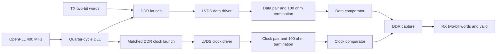
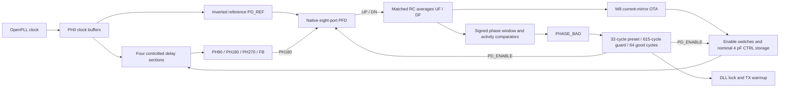

# Architecture and interfaces

`rtl/openlvds_tx.v` assembles a shared bias generator, DLL, lock controller,
startup training counter, DDR launch core, and two differential drivers.
`rtl/openlvds_rx.v` assembles a shared bias generator, two input comparators and
the DDR capture core. `sky130/openlvds_analog.v` declares the physical analog
macro boundaries. `analog/openlvds.spice` implements those same boundaries with
SKY130 MOSFETs, precision poly resistors and MIM capacitors. The canonical
development DLL retains the preceding charge-pump implementation. The OTA
candidate under qualification uses the separate assembly described below; no
electrical release has been published.

The receiver alternatives under qualification retain the complementary input
frontend and change the following decision stage. The compact LVT candidate
uses a low-threshold NMOS pair. The compact PMOS p8/t4 alternative uses a
3.3 V PMOS pair and tail source with an NMOS mirror. Its first inverter uses
thick-oxide devices powered at 1.8 V, followed by two thin-oxide restoration
stages. This allows the decision node to swing above 1.8 V while keeping that
voltage off thin-oxide gates. The PMOS p8/t4 candidate passes its fifteen
source DC cases and nominal source rate test, but fails the captured and
sharp-clock controls. Doubling its tail width improves the captured result
but still loses edges, so these variants are held before native admission.

The LVT layout localizes the complete frontend mirror, tail and resistor-load
network with the decision chain. This reduces the routing capacitance, but the
native receiver still loses captured clock edges. Completed corrected-driver
pin replay also fails: frontend common mode is only 0.735–0.854 V and the tail
node spans 28–131 mV. The passive load network nominally centers each summing
node at 0.75*VREF (0.9 V). Terminal voltages motivate a headroom correction;
they do not establish a BSIM operating region without VDSAT.

The current source-qualified alternatives add a matched pull-up from each
summing node to the stable 1.8 V digital rail. Two or three original precision
poly resistor units in series give unloaded centers of 1.08 V or 1.028571 V,
with equivalent load resistances of 0.4R or 3R/7 instead of R/2. Every original
input, decision, restoration and bias device remains. Both alternatives pass
all fifteen source DC/current/twelve-observed-device stress cases. All added
resistor segments stay in the local frontend row when layout is admitted.
Both pass all three complete source-clock controls and new DRC/LVS,
extraction and independent RC audit. The two-unit native replay completes
with eighteen missing captured-clock edges and zero missing sharp-control
edges; it fails transport admission. The three-unit native replay is running.
Components and coupled-link timing remain gated and unproven. The earlier
1.2 V corrections are rejected because they lose high-common-mode sensitivity
in SF corners. No receiver alternative is promoted into the canonical source.

The next controlled receiver change combines the two-unit frontend correction
with a lower-threshold first restoring inverter. Its PMOS remains W8; only
the first NFET changes to the SKY130 LVT model, at W4 or W8. Later restoring
stages and all frontend, decision and bias devices remain unchanged. In the
two-unit native trace, weak captured pulses reach only about 0.77–0.79 V at
CO and barely move the first inverter output despite improved frontend/tail
voltages. This motivates the threshold experiment; it does not prove the
change will meet timing. Each candidate must independently pass the original
fifteen source DC/current/observed-stress cases and all three source-clock
controls before new physical/native evaluation. The earlier LVT-restorer-only
failure used a different frontend and is retained as separate evidence.

The OTA DLL correction increases nominal CTRL storage from 4 pF to 16 pF by
adding twelve MIM capacitors while preserving every original device. The
4 pF native model fails the required phase margin at TT/25 °C and FF/0 °C.
The new layout, extraction and independent RC audit pass, and the first full
SS/0 °C source-acquisition case passes with lower control ripple. Remaining
source acquisition, fresh native margins, steps, recovery, readiness, OTA
operating points and full PVT qualification are still required. The corrected
110:1 native driver likewise remains under component qualification; these
separate candidates have not yet established a usable, released PHY.

Both parallel bits are captured together on the PH0 rising edge. Bit 0 stays
in its rising-edge register; bit 1 moves from the pair's hold register into a
falling-edge register at the PH0 falling edge. A mux selected by PH90 emits bit
0 while PH90 is high and bit 1 while it is low. Each capture therefore settles
for a nominal quarter period before selection. Changing the input bus after
capture cannot change the current pair.

The physical input contract assumes an upstream register with at most 250 ps
clock-to-output delay after the preceding rising edge, as specified by
`constraints/tx.sdc`. The link bench holds each complete pair through capture.

The clock replica uses the same three sampling cells, falling-clock inverter,
select buffer, and output mux. Its capture clock is PH90, its select clock is
PH0, and its constant word is `10`. The resulting inverted PH0 clock has its
rising edge centered in bit 0 and its falling edge centered in bit 1. Swapping
the capture/select clock connections also balances the two clock-port loads.
Only the existing PH0/PH90 clocks are needed. Native cells remain explicit for
the constant-input lane. This replaces XOR feedback, whose encoded internal
state produced alternating clock-to-output delays in extracted simulation.

The canonical RX samples both clock edges. At a rising edge it publishes the **previous**
complete pair with bit 0 from the previous rising sample and bit 1 from the
previous falling sample. `valid` qualifies the pair after reset synchronization.
All RX outputs belong to the received-clock domain; downstream logic needs a
separate CDC boundary if it uses another clock.

The SKY130 receiver mapping uses a local inverter and a positive-edge resettable
flip-flop for the falling sampler. `OPENLVDS_SKY130_RX` selects that mapping for
physical implementation; the generic RTL expresses its equivalent behavior.
Receiver SDC uses a virtual launch clock at a quarter-cycle offset and constrains
both input edges. TX SDC preserves true half-cycle paths between DDR registers.

The staged early-publication RX candidate is implemented separately in
`rtl/experiments/openlvds_ddr_rx_early.v`. It continuously samples the rising
and falling serial bits with resettable native cells. At the falling edge, a
second register holds the rising sample while the falling sampler captures the
other bit. These two held bits drive the public outputs through explicit
`buf_4` cells; a falling-edge register and another `buf_4` publish VALID.
The falling clock comes from one retained `inv_4`. No additional external clock,
CDR or analog supply is introduced.

This candidate updates data and VALID during the falling half-cycle. After the
following positive edge, each valid pair equals the canonical receiver's pair.
A synchronous positive-edge consumer sees the same first word and ordered
stream one cycle earlier, so consumers must qualify every word with VALID rather
than assume the canonical latency. Directed first-word/reset tests and the
staged functional regression cover this difference. Native timing must still
prove the internal half-cycle transfer and the unchanged public voltage window
under PVT, duty, jitter and skew. The candidate remains unpromoted while that
qualification runs; the canonical RTL retains its existing behavior.

Reset asserts asynchronously and releases synchronously in each local domain.
`clock_ready` is an external clock contract, not a measured PLL lock detector.
The DLL controller releases its phase detector on the original clock rising
edge (the inverted detector reference falling edge), qualifies a
quiet phase-error indication, and revokes readiness when errors recur. The
phase detector remains disabled for 32 rising edges so the physical control
capacitor can reach its preset before closing the loop. The detector
compares the half-period tap against an inverted reference.
That fixed half-cycle offset excludes the zero-delay solution and leaves time
for the detector reset to recover before the next feedback edge. After
qualification the TX sends alternating training data for 256 cycles before
asserting `tx_ready`. Supply and reference sources must already be operating.

## OTA candidate under qualification

The candidate keeps the four current-starved delay sections and compares PH180
with an inverted PH0 reference. Their half-period alignment sets PH90 near a
quarter period: 625 ps at 400 MHz. The fourth tap FB remains available for
observation. The forwarded clock still supplies RX timing directly; no CDR is
introduced.

The eight PFD terminals comprise six logic signals and two supply pins. Its
reference and feedback connect directly to native flip-flop clocks; matched
`buf_8` outputs drive UP/DN and the coincidence reset path. There are no private
raw-clock qualifier ports in this candidate. The analog boundary has 15 pins.
`rtl/experiments/openlvds_dll_core_area.v` connects these macros while preserving
the existing external DLL-core interface. The matching physical declarations are
in `sky130/experiments/openlvds_analog_area.v`.

The averages drive a signed transconductor: UF above DF raises CTRL and reduces
the delay, providing negative feedback. W8 denotes the 8 µm thick-oxide OTA
input devices; C4 denotes nominal 4 pF control storage. Enable switches disconnect
the OTA during preset. The controller retains the 32-cycle preset and requires
both a 615-cycle acquisition guard and 64 good cycles after an error. Those two
qualification counters run concurrently. A new fault resets them and revokes
lock. TX warmup remains 256 cycles.

The monitor repair reduces its resistor lengths by four, increases averaging
capacitance fourfold to preserve nominal averaging R×C, and increases comparator
branch widths fourfold. The averaging capacitors and fast-clock circuitry stay
in the control island; the window/activity comparators occupy a separate monitor
island. Comparators check both signed error and abnormal UP/DN activity, including
stuck outputs. External acceptance remains quiet at 0/±50 ps and valid fault
coverage at ±150/±300 ps in the specified scoring window. Extracted wire and
device capacitance still require native validation; a passing schematic proxy is
not sufficient.

The candidate serializer ends both data and clock lanes with matched native
`buf_4` outputs. Its captured physical sources and the 15/8-port DLL assembly pass
the full 54-case functional regression. Electrical qualification, measured loop
margins, recovery/readiness replay, six-fixture RC certification and all 45 link
cases remain required. Published packages use the exact tested libraries and
matching source snapshots, located with `make release-library` after promotion.

## Canonical development DLL baseline

The DLL has four current-starved delay sections, a standard-cell phase/frequency
detector, charge pump, physical MIM loop capacitor, startup control preset, and
an averaged rising-edge phase-error indicator. Each delay section uses matched NMOS
footer and PMOS header currents so both clock edges are delayed. A buffered
control-voltage replica steers idle charge-pump current away from the storage
capacitor, avoiding floating switch-node charge sharing. Reference and feedback buffer replicas
reduce detector loading asymmetry. The `PD_REF` output is the inverted PH0
detector reference; `FB` remains the fourth delay tap for observation. Its analog block and PFD are separate physical
macros connected by `rtl/openlvds_dll_core.v`.

The phase qualifier senses the inverted reference, half-period tap, and
quarter-period window through identical resistor/MIM input filters. Matched
native buffers restore the reference and feedback; a raw-clock XOR expression
is masked by the restored window. This excludes the PFD reset coincidence
pulse. A 10 kΩ / 1 pF average is compared with a 100 mV reference made from
18 identical resistor units, using the DLL's mirrored bias. The comparator
restores `PHASE_BAD` to a logic level. Passive sensing loads on PH270 and FB
balance the remaining taps. The private analog macro exposes three filtered
sense signals and three independent sense inputs for fault injection; the
assembled core ties them internally, so the public PHY interface is unchanged.
The filtered sense signals do not enter the charge-pump PFD clock paths.

## Differential I/O and clock source

The TX uses a resistively loaded, thick-oxide differential current-mode level
converter followed by 3.3 V output buffers. It consumes static bias current to
avoid unequal recovery of regenerative level-shifter nodes at the DDR rate.
The TX current-steering bridge mirrors the external current reference, while
an on-chip common-mode feedback amplifier controls the sink current. Large
transistors are laid out as parallel fingers to limit gate resistance. The RX
combines complementary 3.3 V differential input stages, resistive loads at VREF,
and a 1.8 V decision stage. The shared bias circuit creates NMOS bias from the
external PMOS diode reference; connect one 35 µA sink per complete TX or RX.

OpenPLL integration uses `examples/openlvds_openpll.v`, the pinned modern 25 MHz
configuration table, and divider 16. Its `TRACKING` flag describes controller
state. The simulation fixture pulses reset with enable asserted so internally
gated resets receive an initialization event. The test rejects unknown DCO
codes and measures the resulting frequency and duty cycle.

The generated analog layouts prioritize inspectable, deterministic connectivity.
Their long bus placement has considerable area and parasitic cost and is not an
area-optimized production floorplan. The RTL assembly does not imply there is a
single routed, pad-integrated PHY GDS.

## Qualification contract revision

The clock test points are 390, 400, and 410 MHz (780–820 Mb/s DDR).
Supplies stay fixed; process corners and 0/25/40 °C temperatures are unchanged.
Driver voltage limits apply to both settled polarities into 100 Ω. The driver
bench holds these polarities before its cadence test. Loaded transmitter eye
metrics are diagnostic. Link acceptance retains receiver sensitivity, legal
receiver pin voltages, correct payload, and the additional 200 ps sampling
margin. This revision does not qualify historical 380/420 MHz diagnostics as
390/410 MHz results, or promote the source-terminated driver experiment.
