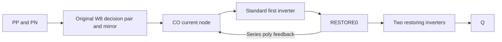
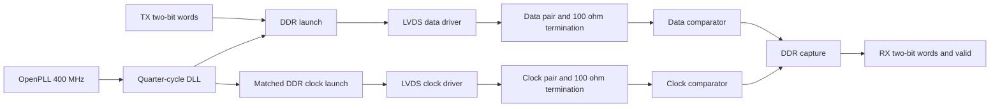
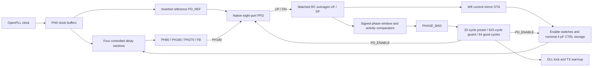

# Architecture and interfaces

`rtl/openlvds_tx.v` assembles a shared bias generator, DLL, lock controller,
startup training counter, DDR launch core, and two differential drivers.
`rtl/openlvds_rx.v` assembles a shared bias generator, two input comparators and
the DDR capture core. `sky130/openlvds_analog.v` declares the physical analog
macro boundaries. `analog/openlvds.spice` implements those same boundaries with
SKY130 MOSFETs, precision poly resistors and MIM capacitors. The canonical
development DLL retains the preceding charge-pump implementation. The OTA
candidate under qualification uses the separate assembly described below; no
electrical release has been published.

The receiver alternatives under qualification retain the complementary input
frontend and change the following decision stage. The compact LVT candidate
uses a low-threshold NMOS pair. The compact PMOS p8/t4 alternative uses a
3.3 V PMOS pair and tail source with an NMOS mirror. Its first inverter uses
thick-oxide devices powered at 1.8 V, followed by two thin-oxide restoration
stages. This allows the decision node to swing above 1.8 V while keeping that
voltage off thin-oxide gates. The PMOS p8/t4 candidate passes its fifteen
source DC cases and nominal source rate test, but fails the captured and
sharp-clock controls. Doubling its tail width improves the captured result
but still loses edges, so these variants are held before native admission.

The LVT layout localizes the complete frontend mirror, tail and resistor-load
network with the decision chain. This reduces the routing capacitance, but the
native receiver still loses captured clock edges. Completed corrected-driver
pin replay also fails: frontend common mode is only 0.735–0.854 V and the tail
node spans 28–131 mV. The passive load network nominally centers each summing
node at 0.75*VREF (0.9 V). Terminal voltages motivate a headroom correction;
they do not establish a BSIM operating region without VDSAT.

The current source-qualified alternatives add a matched pull-up from each
summing node to the stable 1.8 V digital rail. Two or three original precision
poly resistor units in series give unloaded centers of 1.08 V or 1.028571 V,
with equivalent load resistances of 0.4R or 3R/7 instead of R/2. Every original
input, decision, restoration and bias device remains. Both alternatives pass
all fifteen source DC/current/twelve-observed-device stress cases. All added
resistor segments stay in the local frontend row when layout is admitted.
Both pass all three complete source-clock controls and new DRC/LVS,
extraction and independent RC audit. Both complete native replays with eighteen
missing captured-clock edges and zero missing sharp-control edges; both fail
transport admission.
Components and coupled-link timing remain gated and unproven. The earlier
1.2 V corrections are rejected because they lose high-common-mode sensitivity
in SF corners. No receiver alternative is promoted into the canonical source.

The next controlled receiver change combines the two-unit frontend correction
with a lower-threshold first restoring inverter. Its PMOS remains W8; only
the first NFET changes to the SKY130 LVT model, at W4 or W8. Later restoring
stages and all frontend, decision and bias devices remain unchanged. In the
two-unit native trace, weak captured pulses reach only about 0.77–0.79 V at
CO and barely move the first inverter output despite improved frontend/tail
voltages. This motivates the threshold experiment; it does not prove the
change will meet timing. Both widths now independently pass all fifteen
source DC/current/observed-stress cases. Their fresh admission explicitly
uses a completed matched 1 ps maximum-step SF/40 retry; the other fourteen
fixtures retain 50 ps. Both also pass all three full source-clock controls,
47 checks each, without missing/repeated edges. Both new layouts pass DRC/LVS,
extraction and independent RC audit. Their full native replays fail: N4 misses eighteen captured-clock edges and
N8 misses sixteen; both sharp controls lose zero. Neither receives native
transport admission, so components and coupled timing remain held.
The earlier LVT-restorer-only
failure used a different frontend and is retained as separate evidence.

The next matched experiments separate restoration balance from decision gain.
Both use the source-qualified two-unit frontend and P8/N8 LVT restorer as
control. One reduces only the first-restorer PMOS from W8 to W4. The other
widens only both LVT decision inputs from W8 to W32, retaining the W16 tail
and W8 PMOS mirror. These are sizing changes within the existing topology;
actual currents and stress are measured again. All six initial DC pilots
pass for both candidates. The expanded matrix rejects P4/N8 at FF/40:
+100 mV at the lowest common mode produces only 10.6 mV at Q. Its CO is
unchanged from control, but the weaker PMOS pulls the first-restorer output
too low for the following stages to recognize the intended state. The W32
pair completes and passes all fifteen original source DC/current/stress
cases. Its source-clock context completes all three full 80 ns controls
with 47 checks each, zero missing/repeated edges and explicit positive
source-clock admission. The fresh captured and sharp candidate traces pass;
the matched P8/N8 reference is reused with its explicit identical-fixture
receipt. The new eighty-device layout passes DRC/LVS, extraction and RC
audit. Both full native replays are complete: the captured clock misses
eighteen edges and the sharp control misses none. This layout is rejected
for native transport. Physical-only routing alternatives preserve the source
and devices while testing shorter internal bus access; they have no native
or component admission.
A completed, byte-identical P8/N8 captured reference can be reused with an
explicit receipt; each modified candidate still needs fresh captured and sharp
source clocks, its own GDS/extraction audit and both full native replays.

The next receiver topology is implemented as a separate experimental factory
in `scripts/receiver_differential_restore.py`. It retains the original W8 LVT
decision pair, W16 tail, W8 PMOS mirror and two-unit frontend correction.
A new LVT differential amplifier senses CO against CL. Seven parallel original
poly resistor units connect its current output to CO_TRACK, the existing
matched-inverter trip replica. A standard P16/N8 first restoring inverter
has the same device models, lengths and width ratio as that replica. The
original later buffers and external 35 microampere bias contract remain.
The amplifier has two sizes, with W8 or W16 inputs and proportionally scaled
tail and mirror devices. Its extra 1.8 V supply current must be measured.

This choice follows saved native waveform comparisons: widening the original
input pair to W32 removes the correct CO-minus-CL polarity throughout four
of five examined missed response periods, whereas the original W8 pair
retains small late differential excursions. Amplifying the W32 result alone
would therefore leave an upstream failure. The new topology tests whether
those W8 excursions can drive restoration through a loaded trip reference.
This is a hypothesis, not a demonstrated timing improvement.

The full source DC screen is implemented in
`scripts/screen_receiver_differential_restore.py`. SS/40 and FF/40 pilots each
compare an unchanged matched control with both amplifier sizes using the
original 144 ns/twelve-point sensitivity fixture, fixed supplies and uniform
1 ps maximum step. Fourteen control or nineteen modified MOS devices are
observed, including the now functional trip reference and amplifier tail.
Both amplifier sizes pass the complete SS/40 and FF/40 pilots. The
fifteen-corner matrix completes with 15/15 for the larger amplifier and 14/15
for the smaller one. Only the larger original amplifier advances to source
clocks. The matched-unit reference family separately passes all fifteen source cases.
A separate source-clock adapter enforces complete fifteen-corner admission
and fresh modified captured/sharp clocks. All fifteen source corners,
source clocks, new geometry/LVS/RC audit, native
transport, component conditions and coupled timing remain required before
selection. No ideal comparator substitutes for the transistor circuit.

The original larger amplifier completes both full extracted controls in
`receiver_replay/80ceda71c5337d7a`: eighteen captured-clock transitions are
missing, while the sharp control loses none. Complete read-only comparison
`receiver_decision_comparison/11ec5ff01c16e3a2` finds nine missing falling
response periods, eight without the first restoring inverter crossing 0.9 V.
One still has no positive CO-minus-CL excursion throughout its response
period. The extra amplifier does not close native transport and receives no
component or PHY admission. Matched-unit variants retain their own ongoing
native tests.

Further complete stage observation
`amplifier_transport_observations/53b6e8d770e8ebad` within that replay finds
seven of its nine missing falling periods never develop positive
AMP_OUT-minus-loaded-CO_TRACK. At 41.823952 ns that difference reaches
+24.624 mV but RESTORE0 remains above 0.9 V. At 56.447186 ns RESTORE0 does
cross, while RESTORE1 peaks at only 0.681132 V and never crosses. Thus losses
appear at multiple stages. These are measured wire excursions and threshold
crossings; they do not establish transistor gain or static switching offsets.

The first differential factory's smaller amplifier fails SF/0 at the highest
input common mode, while its larger amplifier passes. At the 142 ns sample,
CO minus CL is -87.602 mV, but AMP_OUT is 743.433 mV, RESTORE0 is 702.085 mV
and Q remains low. The observed-device stress screen passes. This is a source
sensitivity failure in restoration, not loss of the first decision polarity.

A separate fixed-supply trip characterization identifies a source-model offset:
whole-width P16/N8 first inverter and P32/N16 reference switch at 740.391 and
765.255 mV at SF/0. Their equal width ratio does not provide identical trip
voltages in these models. The physical finger equivalents both switch at
741.399 mV in the isolated unloaded test. This test uses one PVT and fixed
1.8 V; it establishes neither loaded-reference behavior nor native timing.
Evidence is `receiver_trip_reference/b5abcf678318f470`.

`receiver_matched_trip_restore.py` addresses that mismatch in a new source
family. Its reference uses two parallel copies of the exact first inverter,
each P16/N8, preserving total width and reference strength. The flattened
physical device/connectivity multiset is unchanged, with 87 or 90 devices for
the two amplifier sizes. This does not transfer qualification: the new family
has separate source fixtures and requires its own admissions. Full SF/0 and
SS/40 DC pilots pass for control and both amplifier sizes in `receiver_matched_trip_static/4815725ab130e6ee`
and `48704bf4e6b7438d`. Prior source factories, reports and campaigns remain
unchanged. The matched-unit fifteen-corner campaign
`receiver_matched_trip_matrix/9847fc526899414a` completes with 15/15 for control
and both amplifier sizes. Both candidates advance to source clocks with
independent admissions. Its own source-clock,
physical/native, sixty-component, corrected-driver coupling and RC adapters
preserve the original fixtures and admission gates. They cannot substitute
old-family qualification for this source-model correction.

Both matched-amplifier sizes pass all three original full source-clock controls.
Their own 87- and 90-device layouts pass DRC/LVS, extraction and independent
RC audit. The smaller matched amplifier completes its native controls and fails with
sixteen captured transitions missing and zero sharp-control transitions
missing. Stage observation `amplifier_transport_observations/c00a01def73f960f`
inside its replay finds eight lost falling periods: one without positive
CO-minus-CL, three without positive AMP_OUT-minus-loaded-reference and seven
without a first-restorer crossing. The larger matched amplifier is still
running. Source-model matching alone has not closed native transport.

A separate three-bus W32 routing experiment moves only CT, CO and CL below
the critical row. Layout `receiver_layout/677ed99567c83bfb` passes DRC/LVS,
extraction and independent RC audit. Explicit boundary wire capacitance falls
on PP, PN, CO, CL and CT relative to the original W32 layout. These are passive
wire measurements, not effective input capacitances or timing proof; this
layout completes both full native controls in `receiver_replay/96ae8fcd14f244e4`.
It still misses eighteen captured-clock edges and loses none in the sharp
control. It is rejected for native transport despite the passive improvements.

Complete waveform comparison `receiver_decision_comparison/da25d827957d1f62`
remeasures all three native receivers with unchanged original stimuli and
numerical policies. The W8/N8 receiver misses eight falling periods; one has
no positive CO-minus-CL excursion throughout the response period. Original
W32 misses nine, with seven lacking that excursion; the three-bus W32 route
still misses nine, with six lacking it. These are wire observations, not
MOS terminal measurements. The associated read-only `frontend_observation/`
shows that at the W8/N8 58.919554 ns missed period, PP minus PN reaches only
-2.183 mV during the negative input pulse and -18.286 mV over the response
period. CO minus CL never exceeds -22.892 mV. An output gain stage alone
cannot recover a polarity that never develops; the changed loading and new
geometry of the amplifier candidates must be tested natively.

A separate feedback-inverter experiment addresses the decision-node swing
itself. `receiver_tia_restore.py` retains the original two-unit frontend,
W8 decision pair, W16 tail and W8 PMOS mirror. The first restorer becomes the
standard P16/N8 inverter. Two or four original precision-poly units in series
connect RESTORE0 back to CO, providing negative feedback around that inverter.
Its intended role is a current-to-voltage amplifier: decision current changes
RESTORE0 while CO remains closer to the inverter's operating point. The next
two restoring stages are unchanged. No extra differential pair or functional
trip replica is added; the original unloaded reference remains diagnostic.
The source hypothesis is tested with full pilots at
SS/40 (`receiver_tia_static/e00432100ec8ebad`) and SF/0 (`49580e6e4b65d68f`).
All fourteen observed MOS devices retain the original project stress screen.
Both feedback values pass both pilots; full matrix
`receiver_tia_matrix/33a571a155c3a105` completes with 15/15 for control and
both feedback values. Both candidates advance to the original full source-clock
controls with their own admissions. Its layout flow orders the
frontend loads, W8 decision stage, first-inverter feedback loop and later
buffers along the critical row. CT, CO, CL and RESTORE0 use four 0.4 micrometre
buses at 1.2 micrometre pitch below that row. Feedback intermediate nodes use
the first upper channels; all feedback resistors remain local. The unused
trip reference is folded with the diagnostic cells. Physical work requires
all fifteen source cases and all three original source-clock controls to pass.
Full native replays preserve their original 80 ns fixtures and 1 ps maximum
step, adding probes for every feedback intermediate node. The four-unit
variant passes all three source-clock controls. Its 79-device layout
`receiver_layout/c196040b40845390` passes DRC/LVS, extraction and independent
RC audit; fresh full native captured/sharp replay
`receiver_replay/f03923bf25510f9a` is running. Native transport remains unproven.

A further exact resistor-only reduction is available as a diagnostic candidate
for the original larger-amplifier layout. It preserves all devices,
capacitors, ports and eighteen native probe vertices, reducing 16,661 wire
resistors to 5,365. Four sparse boundary-current witnesses pass. The live
native model is unchanged; transient equivalence and throughput remain
unmeasured. This reduction cannot substitute for receiver qualification.

The OTA DLL correction increases nominal CTRL storage from 4 pF to 16 pF by
adding twelve MIM capacitors while preserving every original device. The
4 pF native model fails the required phase margin at TT/25 °C and FF/0 °C.
The new layout, extraction and independent RC audit pass, and full SS/0 °C,
TT/25 °C and FF/0 °C source-acquisition cases pass with lower control ripple.
The original 24-case native screen is running in a fresh qualification context.
Fresh native margins, steps, recovery, readiness, OTA
operating points and full PVT qualification are still required. The corrected
110:1 driver passes all thirty source/native component cases, including its
loaded-eye screen. Receiver qualification and coupled-link timing remain
open; these separate candidates have not established a usable, released PHY.

Both parallel bits are captured together on the PH0 rising edge. Bit 0 stays
in its rising-edge register; bit 1 moves from the pair's hold register into a
falling-edge register at the PH0 falling edge. A mux selected by PH90 emits bit
0 while PH90 is high and bit 1 while it is low. Each capture therefore settles
for a nominal quarter period before selection. Changing the input bus after
capture cannot change the current pair.

The physical input contract assumes an upstream register with at most 250 ps
clock-to-output delay after the preceding rising edge, as specified by
`constraints/tx.sdc`. The link bench holds each complete pair through capture.

The clock replica uses the same three sampling cells, falling-clock inverter,
select buffer, and output mux. Its capture clock is PH90, its select clock is
PH0, and its constant word is `10`. The resulting inverted PH0 clock has its
rising edge centered in bit 0 and its falling edge centered in bit 1. Swapping
the capture/select clock connections also balances the two clock-port loads.
Only the existing PH0/PH90 clocks are needed. Native cells remain explicit for
the constant-input lane. This replaces XOR feedback, whose encoded internal
state produced alternating clock-to-output delays in extracted simulation.

The canonical RX samples both clock edges. At a rising edge it publishes the **previous**
complete pair with bit 0 from the previous rising sample and bit 1 from the
previous falling sample. `valid` qualifies the pair after reset synchronization.
All RX outputs belong to the received-clock domain; downstream logic needs a
separate CDC boundary if it uses another clock.

The SKY130 receiver mapping uses a local inverter and a positive-edge resettable
flip-flop for the falling sampler. `OPENLVDS_SKY130_RX` selects that mapping for
physical implementation; the generic RTL expresses its equivalent behavior.
Receiver SDC uses a virtual launch clock at a quarter-cycle offset and constrains
both input edges. TX SDC preserves true half-cycle paths between DDR registers.

The staged early-publication RX candidate is implemented separately in
`rtl/experiments/openlvds_ddr_rx_early.v`. It continuously samples the rising
and falling serial bits with resettable native cells. At the falling edge, a
second register holds the rising sample while the falling sampler captures the
other bit. These two held bits drive the public outputs through explicit
`buf_4` cells; a falling-edge register and another `buf_4` publish VALID.
The falling clock comes from one retained `inv_4`. No additional external clock,
CDR or analog supply is introduced.

This candidate updates data and VALID during the falling half-cycle. After the
following positive edge, each valid pair equals the canonical receiver's pair.
A synchronous positive-edge consumer sees the same first word and ordered
stream one cycle earlier, so consumers must qualify every word with VALID rather
than assume the canonical latency. Directed first-word/reset tests and the
staged functional regression cover this difference. Native timing must still
prove the internal half-cycle transfer and the unchanged public voltage window
under PVT, duty, jitter and skew. The candidate remains unpromoted while that
qualification runs; the canonical RTL retains its existing behavior.

Reset asserts asynchronously and releases synchronously in each local domain.
`clock_ready` is an external clock contract, not a measured PLL lock detector.
The DLL controller releases its phase detector on the original clock rising
edge (the inverted detector reference falling edge), qualifies a
quiet phase-error indication, and revokes readiness when errors recur. The
phase detector remains disabled for 32 rising edges so the physical control
capacitor can reach its preset before closing the loop. The detector
compares the half-period tap against an inverted reference.
That fixed half-cycle offset excludes the zero-delay solution and leaves time
for the detector reset to recover before the next feedback edge. After
qualification the TX sends alternating training data for 256 cycles before
asserting `tx_ready`. Supply and reference sources must already be operating.

## OTA candidate under qualification

The candidate keeps the four current-starved delay sections and compares PH180
with an inverted PH0 reference. Their half-period alignment sets PH90 near a
quarter period: 625 ps at 400 MHz. The fourth tap FB remains available for
observation. The forwarded clock still supplies RX timing directly; no CDR is
introduced.

The eight PFD terminals comprise six logic signals and two supply pins. Its
reference and feedback connect directly to native flip-flop clocks; matched
`buf_8` outputs drive UP/DN and the coincidence reset path. There are no private
raw-clock qualifier ports in this candidate. The analog boundary has 15 pins.
`rtl/experiments/openlvds_dll_core_area.v` connects these macros while preserving
the existing external DLL-core interface. The matching physical declarations are
in `sky130/experiments/openlvds_analog_area.v`.

The averages drive a signed transconductor: UF above DF raises CTRL and reduces
the delay, providing negative feedback. W8 denotes the 8 µm thick-oxide OTA
input devices; C4 denotes nominal 4 pF control storage. Enable switches disconnect
the OTA during preset. The controller retains the 32-cycle preset and requires
both a 615-cycle acquisition guard and 64 good cycles after an error. Those two
qualification counters run concurrently. A new fault resets them and revokes
lock. TX warmup remains 256 cycles.

The monitor repair reduces its resistor lengths by four, increases averaging
capacitance fourfold to preserve nominal averaging R×C, and increases comparator
branch widths fourfold. The averaging capacitors and fast-clock circuitry stay
in the control island; the window/activity comparators occupy a separate monitor
island. Comparators check both signed error and abnormal UP/DN activity, including
stuck outputs. External acceptance remains quiet at 0/±50 ps and valid fault
coverage at ±150/±300 ps in the specified scoring window. Extracted wire and
device capacitance still require native validation; a passing schematic proxy is
not sufficient.

The candidate serializer ends both data and clock lanes with matched native
`buf_4` outputs. Its captured physical sources and the 15/8-port DLL assembly pass
the full 54-case functional regression. Electrical qualification, measured loop
margins, recovery/readiness replay, six-fixture RC certification and all 45 link
cases remain required. Published packages use the exact tested libraries and
matching source snapshots, located with `make release-library` after promotion.

## Canonical development DLL baseline

The DLL has four current-starved delay sections, a standard-cell phase/frequency
detector, charge pump, physical MIM loop capacitor, startup control preset, and
an averaged rising-edge phase-error indicator. Each delay section uses matched NMOS
footer and PMOS header currents so both clock edges are delayed. A buffered
control-voltage replica steers idle charge-pump current away from the storage
capacitor, avoiding floating switch-node charge sharing. Reference and feedback buffer replicas
reduce detector loading asymmetry. The `PD_REF` output is the inverted PH0
detector reference; `FB` remains the fourth delay tap for observation. Its analog block and PFD are separate physical
macros connected by `rtl/openlvds_dll_core.v`.

The phase qualifier senses the inverted reference, half-period tap, and
quarter-period window through identical resistor/MIM input filters. Matched
native buffers restore the reference and feedback; a raw-clock XOR expression
is masked by the restored window. This excludes the PFD reset coincidence
pulse. A 10 kΩ / 1 pF average is compared with a 100 mV reference made from
18 identical resistor units, using the DLL's mirrored bias. The comparator
restores `PHASE_BAD` to a logic level. Passive sensing loads on PH270 and FB
balance the remaining taps. The private analog macro exposes three filtered
sense signals and three independent sense inputs for fault injection; the
assembled core ties them internally, so the public PHY interface is unchanged.
The filtered sense signals do not enter the charge-pump PFD clock paths.

## Differential I/O and clock source

The TX uses a resistively loaded, thick-oxide differential current-mode level
converter followed by 3.3 V output buffers. It consumes static bias current to
avoid unequal recovery of regenerative level-shifter nodes at the DDR rate.
The TX current-steering bridge mirrors the external current reference, while
an on-chip common-mode feedback amplifier controls the sink current. Large
transistors are laid out as parallel fingers to limit gate resistance. The RX
combines complementary 3.3 V differential input stages, resistive loads at VREF,
and a 1.8 V decision stage. The shared bias circuit creates NMOS bias from the
external PMOS diode reference; connect one 35 µA sink per complete TX or RX.

OpenPLL integration uses `examples/openlvds_openpll.v`, the pinned modern 25 MHz
configuration table, and divider 16. Its `TRACKING` flag describes controller
state. The simulation fixture pulses reset with enable asserted so internally
gated resets receive an initialization event. The test rejects unknown DCO
codes and measures the resulting frequency and duty cycle.

The current recorded OpenPLL RTL/controller and fixed-code extracted DCO traces
also pass the revised 390–410 MHz / 45–55 percent duty contract. Their measured
frequencies are 400.942482 and 399.546838 MHz. `check_openpll_contract.py`
remeasures both archived traces, checks the required Git revision, source and
PDK fingerprints, and reconstructs the physical CSV from the original waveform.
`require_openpll_contract.py` fails if either current-contract result is false
or incomplete. This preserves the frozen legacy producer and its historical
380–420 MHz acceptance test. It does not establish closed-loop physical PLL
jitter performance; the extracted trace remains a fixed-code DCO observation.

The generated analog layouts prioritize inspectable, deterministic connectivity.
Their long bus placement has considerable area and parasitic cost and is not an
area-optimized production floorplan. The RTL assembly does not imply there is a
single routed, pad-integrated PHY GDS.

## Qualification contract revision

The clock test points are 390, 400, and 410 MHz (780–820 Mb/s DDR).
Supplies stay fixed; process corners and 0/25/40 °C temperatures are unchanged.
Driver voltage limits apply to both settled polarities into 100 Ω. The driver
bench holds these polarities before its cadence test. Loaded transmitter eye
metrics are diagnostic. Link acceptance retains receiver sensitivity, legal
receiver pin voltages, correct payload, and the additional 200 ps sampling
margin. This revision does not qualify historical 380/420 MHz diagnostics as
390/410 MHz results, or promote the source-terminated driver experiment.
