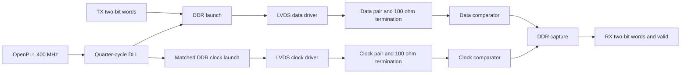

# Architecture and interfaces

`rtl/openlvds_tx.v` assembles a shared bias generator, DLL, lock controller,
startup training counter, DDR launch core, and two differential drivers.
`rtl/openlvds_rx.v` assembles a shared bias generator, two input comparators and
the DDR capture core. `sky130/openlvds_analog.v` declares the physical analog
macro boundaries. `analog/openlvds.spice` implements those same boundaries with
SKY130 MOSFETs, precision poly resistors and MIM capacitors.

Both parallel bits are captured together on the PH0 rising edge. Bit 0 stays
in its rising-edge register; bit 1 moves from the pair's hold register into a
falling-edge register at the PH0 falling edge. A mux selected by PH90 emits bit
0 while PH90 is high and bit 1 while it is low. Each capture therefore settles
for a nominal quarter period before selection. Changing the input bus after
capture cannot change the current pair.

The physical input contract assumes an upstream register with at most 250 ps
clock-to-output delay after the preceding rising edge, as specified by
`constraints/tx.sdc`. The link bench holds each complete pair through capture.

The clock replica uses the same three sampling cells, falling-clock inverter,
select buffer, and output mux. Its capture clock is PH90, its select clock is
PH0, and its constant word is `10`. The resulting inverted PH0 clock has its
rising edge centered in bit 0 and its falling edge centered in bit 1. Swapping
the capture/select clock connections also balances the two clock-port loads.
Only the existing PH0/PH90 clocks are needed. Native cells remain explicit for
the constant-input lane. This replaces XOR feedback, whose encoded internal
state produced alternating clock-to-output delays in extracted simulation.

RX samples both clock edges. At a rising edge it publishes the **previous**
complete pair with bit 0 from the previous rising sample and bit 1 from the
previous falling sample. `valid` qualifies the pair after reset synchronization.
All RX outputs belong to the received-clock domain; downstream logic needs a
separate CDC boundary if it uses another clock.

The SKY130 receiver mapping uses a local inverter and a positive-edge resettable
flip-flop for the falling sampler. `OPENLVDS_SKY130_RX` selects that mapping for
physical implementation; the generic RTL expresses its equivalent behavior.
Receiver SDC uses a virtual launch clock at a quarter-cycle offset and constrains
both input edges. TX SDC preserves true half-cycle paths between DDR registers.

Reset asserts asynchronously and releases synchronously in each local domain.
`clock_ready` is an external clock contract, not a measured PLL lock detector.
The DLL controller releases its phase detector on the original clock rising
edge (the inverted detector reference falling edge), qualifies a
quiet phase-error indication, and revokes readiness when errors recur. The
phase detector remains disabled for 32 rising edges so the physical control
capacitor can reach its maximum-control, minimum-delay preset. The detector
compares the half-period tap against an inverted reference.
That fixed half-cycle offset excludes the zero-delay solution and leaves time
for the detector reset to recover before the next feedback edge. After
qualification the TX sends alternating training data for 256 cycles before
asserting `tx_ready`. Supply and reference sources must already be operating.

The DLL has four current-starved delay sections, a standard-cell phase/frequency
detector, charge pump, physical MIM loop capacitor, startup control preset, and
a filtered pulse-width error indicator. Each delay section uses matched NMOS
footer and PMOS header currents so both clock edges are delayed. A buffered
control-voltage replica steers idle charge-pump current away from the storage
capacitor, avoiding floating switch-node charge sharing. Reference and feedback buffer replicas
reduce detector loading asymmetry. The `PD_REF` output is the inverted PH0
detector reference; `FB` remains the fourth delay tap for observation. Its analog block and PFD are separate physical
macros connected by `rtl/openlvds_dll_core.v`.

The TX uses a resistively loaded, thick-oxide differential current-mode level
converter followed by 3.3 V output buffers. It consumes static bias current to
avoid unequal recovery of regenerative level-shifter nodes at the DDR rate.
The TX current-steering bridge mirrors the external current reference, while
an on-chip common-mode feedback amplifier controls the sink current. Large
transistors are laid out as parallel fingers to limit gate resistance. The RX
combines complementary 3.3 V differential input stages, resistive loads at VREF,
and a 1.8 V decision stage. The shared bias circuit creates NMOS bias from the
external PMOS diode reference; connect one 35 µA sink per complete TX or RX.

OpenPLL integration uses `examples/openlvds_openpll.v`, the pinned modern 25 MHz
configuration table, and divider 16. Its `TRACKING` flag describes controller
state. The simulation fixture pulses reset with enable asserted so internally
gated resets receive an initialization event. The test rejects unknown DCO
codes and measures the resulting frequency and duty cycle.

The generated analog layouts prioritize inspectable, deterministic connectivity.
Their long bus placement has considerable area and parasitic cost and is not an
area-optimized production floorplan. The RTL assembly does not imply there is a
single routed, pad-integrated PHY GDS.
