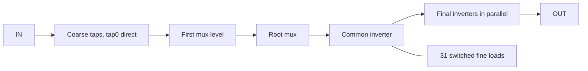

# Calibrated digital clocking, v2

This is the implementation contract for the architecture selected from the two
new papers in `../refs`. The machine-readable base policy is `clocking_v2.json`, with the approved
40--60% input-duty amendment in `clocking_duty_v2_2.json`.
All v2 evidence starts unqualified. Existing analog DLL artifacts and producer
sources remain immutable; they do not establish v2 performance.

Chen et al., CICC 2013 (10.1109/CICC.2013.6658549), motivates separately balanced
quarter-period delay sections and the symmetric rising-event DCC in Fig. 10(a).
Choi et al., A-SSCC 2016 (10.1109/ASSCC.2016.7844181), motivates coarse-first,
back-off, then fine training. Neither paper supplies SKY130 delay values or fixes
our detector's unequal-slew bias by itself. Its PODL driver is not adopted.

## Clock islands

TX: OpenPLL -> four independently programmable noninverting sections -> two
symmetric DCCs -> data DDR plus dedicated forwarded clock -> existing LVDS I/O.
RX clock: existing receiver -> deskew DCDL -> one four-section DLL and two DCCs
-> capture. RX data retains the existing analog receiver and DDR sampler.
The forwarded clock no longer traverses a constant-data DDR mux. The current
DCC release controller aligns delivered rising clocks with their respective
raw PH0/PH90 rising phases, preserving positive quadrature. This supersedes the
initial inverted-output startup assumption. Native startup and input-port timing
still need qualification; changed clock latency is included in RX training.

During calibration a section sees the common reference, then the sections are
cascaded. Increment the fastest section, validate an unwrapped tagged-burst
one-period measurement, and require 64 valid confirmations. The current detector
candidate uses analog edge conditioning followed by a retained-event
regenerative arbiter, input swapping and repeated votes; both extreme
unequal slews must still bracket zero within +/-20 ps. Clock codes update only
while outputs are invalid and become immutable during payload.

Each DCC ORs the outputs of identical pulse FFs driven by opposite rising
phases and toggles a final FF. The repaired pulse reset stays asserted until
its input clock falls, preventing repeated events during the high phase.
The 780--820 MHz event stream, including
minimum jittered event spacing, pulse widths, startup polarity, CQ asymmetry
and real loads, must pass native simulation. A standard-cell implementation is
a candidate, not an assumed solution. Small custom timing cells are allowed if
that candidate fails. Ideal behavioral clocks never grant native admission.

Select the smallest qualified extracted-area configuration, then power, then
configuration order. TX coarse counts are 16/32/64; RX 64/128/256; fine counts
16/32. Require overlapping coarse/fine ranges, a common monotonic legal sequence
across all 15 PVT, and no legal delay gap above 20 ps (target 10 ps). RX deskew
must cover at least the longest period plus 500 ps. The TX sections must span
609.8--641.1 ps with headroom. These are search bounds, not measured delays.

## Lab protocol and interfaces

Both ends add `mgmt_clk_25`, `train_req`, `cal_busy`, `cal_fail`, `failure_code`.
RX adds `rx_ready`. Management clock is independent of the forwarded clock.
A lab controller holds training until RX readiness; there is no return lane.
OpenPLL TRACKING is a controller state, not proof of clock lock.

1. Calibrate TX; allow at least 256 switching cycles before training is valid.
2. Repeat a 256-bit frame: `ffff0000`, followed by 224 PRBS7 bits using
   x^7+x^6+1, seed 7f, MSB first. Prove cyclic marker uniqueness.
3. Calibrate RX DLL and scan every qualified deskew code. Discard samples during
   update/settling. Require four complete matching frames per candidate. Resolve
   both pair orientations using the marker.
4. Choose maximum worst physical clearance using characterized delay intervals,
   not the midpoint in code indices. Require >=250 ps training clearance on
   both sides and >=200 ps aperture-subtracted native payload margin.
5. Assert `rx_ready`. Controller preloads the first payload word before ending
   training. TX emits `0000ffff`, then payload; RX exposes valid only after the
   recognized end boundary. There is no payload backpressure.

Use atomic request/acknowledge CDC for multi-bit codes and status. Reset,
disable, retraining or clock loss invalidates outputs. Timeout is 100 ms on the
25 MHz management clock. Confirmed clock loss clears readiness within eight
management cycles. Explicit retraining follows frequency/operating-point
changes; seamless temperature tracking is outside this startup architecture.

## Migration and qualification

Use `scripts/drain_legacy_clocking.py` on exact legacy Python coordinator PIDs.
It verifies UID/argv/open artifact lock, stops only dispatch, archives only that
PID's pending tickets under the shared queue lock, and leaves solvers/exporters
running. Once children exit it inventories original files in separate receipts
and retires the stopped coordinator. Incomplete campaigns remain incomplete;
unrecorded terminal exports need independent measurement. Original artifacts
are never rewritten. Keep the 54-case analog source survivor and 480-condition
capture aperture as retained evidence, not v2 certificates.

Implement in meaningful commits: contract/drain; reference algorithms/protocol;
clock primitives and native feasibility; calibration/CDC/training RTL; fresh
physical implementation; native integration and release. Each diagnostic uses
at most two workers and the existing six-slot fair priority/aging dispatcher.
Do not change its bound implementation or lock inodes.

V2 release gates derive from its architecture descriptor, not the old fixed
8-block/336-case analog stage. Analog I/O stability/reference/stress checks
remain required. Digital convergence replaces only analog DLL control-loop
checks. Verify all five process corners at 0/25/40 C, 390/400/410 MHz, fixed
supplies, actual loads/slews and injected jitter. RX reference duty coverage is
40--60% under `clocking_duty_v2_2.json`; a wider actual slew domain requires
native downstream requalification. Native selected
and boundary codes must validate the characterized models used for long
behavioral calibration scans. Full-link checks require actual qualified phases,
45 cases, 4096 nominal/512 corner bits, two OpenPLL traces, 200 ps margins,
one million behavioral bits and fresh joint-RC release proofs.

## Running the new work

The implementation is versioned under `rtl/v2/` and `sky130/v2/`. The executable
reference algorithms are `scripts/clocking_v2.py`. Run focused checks with:

```sh
scripts/env.sh --ngspice python3 -m unittest discover -s tests -p '*v2*.py'
```

`probe_digital_dcc_v2.py`, `probe_digital_dcc_drive_v2.py` and
`probe_digital_dcc_output_v2.py` retain separate source circuit revisions.
`expand_digital_dcc_v2.py prepare <complete-output-screen>` independently
remeasures the selected source before preparing the 270-case PVT expansion.
`probe_digital_dcdl_v2.py` measures single pulses without modulo-period ambiguity;
`probe_digital_dcdl_smooth_v2.py` is a separate numerical diagnostic.

For a completed source context, run:

```sh
scripts/env.sh --ngspice python3 scripts/verify_digital_clocking_v2.py <artifact>
```

The consumer locks out concurrent execution, checks bound input and output
hashes, compares binary and exported samples exactly, and remeasures every
successful case. It retains numerical failures and writes a separate receipt.
Its reports are source feasibility only. In particular, the proposed inverted
DCC output is high during reset and falls on its first phase0 event; invalidation
and identical phase conventions are required during integration. Sparse DCDL
samples cannot generate a production code table. No physical certificate is
transferred from the legacy architecture or from these source experiments.

## DLL configuration and control integration

`openlvds_dll_control_v2` connects the actual calibration FSM, Gray-counter clock
watch, complete isolated measurement engine and atomic configuration bridge.
The bridge transfers all four legal-code indices and separated/cascaded mode
as one generation-tagged bundle into the raw-reference domain. Its digital
mailbox acknowledgement is deliberately insufficient to enable measurement.
The physical backend must acknowledge `raw_sequence` through `raw_settled` and
`raw_settled_sequence` only after the delay-ROM outputs, switches and mode route
have settled. It permits commits through `raw_update_allowed` only while the
physical clocks are invalid. These signals are raw-reference-domain inputs;
their exact acknowledgement returns through a second bundled-data mailbox.

The management side requires the acknowledged configuration to match its
current desired bundle. Retraining, disable and clock loss invalidate that
proof. Old transactions drain intact, but an acknowledgement from before
retraining cannot qualify the new generation. Mode changes between the
separated tournament and independent period test also require fresh physical
settling. Locked codes remain frozen. The public DLL lock is masked by current
configuration validity and clock presence; it is not DCC, warmup or RX readiness.

The composed test uses the real controllers, CDC mailboxes, launch logic and
event guards with explicitly synthetic external delay/arbiter paths. It
converges through all 64 confirmations, checks every launch against actual
committed code/mode, freezes after lock, and invalidates after source-clock
loss. Additional cases reject stale/pre-retrain settling, hold unsafe commits,
time out a backend that never settles, and prove default model admission stays
closed. These are control proofs, not physical delay models or native convergence.

Integration exposed an end-to-end clock-loss budget error in the shared clock
watch: eight stale samples after the CDC pipeline exceeded eight management
cycles overall. It now uses four stale samples, reserving three pipeline cycles
and one downstream registered-status cycle. Stop-phase tests cover 80 phases
at each of 390/400/410 MHz and require registered readiness low within eight
management cycles. The eight-cycle contract is unchanged.

## DCC startup and transmitter training

`openlvds_clock_startup_v2` accepts actual raw PH0/PH90 and delivered DCC clocks.
It generates no clock and has a separate, default-false DCC-model admission
parameter. Own-phase reset release is followed by at least 256 actual delivered
rising edges on each clock. Both counters must finish, their synchronized flags
must arrive, and independent clock watchers must report both clocks running
before management `clocks_ready` asserts. Delivered-domain `ready0`/`ready90`
assert through their own two-stage synchronizers and invalidate asynchronously,
including when that clock itself stops. Parameters below 256 hardware warmup
cycles are rejected; absent clocks time out. This startup stage retains the
100 ms timeout parameter; whole-PHY startup budgeting remains to be integrated.

Each clock watch resets with its own DCC release generation. In particular, an
edge produced by the DCC reset output cannot count as fresh running-clock
history after a restart. Clock loss latches failure and resets both DCCs;
disable or a new DLL calibration clears the stage for explicit retraining.
Native DCC CQ/recovery/removal and propagated loads still require qualification.

`openlvds_tx_training_control_v2` connects startup to the existing frame generator
on delivered PH0. Management `train_req` is synchronized into that domain and
remains a level held by the lab controller until RX ready. The first valid pair
starts a complete training frame only after startup. The existing generator's
additional minimum training duration and frame-boundary end-marker rules are
retained. Payload must be preloaded in the pair-clock domain. The dedicated
forwarded clock remains the physical DCC output, not a data mux constant.

The composed protocol test uses the actual clock-hold DCC gate topology with
explicit test-only cell delays. It independently checks 432 transmitted pairs
against three full training frames, the end marker and payload; proves both
delivered warmups; stops each phase independently; and checks asynchronous
disable/source-loss invalidation and fresh reacquisition. Missing both clocks,
one clock never starting, default admission and shortened hardware warmup are
separate rejection cases. These tests do not establish native clock timing.

`openlvds_tx_control_v2` now composes the actual DLL controller, DCC startup and
training generator. A management training edge invalidates output immediately,
issues one DLL-start pulse, waits for calibration and both delivered warmups,
and then retimes the final management grant into the pair-clock domain. The
same training request remains a level for the frame generator, so the lab can
hold training until RX readiness without repeatedly restarting calibration.
DLL/delay and DCC admission remain separate default-false parameters. Backend
ROMs, code/mode settle acknowledgement, physical routes/offsets, observers,
raw phases and delivered DCC clocks are all explicit physical interfaces.

`openlvds_clock_sequence_v2` supplies one 100 ms management deadline across DLL
calibration and DCC warmup. DLL lock cannot restart that budget. Failure reasons
are latched before disabling stages, so their later cleared local flags cannot
erase the cause; a fresh training edge or disable clears the overall failure.
Unadmitted DLL measurements map to the public unqualified-model reason. Clock
loss invalidates the final grant independently of a clock domain's ability to
advance. Completed payload codes and measurement launches remain frozen.

The complete composition test exercises 64 real-controller confirmations,
atomic configuration/physical-settle CDC, actual isolated launch/event logic,
clock-hold DCC gate topology, both warmups and 432 independently checked frame/
end-marker/payload pairs. Separate unit tests cover a deadline spanning both
stages, success at the deadline, held requests, latched stage errors and explicit
retraining. External delay/threshold/arbiter paths and published raw-phase
delays are synthetic; the phase model derives delays from committed codes and
publishes cascaded phases only after DLL lock. These tests do not qualify
pre-lock physical switching, analog transients, SKY130 timing or a full PHY.

## RX scan and capture integration

`openlvds_rx_scan_v2` scans all legal code indices through an admitted delay-ROM
port. The scan records four-frame results, with an independent per-code marker
timeout. It searches contiguous passing runs and maximizes the conservative
minimum distance from both measured eye boundaries using delay intervals. It
then reapplies the selected code and requires a fresh frame test before
`rx_ready`. The model-admission parameter defaults false. No fabricated ROM is
provided as a production implementation.

`openlvds_rx_training_v2` connects the scan, code mailbox, capture training and
tagged command/result mailboxes. Results carry both generation and code index.
Raw and capture clocks are watched independently, and management status masks
public validity when a stopped clock cannot advance capture-domain logic. The
current integration test uses a synthetic eye mask explicitly for protocol/CDC
verification; actual timing-model and native integration remain required.

## DCDL fine-bank correction

The original fine-load source pilot has insufficient coarse/fine overlap. The
new `dcdl_cap_bank_v2.py` uses complementary transmission gates and native MIM
capacitors; disabled branches discharge explicitly. `probe_digital_dcdl_cap_v2.py`
checks two bounded geometries and observes all custom MOS terminal pairs.
`dcdl_cap_strong_v2.py` strengthens the return merge to reduce the unit delay.
`probe_digital_dcdl_batch_v2.py` measures dense code sets in separate tagged pulse
windows, amortizing device-model elaboration without reducing the integration
accuracy or reusing incomplete outputs.

The producer's internal-control 10 mV check was inappropriate for digital
inverter outputs. `analyze_dcdl_batch_v2.py` retains those failures and performs
separate reanalysis with explicit digital logic margins; source inputs, pulse
integrity and thin-oxide stress remain strict. Both that consumer and
`verify_dcdl_mim_v2.py` check exact binary/export agreement and retain receipts
outside producer artifacts. Code-path selection uses conservative intervals
through `digital_delay_path_v2.py`; it cannot supply missing PVT coverage or
turn source data into physical qualification.

## Edge-detector feasibility

`openlvds_bbpd_v2` and `probe_digital_bbpd_v2.py` test matched input swapping,
conditioning and two native edge-sampling FFs at SS40. The native pilot includes
both +/-20 ps and +/-150 ps at matched and unequal slews, and records ambiguous
and unresolved outputs separately from correct signs. Twelve pilot votes do
not qualify 64-confirmation lock or remove the independent tagged-epoch check.
`verify_digital_bbpd_v2.py` remeasures the completed curves with exact waveform
witness checks. A detector with a dead zone or slew-dependent sign failure must
be repaired before it is used by the DLL calibration measurement engine.

## Native repairs and next admission gates

The original 270-case DCC matrix completed without numerical errors, but all
54 SF cases failed. Its reset released while the input clock was still high,
retriggering the native pulse FF. The failed source and independent receipt
`digital_clocking_v2_verification/3c04509edf48618f` remain unchanged.
`openlvds_dcc_clock_hold_v2` adds a clock-aware reset latch. Its 24-case SF40/SS40
pilot preserves one pulse per source edge, including +/-140 ps spacing offsets;
balanced half-cycle error is about 29.7 ps at SF40 and 0.224 ps at SS40.
The new 270-case expansion is `dcc_clock_hold_pvt_v2/8b83d935bd2d01f3`.

`harden_dcc_v2.py` requires a complete independent passing source receipt before
starting fresh placement, DRC/LVS and GDS RC extraction. It checks the exact
reset-feedback topology and rejects inserted signal cells. Physical success
alone cannot admit electrical timing. `openlvds_dcc_release_v2` independently
releases the two DCC resets after their own raw rising phases. Logic regression
sweeps 25 startup offsets and checks positive quadrature; native recovery,
removal, CQ and actual loads remain open.

Physical-flow preflight found that LibreLane's Python lacks NumPy. Before any
physical artifact was prepared, the DCC flow was revised to invoke the unchanged
source-admission checks through `/usr/bin/python3` in the scientific container
environment. It strips foreign Python package paths and checks the exact source
witnesses again when binding physical inputs. The physical manifest now records
both interpreters and LibreLane package hashes. The actual LibreLane constructor
accepts the configuration; this preflight does not run layout or grant source
admission. Original failed-import and successful-preflight logs remain under
`build/dcc-v2-physical-preflight-*.log` and
`build/dcc-v2-physical-config-constructor-preflight.log`.

The mutual-FF detector completed 60 cases and exposes a dead zone near zero.
`openlvds_tag_arbiter_v2` retains isolated input events before a cross-coupled
NAND race, removing that FF setup aperture. Its standard-cell conditioner still
introduces roughly 45 ps of unequal-slew bias. Moving the buffer before the
swap mux did not fix it. The retained `tail140_w20` analog frontend restores all
six +/-20 ps signs, but its new arbiter load initially pushes local reference
ripple 255 uV beyond the 10 mV limit. Increasing only the native reference MIM
from 22x22 to 30x30 um passes all six sign, stress and reference checks; peak
reference is 0.905723 V. Independent receipt:
`clock_repairs_v2_verification/3d4ed08666f410c4`.
`expand_analog_arbiter_v2.py` expands this exact topology to 180 source cases:
15 PVT, both input swaps and matched/unequal slews at +/-20 ps. Low-level tagged
trial control and the six-pair/vote sequencer are now implemented as described
below. Characterized tolerance perturbations, physical routing and detector
integration still need native qualification.

Dense DCDL reanalysis found real SS40 control-device stress at 1.95726 V,
above the unchanged 1.95 V limit. Strengthening the complementary-control
inverter worsens it to 1.97904 V. A native 2x2 MIM shunt reduces it to 1.93214 V
in the first eight-code source test, preserving delays. The separate
`dcdl_control_margin_v2/4a4181e6cbb757d0` tests 2x2/4x4 shunts, both code
directions and large jumps at 20/100/200 ps control slew. All six cases are
complete without numerical errors. Both geometries fail at 20 ps (1.96278 V
for 2x2, 1.96118 V for 4x4), while 100/200 ps pass. Independent receipt:
`dcdl_control_margin_verification_v2/7f57360f2f2b99f7`.
The fastest bulk falling update pulls r0 to -0.16278 V; the worst terminal pair
is the switch PMOS r0/body, not its complementary gate. The separate
`dcdl_charge_kick_v2/a802a32a83c0b5ee` compares adding native 2x2/4x4 MIM at r0
against one-bit thermometer updates near both ends of the fine bank. Both
retain 2x2 complementary-control shunts and 20 ps source slew. No delay ROM is
admitted; a serialized update policy would require its own controller and
native all-code/all-PVT proof before selection. All four charge-kick source
repairs pass, independently remeasured in
`dcdl_charge_kick_verification_v2/702b10e5862a3a2e`:

| Source repair at SS40, 20 ps control slew | Maximum terminal difference |
| --- | --- |
| Single-bit updates near fine 0 | 1.93223 V |
| Single-bit updates near fine 31 | 1.87948 V |
| 2x2 MIM at r0, bulk updates | 1.94795 V |
| 4x4 MIM at r0, bulk updates | 1.91815 V |

`dcdl_node_bank_pvt_v2/e307e4f382060f33` explores the 4x4 node shunt across
150 source runs: every PVT, coarse 0/1, all 32 fine codes and an additional
bidirectional bulk-update run at each coarse/PVT. It retains the 2x2 EB shunts,
coarse-count 16 topology, 20 ps control transitions and unchanged stress limits.
This is source range/health exploration, not final minimum-area selection.
RX coarse-count/range and actual periodic pulse transport remain separate.
The independent consumer keeps repeated/history-dependent delay extrema;
these observed ranges are not quantified numerical uncertainty or a legal ROM.

Next gates, in dependency order: finish independent source repair matrices;
select a stress-safe fine bank and characterize a common all-PVT code path;
qualify tagged measurement paths, offsets and clock primitives physically;
connect TX/RX clock islands; then run the native full-link and release matrix.
Supplies remain fixed throughout.

## Isolated measurement trials

`openlvds_tag_launch_v2` accepts one management command through an atomic CDC
mailbox. Enables change on falling raw-reference edges. A separated trial
launches source and comparison pulses together; a period trial launches its
comparison pulse on the next raw rising edge. A second mailbox acknowledges
that the pulse sequence ended. This acknowledgement is not detector settling
or DLL lock. Disable and clock loss cancel outstanding commands.

`openlvds_phase_trial_v2` holds section routes and input swap through result
consumption. It clears prior event history, arms the retained detector, starts
the launcher, waits for the configured characterized settling interval and
samples synchronized decisions. Each conditioned pre-swap input must contain
exactly one rising event and return low. Missing/duplicate events, unresolved
decisions, timeout and frontend loss reject the trial. Results retain request
sequence tags and survive management backpressure. Failure cancels the launcher
so a delayed command cannot contaminate a later trial.

Admission defaults closed. Physical wrappers must connect the actual routing,
conditioner, arbiter and event observers, qualify minimum event widths and the
worst path/settling window, and provide frontend readiness. Protocol tests use
explicit synthetic paths only. They test both input swaps, a 2.4/2.6 ns period
bracket and a 5.1 ns delay that remains long rather than aliasing at 400 MHz.
No simulated logic delay is admitted as native timing evidence.

`openlvds_dll_measure_v2` compares all six section pairs at both signed
threshold offsets, with three valid votes for each input-swap orientation.
Both normalized swap majorities must agree. A section is eliminated from the
minimum candidates only when another is faster outside the threshold bracket;
ties select the lowest eligible index. Thus the chosen section is within the
characterized bracket of the true minimum, rather than claiming sub-threshold
ordering. All six pairs must lie inside the bracket to report balance; a chain
of locally close adjacent pairs cannot hide a wider overall spread.

Period mode uses the same signed bracket with the next-epoch reference. It
reports short, in-window or long; swapped-input disagreement, a reversed
bracket, stale sequence or missing/duplicate events reject the measurement.
Only explicit unresolved-detector decisions can retry, at most three times
per voting block. Route acknowledgement must carry the current sequence.
One level request produces one response and then must deassert. The existing
calibration FSM still requires 64 complete confirmations and freezes codes.

`openlvds_dll_measurement_v2` connects this sequencer to the actual phase-trial
controller and pulse launcher. The physical wrapper supplies acknowledged
routes, the two conditioned pre-swap event inputs and retained arbiter outputs.
Its offset branches must be characterized together with detector bias, bounded
inside +/-20 ps and checked against legal code steps for convergence. Admission
defaults closed in both constituent modules. Event observers receive an
explicit per-trial reset assertion before their synchronized flags are trusted;
their idle values cannot initialize or certify a measurement.

Tests cover the composed pulse/event path, normalized input swaps, majority
votes, bounded retries, stale route/result tags and multi-period rejection.
A separate transaction model drives the real calibration FSM through code
increments and all 64 confirmations. These synthetic external models prove
control behavior only. Yosys process/check passes for default and admitted
configurations do not replace physical/native timing qualification.

`phase_threshold_pair_v2.py` now supplies a native source candidate for the
signed threshold. Both branches use matched buf_8 drivers, one switched native
2x2 MIM load, explicit off-state discharge and buf_4 outputs. Complementary
selection adds load to reference or feedback; it does not advance an edge.
The branches follow the analog conditioner and precede the exchanged-input
retained arbiter. Their absolute thresholds, including detector bias, are
measured rather than assigned an ideal delay.

`phase_threshold_v2/b5b100243bdaa8b1` runs 18 new-load SS40 source cases:
raw offsets -20/0/+20 ps, matched and both unequal slew directions, and both
threshold polarities. At zero raw offset, opposite threshold selections must
produce opposite decisions; both selections must retain correct outer signs
at +/-20 ps. All custom MOS terminals, native branch pulse transport, digital
control stability and the unchanged 10 mV local-reference limit are checked.
Independent remeasurement is queued after completion. Static controls in this
pilot do not qualify route updates, all-PVT thresholds, extracted matching,
calibration convergence or the PHY.

The first two threshold cases have correct signs and reference ripple, but
fail the unchanged 1.95 V custom-device limit. The off-branch buf_8 node reaches
-0.15631 V immediately before its rising edge; the PMOS node/body difference
is 1.95631 V. This is an electrical failure, not a waived numerical tolerance.
`phase_threshold_load_v2/f8c2416efc6cd197` changes only the two always-connected
base MIMs from 2x2 to 4x4. It retains the switched units and control shunts.
Six matched-slew SS40 cases check -20/0/+20 ps and both threshold selections.
All six pass sign, custom-device stress and reference checks, independently
remeasured in `phase_threshold_load_verification_v2/aaa5f22c61533cda`. Unequal
slews, all-PVT and physical thresholds remain unqualified. Its parent failure
cases were read independently with exact
binary/export and before/after witness checks while other parent cases continued.

`phase_prefix_v2/52fb82044646fca1` repeats all six passing repair cases with
only the quiescent simulation prefix shortened from 200 ns to 20 ns. Native
1 ps precision, supplies, devices, pulse shapes and measurement windows remain
unchanged. Independent paired receipt
`phase_prefix_verification_v2/15be3c82462f9f28` passes voltage (10 mV), individual
edge (0.25 ps), stress-difference (1 mV), sign and health checks. Aggregate native
runtime improves 3.31 times. This is measured matched-slew SS40 equivalence;
hardware warmup remains unchanged, and other loads/PVT remain unqualified.

The next cohort, `phase_threshold_slew_v2/1a45576caa4bab48`, uses that simulation
prefix for the 30 remaining SS40 combinations: matched 100/100 ps with swap 1,
20/250 and 250/20 ps with both swaps, all -20/0/+20 ps offsets and both threshold
selections. Its independent consumer keeps the two swap orders separate and
requires every three-offset bracket and every device/reference health check.
It runs through the shared six-engine dispatcher with two campaign workers;
existing healthy long-prefix jobs continue unchanged.

## Physical fine-switch primitive and early RC screening

`mim_switch_unit_v2.py` defines the actual five-port unit: transmission-gate
NMOS/PMOS, off-state discharge NMOS, a native 2x2 fine MIM and 2x2 control shunt.
The topology test compares its switch terminals and W/L directly against the
native fine-bank source. The node-wide base MIM and control inverter remain
outside the unit. No ideal capacitor or placeholder transistor is used.

The primitive geometry inspection is
`mim_switch_pcells_v2/62cb2bbcbc49aef2`. Native Magic PCells are placed compactly,
with M1 fanout/M2 drops and separate M3 rails. MIM top plates escape on M4 before
descending outside the capacitor. Three failed routing placements remain intact:
the first two expose the 1.34 um MIM-to-unrelated-M3 rule, and the third a local
M2 spacing violation. The current source is `build_mim_switch_unit_v3.py` with
`constraints/v2/mim_switch_unit_legal.json`. Result
`mim_switch_unit_physical_v2/9ee573b2d67b6ab9` has zero Magic DRC errors and a
unique independent LVS match. GDS/LEF generation does not qualify a whole bank.

Fresh GDS extraction in `mim_switch_unit_rc_v2/b1438bbf3193eb2f` contains
199 resistors and 55 parasitic capacitors. Its wire-collapsed audit retains the
intentional MIM devices and matches the source. Independent receipt
`mim_switch_unit_verification_v2/e0f493e7d69328f9` reruns that topology audit and
binds the same exact GDS/netlist bytes. Use its `verified_model`: the original
producer accidentally placed a scope description in the scope-hash field;
the separate receipt retains that value and records the actual schematic SHA
without rewriting the producer or extracted circuit.

The integration LEF in `mim_switch_unit_abstract_v2/e1049520c33a5145`
restricts public routing access to the five designated M3 rails. Other routing
rectangles, including contacts and MIM plates, become obstructions; the routing
geometry multiset, macro origin/size and GDS bytes are preserved. OpenROAD
OpenDB independently reads the derived LEF and confirms the five signal/power/
ground pin types and M3-only access. This is an integration view of the same
DRC/LVS-clean unit, not an array, timing or electrical qualification.

The measured upper bound on interconnect capacitance at NODE is about 3 fF per
unit. This excludes intentional MIM and intrinsic MOS capacitance and is not a
transient timing reduction. `dcdl_unit_rc_v2/fd1d622597ea4be3` therefore tests
31 exact extracted unit models in the retained source coarse core at SS40,
using fine codes 0/31/0. It measures minimum/maximum delay and every extracted
MOS terminal during code updates. This early diagnostic omits inter-unit and
coarse-core routing, so it cannot qualify a full physical bank or delay ROM.
Independent receipt `dcdl_unit_rc_verification_v2/d44e7b19d8358afc` confirms
that unit stress passes, but the minimum rising delay is 711.88 ps at SS40.
This is above both ends of the 609.8--641.0 ps quarter-period range. The first
and repeated fine-0 delays are 713.63/711.88 ps; fine 31 rises at 1302.33 ps.
This hybrid is insufficient for the intended quarter-period clock sections;
whole-bank routing of the present driver configuration is held.

`dcdl_rc_drive_v2/7d81b2af858f05f5` retains the exact unit RC and tests three
source compound-gate alternatives: two merge gates; two turn plus two merge
gates; or three merge gates. Each uses matched parallel copies of existing
native cells with identical logical inputs. The 0/1/16/31/0 sequence checks
minimum/range, a fine step and bulk-update stress. No tolerance, supply or
one-period target changes. Any survivor still needs compound-cell physical
proof, coarse/fine overlap, full PVT and full-bank extraction.

All three cases completed without solver errors and pass custom-device stress;
independent receipt `dcdl_rc_drive_verification_v2/cc13670b539c43b5` confirms
the measured outcomes. Double-turn/double-merge is the sole range survivor:
its fine-0 first/repeated rising delays are 609.24/607.32 ps. The first edge
leaves only 0.52 ps below the fastest quarter period, which is insufficient
to select it for routing.

`dcdl_balanced_drive_v2/ebaad5ef41119fe1` instead doubles every coarse-core
standard cell with identical-input native parallel copies, including all forward,
turn, pass and merge stages. Two variants use double or quadruple output drive.
Both coarse codes 0/1 use the same hardware, with fine codes 0/1/16/31/0,
the unchanged extracted 31-unit bank and unchanged 4x4 shared-node MIM. The
independent consumer measures the worst first/repeated fine-0 rising delay and
conservative rising/falling overlap between coarse 0/fine 31 and coarse 1/fine 0.
This sparse SS40 pilot cannot admit a dense code table, compound-cell layout,
full-bank routing or all-PVT timing, even if its feasibility checks pass.

The first two terminal `core2` cases recover the required minimum-delay
headroom: coarse 0/fine 0 rises at 556.41 ps initially and 554.65 ps on repeat.
However coarse 0/fine 31 is only 832.95 ps, while coarse 1/fine 0 is
858.19/857.68 ps. Even the most favorable repeat leaves a 24.73 ps rising
range gap. Device stress passes, but this is not an overlapping legal code
path. These two completed cases were independently remeasured with exact
binary/export agreement and before/after witness checks while the other two
output-drive cases remained live. Their original files are unchanged.
The complete four-case campaign is now independently verified in
`dcdl_balanced_drive_verification_v2/ca2ad9a4ffc2cf92`. Both variants pass
custom-device stress. Conservative rising overlap is -25.24 ps for `core2`
and -27.11 ps for `core2_output4`; worst first/repeated minimum-code headroom
is 53.35/63.88 ps respectively. The stronger output does not close the gap.

The separate `openlvds_mim_switch_2x3_v2` keeps every MOS and its control shunt
unchanged, increasing only the switched native MIM from 2x2 to 2x3 um.
Actual PCell inspection is `mim_switch_2x3_pcells_v2/4a3bbfab8fe0c7b9`;
the larger MIM has the same width and an additional 1 um total height. Placement
moves its center upward 0.5 um and raises M4 escapes and upper buses 1 um.
`mim_switch_2x3_physical_v2/7635bb0cb7abe0c4` passes zero-error Magic DRC and a
unique LVS match. Fresh GDS extraction
`mim_switch_2x3_rc_v2/942b90d393388692` has 198 resistors and 55 parasitic
capacitors; its metadata contains the actual schematic scope hash. Independent
receipt `mim_switch_2x3_verification_v2/26f440d15e6e9da1` reruns the strict
wire-collapsed topology check. NODE interconnect is about 2.97 fF/unit; this
excludes intentional MIM and MOS capacitance. No old 2x2 model is relabeled.
Its separate M3-only integration view passes actual OpenDB checks in
`mim_switch_2x3_abstract_v2/d61830e948bc02dd`.

`dcdl_larger_unit_v2/b22eb8e365e6d65a` tests 31 exact extracted larger units
with the same `core2` coarse hardware and 4x4 shared-node MIM. Six native tasks
cover SS40, FS40 and FF0, each at coarse 0/1 with fine 0/1/16/31/0. The consumer
requires both-edge overlap, worst first/repeated minimum-code delay and every
custom-device stress check independently at each pilot PVT. This experiment
does not qualify dense steps, common all-PVT ROMs, a physical compound gate,
inter-unit routing or a full bank. Whole-bank routing remains on hold.
The first two SS40 cases have completed without numerical errors and pass
custom-device stress. Their coarse-0 fine-0 first/repeated rising delays are
555.80/554.05 ps; fine 31 is 892.10 ps. Coarse-1 fine-0 is 857.59/857.08 ps,
giving 34.51 ps conservative rising overlap and about 54 ps first-edge headroom.
Full pilot verification still waits for FS40 and FF0. This is early extracted-
unit evidence, not admission of the whole bank or an all-PVT code path.

All these artifacts remain component evidence. Full-array extraction, periodic
pulse transport, native selected/boundary codes, all-PVT models and whole-PHY
qualification remain required. No active layout/model selection is published.

Verification follow-ups use `verify_clocking_when_idle_v2.py` for live contexts.
It retries only contention on the existing execution lock; witness, terminal
state and measurement failures remain errors. Service startup ordering alone
does not imply producer completion. Original early lock-rejection logs remain
retained; no producer is restarted to obtain a proof.

## Superseded source campaigns and current physical work

The source-only `analog_arbiter_pvt_v2/e6ec7847a89bd52b` and
`dcdl_node_bank_pvt_v2/e307e4f382060f33` campaigns are archived incomplete. The
former lacks the new threshold load; its frontend/bias/arbiter library bytes
match the loaded pilot, which must supply its own full-PVT proof. The latter
uses the identical single-drive source whose extracted-unit minimum failed at
711.88 ps. Neither old campaign can qualify the replacement circuit.

`drain_superseded_clocking_v2.py` verifies the exact Python coordinator's UID,
argv, start identity and open artifact-lock device/inode. Run it on the host
with that Python PID, not the Apptainer service parent. Queue ownership uses
the coordinator's open ticket-owner lock inodes: namespace-local PID 14 is
shared by unrelated containers and cannot identify a campaign. No dispatcher
implementation or lock inode changes. Only future dispatch stops; solvers and
exports finish before the stopped coordinator is retired. Reasons and exact
superseding evidence hashes are retained separately.

Receipts `superseded_clocking_drain_v2/1598271_440984732` and
`superseded_clocking_drain_v2/1603762_441209628` retain 54/43 original summaries
and 55/45 cases respectively, including final exports without original case
summaries. Their original campaigns remain incomplete. Unrecorded exports need
independent measurement before any timing claim.

The loaded threshold pilot now independently passes all 30 cases in
`phase_threshold_slew_verification_v2/7061a3cc4f520556`. The six-case larger-unit
pilot independently passes SS40/FS40/FF0 in
`dcdl_larger_unit_verification_v2/8c6234e034c425d5`; minimum conservative rising
overlap is 32.48 ps and minimum first-edge headroom is 53.95 ps. Dense code
steps, other PVT and complete bank routing remain unqualified.

`phase_threshold_pvt_v2/7f2eeea8cd9e0678` is the new 540-point source matrix for
the actual repaired threshold load: all 15 PVT, three slew pairs including
20/250 and 250/20 ps, both swaps, all -20/0/+20 ps offsets and both threshold
selections. Fast and mixed stress corners run first. It retains 1 ps precision,
the verified 20 ns simulation prefix and two workers through the same global
six-engine dispatcher. Independent verification requires 180 complete signed
brackets and all device/reference checks. No voltage sweep or hardware warmup
change is introduced.

### Shared shunt and full-bank topology

`build_mim_base_4x4_v3.py` builds the real shared 4x4 MIM in
`mim_base_4x4_physical_v2/d32143aff2efa2c7`, with zero Magic DRC errors and a
unique LVS match. Raw and restricted-access LEFs are retained. The first
`4a9e84595335b2c5` attempt had clean geometry but its abstract parser expected an
existing obstruction block. A two-port capacitor has no internal signal net,
so Magic exposed all routing as pins and omitted that block. The versioned
replacement adds it while preserving every routing rectangle and the GDS.

`dcdl_mim_bank_v2.py` generates the 16/32 bank: the exact 128-cell paired core,
real coarse/fine control buffers and complement inverters, 31 larger fine units
and one shared shunt. Every legal coarse setting is compared to the measured
native source. That direct parallel-gate RTL is retained as a failed P&R
prototype: Yosys reports 64 multiple-driver nets, so it cannot be passed through
digital hardening as ordinary independent cells.

`dcdl_mim_bank_physical_v2.py` instead groups each pair into a single-output
compound-macro interface. Its 174-instance view expands to the exact retained
238 native instances; Yosys reports zero problems. The 64 compound instances
use four types: paired buf4, NAND2-4, NAND2-8 and NAND2B-4. These now have actual
GDS, native taps, zero Magic DRC and unique LVS matches in
`compound_driver_physical_v2/e526d97182ddb6c5`. Restricted LEFs preserve all
routing geometry and expose only declared metal-3 rails. Earlier sticky-label
parsing and narrow-track/notch failures are retained separately. Fresh native RC
and independent topology audits pass for all four in
`compound_driver_rc_v2/ff754f3ebf571140`.

`dcdl_bank_assembly_v2/cbcead194f7cc775` checks all six macro types in OpenDB,
including the fine unit and shared shunt. Every pin direction/use/layer and all
174 instance connections are present; the 96 macro placements fit without
overlap. The other 78 instances require standard-cell row placement. This
materializes a concrete macro configuration and placement, not a routed bank.
Whole-bank power/signal routing, extracted range/overlap/stress, dense code
characterization and an admitted ROM remain open. Logical blackboxes and
isolated RC proofs supply no bank timing admission.

### Completed DCC source and recovered physical extraction

The repaired 270-case DCC source matrix independently passes all 15 PVT in
`dcc_clock_hold_pvt_verification_v2/f1d1e1e39c014c23`; its worst balanced mean
half-cycle error is 29.70 ps. The queued LibreLane run completed with zero
routing/Magic/KLayout DRC, LVS and antenna counts in
`dcc_physical_v2/75fb1becc16e8a41`. Its strict summary writer then rejected two
infinite unconstrained timing slacks. The original failed state and all files
remain unchanged.

### New buffer ports also require a different signal escape

The v327 footprint plan is **not directly routable by the old v234
straight-escape renderer**. Both public buffer signal ports are on M4
at local y=18.9 um. The old renderer draws each M4 signal directly left
to its M3 spine at that same y. With these actual ports, the A and X
escape segments overlap on different nets, including across each parallel
pair. This would short REQUEST to request_i and RCLK to CLK, independent
of the corrected footprint spacing.

Read-only receipt
`build/reports/counter_m4_escape_conflicts/20261107T032434Z/summary.json`
retains **eight positive-length different-net centerline overlaps** using
the exact v327 placements/ports and unchanged v234 drawing formula. The
REQUEST row is y=224.9 um: the first A segment spans x=6.5--125.16 um,
and its X segment spans x=2--166.90 um, overlapping by 118.66 um. The
CLK row is y=256.9 um: first A spans x=8--125.16 um and X spans
x=5--171.70 um, overlapping by 117.16 um. The parallel-buffer escapes
produce six additional different-net intersections. These are guaranteed
shorts under that formula, not a complete physical DRC audit.

The immutable analysis helper is
`build/analyze-counter-m4-escapes-20261107.py`; the receipt binds its code,
the actual plan manifest/summary/state, and the original escape renderer.
No GDS, native macro, route, waveform or threshold was changed. The
recorded footprint and M3-spine checks remain valid within their scope;
they do not establish M4 escape separation or native routability.

Before physical counter routing, implement port-specific escape geometry
that separates both signal nets across both parallel buffers, then check
it against native component masks and the global bus/via geometry. A
layer change plus a separate access track is a candidate; a horizontal
track shift alone can still cross another buffer's vertical escape or
native internal wire. The final v317 timing point, full native DRC/LVS,
unchanged-device/mask proof and fresh whole-counter shared RC remain
required. The old draw function must not be reused unchanged.

`recover_dcc_physical_v2.py` creates the separate receipt
`dcc_physical_recovery_v2/5b37b88a57c9d32d`, binding the exact GDS consumed by
signoff stages. The new topology policy recognizes true constant-high tie
clones feeding the two pulse FF D pins and power-only decap row endcaps; all
pulse/reset/toggle/output connections remain checked. Altered signal wiring
and signal-connected endcaps are rejected. The actual cloned ties and power
devices remain in the native RC and topology audit.

Fresh extraction contains 6,890 resistors and 734 parasitic capacitors; its
independent wire-collapsed transistor-topology check passes. The actual source
schematic hash is bound explicitly. Nonfinite timing remains named diagnostics,
never zero slack; the original unrecorded producer return code is not invented.
This is physical/RC evidence only. The following native timing experiment
exposes a failure; this backend remains unqualified.

### Native DCC failure and replacement experiments

`dcc_native_rc_v2/3c67e55b2d7e08a2` tests the exact routed network at SS40/SF40,
410 MHz, 20/100/200 fF output load, 20/250 and 250/20 ps input slews, and common
30%/70% input duty. Input-source delays compensate the different rise times so
their actual 0.9 V crossings are exactly half a period apart. Reset releases
150 ps after a PH0 rising crossing while PH0 is high. Every MOS terminal is
saved; all six terminal-pair voltages are screened at 1.95 V. These diagnostics
do not widen the fixed supplies or replace the existing clocking contract.

The first cases miss output events and exceed the terminal screen. Independent
raw-waveform receipt `dcc_native_failure_v2/a8e252ff2a35af3d` binds cases 0/1.
At 30% duty, the phase pulses last about 2.77–2.80 ns, longer than the 1.22 ns
input-event spacing. At 70%, both pulse FFs still fire, but their OR never
crosses below 0.9 V during the measured steady window; the final toggle receives
no new rising edges. Retained failures, rather than the earlier source-only
pass, determine the current hold.

The 24-case `dcc_toggle_pair_v2/9cc8e5acc822a14e` compares the exact routed
transistor network with wire R/C removed against two independent toggle FFs
and a native XNOR. The collapsed controls preserve events; several still fail
half-cycle or terminal screens. The direct two-toggle candidate exposes a
second issue: with feedback `D=!Q`, the master latch can retain a 1 during
reset and toggle when reset deasserts while its clock is high. A simple logical
FF model would miss this startup event.

The 24-case `dcc_toggle_pair_v2/0a6ed067a47953ae` changes feedback to
`D=RESET_N & !Q`. It passes startup and output-event checks in completed cases,
but a single XNOR has excessive duty bias even with matched input slews
(about 67 ps for the first SS40/drive-1 pair). Terminal excursions also remain
above the screening limit. `dcc_toggle_pair_v2/af5834ab76e4deca` tests two native
XNOR2-2 cells with opposite input assignments and tied outputs, retaining equal
aggregate output drive and testing both FF strengths. This is a physical
compound-gate candidate, not a production multi-driver RTL net.

The five-cell reset-qualified drive-2 candidate is separately placed/routed in
`dcc_toggle_pair_physical_v2/59c37db357dc5b9b`, with all six physical check counts
zero and the exact two feedback loops verified. Its fresh network has 6,692
resistors and 586 parasitic capacitors; an independent wire-collapsed topology
audit passes. Nonfinite untimed STA values remain explicit diagnostics.
`dcc_toggle_pair_rc_v2/9cdb701177c3b82b` contains four matched-slew SS40 native
tests at 20/100 fF and 30%/70% duty to separate actual routing effects from the
source candidate's timing/stress limitations. It is not admitted.

The balanced XNOR macro has actual native cells/taps, one public output,
zero Magic DRC and a unique LVS match in
`balanced_xnor_physical_v2/8444c61422ffa5c2`. Fresh extraction and an independent
wire-collapsed topology check pass in `balanced_xnor_rc_v2/7279d17009af8771`
(439 resistors, 247 parasitic capacitors before exact resistor reduction).
The first matched-slew SS40/drive-1 source cases improve mean half-cycle error
from about 67.23 ps to 40.49 ps, but still exceed the terminal screening limit.
That is evidence for testing the symmetric combiner, not electrical admission.
Next admission work must establish symmetric-combiner timing, reset release,
internal stress and actual permanently loaded clock-conditioning interfaces
before full-PVT native DCC qualification or integration into TX/RX. Do not
replace the production backend or assert its admission bits from these pilots.

### Static NAND storage and isolated transmission gates

The routed five-cell diagnostic completes all four tests in
`dcc_toggle_pair_rc_v2/9cdb701177c3b82b` without numerical errors. At SS40,
100/100 ps input slew and 20 fF, its mean half-cycle error is about 108.8 ps and
its worst observed terminal difference is 2.049 V. The 100 fF cases also fail
event association. The actual RC therefore does not rescue this candidate.

Native-source terminal inspection finds charge kick on private storage nodes,
not a changing supply. The 1.95 V screen remains in force; the
[SkyWater device documentation](https://skywater-pdk.readthedocs.io/en/main/rules/device-details.html#v-nmos-fet)
lists that bound for the 1.8 V NMOS model's operating range. No voltage sweep or
relaxed device threshold is introduced.

`dcc_nand_latch_v2/f43da8a77c38ea09` replaces the reset FFs with static NAND
master/slave storage. Internal state initializes through raw clocks while a real
output NAND holds clock_out HIGH in reset. The first matched SS40 cases preserve
events and have about 8.6 ps mean error, but an internal NMOS stack node reaches
roughly -0.40 V. Native 2x2 MIM stack shunts in
`dcc_nand_mid_shunt_v2/973f16363c3657c6` suppress that peak and expose positive
excursions on lightly loaded gate outputs. Adding one native output shunt per
logical net in `dcc_nand_node_shunt_v2/a742d47d1d4db6e6` reduces the first
peak to 1.957 V but makes some events too late for the next-source-event window.
All three 24-case cohorts and their failures remain intact.

`dcc_tg_combiner_v2/4d0f303e86443b69` shortens the combiner to two real CMOS
transmission-gate XOR muxes fed by complementary storage outputs. Direct loading
prevents SF storage from switching. Four matched native buf8 isolation drivers
in `dcc_tg_buffered_v2/5d5df5f8b9f6a416` restore startup and event integrity.
Independent receipt `dcc_static_verification_v2/23edcfb662ca029c` regenerates the
native libraries and decks and remeasures all binary waveforms: **all 24 cases
pass startup, event integrity and terminal screening**, with maximum terminal
difference 1.933721 V. Each of its two TG-size variants still fails the agreed
mean half-cycle requirement in four of twelve cases. Neither is admitted.

The first verifier's extra 50 ps per-individual-cycle criterion is retained in
`dcc_static_verification_v2/882f93591267bc4b` as an obsolete stricter diagnostic.
The frozen descriptor explicitly names `mean_half_cycle_error_ps = 50`.
Versioned verifiers v3/v4 use that agreed mean criterion and preserve individual
half-cycle excursions separately for the full-link margin work. A small mean
does not establish eye margin, and the diagnostic does not add a new release
requirement. No bound producer or prior receipt was rewritten.

Two targeted experiments accompany the 540-case threshold matrix:

- `dcc_tg_ratio_v2/955c8dbc75673e14` changes only the eight custom TG widths,
  retaining every native storage/buffer transistor and MIM. Its 12 matched-slew
  SS40/SF40 cases test P/N ratio headroom and have completed without numerical
  errors. N=1/P=3 µm passes all four of its cases, with 17.2–17.7 ps mean error
  at SS40 and a worst SF40 value below 37.5 ps. N=1/P=4 also passes but reaches
  46.95 ps at SF40; N=0.5/P=2 fails all four mean-error checks. N=1/P=3 is the
  next joint-source integration candidate, not a full-PVT/physical selection.
- `continuous_clock_conditioner_v2/c3bbd0dec4ab33a1` tests the exact retained
  tail140_w20 conditioner and distributed-RC bias continuously at 410 MHz.
  Real buf8 clock drivers feed the actual buffered DCC input circuitry held in
  reset, plus permanent buf8 monitor inputs and fixed native 4x4 MIM rails.
  All twelve SS40/SF40 cases pass clock integrity, common-mode and terminal
  screens. Their largest conditioned phase-spacing error is 4.21 ps, including
  both 20/250 and 250/20 ps raw input slew and both 30%/70% duty. Independent
  receipt `conditioned_clock_verification_v2/94097d668b5de414` regenerates the
  libraries, decks and MOS coverage and remeasures every raw waveform.
  This proves neither DCC run
  timing nor a complete five-channel conditioner; integration remains required.

Native layout access is now concrete. Inspection
`nand_stack_native_inspection_v2/bab67e2b837d7a07` preserves actual NAND GDS/MAG
and extracted device geometry. Label-only proof
`nand_mid_access_v2/9627a8f5d45d42e4` exposes the drive-2 and drive-8 stack nodes
as MID ports, obtains unique transistor-level matches, and identifies existing
local-interconnect landing rectangles on those exact nets. No native mask changed.

Two actual shunted NAND macros now pass DRC, unique transistor-level LVS and
fresh RC topology checks. Physical receipt
`nand_shunt_physical_v2/e81ae766c2d4bf14` adds contacts to existing stack LI,
native 2x2/4x4 stack MIM and 2x2 output MIM, with M3 signal/power interfaces.
Extraction `nand_shunt_rc_v2/ef0d175bd6be9bcb` contains 121 R/68 C for drive-2
and 384 R/197 C for drive-8 before exact resistor reduction. The original
geometry `ea63ebb142230ada` remains preserved: it matched schematics but failed
M1 enclosure and MIM-to-unrelated-M3 clearance rules. The corrected geometry
passes both checks. These are component results, not DCC admission.

`nand_shunt_native_v2/1ac6dd7fabd5ca7d` is the original 48-case electrical pilot:
each extracted gate at SS40/SF40/FF0, 410 MHz, both input pin orders, 20/250 ps
slew and two external loads. A/B clocks offset by a quarter period exercise
610 ps NAND pulses. It checks actual input/output crossings, full-swing logic
settling and all six MOS terminal differences. The first two drive-2, SS40,
20 ps, 5 fF cases preserve output events but fail the terminal screen at
1.980/1.956 V. The first peak combines a 1.959 V output with a -20 mV local
body excursion. Heavier 20 fF drive-2 loading can also miss the full-swing
settling check despite preserving crossing counts. These are explicit load
limits/failures, not a relaxed voltage bound. A separate output-3x3-MIM layout
experiment tests additional damping without changing any transistor size.
Its first geometry `nand_shunt_physical_v2/e6936ac0b1d21df1` preserves unique
LVS but fails one MIM/M3 clearance rule per gate. Raising the output escape
from 10.0 to 10.8 µm produces
`nand_shunt_physical_v2/54edb7bb83c9c87a`: both gates pass DRC/LVS, and fresh
RC/topology receipt `nand_shunt_rc_v2/2bfbb5b632ecca00` passes. The new 48-case
electrical comparison is `nand_shunt_native_v2/85a89de29ccff159`. Its first two
drive-2 SS40/20 ps/5 fF cases now pass events, full-swing settling and terminal
screening: peaks fall from 1.980/1.956 V to 1.931/1.924 V. A subsequent
passivity audit invalidates these RC models (see below). The finite-transient
numbers remain diagnostics, not component timing/stress qualification.
Both isolated-gate cohorts are archived incomplete. Passing geometry does
not select this variant.

### Joint conditioned DCC and native reset release

The joint source pilot now connects the continuous conditioner to the actual
running buffered-TG DCC. A static native two-register controller asynchronously
clears both master/slave states and requires two new conditioned-clock edges
before reset release. A matching controller loads the other phase. The only
external ideal startup stimulus is REQUEST; RESET_N comes from real native
storage. Clock-stop/retrain tests cover stopped HIGH and LOW states. This
source experiment does not replace the production clock-hold control topology
or shorten the 256-actual-clock hardware warmup.

The first controller in `conditioned_dcc_v2/b72aae608fddc043` used redundant
tied REQUEST NAND inputs. The first two cases passed events and mean timing
but exceeded the terminal limit inside that controller only. Versioned
`native_clock_release_v3.py` uses REQUEST directly as first-stage data and one
inverter for its complement. Both asynchronous internal clears remain. The
replacement `conditioned_dcc_v2/96f84f2b4b28c340` tests both TG ratios N1/P3 and
N1/P4, SS40/SF40, three slew pairs and 30%/70% duty at 410 MHz/20 fF. Its first
twelve N1/P3 cases at SS40/SF40 pass startup, events, actual two-edge reset release,
common-mode, mean timing and every MOS terminal screen. The first four mean
half-cycle errors are 16.9–23.1 ps; the worst across all twelve is 38.93 ps,
with a 1.9402 V maximum low-voltage MOS terminal difference. N1/P4 cases are
running; no full-PVT
selection or native RC timing is claimed. Independent raw verification waits
for the whole cohort to finish.

The superseded controller cohort was drained through receipt
`superseded_clocking_drain_v2/1648525_443551665`: exact coordinator identity and
held lock inode were verified, future dispatch stopped, healthy solver/export
children finished, and four completed summaries plus six retained case folders
were inventoried before coordinator retirement. The original artifact remains
incomplete and unchanged. Neither running replacement nor threshold campaign
was restarted. Bound producers and failed geometries remain immutable.

### Native component RC clock assembly

`clock_cell_access_v2/134f0db87cf54b71` proves existing private-node LI access
against exact native transistor sources for NAND2_4, NAND3_2, INV1, INV8 and
BUF8. The NAND3's two private stacks remain distinct and both have LI access.
The inverters need only output shunts; BUF8 also needs its internal inverter
node shunted. These are label-only proofs with no modified native masks.

Physical family `clock_cell_shunts_physical_v2/5b3cb85905697901` passes zero
DRC and unique LVS for six variants: NAND2_4/NAND3_2 with 3x3 output MIM,
INV1 with 2x2, INV8 with 4x4, and BUF8 with either 2x2 or 4x4 output MIM.
Every private stack/buffer node has its own native 2x2 MIM. The buffer variants
serve the DCC isolation and the continuously loaded clock/monitor paths.
The failed first geometry `942016c151757a71` and next `de37deaad4a72bcd`
remain intact: generic pin/contact placement shorted NAND3 B/Y and A/stack
nets, then the narrow inverter's output/input escapes. Selecting separated
native LI contact locations and separating input/output vertical routes fixes
the actual shorts. The original jobs terminated at the strict LEF interface
guard; their stale `routing` state files are not evidence of live jobs.

Fresh family RC/topology receipt `clock_cell_shunts_rc_v2/0730f91e2238a256`
passes all six. Before exact resistor reduction, the respective R/C counts are
215/100, 174/102, 65/25, 214/88, 275/114 and 274/102. All bulk connections and
the RC-separated terminal nodes remain present; no body-node alias removes
the local excursions observed in the first NAND pilot.

The complementary TG pass network now has actual guarded-MOS layouts for
N1/P3 and N1/P4: `tg_xor_physical_v2/cd7f1e9ec225297f`, both zero DRC/unique
LVS. They retain exactly the eight source-sized MOS devices and the native
2x2 XOR-output MIM; storage and buffers are separate components. Their initial
layouts are about 134 x 37 µm. Fresh RC/topology receipt
`tg_xor_rc_v2/66a14c9b49abe012` passes both, with 796 R/137 C and 900 R/137 C
before reduction. This layout is an electrical experiment, not an area or
interconnect timing claim.

`native_clock_components_v2/5e946e50652708ef` assembles those actual component
RC models with the larger-output-shunted NAND2_2/NAND2_8 models from
`nand_shunt_rc_v2/2bfbb5b632ecca00`. The DCC, both native two-edge reset
controllers and all four clean/monitor buffers are now hierarchical extracted
components. It retains the analog conditioner source and actual distributed
bias RC. Every extracted instance maps ports by name. Recursive MOS coverage
retains separate drain/gate/source/body RC vertices: **880 MOS per case**,
including 280 in the DCC and 192 in each reset-controller replica.

The eight-case pilot tests both TG ratios, SS40/SF40 and 30%/70% duty at
410 MHz/20 fF with matched raw slews. Its decks and complete device coverage
regenerate successfully. Its first cases fail numerically before clock startup;
this cohort is archived incomplete following the passivity finding below.
Inter-component wires are still ideal; the next routed backend needs
fresh whole-layout RC. No whole-backend, all-PVT or PHY admission follows from
these component proofs. The software regression passes all 1,698 tests without
skips (`build/native-clock-components-v2-full-tests.log`).

### Passivity repair before native timing qualification

`rc_passivity_v2/b7f074f8e2f99245` identifies negative parasitic capacitors in
seven of the ten first component models. Their capacitor matrices have
negative diagonal entries, giving explicit negative-energy basis-vector
witnesses at internal vertices. In NAND8, `B.n15` has a -3.81621 fF capacitor
to VGND and no intrinsic MOS or MIM terminal on that vertex. The first joint
RC simulations abort near 17.3 ps, before raw clocks start at 22 ns. Isolated
NAND8 runs also spend hundreds of thousands of steps near 17–18 ps.
`rc_passivity_v2/651ae98a9ba3bb5c` binds the issue to both isolated-gate
cohorts. Their timing/stress diagnostics are **not qualification evidence**,
even where the transient finished.

This does not invalidate source-only cells or DRC/LVS. Bias receipt
`rc_passivity_v2/daf4709e5246a6fe` confirms positive R/C elements in the
unchanged bias library. Receipt `rc_passivity_v2/72f07ac0eb6b515d` separately
confirms all four retained DCDL compound RC models have positive elements.
The earlier routed clock-hold DCC is also passive in
`rc_passivity_v2/66feb64fa88260ba`; its prior timing failure is not explained
by this particular defect. These certificates concern RC signs, not whole-chain
timing.

The versioned flat extraction experiment uses `extract no resistance` before
initial extraction, one explicit unsimplified `extresist` pass with zero
threshold/mindelay/minres, and `ext2spice hierarchy off` plus an explicit top
subcircuit. This removes negative capacitors from all ten regenerated
components without deleting, clipping or relocating any element. The pinned
tool is Magic 8.3.623. The upstream [command documentation](https://github.com/RTimothyEdwards/magic/blob/master/doc/html/extresist.html)
describes these controls; a later [upstream issue](https://github.com/RTimothyEdwards/magic/issues/557)
also reports capacitance problems with hierarchical output on another PDK.
That report motivated this controlled experiment, not a conclusion about our
specific root cause. Several extraction controls change together, so this
does not isolate which one caused each former defect.

Flat output appends `$ **FLOATING` comments to some parasitics. The old
topology collapser recognized only four-token R/C lines, leaving commented
parasitics in the wire-collapsed netlist and causing false LVS mismatches.
A versioned auditor strips inline comments before the unchanged collapse,
preserving every native MOS/MIM. Fresh independent topology receipts now
pass with positive R/C elements:

- NAND2_2/NAND2_8: `passive_clock_rc_verification_v2/6e12628bd8ac8bc9`.
- Six qualifier/NAND3/inverter/buffer variants:
  `passive_clock_rc_verification_v2/92eed0de8314254e`.
- Both guarded TG XORs: `passive_clock_rc_verification_v2/b6bca7b2eadf7928`.

The original flat-extraction receipts `acde423833429b59`, `92f2004644d6f040`
and `ecd1efe7bfaab12c` remain preserved with their false topology failures.
No original extracted file or report was edited to make the new audit pass.
`extract_native_flat_v4.py` rejects nonpositive resistors or negative
capacitors before marking extraction successful. Tests cover that gate,
comment handling, and refusal to signal unrelated or unfrozen jobs.

Three separate drain receipts preserve the invalid cohorts:
`1652238_443753319` retains 24 summaries/26 case folders;
`1653853_443788595` retains 26/28;
`1657643_443902568` retains 7/8. Each exact coordinator was verified and
frozen before future dispatch stopped. Four owned SPICE leaves using the
proven-nonpassive libraries were terminated with per-PID/start/argv and partial
raw-time receipts; adapters exited and all files were inventoried before
coordinator retirement. Source/threshold solvers were not signalled, and no
dispatcher lock inode changed. These are archived incomplete campaigns.

Replacement `native_clock_components_v2/fab3576c6ca5b3c8` uses only the ten
positive-element, independently topology-verified RC models. It retains all
880 MOS witnesses, the same eight-case matrix and source startup stimulus.
Its first two simulations have advanced beyond 4.5 ns, past the old pre-clock
failure. They are still running; native timing/stress results are unproven.
Independent whole-cohort raw verification is queued. The complete software
suite passes **1,706 tests without skips** in
`build/passive-native-clock-components-v3-full-tests.log`.

The next integration must finish the joint source matrix and independent
waveform verification, then qualify the component-RC assembly and route the
physical DCC/reset/clock backend. Whole-backend RC, all 15 PVT and
390/400/410 MHz, actual permanent
measurement loading, and closed-loop DLL/RX/full-link qualification remain
required. Production control RTL still has its clock-model admissions closed.

### Approved duty range and native integration status (2026-11-04)

The user-approved reference-clock input duty range is now **40%–60%**.
`clocking_duty_v2_2.json` applies only that override to the SHA-bound original
descriptor. The output mean half-cycle error limit remains **50 ps**;
390/400/410 MHz, all 15 process/temperature combinations, fixed supplies and
all other requirements remain unchanged. Earlier 30%/70% campaigns retain
their original identities and continue without restarting healthy solvers.
The four-case stronger-storage native pilot
`native_clock_components_v2/363a482d0837cc35` tests both new duty endpoints
at SS/40 C, 410 MHz with one or three actual clock drivers. It is running;
neither that pilot nor its queued independent verifier has admitted the PHY.

The source conditioner/DCC matrix `conditioned_dcc_v2/96f84f2b4b28c340`
passes all 24 cases. Independent receipt
`conditioned_clock_verification_v2/d2819f2b5a574d05` regenerates libraries,
decks and MOS coverage and remeasures the raw waveforms: worst mean
half-cycle errors are 38.921 ps (P3) and 48.482 ps (P4), with a worst
low-voltage MOS terminal difference of 1.94012 V. This is a two-PVT source
pilot, not physical or all-PVT qualification.

The passive component-RC baseline now reaches clock startup. Its first two
SS/40 C cases fail reset release rather than numerical convergence.
`native_clock_release_failure_v2/d2139c60ceb19998` binds the raw/deck
identities and diagnoses saved MOS terminals through the extracted resistor
graphs: at 30% duty the master sets but the slave does not latch; at 70%
the master does not set. The stronger native-storage experiment retains
these failures. Its 70% one-driver case releases reset and meets steady
half-cycle timing (9.624 ps mean error), but misses the first expected P0
event. Startup and event-integrity requirements remain enforced.

Whole-bank routing now preserves all 174 intended instance connections,
passes detailed routing and antenna checks, and reaches GDS DRC/LVS.
Metadata receipt `dcdl_macro_boundaries_v2/ec13d360f6f77457` supplies the
required placement boundaries. Frame receipt
`dcdl_macro_frames_v2/7dcd08948d158942` then normalizes all six macro
GDS/LEF coordinate frames, preserving native geometry under a verified rigid
translation. This fixes an observed mismatch between streamed GDS placement
and routed OpenDB pins. The resulting bank run
`dcdl_bank_physical_v2/ea909f46b30b7d57` still fails signoff: 143 Magic DRC,
36 KLayout DRC and 33 LVS errors remain. It is not a clean physical bank;
fresh whole-bank passive RC and native delay/ROM qualification remain pending.

The complete software regression passes **1,722 tests without skips** in
`build/approved-duty-and-bank-frames-v2-full-tests.log`. This validates the
software checks and generators, not the unfinished native timing or layout.

### Clean whole-bank physical signoff

Bank run `dcdl_bank_physical_v2/3a29043d4903f11c` completes successfully
with zero routing DRC, Magic DRC, KLayout DRC, LVS errors and antenna
violating nets/pins. Netgen reports a unique match, and the independent final
OpenDB connection check preserves every intended instance and signal/power
connection. Clock timing, delay range and the legal-code ROM remain unqualified.

The fixes preserve all native devices: frame/keepout receipt
`dcdl_macro_frames_v2/a2fc8fb180bdd025` adds M3 routing obstructions around
MIM markers with 1.34 um clearance (0.14 um plate enclosure plus 1.2 um
unrelated-metal spacing), without changing any physical mask or pin. Run
`dcdl_bank_physical_v2/90abcc8ddeefe82a` proves that this clears the capacitor
spacing errors, but retains two untapped nwell islands and fails signoff.
The clean successor uses actual `tapvpwrvgnd_1` row endcaps to supply local
well contacts. Earlier failing layouts and their metrics remain preserved.

`extract_dcdl_bank_rc_v2.py` requires the clean physical gates, repeats the
final connection check, and checks continuity of both final power grids before
fresh flat extraction. Its native reference expands the actual final OpenDB
instances, including routing-added diodes and filler/decap cells, through each
macro's own schematic scope. It preserves primitive parameters and unit
suffixes without resizing or splitting devices. The preflight on the earlier
bank expands 1,214 routed instances to 2,884 native primitives; this is a
reference-generation check, not an extracted topology result. Whole-bank
extraction must separately pass positive-element screening and strict Netgen
comparison after comment-aware RC collapse. Macro-level LVS alone does not
replace that expanded audit.

Whole-bank RC campaign `dcdl_bank_rc_v2/4b6f1c51ef43e238` completes and passes.
Its fresh final-OpenDB check passes, and OpenROAD confirms all shapes on each
of VPWR and VGND are connected. The clean bank reference expands 1,205
placed instances into 2,684 native primitives. Fresh extraction from the actual
clean GDS produces 87,565 resistors and 22,956 capacitors, with positive-element
screening passed. Exact positive-conductance star-mesh reduction retains
61,876 resistors; a separate reread of the hash-checked simulator-facing model
also passes elementwise passivity. All 50 formal ports are retained. Strict
Netgen comparison of the wire-collapsed model against the fully expanded
native reference reports a unique match. This qualifies the bank's extracted
DC topology and passive RC, not its delay range or timing. The
complete pinned-environment software suite passes **1,730 tests without
skips** (`build/whole-bank-rc-admission-v2-full-tests.log`). Earlier host-only
and tools-Python regression attempts lack the required scientific Python
dependencies; they are retained as failed environment attempts, not regression
evidence. Use `make test-full` for the pinned complete suite.

The original passive component-RC clock cohort `fab3576c6ca5b3c8` has now
finished: six cases fail reset release; the remaining SF/40 C cases fail event
integrity and exceed 50 ps mean half-cycle error (82.699 ps P3, 135.504 ps P4).
The stronger-storage 30%/70% cohort `786085a1def9aeb4` also completes without
a qualifying case: two reset-release failures, a one-driver 70% startup/event
failure, and a three-driver 30% event failure despite 13.346 ps steady mean
half-cycle error. The approved 40%/60% cohort is separate and remains running.
These results keep reset release and first-event timing as active native-clock
work; they do not relax either requirement.

### Routed-bank timing pilot and phase-qualified reset prototype

`routed_dcdl_bank_v2/5dadafbb1d5d8a27` is the first timing campaign using
the complete clean bank's native RC model. Six cases cover SS/40 C and FF/0 C
at (coarse, fine) = (0,0), (0,31), (1,0), with 20 fF output load and 100 ps
input slew. Each static code receives two isolated pulses in separate 10 ns
windows, retaining absolute rising/falling delay epochs. The independent
consumer regenerates the decks and all 2,609 MOS witnesses, rereads every raw
trace, checks minimum quarter-period headroom, and conservatively compares
both polarities of coarse/fine overlap across the repeated pulses. The
campaign is running; timing and overlap results are not yet available. These
six cases do not provide dense fine-code steps, code-update stress, all-PVT
coverage or a legal-code ROM.

New native runs use `run_native_binary_v2.py` to retain and validate complete
ngspice binary waveforms without exporting every internal terminal to ASCII.
It retains the same model, Gear/tolerance/KLU settings and full transient
duration, checks the pinned runtime, rejects pre-existing outputs, and checks
all requested vectors, time ordering and finite samples. The memory-mapped
reader avoids loading duplicate multi-gigabyte arrays. Existing bound runs
and the shared six-engine dispatcher remain unchanged; both new campaigns
use at most two workers each. Physical receipt validation still executes under
its exact recorded tools-Python interpreter before scientific-Python waveform
work, preserving the original tool identity.

The approved-duty one-driver cases 0/1 in `363a482d0837cc35` now finish.
At 40%/60% duty they pass terminal stress, two-clock readiness and steady mean
half-cycle error (10.683/9.448 ps), but fail startup/event integrity: release
occurs at 34.0885/34.0488 ns, and the first subsequent P0 event produces no
output transition. The three-driver cases are still running. Narrowing the
duty range fixes these two cases' failure to release reset, but does not fix
release-phase alignment; the event analyzer and 50 ps output limit remain
unchanged.

`native_phase_clock_release_v2.py` retains the native two-register readiness
chain and replaces its direct output qualifier with low-phase arming followed
by sticky high-phase release. All added storage clears asynchronously from
REQUEST, including with a stopped clock. This is 28 real NAND/inverter gates
per controller, assembled from the existing passive, DRC/LVS/topology-verified
component RC models. Boolean tests cover late readiness and stopped-clock
clear; they do not establish native setup/hold or release latency.

Native campaign `native_clock_components_v2/802cabc7d3ad7564` binds both
retained failed raw/deck identities and tests the new controller at 40%/60%,
SS/40 C, 410 MHz, 20 fF, with one/three actual clock-driver instances. The
two variants retain 1,560/1,648 MOS witnesses. It is queued under the shared
dispatcher, with independent library/deck/MOS regeneration and raw
verification scheduled. Both the analog conditioner source plus native bias
RC and ideal inter-component wiring remain explicit limitations. Whole
clock-backend routing, full-PVT timing and PHY admission remain open.

The complete pinned regression passes **1,739 tests without skips** in
`build/phase-armed-release-v2-full-tests.log`. This is software verification;
neither new simulation campaign has supplied a native timing qualification.

### Routed timing limits and narrower repair experiments

The first two complete SS/40 C routed-bank cases have no numerical errors and
pass all 2,609 MOS terminal screens. At minimum code (0,0), the initial/repeated
rising delays are 950.018/947.087 ps and falling delays are
1072.075/1072.062 ps. These miss the required 609.756–641.026 ps quarter-period
range. At (0,31), rising delay is 1375.090/1372.137 ps and falling delay is
1596.760/1596.771 ps. Their worst terminal differences are 1.938652 and
1.938491 V. The remaining coarse/PVT cases and independent whole-cohort
verification are still running. Clean layout, passive RC and correct pulse
epochs therefore have not established a usable quarter-period section.

Loading receipt `routed_bank_loading_v2/4f1ca4e225edbbc6` identifies the path
nets through resistor connectivity without changing the simulation network.
The return net r0 has 238.982 fF of external passive capacitance, including
169.768 fF to VGND, compared with 28.494 fF on f0 and 30.503 fF on t0. Its
native fanout includes 55 drain, 55 source and four gate terminals plus the
direct 4x4 MIM shunt. These passive totals exclude intrinsic nonlinear MOS/MIM
capacitance; they identify a loading concentration rather than proving an
exact attribution of transient delay. The bank's redundant input/output
buffers and fine-bank placement/loading now need joint investigation before
another full implementation is selected.

`weighted_fine_bank_v2/43447c0bbcb6ec85` tests a five-bit fine-bank alternative
while the complete thermometer-bank runs continue. It retains every native
coarse stage and the four actual compound-core RC models. Five switched MIMs
have nominal areas 6/12/24/48/96 square micrometres, preserving the former
31-unit total of 186. Two switch-size profiles compare fixed widths with
1/2/2/3/4 scaling. Both retain native complementary control buffers,
discharge switches, 2x2 control shunts and the shared 4x4 node shunt. Four
SS/40 C cases cover both profiles and coarse 0/1 with fine codes
0/1/16/31/0, input slew 100 ps, control slew 20 ps and load 20 fF. All 2,375
MOS witnesses per profile are saved, including code-update intervals.
The campaign and independent regeneration/raw verifier are queued under the
unchanged six-engine dispatcher, with at most two workers. Fine switches,
control cells and common wiring are source-only here. Binary MIM areas alone
do not prove binary electrical weights, monotonicity or 20 ps legal gaps;
dense common-code, physical RC and all-PVT qualification remain necessary.

The complete 40%/60% stronger-storage clock cohort `363a482d0837cc35` has now
finished. Independent receipt
`native_clock_components_verification_v2/30873f09970e20ea` regenerates all
libraries, decks and MOS coverage and remeasures all four raw waveforms.
Every case passes steady mean timing, voltage screening and two-clock reset
readiness, but fails first-event integrity. Mean errors are 10.683/9.448 ps
for one driver and 10.694/9.479 ps for three drivers at 40%/60%. The latter
pair passes first-phase polarity but still misses startup events. None is
admitted. The phase-armed NAND prototype `802cabc7d3ad7564` is still running;
preliminary traces show no release in its first case and multiple releases in
its second. Those observations are not final whole-run measurements and do
not justify selecting that architecture.

Alternative `native_clock_components_v2/acc8cd8e1df679ed` uses two unmodified
source `dfrtp_1` or `dfrtp_2` asynchronous-clear readiness FFs per controller,
followed by the existing actual output-buffer RC macro. Both FFs clear from
REQUEST; second-stage data comes from first-stage Q. This data saturates
after readiness, unlike the earlier continuously toggling FF/XNOR DCC that
failed private-node stress. The unchanged passive-RC DCC and one actual
clock driver per phase remain connected. Four SS/40 C, 410 MHz, 20 fF,
100 ps slew cases test both FF drives at 40%/60% duty, retaining 852/860 MOS
witnesses. The experiment and independent verifier are queued. Native FF
private-node stress, first-event timing and fresh FF physical RC are required;
standard-cell provenance is not a substitute for those proofs.

The complete pinned software suite passes **1,749 tests without skips** in
`build/native-ff-and-weighted-fine-v2-full-tests.log`. All old and new failed,
partial and running artifacts remain intact. Production model admissions stay
closed, and full DLL/RX/link/OpenPLL qualification remains unfinished.

### Direct-port bank reaches clean native RC

`dcdl_mim_bank_direct_v2.py` removes only the two compound input/output
buffers from the 174-instance bank, connecting IN to the former f0 net and OUT
to the former r0 net. Every coarse stage, fine switch, control buffer, tie and
shared MIM remains unchanged. The external thermometer-control interface is
retained. This is a separate 172-instance physical variant, not an edit to the
old bank or its bound timing evidence. Its eventual upstream driver, downstream
load and multi-section clock propagation still need native qualification.

Preflight `dcdl_bank_direct_assembly_v2/759e6c27363975af` checks all 172
instances, 94 macro placements and 78 native standard cells in OpenDB. It
reuses the exact normalized macro views from the clean retained bank, including
their MIM keepouts. Fresh run `dcdl_bank_physical_v2/a04b1f6612f4d8c4` then
passes detailed routing, Magic/KLayout DRC, LVS and antenna checks with zero
errors. The final database check preserves all intended connections and rejects
unrequested signal buffers; none was inserted to restore the deleted stages.

Fresh extraction `dcdl_bank_direct_rc_v2/1d3adf1f73d5cc61` verifies continuity
of both final power grids and yields 88,872 resistors and 22,759 capacitors,
all passing the elementwise passivity gate. Exact positive-conductance reduction
retains 62,482 resistors. Strict comparison against the fully expanded native
reference, containing 2,643 primitives from 1,238 final placed instances,
matches uniquely. This is physical/passive-RC/DC-topology proof, not a timing
or ROM admission.

Timing campaign `routed_dcdl_bank_direct_v2/88e8378abb06e188` is queued with
seven cases and 2,569 MOS witnesses per case. It retains the original two-PVT
SS/40 C and FF/0 C minimum, maximum-fine and next-coarse tests at 100 ps input
slew, and adds an early SS/40 C minimum-code case at 250 ps input slew. All
use two absolute-epoch pulses and 20 fF load. The independent consumer requires
all seven raw cases, deck/MOS regeneration and the maximum-slew stress/range
check. This matrix does not cover the 20 ps input-slew boundary, dense codes,
actual upstream-driver loading, a four-section chain or full PVT; those remain
open. Timing benefit from removing the buffers has not yet been demonstrated.

The first two native-FF release cases in `acc8cd8e1df679ed` also complete.
At 40%/60% duty they pass first-phase polarity and show mean half-cycle errors
of 10.687/9.470 ps, but miss the first two expected output events. Their public
reset releases at 33.4618/33.4566 ns, leaving only about 389 ps before the
following P180 edge. Native-FF private-node screening fails: the 1.8 V FF
terminal-pair peaks reach 2.248545/2.248538 V. For example, XR180 first-stage
PFET X12 has about 0.00062 V on one terminal and 2.24917 V on another near
30.376 ns in the 40% case. These are distinct from the permitted larger
terminal differences in the 5 V analog devices. Native FF provenance therefore
does not establish electrical safety or first-event setup. Private-node
guarding/physical RC and separation of internal data preparation from public
clock release need investigation before another release controller is selected.
All unfinished and failed clock runs continue to retain their own evidence.

The full pinned software suite passes **1,754 tests without skips** in
`build/dcdl-direct-bank-coverage-v2-full-tests.log`. All model-admission bits
remain closed while native timing, DLL/RX/link and OpenPLL integration are open.

### Guarded native FF preparation: reset stress versus release latency

The approved input-duty endpoints remain **40% and 60%**, as recorded in
`clocking_duty_v2_2.json`. This narrows the reference-clock input check only;
the output mean half-cycle-error limit remains 50 ps. Existing bound 30%/70%
experiments retain their original identity and results.

Diagnosis `native_ff_guard_targets_v2/9a19ac3ff6a7d9eb` regenerates the first
two completed native-FF release decks and accounts for all 34 violating FF
devices per case. It selects six actual private nodes for native MIM guards;
it does not resize or replace native transistors. The new source controller
uses three asynchronous-clear native FFs: internal PREPARE rises after two
clock edges and the buffered public mask releases after three. A separate DCC
source variant enables its two data gates with PREPARE while retaining the
public output mask. That DCC variant has not yet been jointly simulated.

Isolated campaign `guarded_clock_prepare_v2/78ecab6164cb0fd9` tests 1 x 1 and
2 x 2 um guards at both duty endpoints and both stopped-clock levels, at
SS/40 C, 410 MHz and 100 ps input slew. It connects real passive-RC clock and
output buffers, two native NAND data-input loads and one public-mask load,
retaining 192 MOS witnesses. All eight complete waveforms pass the two-/three-
clock counts, asynchronous clearing and reassertion with a stopped clock.
All eight fail the 1.95 V terminal-pair screen, reaching 2.193--2.232 V.
Independent receipt `guarded_clock_prepare_verification_v2/4f3b294c97046382`
regenerates and remeasures all eight cases; neither guard profile passes.

Reset-specific diagnosis `native_ff_reset_guard_targets_v2/945463b891af84e7`
retains those six guards and identifies four additional actual private nodes:
`a_1270_413#`, `a_193_47#`, `a_639_47#` and `a_805_47#`. These excursions
arise in reset/clock-stop states absent from the original release-only sample.
Matched campaign `guarded_clock_prepare_v3/5eff041b5135f471` therefore adds
ten guards per FF and repeats the same eight cases without changing the old
producer or its artifacts. All eight complete without numerical errors and
retain the expected counts and stopped-clock clearing.

The smaller guards pass stress only when the clock stops high; low-stop cases
still reach 2.008672 V. Their public-release latency is approximately 891 ps.
The larger guards pass stress in all four cases, with peaks below 1.910 V,
but release 1,233.854--1,235.012 ps after the qualifying edge. This exceeds
the 410 MHz half-period by 14.341--15.500 ps; internal preparation has only
66.547--67.513 ps of margin to that half-period. Neither profile therefore
passes the complete isolated-counter feasibility gate. Independent receipt
`guarded_clock_prepare_verification_v3/f2d4cc5fc5e5dccf` regenerates and
remeasures all eight complete waveforms and confirms both profile failures.
No actual first DCC event, physical guarded-FF extraction, full PVT or PHY
admission follows from these source-level experiments. A faster phase-qualified
release path or selectively sized guards needs a fresh versioned experiment;
uniformly increasing guard capacitance has exposed a timing tradeoff.

The original buffered-bank campaign `routed_dcdl_bank_v2/5dadafbb1d5d8a27`
also finishes all six cases. Independent receipt
`routed_dcdl_bank_verification_v2/b5d120ed0fcffceb` confirms its failure:
SS/40 C minimum rising delay is 947.087 ps, above the required quarter-period;
the maximum-fine to next-coarse rising gaps are 168.561 ps at SS/40 C and
39.917 ps at FF/0 C. Both next-coarse cases fail terminal stress. The separate
direct-port bank and weighted-fine campaigns remain in progress; neither is
admitted on the basis of these results.

The full pinned software suite passes **1,764 tests without skips** in
`build/guarded-clock-prepare-reset-v3-full-tests.log`. These are software checks;
the circuit failures above remain qualification failures. All failed and
partial artifacts are retained and all production admissions remain closed.

### Strong NAND2 phase-qualified release experiment

The next source controller, `guarded_phase_clock_release_v2.py`, retains two
native asynchronous-clear readiness FFs and all ten diagnosed MIM guards per
FF. It replaces the third release FF and its output buffer with two sticky
phase-qualified states made from already extracted, passivity-checked native
NAND2_8 macros. The first state arms after readiness while CLK is low; the
second sets the public release on the next high phase. REQUEST asynchronously
clears both readiness FFs and both sticky states, including stopped-clock
operation. This is a fresh diagnostic candidate, not a production selection.

The earlier phase-armed prototype used NAND3 feedback with one input tied to
VPWR. Its Boolean function is NAND2(Q, REQUEST); using the actual strong NAND2
macro removes the redundant transistor stack. Both phase setters also use
NAND2. Their readiness/armed inputs are cleared by REQUEST; no new asynchronous
set permission is introduced. Actual reset races, arming setup and loaded
release latency still require waveform evidence.

Campaign `guarded_phase_clock_release_v2/61817fe170bad6b5` is running eight
SS/40 C, 410 MHz, 100 ps input-slew cases: two guard sizes, 40%/60% duty and
both stopped-clock levels. All two data-gate NAND inputs and the output-mask
NAND input now load the public release together, matching the original DCC
reset fanout; PREPARE is only the diagnostic second-FF readiness node. Each
case saves all 350 actual MOS terminal witnesses. The consumer retains the
two-/three-clock counts, full-waveform voltage screen and stopped-clock clear
and reassertion checks, and additionally requires arming while CLK is low,
before the release clock, with a cleared arm after stopped-clock reset.
An independent consumer is watching this exact immutable campaign.

This assembly uses extracted NAND/inverter/clock-buffer components and source
guarded FFs with ideal inter-component wires. Fresh guarded-cell geometry/RC,
actual DCC first-event behavior, joint routing and all-PVT qualification remain
required. The new tests explicitly reject high-phase arming and uncleared
sticky state; they do not establish analog feasibility.

Meanwhile six of seven direct-port bank cases have completed. The SS/40 C
minimum-code repeat pulse measures 452.997/455.386 ps rising/falling delay at
100 ps input slew, and 481.525/511.306 ps at 250 ps slew; both pass the voltage
screen and fit below the fast quarter-period. SS maximum-fine rising delay is
792.894 ps, while next-coarse minimum rising delay is 1,024.654 ps, leaving a
231.760 ps gap. That next-coarse case fails stress at 2.015353 V. These are
producer measurements pending completion and independent verification of the
seven-case matrix. Removing port buffers therefore shows useful minimum-delay
headroom but does not yet solve coarse/fine overlap or coarse-stage stress.

The full pinned software suite passes **1,767 tests without skips** in
`build/guarded-phase-release-v2-full-tests.log`. The live circuit campaign and
its independent consumer have not yet established feasibility or admission.

### Localize stopped-clock reassertion stress and buffer REQUEST

The first two completed strong-NAND2 phase-release cases keep the expected
two-/three-clock counts, low-phase arming and stopped-clock clearing. Public
release takes 552.357 ps after its qualifying clock, versus approximately
891 ps for the smaller-guard three-FF counter. Both still fail voltage screening.
Diagnosis `guarded_phase_release_failure_v2/cccc41ace02b794e` independently
regenerates both complete decks, libraries and MOS coverage, checks retained
file hashes and localizes every failed terminal pair. It covers these two
completed cases only; the remaining campaign cases keep running.

All worst excursions in those two cases occur at the 23 ns REQUEST reassertion
with CLK stopped. The first low-stop FF reaches 2.008672 V across native
private nodes at 23.0103 ns. The sticky feedback NANDs also fail: for example,
the high-stop release feedback NFET reaches 1.969990 V at 23.0405 ns, with
approximately 1.8443 V on an output terminal and -0.1257 V on its actual
R-separated body terminal. This is local extracted body bounce despite a
stable external supply. These waveforms suggest testing a slower *physical*
REQUEST driver; they do not prove the repair works.

`guarded_phase_clock_release_v3.py` inserts the already extracted buf8_o4
between external REQUEST and all readiness-FF and sticky-feedback REQUEST
consumers. External REQUEST retains its 20 ps transition stimulus. No input
edge is numerically slowed, no voltage is clipped and every added buffer MOS
is included in screening. This tests a circuit change under the same stimulus.
Both buffer polarities, stopped-clock reassertion and reset clearing remain
covered by the complete-waveform checks. Buffered REQUEST itself must retain
two causal rising events and one falling event.

Matched campaign `guarded_phase_clock_release_v3/25c69fe1471210ba` is running
the same eight SS/40 C, 410 MHz, 40%/60% duty and low-/high-stop cases with
1 x 1 and 2 x 2 um guards. Its independent consumer is watching. Feasibility
has not yet been established. In particular, the completed 60%-duty cases of
the unbuffered candidate also fail the low-level arming check even though they
retain the two-/three-clock transition counts; REQUEST buffering alone is not
assumed to repair that separate phase-path timing issue. A shorter arming
path, such as a native inverting-input NAND replacing the separate clock
inverter and setter, needs a new experiment if this limit persists.

The full pinned software suite passes **1,769 tests without skips** in
`build/buffered-request-phase-release-v2-full-tests.log`. All electrical and
physical qualification failures remain retained, and no production model is
admitted by these diagnostic changes.

### Native NAND2B arm setter and physical FF-access evidence

The unbuffered strong-NAND2 release campaign now completes all eight cases.
Independent receipt `guarded_phase_release_verification_v2/61f35903007a843f`
regenerates and remeasures every waveform and confirms that neither guard
profile passes. The larger guards still reach 1.969996 V in the extracted
feedback NANDs, and the 60%-duty cases fail the low-level arming check. The
buffered-REQUEST comparison remains running. Its first six completed cases
remove the NAND stress failures; smaller-guard low-stop FFs still reach
1.982827 V, while the two larger-guard 40%-duty cases pass the isolated
counter checks. Completed 60%-duty cases still fail low-level arming.

`guarded_phase_clock_release_v4.py` replaces only the separate CLK inverter
and arm setter with `openlvds_nand2b_4_pair_v2`: A_N=CLK, B=PREPARE and
Y=arm_sn. It preserves buffered REQUEST, both guarded source FFs, every
sticky feedback element and the public release path. This uses the exact
existing native compound GDS/RC, not a Boolean or ideal timing replacement.
`phase_release_rc_families_v2.py` requires the four compound physical and
strict-topology receipts, native source/GDS identities and positive-element RC
in addition to the retained clock-cell receipts. Its read-only bound check
uses the exact recorded Magic/Netgen binary paths without rerunning a physical
job or changing any existing extraction.

Campaign `guarded_phase_clock_release_v4/eb9bf06cd78f4ceb` is running the
matched eight cases with its independent consumer watching. The first four
completed cases all pass low-level arming, including 60% duty; public-release
latency is approximately 536--547 ps. They remain electrical failures: the
smaller-guard low-stop FFs still exceed 1.95 V, and the new native NAND2B arm
setter reaches approximately 1.9715 V in high-stop cases. These are producer
measurements, not a verified all-profile feasibility result. The faster arm
path therefore addresses one timing mechanism while leaving voltage and
physical-FF issues open.

Physical access probe `guarded_ff_access_v2/45be9f96a32eec57` retains an
unsuccessful diffusion-only label attempt. The native FF node `a_761_289#`
has its coordinate anchor on polysilicon, so that assumption is invalid.
The separate corrected producer `inspect_guarded_ff_access_v3.py` labels the
actual native N/P diffusion or polysilicon at each selected coordinate and
rejects ambiguous crossings. It changes labels/ports only, preserves every
native mask rectangle and compares the extracted circuit to the exact native
MOS source with the ten selected private-node ports exposed.

Corrected receipt `guarded_ff_access_v2/31e9072b18035154` passes unique LVS
and proves all ten selected nodes distinct. Six have surveyed existing LI
landing rectangles. Four do not: `a_1217_47#`, `a_1270_413#`, `a_639_47#`
and `a_805_47#`. This is a failed access-admission result under the current
landing rules, not a proof that no possible new contact or layout can reach
them. It prevents treating the source-level ten-guard FF as an already
implementable unchanged-mask cell. Added-contact/layout work or a different
readiness storage architecture must resolve those nodes before a guarded-FF
physical RC campaign can qualify this controller. A phase counter built from
the existing static macros is another architecture to investigate; it must
retain startup edge ordering, stopped-clock reset and all voltage checks.

The direct-port routed bank also completes and passes independent raw
regeneration/remeasurement in
`routed_dcdl_bank_direct_verification_v2/902ae2bfdcf4fde2`. Minimum-code
quarter-period headroom is at least 154.245 ps at SS/40 C with 100 ps input
slew, 98.450 ps at 250 ps slew, and 356.790 ps at FF/0 C. Coarse/fine gaps
remain: SS rise/fall 231.760/206.815 ps and FF rise/fall 46.370/78.897 ps.
The next-coarse cases fail stress at 2.015353 V (SS) and 1.990872 V (FF).
Both PVT groups fail sparse feasibility, and no legal-code ROM is admitted.

The full pinned software suite passes **1,774 tests without skips** in
`build/nand2b-and-guarded-ff-access-v3-full-tests.log`. Native electrical,
guarded-cell geometry/RC, whole-clock routing and full PHY qualification remain
open. All failed access attempts and circuit waveforms are retained.

### Alternating static-phase readiness architecture

The buffered-REQUEST comparison completes all eight cases. Independent receipt
`guarded_phase_release_verification_v3/46b9d505a4f9488c` regenerates and
remeasures the complete matrix. The larger guards pass all voltage screens,
with maximum terminal-pair difference 1.928114 V, but neither guard profile
passes full feasibility because 60%-duty low-level arming still fails. The
native NAND2B arm-setter candidate remains a separate running experiment.

`static_phase_clock_release_v2.py` now implements an alternative readiness
architecture entirely from the existing physical/passive-RC macros. It uses
six alternating sticky states: low0, high1, low1, high2, low2 and public high3.
Low0 qualifies a low phase after REQUEST before the first counted high phase.
High2 supplies diagnostic PREPARE; low2 supplies the sticky arm; high3 opens
the public mask. The initial low state is intended to prevent a REQUEST
asserted during a high phase from counting that partial high phase. Real
setup/hold and analog races remain waveform requirements, not consequences
of the Boolean description.

All six feedback paths share a real buf8_o4 REQUEST driver. High setters use
native shunted NAND2 macros; low setters use the actual NAND2B4-pair macro.
Drive-4 and drive-8 variants compare state-path speed against the real clock
and REQUEST fanout. Both retain the drive-8 public setter and output gate.
There are no source readiness FFs or private FF guard connections in this
candidate. Its individual macros already have native geometry, strict topology
and passive-RC receipts; the complete controller still needs physical routing
and fresh extraction. Component proof alone does not qualify this architecture.

Campaign `static_phase_clock_release_v2/2fe84bb44161f56d` is running eight
SS/40 C, 410 MHz, 100 ps input-slew cases: both drives, both approved duty
endpoints and both stopped-clock levels. Each case retains the original 20 ps
external REQUEST transitions, 2 ns reset/reassertion interval, seven real
loaded clock pulses and all three DCC reset-input loads on the public mask.
The two variants save 488/696 actual MOS terminal witnesses. In addition to
the retained two-/three-clock transition counts and 1.95 V voltage screen,
measurement checks low0/high1/low1 ordering, low-phase qualification and
clearing of intermediate states after a stopped-clock reset. Low0 may arm
again after reassertion with a stopped-low clock; high1, low1, PREPARE, arm
and public release must remain cleared until new clock activity.

The independent consumer watches this exact immutable matrix. It requires all
eight regenerated libraries/decks and complete raw waveforms, retaining any
reproducible event failures as negative evidence for the affected drive profile.
The candidate has not yet established native feasibility or an actual DCC
first event. No source FF repair, controller physical-RC, full-PVT, DLL or PHY
admission is inferred from it.

The full pinned software suite passes **1,777 tests without skips** in
`build/static-phase-release-v2-full-tests.log`. The new tests reject missing
profile coverage, bad intermediate phase ordering and uncleared stopped-clock
state. All prior failed and running artifacts remain intact.

### Return-mux delay bank and physically reachable NAND2B guards

The native NAND2B arm-setter campaign finishes all eight cases. Independent
receipt `guarded_phase_release_verification_v4/25d225f32860b5ba` confirms
the faster arming result but rejects both guard profiles: their maximum
terminal-pair differences remain 1.982825/1.972642 V. This does not repair the
guarded FF's physical-access limitation or admit a controller.

The all-static phase-counter campaign also finishes all eight cases, with
independent receipt `static_phase_release_verification_v2/b4731b4ce1f9a6cb`.
Every case retains the two-/three-clock transition counts. Drive-4 passes
phase ordering and stopped-clock logic, but only its 60%-duty low-stop case
passes full feasibility; voltage rejects the other three. Drive-8 reduces
some voltage excursions but introduces late initial-low qualification, and
its high-stop cases also fail reset clearing and voltage. Neither complete
drive profile passes; maximum voltage differences are 1.967293/1.967572 V.

Diagnosis `static_phase_release_failure_v2/d03a3298db2f7239` regenerates and
remeasures the three complete failed drive-4 cases. The 40%-duty low-stop
case peaks at 1.950415 V during initial qualification near 3.8565 ns, including
local body bounce. Both high-stop cases have floating NFET series nodes in
all three NAND2B low setters: initial setter stack nodes reach approximately
-0.1681 V while its output stays near 1.7992 V, and the following setters
retain approximately -0.1570 V against 1.8000 V near 25.04 ns. Slowing only
REQUEST is therefore not assumed to fix every failing setter. These results
remain electrical failures at the unchanged 1.95 V screen.

Native access proof `nand2b_access_v2/389725ef7a1d1742` passes exact-source
unique LVS and proves both NAND2B4 private nodes distinct with existing LI
landings: inverter node `a_27_47#` and series-stack node `a_215_47#`.
Unlike the four problematic FF nodes, these permit a concrete shunt layout
without adding diffusion contacts or changing native transistor masks.

Two native NAND2B4 shunt macros now add a 2 x 2 um MIM to each private node
and compare 1 x 1 versus 2 x 2 um public-output MIMs. The first physical
attempt `nand2b_shunts_physical_v2/ef841c7df56f6b98` preserves two LVS
passes but fails two Metal2 spacing checks per variant. Corrected producer
`build_nand2b_shunts_v3.py` chooses another independently surveyed inverter
LI landing away from the left rail straps. Fresh physical run
`nand2b_shunts_physical_v2/c94c88d0d7ffd713` passes DRC with zero errors
and unique LVS for both variants. No native transistor is resized or removed.

Fresh GDS extraction `nand2b_shunts_rc_v2/99b3d8b0d58b1782` uses the retained
flat, single-pass extraction and elementwise passivity gate. The variants
contain 291/292 resistors and 98/94 capacitors before exact positive-conductance
reduction. Both primary wire-collapsed topology comparisons pass against the
actual guarded source. Independent receipt
`nand2b_shunts_rc_verification_v2/dc43c73ad540c75b` confirms both complete
GDS/source/interface identities, elementwise passivity and unique topology
matches using comment-aware collapse. Native controller timing with these
models remains untested; adding
guards may consume arming margin and must not be inferred safe from geometry.

In parallel, `dcdl_mux_return_v2.py` replaces the old turn/pass/merge return
structure with a native inverting mux. It realizes
`r_i = coarse_i ? !r_(i+1) : f_i` using `MUX2I(!f_i, r_(i+1), coarse_i)`.
The last return retains two native inversions, preserving a two-stage final
turnaround. All sixteen coarse choices, fifteen gated forward stages and
thirty-one extracted 2 x 3 fine units remain. Native turn inverters are paired;
return muxes are paired, with four copies at the root to match its stronger
nominal drive. New compound mux/turn geometry is still required.

Campaign `dcdl_mux_return_v2/1eb79ae5fb488676` is running six SS/40 C and
FF/0 C minimum, maximum-fine and next-coarse cases, each with two isolated
pulses, 100 ps input slew, 20 fF load and 2,269 native MOS witnesses. Forward
drivers and fine units use their exact independently checked passive RC;
muxes, turn/control cells and common wires remain source-only. Internal
thermometer controls must also retain logic margins. Its independent consumer
is watching. This tests whether a shorter coarse increment can bridge the
measured gaps; it does not supply a physical bank, dense/common ROM, full-PVT
or periodic-clock admission. Source tests verify polarity and selected actual
depth at every coarse code, including the restored final turnaround.

The full pinned software suite passes **1,780 tests without skips** in
`build/dcdl-mux-and-nand2b-shunts-v2-full-tests.log`. Physical shunt DRC/LVS
and fresh RC checks are additional native evidence; all production admissions
remain closed pending electrical and integrated qualification.

### Apply independently extracted NAND2B guards to the static counter

`static_phase_clock_release_v3.py` keeps the drive-4 static counter and replaces
only each low-phase NAND2B4 pair with two independently extracted guarded
NAND2B4 macros. The first variant uses 1 x 1 um output guards; the second uses
2 x 2 um output guards. Both use the physical 2 x 2 um private-node guards.
REQUEST conditioning, high-phase setters, all state feedback, public-output
strength and the loaded clock driver remain the same. Correct mapping follows
the extracted port order, including the explicit power/ground terminals.

`static_release_rc_families_v2.py` requires both exact guarded macro names,
their complete independent RC receipt, clean physical reports, stored binary
identities, source/GDS hashes and passive-element checks. It also retains the
earlier native clock and compound receipts. No voltage trace, MOS or passive
element is clipped, removed or aliased when constructing this candidate.

Matched campaign `static_phase_clock_release_v3/3b8f6d1c2c2f9989` is running
eight SS/40 C, 410 MHz, 40%/60% duty and low-/high-stop cases, comparing the
two physical shunt variants. It retains the original seven pulses, 20 ps
external REQUEST transitions, 2 ns reset/reassertion interval and all three
DCC reset-input loads. Its independent consumer reuses the complete phase
ordering, stopped-state, count and voltage checks and regenerates both actual
guarded libraries. Feasibility remains unproven: the guards add real loading
and may reduce low-phase arming margin. Whole-controller wires, actual DCC
first-event behavior, full PVT and PHY admission remain open.

Both guarded variants retain 488 actual MOS witnesses per case. The full
pinned software suite passes **1,782 tests without skips** in
`build/guarded-static-phase-release-v2-full-tests.log`; matched analog cases
and their independent consumer continue running. These software checks and
the isolated macro RC proofs do not admit the integrated controller or PHY.

### Lower the native NAND2B body-return impedance

The guarded static-counter campaign completes all eight cases. Independent
receipt `static_phase_release_verification_v3/433b099a7794d47a` regenerates
and remeasures the whole matrix and rejects both variants. The maximum
terminal-pair differences are 1.969781 V for o1 and 1.956287 V for o2.
Completed 60%-duty cases pass voltage screening but fail low-level phase
qualification. Thus private-node guards alone do not establish controller
feasibility, and neither voltage nor timing failures are waived.

Diagnosis `guarded_static_phase_release_failure_v2/6a864d359568130b`
reproduces both first o1 failures. The remaining worst pair is now output
versus body, rather than the original unguarded floating stack: the initial
low setter has approximately 1.931505 V on Y and -0.038276 V on its actual
R-separated NFET body at 4.0055 ns. Both parallel macros show the same pair.
This identifies body-return impedance and output overshoot as the next
electrical mechanisms to test; stable external VGND does not force local
extracted body terminals to be ideal ground.

`build_nand2b_bodytap_v2.py` adds a complete row of thirteen native tap cells
below each guarded NAND2B4. The row is mirrored so its substrate contacts
face the native NFET region, with ground-rail location -0.4 um. Its separate
lower nwell rail is connected to VPWR at -3.12 um through a lower power trunk.
All native transistor masks, the two private MIM guards and each variant's
public output MIM remain unchanged. The new macros have distinct names and
fresh GDS; no retained prototype or RC model is edited in place.

Fresh physical run `nand2b_bodytap_physical_v2/1f230175810cee8a` passes zero
DRC and unique LVS for both o1/o2 tap-row variants. Fresh extraction
`nand2b_bodytap_rc_v2/d46e4b8f65596f09` retains 488/489 resistors and
121/117 capacitors before exact positive-conductance reduction. Both raw
element gates and primary topology comparisons pass. Independent receipt
`nand2b_bodytap_rc_verification_v2/bc0db584463b32eb` confirms exact two-variant
coverage, source/GDS/interfaces, positive passive elements and unique topology.

Read-only comparison `nand2b_body_resistance_v2/c18a95f510a9e8df` uses the
actual verified resistor networks. Maximum shortest-series-path bounds from
NFET bodies to VGND decrease from approximately 5,203.956 ohms to 2,748.999
ohms; the PFET-to-VPWR bound remains approximately 1,515.755 ohms. These are
upper bounds from one positive resistor path, not effective resistances or
transient predictions. Parallel paths and intrinsic junctions remain in the
unaltered simulation models. This diagnostic does not replace electrical
screening or admit a reduced model.

`static_phase_clock_release_v4.py` connects those actual tap-row RC macros
to the same drive-4 static counter, changing only the low-setter physical
models. Campaign `static_phase_clock_release_v4/c0bf7f7c59e1f899` is running
the matched eight SS/40 C, 410 MHz, 40%/60% duty and low-/high-stop cases,
with 488 native MOS witnesses per case. It retains seven loaded pulses,
20 ps external REQUEST transitions, the 2 ns reset/reassertion interval,
all three DCC reset-input loads and all earlier phase/count/reset/voltage
checks. Its independent consumer requires both complete regenerated variant
matrices. Whether the new contacts reduce peak voltage sufficiently remains
unproven, and the earlier 60%-duty timing failures remain an open requirement.

The full pinned software suite passes **1,785 tests without skips** in
`build/bodytap-static-phase-v2-full-tests.log`. The tap-row physical/RC proofs
and resistor-path analysis are additional scoped native checks. Actual DCC
first events, whole-controller RC, full-PVT and full PHY qualification remain
open; production admissions stay closed.

### Retain the stack guard while reducing inverter-node loading

The tap-row counter campaign completes all eight cases without numerical
errors. Independent receipt
`static_phase_release_verification_v4/a5e19eac8926fdb1` regenerates and
remeasures the whole matrix. Every case passes terminal screening; maxima are
1.943492 V (o1) and 1.946248 V (o2). Both 40%-duty cases in each variant pass
the complete isolated-counter gate. The 60%-duty cases still fail low-level
phase qualification, so neither variant passes the complete four-case profile.
The new contacts therefore address the measured voltage problem in this
SS/40 C matrix; full-PVT voltage qualification remains open.

`build_nand2b_stack_guard_v2.py` retains the mirrored thirteen-tap row and
2 x 2 um series-stack MIM, and removes only the added inverter-node MIM and
its route. It preserves the original native inverter node `a_27_47#` and
every transistor. The series node `a_215_47#` remains explicitly connected to
its physical guard through the proven MID0 access. The two variants retain
1 x 1 and 2 x 2 um public-output MIMs. This tests the timing cost of guarding
an inverter node that was not the localized failure in the retained drive-4
diagnosis. It does not presume that the native inverter is safe at every PVT;
all its actual MOS terminals remain screened at the same 1.95 V limit.

Fresh physical run `nand2b_stack_guard_physical_v2/597f324ab7f4a8d5` passes
zero DRC and unique LVS for both variants. Fresh extraction
`nand2b_stack_guard_rc_v2/cf3503a5a3efb48a` retains 479/480 resistors and
120/116 capacitors before exact positive-conductance reduction. Both primary
passivity and topology gates pass. Independent receipt
`nand2b_stack_guard_rc_verification_v2/62a9e4b71323a44a` confirms both exact
source/GDS/interfaces, positive elements and unique topology matches. These
are distinct macros and artifacts; earlier guards, failed waveforms and
running experiments remain intact.

`static_phase_clock_release_v5.py` applies these actual RC models to only
the three low-phase setters in the same drive-4 counter. All high setters,
feedback, REQUEST conditioning, public output and loaded clock driver remain
unchanged. Campaign `static_phase_clock_release_v5/69d0acd654522289` is
running the matched eight SS/40 C, 410 MHz, 40%/60% duty and low-/high-stop
cases with 488 MOS witnesses per case. The first two o1 cases complete and
pass the full isolated-counter gate, with peaks 1.940187/1.909628 V. The
60%-duty cases and complete profile proof are still pending. The independent
consumer is watching and retains every earlier phase/count/reset/voltage check.
No joint DCC first event, whole-controller RC, full-PVT or PHY admission
follows from these initial results.

The full pinned software suite passes **1,787 tests without skips** in
`build/stack-guard-static-phase-v2-full-tests.log`. Source tests verify that
only the series node is exposed for guarding, that both native transistors
in the test fixture remain unchanged and that all sequencing checks are
retained. The native layout/RC checks above independently cover the real cell.

### Complete stack-only guarded release counter result

The eight cases in `static_phase_clock_release_v5/69d0acd654522289`
complete without numerical errors. Independent receipt
`static_phase_release_verification_v5/7b739b8137745f14` remeasures every
case: both o1/o2 physical guard variants pass at 40%/60% duty and both
stopped-clock levels, SS/40 C and 410 MHz. This supersedes the pending
60%-duty status above. The original phase-order, three-clock release,
asynchronous clear, stopped-clock reassertion and 1.95 V terminal limits
remain enforced.

`verify_static_phase_profile_v2.py` additionally permits preselection only
of a complete four-case positive variant, binding all retained files and
independently regenerating and remeasuring both duties and stop levels.
The selected o1 receipt is
`static_phase_profile_verification_v2/c657a2d449809d32`. Its scope is the
isolated loaded counter, without whole-controller RC, full-PVT or PHY
admission. This allows joint DCC experiments without waiting for unrelated
variant results; the full eight-case independent receipt remains available.

### Joint conditioner/DCC restoration with static release

`probe_native_static_dcc_v2.py` binds the positive o1 counter receipt above
and restores both static controllers in the analog-conditioned clock/DCC
chain. Campaign `native_static_dcc_v2/8f73e3a90f1d54b3` has four declared
SS/40 C, 410 MHz cases: common release versus early internal data prepare,
each at the approved 40% and 60% duty endpoints. Supply voltages remain
fixed at 3.3 V and 1.8 V. This focused pilot does not replace the required
390/400/410 MHz and 0/25/40 C qualification matrix.

Each phase uses three actual extracted clock-driver components. In common
mode the public RESET_N qualifies both DCC data and its output mask. In
prepare mode only the two data qualifiers use PREPARE_0; the public output
mask still uses RESET_N. A separate own-phase counter produces
PREPARE_180/RESET_180. Both masks must follow at least three actual clocks;
preparation must follow REQUEST and precede its own public mask. The
original first-P180 startup, one correctly directed output per source
interval, common-mode and every MOS terminal-pair voltage check remain.
The mean output half-cycle error limit remains **50 ps**; individual
half-cycle excursions remain diagnostic.

The producer retains every complete raw waveform and failed result. The
independent `verify_native_static_dcc_v2.py` regenerates component libraries,
actual MOS witnesses and all decks, then remeasures every completed case.
The pilot and verification watcher run under
`openlvds-native-static-dcc-v2-pilot.service` and
`openlvds-native-static-dcc-v2-verify.service`, using the shared six-engine
dispatcher with at most two workers. Existing healthy solvers continue.

The conditioner is source circuitry with extracted bias; DCC, clock drivers
and counter use native component RC. Common wires and parallel-driver
routing remain ideal. There is no whole-backend RC, 256-clock hardware
warmup, full-PVT, link or PHY admission from these four cases. The original
release/deadline and qualification requirements remain open.

Validation: `make test-full` passes **1,789 tests without skips**
(`build/native-static-dcc-v2-full-tests.log`). New synthetic waveform checks
reject early masks, late prepare, missing output events and overstress.
A separate read-only regeneration check matches all four decks and all
1,588 actual MOS witnesses per case. At this checkpoint the joint pilot
is running with its first two cases queued for engine capacity; no joint
waveform result is claimed.

### Matched transient iteration allowance experiment

The original return-mux cases remain live. A read-only look at their flushed
binary prefixes found case 0 at 0.874060 ns (10,402 complete records) and
case 2 at 0.465713 ns (7,054 records), before the first 2.1 ns input edge.
Across the last 128 flushed records, the largest voltage range was only
5.3e-11/8.4e-11 V, despite accepted time steps down to 0.000244 ps. This is
non-gating progress telemetry, without complete-waveform or electrical
qualification. It motivates a numerical experiment rather than a conclusion
that these quiet intervals demonstrate a functional oscillation.

`probe_dcdl_iterations_v2.py` prepares two matched full-duration cases from
`dcdl_mux_return_v2/1eb79ae5fb488676`, retaining exact case 0/2 models,
component RC, tolerances, 2 ps maximum step, two input pulses, saved MOS
terminals and 20 ns stop. The only numerical change is `.options itl4=100`.
The [ngspice manual](https://ngspice.sourceforge.io/docs/ngspice-manual.pdf)
defines ITL4 as the transient time-point iteration limit (default 10).
No supply, circuit, device model, initial condition, voltage limit or timing
requirement is changed by this experiment.

Campaign `dcdl_iterations_v2/a994d04ddcc0bdbb` runs with two lower-priority
workers under the existing six-engine dispatcher. The original solvers
continue. Units `openlvds-dcdl-iterations-v2-pilot.service` and
`openlvds-dcdl-iterations-v2-verify.service` retain independent complete raw
remeasurement. The consumer regenerates every parent library and MOS
witness and checks every altered deck. Comparisons to original waveforms
are reported only for original cases that have completed, and include
maximum pulse-delay and individual MOS-peak differences. Missing baseline
results are explicit; no speed or equivalence claim follows from partial
traces. This experiment cannot admit a legal-code ROM or PHY.

The joint static-release DCC cases 0 and 1 have acquired simulator slots;
read-only prefixes reach approximately 5.09/4.46 ns. These are still before
the raw clocks start at 22 ns. There is no complete joint result yet.

Validation: `make test-full` passes **1,791 tests without skips** in
`build/dcdl-iterations-v2-full-tests.log`. Tests ensure the matched deck
changes only its title and iteration allowance, and reject pulse-epoch or
MOS-coverage mismatches in numerical comparisons. The matched simulations
remain queued at this checkpoint; no runtime improvement is claimed.

### Direct-port weighted fine bank with an actual guarded NAND2B comparison

The original weighted bank still contains the two compound port buffers.
Their cost is already established separately by the buffered/direct routed
bank measurements; that original weighted campaign is retained and continues.
`dcdl_weighted_direct_v2.py` now removes only those port buffers, aliases
f0/r0 to IN/OUT and retains all sixteen coarse choices. Its five root-sized
switches preserve the original 6/12/24/48/96 um2 MIM weights, total 186 um2,
with the same 4x4 shared base and 2x2 complementary-control shunts.

A second mode replaces all 31 paired NAND2B core cells (both turn and pass)
with two actual o1 stack-guard/body-contact macros per pair. It retains their
original named input/output connections and all native MOS. Both the original
compound library and the guard library have independent passive-RC, DRC and
unique-LVS proofs. Guarding is a candidate for the observed terminal-voltage
failure, not an assumption that isolated-counter results transfer to a bank.
The source root fine-switch/control geometry and common/parallel wires still
need their own physical implementation and extraction.

`probe_weighted_direct_v2.py` prepares campaign
`weighted_direct_v2/70fd8cd26309c493`: guarded/plain modes at coarse 0/1,
SS/40 C, fixed 1.8 V, 100 ps input slew and 20 fF load. All four cases retain
2,335 actual MOS witnesses and the complete coarse topology. The six 10 ns
pulse windows use fine codes **0, 1, 15, 16, 31, 0**, explicitly covering
both sides of the binary carry and the return to minimum code. Every pulse
must have exactly one correctly ordered rise and fall, and both external and
native buffered controls must settle before it. Full 60 ns traces and every
MOS terminal pair remain required, without initial conditions or clipping.
ITL4=100 raises the iteration allowance only; the original numerical
tolerances and 2 ps maximum step remain. Its runtime benefit is unproven.

`verify_weighted_direct_v2.py` regenerates every native library, component
connection, MOS witness and deck, then independently remeasures all four
complete raw traces. The sparse screen requires minimum-delay quarter-cycle
headroom, coarse0/fine31 to coarse1/fine0 overlap in both polarities, sampled
fine ordering, 0->1 and 15->16 observed increments in (0,20] ps, and the
unchanged 1.95 V terminal limit. The repeated code-zero delay is reported.
A failed observed carry is evidence about that pair; it does not prove that
no filtered common legal-code table exists. Dense all-PVT code selection is
still required even if every sparse observation passes.

The pilot and consumer run as `openlvds-weighted-direct-v2-pilot.service`
and `openlvds-weighted-direct-v2-verify.service`. They use at most two workers
and the shared six-engine dispatcher. The four cases are queued while older
healthy solvers continue. Independent read-only preflight regenerates all
libraries, 2,335 MOS witnesses per mode and all four decks exactly. No whole
bank RC, dense ROM, periodic-clock, full-PVT, DLL or PHY admission follows.

Validation: `make test-full` passes **1,795 tests without skips** in
`build/weighted-direct-v2-full-tests.log`. New tests preserve every coarse
connection across guard replacement, exercise the carry/repeat fixture,
retain native tie resistors while mapping distinct private MOS nodes and
reject incomplete coverage, reversed/oversized carry, lost overlap,
insufficient quarter headroom and terminal-stress failures. All production
model and ROM admissions remain closed pending complete electrical results.

### Physical guarded NAND2B pair for native backend integration

The counter and guarded weighted-bank prototypes use two guarded NAND2B4
outputs in parallel. Their ideal shared wires are not a physical macro.
`build_nand2b_guard_pair_v2.py` imports the exact o1 guarded cell GDS twice
and routes all five public nets on M4, preserving both child hierarchies,
private shunts and body-contact rows. Its first placement,
`nand2b_guard_pair_physical_v2/6fcc7ef0cd46a890`, passes unique LVS but has
22 DRC violations around compact signal vias and their native M3 neighbors.
The failed geometry and source are retained.

Revision `build_nand2b_guard_pair_v3.py` moves signal landings to the right
of the dense native contacts and uses 0.32 um via paint with 0.44 um metal
landings. Its fresh result,
`nand2b_guard_pair_physical_v2/d9d269bff28ee670`, has **zero DRC violations
and unique LVS**. The two source cells and native masks are unchanged;
the source schematic hashes are identical across both wrapper revisions.
The new public macro is `openlvds_nand2b_4_o1_stack_guard_pair_v2`, with
A_N/B/Y/VGND/VPWR ports and a single public output for implementation tools.

`restrict_macro_rails_v5.py` selects designated M3 or M4 access shapes while
preserving the exact union of routing/obstruction geometry and native antenna
metadata. Earlier bound M3-only interfaces remain unchanged. The paired
macro exposes its shared M4 buses and keeps its child M3 shapes obstructed.
This geometry/connectivity result does not establish electrical timing,
whole-controller RC, full PVT or PHY admission.

### Fresh passive RC proof for the physical guarded pair

`extract_nand2b_guard_pair_v2.py` extracts the clean paired GDS in a new
namespace: `nand2b_guard_pair_rc_v2/2e6cb776c0315f4a`. The unmodified flat
model has **988 positive resistors, 292 nonnegative capacitors and all 36
native MOS**. Exact positive-conductance star-mesh elimination removes 193
unprotected algebraic nodes, leaving 789 resistors and the same capacitors
and native terminals. This includes the real shared M4 routes and vias.
No extracted device, guard, supply path or negative element is discarded.

`verify_nand2b_guard_pair_rc_v2.py` independently binds the physical GDS,
source, ports, extractor and raw/reduced files, repeats the passivity audit
and runs strict fresh Netgen LVS. Receipt
`nand2b_guard_pair_rc_verification_v2/8df7c5f5a7ab600e` passes. Inline-comment
aware wire collapse is used only for the LVS comparison; the simulation
RC library remains unchanged. The preceding single-cell pilots continue to
use their bound libraries. Substituting this paired RC into the counter and
bank requires new timing experiments, then whole-controller routing and
fresh extraction. No electrical or PHY admission follows from RC topology.

Validation: `make test-full` passes **1,797 tests without skips** in
`build/nand2b-guard-pair-v2-full-tests.log`. Source tests preserve the actual
child pin order and schematic and check that M4 access restriction retains
every routing shape while rejecting wrong-layer/absent access. Actual Magic
DRC, unique Netgen LVS, positive-R/nonnegative-C audit and independent fresh
RC topology verification provide the physical evidence above.

### Loaded counter experiment with actual routed low-setter pairs

`static_phase_clock_release_v6.py` replaces only the three low-setter
parallel connections in the positive o1 counter with the new physical
`openlvds_nand2b_4_o1_stack_guard_pair_v2` RC. All high setters, feedback,
REQUEST buffer, public output, clock driver and three public DCC input loads
remain unchanged. This adds the actual shared pair M4/via RC while retaining
all 488 MOS witnesses in the loaded harness. Inter-macro wiring outside
each pair remains ideal and still requires whole-controller routing.

`guard_pair_release_rc_families_v2.py` requires the independently verified
pair GDS/source/passivity/LVS identity and retains the original component
family checks. Campaign `static_phase_clock_release_v6/d88c3462d0e8e585`
is queued for four SS/40 C, 410 MHz cases: 40%/60% duty and both stopped
levels. It binds the complete positive original o1 profile
`static_phase_profile_verification_v2/c657a2d449809d32`. No old solver,
fixture or extracted library is changed.

`verify_static_phase_clock_release_v6.py` regenerates every component,
counter and harness, checks every requested actual MOS terminal and full
26 ns stop, and independently remeasures all four cases, including any
reproducible complete-waveform event-count failures. The original alternating
phase order, two/three clock counts, margin to the following half phase,
asynchronous clear, stopped-clock reassertion and 1.95 V screen remain.
It also independently remeasures each exact matching original baseline raw
and reports prepare/public-release time and terminal-peak changes. No result
from another temperature, duty or stop level can substitute for a missing
case.

The pilot and verifier run as
`openlvds-routed-pair-static-phase-v2-pilot.service` and
`openlvds-routed-pair-static-phase-v2-verify.service`, using two workers and
the existing shared six-engine dispatcher. Independent read-only preflight
regenerates all four decks and their 488 MOS witnesses exactly. Timing,
actual DCC first event, whole-controller RC, full-PVT and PHY admission are
still pending. `make test-full` passes **1,799 tests without skips** in
`build/routed-pair-static-phase-v2-full-tests.log`.

### Numerically failed original baseline is retained without timing comparison

Original return-mux case 2 has now terminated at 0.654404 ns, before its
first input edge at 2.1 ns. Its ngspice log reports `Timestep too small`,
a final 2.5e-24 s step and an aborted transient. All raw/deck/log evidence
remains in `dcdl_mux_return_v2/1eb79ae5fb488676/2`. This is a numerical
failure, not a complete pulse/timing verdict. The other original solvers
and the ITL4=100 comparison campaign continue.

The original iteration-test consumer rejected an experiment if an original
baseline row had any error. `verify_dcdl_iterations_v3.py` now retains and
hashes that failed baseline evidence, records the comparison as unavailable,
and still requires complete regenerated decks, full-duration new waveforms,
every MOS terminal and independent new raw remeasurement. A valid baseline
still requires exact independent remeasurement before pulse/peak differences
are reported. No timing equivalence is inferred for the failed baseline.

Only the read-only v2 verification watcher was retired; its source remains
intact. Replacement unit `openlvds-dcdl-iterations-v3-verify.service` watches
the same unchanged producer artifact. No simulation was stopped or restarted.
Two focused tests pass: the failed-baseline path must not attempt a raw
comparison, inconsistent failed rows are rejected, and a valid baseline
requires matching independent measurement. The routed-pair full suite above
completed before this isolated new consumer was added.

### Complete native static release-counter physical backend

`build_static_phase_backend_v2.py` constructs the complete tested nineteen-
macro counter from its exact component-RC topology: fourteen ordinary native
logic/driver macros, two stronger release gates and three routed guarded
low-setter pairs, across four actual macro types. Each output net has one
public driver. Native GDS, private guards and body contacts remain intact.
The first artifact `static_phase_backend_physical_v2/0755686519e08e14`
stops during route construction because a floating-point rail-boundary
comparison rejects a coordinate differing by less than a layout grid.
It is retained as an incomplete artifact, not a running physical job.

Revision `build_static_phase_backend_v3.py` makes that boundary check grid
aware and records terminal exceptions explicitly. Whole-counter artifact
`static_phase_backend_physical_v2/81e0989798b29f0d` completes with **zero DRC
violations and unique LVS** against the full native schematic. All nineteen
macros and every feedback, clock, request and supply connection are routed.
M3 spines use empty macro corridors; M4 local escapes join per-stage M5
buses. The six public CLK/REQUEST/PREPARE/RESET_N/VPWR/VGND ports expose M5
access. `restrict_macro_rails_v6.py` supports that layer while preserving
all routing/obstruction geometry and antenna metadata. No STA timing model,
production controller selection or electrical admission is fabricated.

The structural route binds exact native port orders, rejects conflicting
source definitions across reused cells and refuses different nets sharing
a spine interval. Native schematic definitions are deduplicated only when
their complete tokenized bodies agree. Actual full-block DRC/LVS, rather
than structural software checks alone, establishes geometry/connectivity.
The preceding paired-component and joint clock simulations continue with
their immutable libraries; this backend does not replace them silently.

Validation: `make test-full` passes **1,805 tests without skips** in
`build/static-phase-backend-v2-full-tests.log`. Focused checks require all
nineteen unique output drivers, preserve complete clock/request/prior-state
fanout, reject conflicting native source bodies and preserve every routing
shape when selecting M5 access. The reported DRC evidence is from Magic;
independent whole-block DRC/antenna checks and physical timing remain open.

### Full-counter passive RC, preserving every native terminal

`extract_static_phase_backend_v2.py` freshly extracts the entire routed
counter from its GDS, rather than concatenating component RC. Artifact
`static_phase_backend_rc_v2/9191dc88414e60d0` retains **402 native MOS,
7,933 positive resistors and 2,141 nonnegative capacitors**, including its
feedback, clock/request spines, M4 escapes, M5 buses, shared supplies and
all device body paths. Exact positive-conductance star-mesh reduction of
unprotected algebraic nodes leaves 5,765 resistors and the same capacitors
and MOS terminals. No parasitic thresholding, device removal or supply-path
alias is used to obtain passivity.

`verify_static_phase_backend_rc_v2.py` independently reaudits the flat model,
checks exact GDS/source/interface hashes and repeats strict topology LVS.
Receipt `static_phase_backend_rc_verification_v2/2998abbb3942aa22` passes.
The normalized RC interface order is
`REQUEST VGND VPWR CLK PREPARE RESET_N`; consumers must map by port name.
Wire collapse is used only for independent LVS; the electrical RC remains
intact. This is a whole-counter geometry/connectivity/passivity result,
without native timing, independent DRC/antenna, actual DCC first-event,
full-PVT, full-clock backend or PHY admission. Its four-dimension native
loaded-counter timing cases must be prepared separately and retain the
approved 40%/60% duty endpoints and all stopped-clock checks.

### Completed common-release startup misses are late data preparation

Both common-release cases 0/1 in
`native_static_dcc_v2/8f73e3a90f1d54b3` complete without numerical errors.
They pass every terminal-voltage check, common mode, preparation/mask order,
at least three actual release clocks and the mean half-cycle limit
(11.6835/8.1492 ps for 40%/60% duty). They fail exactly the first expected
P180 and following P0 output events; subsequent measured output intervals
pass. This is not a device-overstress failure or an incomplete transient.

`diagnose_common_dcc_startup_v2.py` independently regenerates and remeasures
both complete cases, then observes every actual output drain/source terminal
connected to each native gate's output through resistor-only paths. It does
not introduce ideal logical aliases or choose one favorable finger. Receipt
`common_dcc_startup_diagnosis_v2/35194dbd49c1ca42` binds all retained files.
B's master first crosses high **1,789.8--1,801.6 ps** after its first expected
P180 clock at 40% duty, and **2,262.8--2,274.2 ps** after that clock at 60%.
The real data/master/slave terminal event lists localize the missed first
sample: data qualification arrives too late to establish the initial B
master state in its first acquisition window. The common enable starts data
preparation and the public mask together. The separately queued early-data
prepare mode is the existing direct test of that startup cause; a repair
pass is not inferred before its complete waveforms are available.

### Unloaded physical observations preserve full-counter phase checks

A flat full-counter model needs real observation points for its internal
phase-order and stopped-clock checks. The characterization view exposes the
existing low0/high1/low1/armed/request_i M5 conductors as five unloaded test
ports, alongside the six original functional ports. No devices, routing,
voltage sources, shorts or external loads are added. The original six-port
GDS/RC and its immutable proofs remain unchanged.

`observe_static_phase_backend_v2.py` first imports and flattens the actual
clean GDS, rather than synthesizing a logical replacement. Artifact
`static_phase_observed_physical_v2/64e64b3269c11645` retains zero DRC but
fails interface qualification: GDS label import loses the six original
Magic port numbers. Revision `observe_static_phase_backend_v3.py` explicitly
restores those original ports before flattening and appending the five
observation labels. Fresh artifact
`static_phase_observed_physical_v2/8ca98eafae7d6aa9` passes **zero Magic DRC
and unique eleven-port LVS**. The flattened mask-geometry prefix hashes
before/after annotation are identical. Only labels and port attributes
change. Internal source names are exposed by extending the source interface;
every native instance and connection remains intact.

Fresh extraction `static_phase_observed_rc_v2/2fc7d6d1a2ace804` has 6,405
positive resistors, 2,136 nonnegative capacitors and 402 native MOS. Exact
algebraic-node elimination leaves 5,255 resistors. Independent receipt
`static_phase_observed_rc_verification_v2/e71c1b13b0b4547c` passes the sign,
GDS/source/interface and strict fresh LVS audits. Its eleven declared ports
protect the observation conductors during exact reduction. Flattening and
labeling can change extraction partitioning, so timing equivalence to the
six-port extraction is not assumed from element counts. This freshly
extracted characterization view must pass its own full native timing checks.

### Full routed-counter loaded timing pilot retains every phase check

`static_phase_clock_release_v7.py` connects the eleven physical RC ports by
name inside a six-port test wrapper. The five observation nets stay unloaded;
no ideal source, extra device or internal electrical alias is inserted.
`whole_counter_rc_families_v2.py` requires the independently verified full
counter and retains the native clock-driver/load RC family checks.

Campaign `static_phase_clock_release_v7/d08f71c9cc098f2b` declares four
SS/40 C, 410 MHz cases: 40%/60% duty crossed with low/high stopped clock.
It retains the real clock driver and all three DCC reset-input loads, with
**488 actual MOS witnesses** per case. The 26 ns fixture still includes
asynchronous clear and request reassertion with the clock stopped. Source
counter states are replaced by the complete distributed physical RC;
harness wires outside that block remain ideal.

`verify_static_phase_clock_release_v7.py` independently regenerates all
libraries, wrappers, decks and actual MOS mappings. It retains the original
alternating phase/order, two/three clock counts, next-half-phase margins,
stopped-clock clear/reassertion, buffered REQUEST and 1.95 V checks. It also
remeasures the matching complete original o1 baseline and reports timing
and voltage changes, rather than treating routing/LVS as timing evidence.
The pilot/consumer run as `openlvds-whole-counter-static-phase-v2-pilot.service`
and `openlvds-whole-counter-static-phase-v2-verify.service`, under the same
six-engine queue and two-worker campaign limit. Cases are queued, not passed.
Independent preflight exactly regenerates all four decks and 488 MOS witnesses.

`make test-full` passes **1,809 tests without skips** in
`build/whole-counter-static-phase-v2-full-tests.log`. Tests preserve native
mask/source bodies during observation, select only resistor-connected real
MOS output terminals, map all eleven physical ports and reject a missing
monitor or incomplete/failed timing profile. Native timing, early-data DCC
repair, full PVT, independent physical/antenna and full-chain PHY admission
remain pending.

### Independent full-counter macro DRC and installed partial antenna check

`check_static_phase_klayout_v2.py` runs the unmodified installed SKY130A MR
runset against the exact complete counter GDS. Artifact
`static_phase_klayout_v2/0bdae5d1739762aa` reports **zero violations** with
FEOL, BEOL, off-grid and floating-metal checks enabled, two checker threads
and no SRAM exclusion. The run uses the parameter names actually implemented
by that pinned deck (`top_cell`, `floating_met`, `thr`), binds its content hash
and checks the selected top and enabled-group confirmations. This is macro
DRC, without die seal/density or antenna coverage from that deck.

`check_static_phase_antenna_v2.py` separately runs the installed Magic antenna
rules after extracting the full counter. Artifact
`static_phase_antenna_v2/87f3306ba8932cb2` reports **zero antenna feedback
entries**, with all **402 native MOS** in its extraction. Successful command
completion and complete device coverage are required; an empty/missing report
cannot count as a pass. The pinned technology explicitly selects its
**partial** antenna model and notes that diode diffusion is not modeled.
This check therefore does not establish cumulative/foundry antenna signoff.
The [Magic command reference](https://opencircuitdesign.com/magic/commandref/antennacheck.html)
requires extraction before checking so that sensitive gates can be enumerated;
the retained logs confirm the actual extraction and antenna execution.

`verify_static_phase_geometry_v2.py` independently reparses the raw KLayout
XML, Magic result, feedback and extracted devices; checks the exact run
command and enabled rule groups; and rejects reports for different counter
GDS inputs. Receipt
`static_phase_geometry_verification_v2/020baf11a08a6301` passes. No routing,
parasitic model, live simulation or production-admission bit is changed.
Native timing, full PVT, cumulative/foundry antenna and full-chain PHY
qualification remain open.

`make test-full` passes **1,811 tests without skips** in
`build/static-phase-independent-checks-v2-full-tests.log`. New parser tests
reject incomplete/wrong-top DRC reports, count each violation record and
require successful antenna execution with every native MOS before accepting
zero feedback. The combined audit above was also run against the actual
complete physical reports.

### First original weighted-bank result: minimum range and fine-control stress

Original buffered weighted-bank case 0 (unit-sized switches, coarse 0),
`weighted_fine_bank_v2/43447c0bbcb6ec85/0`, now completes without numerical
errors. At fine code 0 its first rise/fall delays are 661.737/770.299 ps,
leaving **-160.543 ps** fast-quarter headroom. Fine code 31 reaches
735.607/868.790 ps: this sparse unit-switch case alone does not establish
coarse overlap or a legal fine-code table.

Terminal failures include the turn0 core (2.033147 V), native source fine
buffers (up to 2.087355 V), fine inverters (1.988506 V) and fine switches
(1.978124 V), all above the retained 1.95 V limit. Thus port-delay and turn
repairs alone cannot qualify this completed case: the control/fine network
also needs investigation. The direct-port guarded root-switch comparisons
already running retain their own scope; no result for them is inferred from
this original unit-switch trace. All failed and unfinished artifacts remain.

### Isolated weighted fine-control repair experiment

The completed original weighted-bank failure includes the native source
buf_1/inv_1 controls and fine switches as well as the turn cell. The next
experiment isolates that network, rather than attributing every failure to
the coarse path. `weighted_fine_control_v2.py` compares the original source
controls with the existing physically extracted BUF8-o4 and INV8-o4 shunted
macros. The fine root-switch geometry, MIM weights, keeper transistors and
2x2 ENB shunts are unchanged. The swap selects complete native components;
it is not a scalar transistor resize or a new behavioral timing model.

`probe_weighted_fine_control_v2.py` binds the completed full-bank case-0
failure and its exact files as motivation. Campaign
`weighted_fine_control_v2/a522d5d58a738970` declares four SS/40 C cases:
source/guarded driver selection crossed with DATA held at logic 0/1.8 V.
Supply remains fixed at 1.8 V. All five fine loads are connected, and 20 ps
control transitions apply codes **0,31,0,16,15,0** in six 2 ns windows.
The 12 ns trace covers maximum loading, discharge/reassertion and the
16->15 carry. Every EN/ENB and fine CAP node must reach its expected rail
within the retained 1.5--1.9 ns settled window of each word. Every actual
MOS terminal pair is still screened at 1.95 V, including the entire input
edge, with no clipping, initial conditions or tolerance change.

The guarded profile has 205 MOS witnesses; the source reference has 45.
`verify_weighted_fine_control_v2.py` independently regenerates every native
library, fine load, device witness and deck, checks complete raw file hashes,
and remeasures all four cases. Both DATA biases are required per driver
profile. A failed source reference remains negative evidence and cannot
hide a guarded failure or count as its repair. These are source fine-device
bias tests with actual guarded-driver RC, without full-bank delay/range,
physical fine/control/common-wire RC, active-clock, full-PVT or PHY admission.

Units `openlvds-weighted-fine-control-v2-pilot.service` and
`openlvds-weighted-fine-control-v2-verify.service` queue the cases under the
existing six-engine/two-worker limits; earlier healthy jobs continue.
Independent read-only preflight regenerates all four decks and 205/45 MOS
witnesses exactly. `make test-full` passes **1,814 tests without skips** in
`build/weighted-fine-control-v2-full-tests.log`. Tests reject transient
overstress, failed keeper discharge and missing DATA-bias coverage, preserve
the fine source geometry and map actual driver port order. Component repair
and subsequent full-bank results remain pending.

### Physical root-weighted fine cells

`weighted_fine_unit_v2.py` preserves the five existing root-profile device
schematics, including the 6/12/24/48/96 square-micron MIM weights, switch
scales 1/2/2/3/4, keeper transistors and 2x2 ENB capacitors. The physical
builder generates actual SKY130 PCells and derives placement from their
native bounds. Each cell exposes NODE, EN, ENB, VDD and VSS on metal3.

The first artifact, `weighted_fine_unit_physical_v2/9a153bea1d4b611f`, is
retained with its failed largest cell. The first four cells passed DRC/LVS;
the largest exposed a shared-height CAP/ENB escape short and a bottom-plate
ground drop crowded against the CLR signal columns. Its sources remain
unchanged. `build_weighted_fine_units_v3.py` and
`weighted_fine_unit_layout_v3.py` separate the capacitor escape planes and
select a compatible existing ground column when the larger plate requires
one. No transistor or capacitor dimensions change.

Artifact `weighted_fine_unit_physical_v2/59dd66c845aa3f2f` completes all five
cells with zero Magic DRC errors and successful unique Netgen LVS. Source,
PDK, tool, GDS and LEF identities were checked again after completion.
Regression tests preserve the original device connectivity and exercise the
largest-cell escape clearance and ground-column choice that caused the
first failure. These are physical component results only: fresh extracted
RC, timing, full-bank integration and PHY admission remain pending.
`make test-full` passes 1,817 tests without skips; the log is
`build/weighted-fine-units-physical-v2-full-tests.log`.

The approved duty amendment remains `clocking_duty_v2_2.json`: input
endpoints are 40% and 60%; the output mean half-cycle error limit remains
50 ps. The frozen base descriptor and previous bound experiments are
retained. No supply sweep is introduced.

### Fresh RC for all five root-weighted fine cells

`extract_weighted_fine_units_v2.py` extracts from each actual GDS in the
completed five-cell physical family, using single-pass unsimplified native
resistance extraction. Artifact `weighted_fine_unit_rc_v2/74761bf55657275c`
passes the positive-resistor/nonnegative-capacitor gate and a fresh strict
Netgen comparison for every cell. Wire collapse is used for topology
comparison only; the simulation models retain their distributed R/C.
The established algebraic star-mesh reduction protects device and capacitor
nodes and introduces no empirical timing approximation.

| Fine bit | Native resistors | Native capacitors | Reduced resistors |
| --- | ---: | ---: | ---: |
| 0 | 194 | 58 | 170 |
| 1 | 250 | 68 | 208 |
| 2 | 250 | 68 | 206 |
| 3 | 292 | 62 | 238 |
| 4 | 324 | 61 | 267 |

`verify_weighted_fine_units_rc_v2.py` independently checks exact coverage,
physical/source/interface identity, both raw and reduced network passivity,
the raw hash recorded by reduction, and fresh strict topology comparisons.
Receipt `weighted_fine_unit_rc_verification_v2/c433d849b89e6612` passes all
five cells. Missing, duplicated, reordered or dirty physical cells are
rejected before extraction. These models retain actual native MOS junction
geometry and MIM devices. The scope remains component RC/topology; native
timing, control-driver safety, full-bank integration, dense PVT mapping and
PHY admission remain open. Earlier source-fine experiments are preserved
and do not acquire physical-fine coverage from this separate receipt.
`make test-full` passes 1,820 tests without skips, recorded in
`build/weighted-fine-units-v2-rc-full-tests.log`.

### Isolated control repair with physical fine-cell RC

`weighted_fine_rc_families_v2.py` admits only the complete independently
verified five-cell fine family. It rechecks the bound source/PDK/tool and
physical identities, raw and reduced RC hashes/passivity, exact coverage and
the independent topology logs before returning simulator models. This is a
read-only check; no physical job is rerun. The existing source-fine pilot and
its failed/unfinished artifacts remain unchanged.

`weighted_fine_control_v3.py` connects each actual fine macro by its own
extracted port order. It identifies the switched MIM by its exact dimensions
and follows resistor connectivity to every physical plate node, requiring
all three native MOS plate terminals to remain connected and isolated from
public rails/signals. No ideal CAP alias or electrical observation port is
introduced. All 11/17/17/14/13 plate nodes for bits 0 through 4 are retained
in the waveform and checked for settling. Capacitive coupling is not treated
as a wire. Regression tests reject a disconnected keeper, a plate short,
negative resistance, wrong plate dimensions, hidden far-node settling
failure and transient MOS overstress.

Campaign `weighted_fine_control_v3/f276c77a9801f293` compares the native
BUF8-o4/INV8-o4 guarded drivers with source buf_1/inv_1 controls, both driving
the same actual fine-cell RC. Four SS/40 C cases cover DATA held at 0 or
1.8 V for each driver profile, fixed 1.8 V supply, 20 ps control edges and
codes 0,31,0,16,15,0 over 12 ns. Every physical plate node must settle within
0.18 V of its expected rail during each retained 1.5--1.9 ns window; all
MOS terminal pairs retain the 1.95 V whole-waveform limit. The guarded and
source profiles contain 205 and 45 MOS witnesses respectively.

`probe_weighted_fine_control_v3.py` binds the native fine receipt, guarded
driver receipt and completed original weighted-bank failure. The independent
`verify_weighted_fine_control_v3.py` regenerates the libraries, device/plate
witnesses and decks before checking complete raw waveforms. Services
`openlvds-weighted-fine-control-v3-pilot.service` and
`openlvds-weighted-fine-control-v3-verify.service` queue and verify this work
under the unchanged six-engine/two-worker policy. This is a fixed-data
component experiment with ideal intercell wires; active-clock, full-bank
timing/range, full-PVT and PHY admission remain open. A passing physical RC
receipt or deck preflight does not establish a passing electrical result.
Independent read-only preflight regenerated all four decks and all native
MOS/plate witnesses exactly. `make test-full` passes 1,824 tests without
skips in `build/weighted-fine-control-v3-full-tests.log`.

### Full-bank candidate with physical guard pairs and fine/control RC

`dcdl_weighted_direct_v3.py` retains the full sixteen-choice coarse topology
and direct input/output ports. All 31 turn/pass compound drivers now select
the actual routed guarded NAND2B pair model, replacing the earlier ideal
parallel connections between two separate guarded cells. Forward/merge
connections and every coarse choice remain. Each of the five fine loads
uses its independently verified physical RC macro, and all five fine-control
buffer/inverter pairs select the native BUF8-o4/INV8-o4 guarded models.
Connections use each extracted macro's port order. The selected macros retain
their extracted device geometry; voltage limits and fine-MIM area are unchanged.

`probe_weighted_direct_v3.py` prepares two SS/40 C cases at coarse settings
0 and 1, each with codes 0,1,15,16,31,0 over 60 ns. The full native hierarchy
contains 2,495 MOS witnesses. Campaign
`weighted_direct_v3/8d170377b3a7a963` binds all four physical RC families,
PDK/model files, generated libraries/decks, solver settings and source.
The 100 ps isolated input pulses, 20 ps controls, fixed 1.8 V supply,
20 fF output load, ITL4=100, 2 ps maximum timestep and existing tolerances
are retained. All six MOS terminal-pair voltages retain the 1.95 V screen;
LSB/carry steps, both edge polarities, quarter-period headroom, adjacent
coarse overlap and repeated code-zero delay are still measured.

This campaign is **prepared, not started or passed**. The run command
requires `--control-receipt` pointing to the independent physical-fine
control verifier's receipt. `weighted_bank_control_gate_v2.py` checks its
identity, bound raw/deck/result witnesses, matching fine/driver families,
complete four-case coverage and a guarded-driver pass at both DATA biases.
A failed source-driver reference cannot stand in for a guarded pass. The
gate is checked again before each solver starts; its receipt/hash is saved
in `control_gate.json` and rechecked by the full-bank verifier. Missing,
unsafe, incomplete or mismatched prerequisites cannot launch this campaign.

`verify_weighted_direct_v3.py` regenerates the full native library and MOS
witnesses, then remeasures both complete raw traces and all existing sparse
feasibility checks. No new solver tickets are queued at this checkpoint.
Source coarse-control cells and the source 4x4 shared base MIM remain;
intercell wires are ideal. Whole-bank routing/RC, active periodic clocks,
dense common code mapping across all 15 PVT points, upstream/downstream
chain integration and PHY qualification remain required. Sparse pilot
success would not admit a code ROM or establish a usable PHY.
Independent read-only preflight regenerated both 60 ns decks and all 2,495
MOS witnesses exactly. An attempted run without `--control-receipt` was
rejected before creating execution state or raw output.
`make test-full` passes 1,829 tests without skips, recorded in
`build/weighted-direct-v3-full-tests.log`.

### ITL4 increase reproduces the original coarse-1 numerical failure

Case 2 of `dcdl_iterations_v2/a994d04ddcc0bdbb` has now completed with a
numerical error. `diagnose_dcdl_iterations_v2.py` binds the completed case
and original `dcdl_mux_return_v2/1eb79ae5fb488676/2` failure, checks every
retained output hash, verifies the exact title/ITL4-only deck change and
regenerates both translated solver decks. Diagnosis
`dcdl_iteration_failure_v2/fe0c114ee910ccca` confirms that the raw binary
payloads are bit-for-bit identical: 2,671 variables, 8,629 records, with the
last accepted sample at **0.6544043994140895 ns**. Header title/date metadata
is excluded from the payload comparison; complete raw files remain bound.

Both terminal logs report timestep collapse at 0.654404 ns, timestep
2.5e-24 s, with `bin#branch` named by the solver. The translated ITL4=100
option is present. This rules out simply raising this allowance as the fix
for this matched case. It does not prove that the reported branch is the
underlying cause, and it does not establish a simulator speed comparison.
The first input pulse is at 2.1 ns; neither run reaches it. Partial raw
prefixes are explicitly marked incomplete and unqualified, never passed to
the full-waveform timing/safety gate as successful traces. The original
failure and new failure remain intact; the other healthy matched case is
not restarted or stopped. The dispatcher filled the naturally released
slot with the next existing return-mux case.
`make test-full` passes 1,832 tests without skips, recorded in
`build/dcdl-iteration-failure-v2-full-tests.log`. Parser regressions reject
truncated records, invalid native formats and nonterminal/ambiguous failure
logs, and keep aborted prefixes explicitly unqualified.

### Physical NAND2 pair for forward-stack conditioning experiments

Read-only inspection of the immutable coarse-1 failed prefix finds IN at
exactly 0 V throughout and a maximum saved-node excursion of about 3.03 nV.
The largest excursions occur at native forward-NAND stack terminals around
1.337 V. The accepted trajectory is therefore nearly static before failure;
this is not evidence of a data-edge timing violation. These observations
motivate testing stack conditioning, but do not establish the underlying
solver/model cause or prove that a guard capacitor will fix it.

`build_nand2_guard_pair_v2.py` assembles two unchanged native
`openlvds_nand2_4_o3_shunted_v2` GDS cells with real shared M4 wiring. Each
child already has its own 2x2 MID MIM guard and 3x3 output MIM shunt, with
native transistor geometry and side body contacts retained. The new model
is `openlvds_nand2_4_o3_shunted_pair_v2`, exposing A/B/Y/VGND/VPWR. The
noninverting A input must not be confused with the separate NAND2B guard
pair's A_N input. No native mask or device dimension is edited inside a
child; the shared pair interconnect is drawn and checked physically.

Artifact `nand2_guard_pair_physical_v2/e1fa9ef6fbb91a5e` has zero Magic
DRC errors and successful unique Netgen LVS. Fresh extraction
`nand2_guard_pair_rc_v2/75cf8ac0c93e10ea` contains 32 native MOS, four native
MIM devices, 556 positive resistors and 218 nonnegative parasitic capacitors;
the exact algebraic reduction retains 388 resistors. Independent receipt
`nand2_guard_pair_rc_verification_v2/b9ec344c4af3618b` checks both raw and
reduced passivity/hashes and a fresh strict topology comparison.

`forward_guard_rc_families_v2.py` checks the receipt, bound source/PDK/tools,
actual physical GDS/source and topology logs before providing this model to
later experiments. Other native RC families remain distinct. The existing
full-bank v3 candidate, active solvers and queued control tests are unchanged.
The extra output/MID loading must be characterized; no convergence repair,
coarse step, headroom, common-code ROM or PHY admission is inferred from
the physical/passive/topology results. The next electrical comparison must
retain the original paired NAND as a reference and measure both inactive
bias behavior and loaded transition timing before any bank substitution.
Read-only model-reader preflight verified the bound receipt and loaded all
32 native MOS and four MIM devices. `make test-full` passes 1,834 tests
without skips in `build/nand2-guard-pair-v2-full-tests.log`.

### Matched electrical comparison of original and shunted forward pairs

`probe_forward_pair_v2.py` binds the original extracted NAND2 pair, the new
independently verified shunted pair, and the completed matched pre-input
failure diagnosis. Campaign `forward_pair_v2/f74f825112bc7310` declares four
SS/40 C cases: shunted/original crossed with B/A as the switching input.
The other input is held at 1.8 V. The B-switching case therefore begins at
A=1.8 V, B=0 V, the inactive stack state motivating the experiment. Both
models retain their actual complete 32-MOS geometry and distributed RC.

Every case uses the same fixed 1.8 V supply, 20 fF load, 100 ps 10--90%
tanh edges, 20 ns duration, 1 ps maximum timestep, Gear integration,
RELTOL=1e-4, ABSTOL=1e-12 and ITL4=100. Pulses rise at 2.1/12.1 ns and
fall at 6.1/16.1 ns. The measurement checks the complete source waveform,
initial settled high output and all subsequent settled truth levels,
exactly four output edges of the correct polarity/epoch, both propagation
directions, and all six terminal-pair differences on every native MOS at
the unchanged 1.95 V limit. Initial 0--1 ns terminal excursion is reported
as a diagnostic, not used as a new pass threshold. Extra initial glitches,
stuck output levels and transient overstress remain failures.

`verify_forward_pair_v2.py` independently regenerates both libraries, all
four decks and native MOS witnesses, validates hashes and translated decks, and
remeasures successful complete raw traces. A completed timestep-collapse
case is retained with its failure log and unqualified partial raw file; it
cannot supply an electrical result or propagation difference. Infrastructure
errors cannot masquerade as a known numerical failure. Both input
orientations must pass for a shunted component pass. A failed original
reference does not conceal a shunted failure; no timing difference is
reported unless both compared isolated cases pass. Elapsed wall time is
retained without a simulator-speedup claim.

Independent read-only preflight regenerated all four exact decks and all
32 MOS witnesses per case. Services `openlvds-forward-pair-v2-pilot.service`
and `openlvds-forward-pair-v2-verify.service` queue/verify under the unchanged
six-engine/two-worker policy. This is an isolated component comparison with
ideal upstream sources; it cannot establish full-bank convergence, coarse
step/headroom, dense common PVT mapping, periodic-clock operation or PHY
admission. The existing bank candidate and healthy solvers remain unchanged.
`make test-full` passes 1,838 tests without skips in
`build/forward-pair-v2-full-tests.log`. Regression cases reject initial
glitches, incomplete output settling, transient stress and changed supply,
retain both pin orientations and prevent failed-reference timing comparisons.

### Full candidate physical hierarchy and OpenDB assembly

`weighted_bank_physical_v2.py` supplies the physical hierarchy for the staged
v3 weighted-bank candidate. It preserves all sixteen coarse choices, the 31
routed NAND2B guard pairs, original forward/merge compound cells, five native
fine cells and ten native fine-control drivers. The shared 4x4 MIM is wrapped
in its existing physical macro. The hierarchy has 94 instances: 78 macros
from eleven exact types, plus the fifteen standard coarse-control buffers
and one tie cell. Standard-cell body pins are explicitly connected.

`assemble_weighted_bank_v2.py` regenerates the native candidate library and
compares complete flattened leaf multisets against the physical hierarchy.
The proof includes every R/C statement, native MOS/MIM/passive primitive,
internal node path, parameter and multiplicity. Only leaf-device labels and
the root VPWR/VGND versus VDD/VSS naming convention are adapted. The shared
MIM wrapper adds no device or electrical change. No device or parasitic is
collapsed to obtain this source equivalence.

Assembly `weighted_bank_assembly_v2/da87ad589530ae49` passes the real OpenDB
check. Actual LEF dimensions drive a provisional 305x468 um placement; the
larger guard/fine macros do not reuse the old fixed pitches. All 78 macros
are placed without overlap, and OpenDB confirms all 94 instance identities,
473 instance-terminal connections, 24 public ports and their direction/use,
and the actual M3/M4 macro-access layers. The complete native source,
generated structural Verilog/SPICE, macro configuration, physical views,
PDK/tool identities and saved database are bound in the artifact. No SPICE
engine ticket is consumed by these physical-tool checks.

`verify_weighted_bank_assembly_v2.py` regenerates the native library and leaf
proof, derives expected connections from the rendered SPICE and reloads the
saved database in a separate OpenROAD process. Receipt
`weighted_bank_assembly_verification_v2/31b0f9559cd509d6` independently passes
all instance/model/connection, public-interface, actual macro geometry,
placement status, access-layer and serialized die checks. Output hashes
and regenerated Verilog/SPICE are checked by the assembly binding consumer.
Regression cases retain the complete coarse/fine hierarchy, all native
passives and dimensions, reject duplicate/wrong-pin-count instances, and
exercise placement with deliberately oversized guard/fine macros.

This is an assembly preflight, not a routed bank. The 16 standard cells
and top-level I/O pins are not placed; rows, power routing, signal routing,
whole-bank DRC/LVS/antenna/RC and timing still remain. The staged electrical
candidate's control-repair prerequisite is unchanged, and no qualified
model, legal code ROM, configuration or PHY is selected by this result.
`make test-full` passes 1,843 tests without skips, recorded in
`build/weighted-bank-assembly-v2-full-tests.log`.

### Routing-ready macro frames with actual placed-pin equivalence

`normalize_weighted_bank_frames_v3.py` consumes the independent full-bank
assembly receipt. It checks its exact source/PDK/tool bindings and serialized
connectivity/model/interface readback before adapting all eleven macro types.
Every macro receives a zero-origin LEF/GDS coordinate frame and an exact
235/4 PR boundary. Existing native MIM markers generate conservative metal3
routing obstructions expanded by 1.34 um, using the retained native frame
helpers. Source GDS, LEF, SPICE and their physical/electrical records remain
unchanged; no native transistor, capacitor or routing mask is redrawn.

Artifact `weighted_bank_macro_frames_v2/04ede2e3d90cc5de` passes fresh GDS
reload/XOR checks on every physical layer except PR metadata. All cell
hierarchy, transforms and labels match the exact rigid translation. Two
separate OpenROAD processes then read the original and normalized LEFs and
place all 78 actual macro instances. Their 377 placed public-port rectangles,
layers, direction/use and all 78 macro bounding boxes are identical. This
uses actual instance origins and shape coordinates from OpenDB, rather than
assuming a LEF-origin sign convention. The bound consumer also checks all
adapted output hashes, unchanged source views/configuration and the exact
complete eleven-type set. Regression cases reject one-DBU pin/box shifts,
duplicated port records and failed tool runs even when saved rectangles match.

The first producer, `normalize_weighted_bank_frames_v2.py`, passed those
physical checks but wrote into the older directory namespace. Its source
and `dcdl_macro_frames_v2/28010e726741bfa7` output are retained and held for
the binding mismatch. Revision v3 fixes the producer namespace and binds
both helper revisions; the corrected artifact passes its own consumer.
No original or failed/partial evidence is overwritten.

These are physical-view preparation results, not whole-bank routing or
signoff. Standard-cell/I/O placement, rows, power and signal routing,
whole-bank DRC/LVS/antenna/RC, native timing and code admission remain open.
No new SPICE ticket was added by this work.
The corrected consumer revalidated all eleven macro types and reports 18
MIM keepout boxes. `make test-full` passes 1,845 tests without skips in
`build/weighted-bank-frames-v3-full-tests.log`.

### Return-mux FF minimum-code numerical failure

Original return-mux case 3 (FF/0 C, coarse 0/fine 0) has now completed with
timestep collapse at 0.129134 ns, timestep 2.5e-24 s, reporting `bin#branch`.
It does not reach the first 2.1 ns input pulse. This extends the observed
pre-input numerical problem beyond the retained SS/40 C coarse-1 failure;
it supplies no pulse-delay, safety or legal-code result. Its failed raw,
decks and logs remain intact. The dispatcher naturally reassigned the
released engine to early-prepare joint-DCC case 2; all other healthy solvers
continue without restart. The isolated original/shunted forward-pair
comparison is still queued, so no conditioning repair is inferred yet.

### Full-bank CAD placement bring-up and retained PDN failures

`weighted_bank_flow_v3.py` renders the exact staged hierarchy for LibreLane.
It retains all instance/model identities and signal connections. The sixteen
standard cells use the flow's global supply/body connections; the adapter
refuses to omit any body/power pin whose source connection differs from its
expected rail. Eleven hard macro interfaces retain explicit power pins and
their actual port directions. Only five internal net names are renamed to
avoid sharing the Verilog namespace with fine-cell instance names. The
reversible map is bound in the manifest and applied during the post-flow
connection comparison. Public ports and instance names are unchanged.

`harden_weighted_bank_v4.py` consumes the bound normalized macro frames,
places all sixteen controls on native 0.46x2.72 um sites above the fine bank,
and runs the Classic flow through `OpenROAD.DetailedPlacement`. It retains
the existing macro coordinates and disables input/output repair, delay-cell
replacement and CTS. The SDC supplies a 20 fF nominal output load and does
not claim STA admission for the calibrated asynchronous delay paths. The
post-flow reader checks every original signal/body/supply attachment,
macro model/position/orientation, public direction/use, all original cell
placement states, I/O shapes and OpenROAD placement legality. Physical
fill/tap/diode cells and real constant cloning are accounted for; extra
functional buffers or changed body rails are rejected.

All attempts remain separate and immutable:

| Producer | Artifact under `weighted_bank_bringup_v2` | Result |
| --- | --- | --- |
| `harden_weighted_bank_v2.py` | `00e6c00d855ce374` | Held at lint: five internal net/instance name collisions produced 20 errors. |
| `harden_weighted_bank_v3.py` | `f63e6c5a46de12f5` | Renaming fixed lint and synthesis; PDN stopped at PDN-0179, an unrepairable narrow right-edge channel. The saved partial DB retains the original connections. |
| `harden_weighted_bank_v4.py` | `739e945fe80c24fe` | A 35 um right-edge extension, to 340x468 um, removed the channel failure and reached detailed placement. All original placement/interface checks pass, but deferred power-grid errors keep the run held. |

The latest saved database has all 94 original cells placed, unchanged macro
boxes/orientations and 22 signal I/O pins with actual geometry. Its instance
and public-interface checks and `check_placement -verbose` pass. The CAD
return code is nevertheless 2: the grid checker reports **8,892 power-grid
violations**, including 62 disconnected guard-pair supply pins/shapes and
failed M4-to-M5 via insertions. Logical ITerm/net assignment is not proof of
physical supply continuity. `placement_bringup_passed` and
`physical_implementation_passed` remain false. The tool's suggestion that
grid warnings may be ignored if LVS passes is not adopted.

The next physical fix must provide legal, connected access from the guard
pairs' narrow M4 power rails to the external grid and recheck the full grid.
Signal routing, whole-bank DRC/LVS/antenna/RC and native timing remain open.
The candidate's electrical control-repair prerequisite and all PHY/code-ROM
admission flags remain unchanged. Six healthy SPICE solvers continue; these
CAD attempts consume no SPICE tickets. `make test-full` passes 1,850 tests
without skips in `build/weighted-bank-flow-v3-full-tests.log`, including
negative body/power, instance-substitution and reversible net-alias checks.

### Existing guard-pair M3 power access and held grid replay

`weighted_bank_power_access_v2.py` promotes exactly four existing M3 power
rectangles from the guarded NAND2B pair's obstructions to their original
named power pins. The candidate is
`weighted_bank_power_access_v2/1df6952c90cd499a`. Each promoted rectangle is
an exact original extracted PG shape, is fully contained in the native M3
GDS, and contains an existing via3 cut completely inside its intersection
with the original named M4 rail. Both child rails are covered for both
supplies. The complete routing-geometry multiset, all signal pin text,
macro boundary and GDS are unchanged. The consumer regenerates the view,
checks the native mask proof again and rejects changed source/output hashes
or any changes to the other ten macro views. This is access preparation,
not grid, timing or PHY admission.

`harden_weighted_bank_v5.py` consumes that bound view and retains the earlier
340x468 um floorplan and all macro positions. Artifact
`weighted_bank_bringup_v2/2c9a89458f8122ee` reaches detailed placement with
all original interface/placement checks passing, but returns 2 because the
power grid remains disconnected. Merely exposing M3 does not resolve the
chip-wide strap phase and M4 signal-obstruction problem. This failed run
and all earlier artifacts remain immutable; all physical/electrical/PHY
admission flags remain false. The next experiment adds local M5 escapes
rather than inferring physical connectivity from logical supply nets.

`make test-full` passes 1,852 tests without skips in
`build/weighted-bank-power-access-v2-full-tests.log`. New negative checks
reject missing, duplicated, shifted and incorrectly named supply rails;
positive checks preserve signal pins and the routing-geometry multiset.

Early-prepare joint-DCC case 2 (SS/40 C, 410 MHz, 40% duty) has completed
with its startup/event, mean half-cycle and terminal-voltage pilot checks
passing. Mean half-cycle error is 8.252 ps and the largest individual
half-cycle error is 46.719 ps. This is a single component-RC pilot result;
the corresponding 60% case and independent four-case receipt remain
pending. It does not qualify full-PVT startup, hardware warmup or the PHY.

### Wider native guard-pair power rails

`build_nand2b_guard_pair_v4.py` widens only the shared M4 supply rails from
0.8 to 1.6 um. Their original x envelope is retained, so the native macro
footprint does not grow. Child devices, guard capacitors, signal routing,
port centers and the native schematic are unchanged. Physical artifact
`nand2b_guard_pair_physical_v2/5946b21d55ad3174` passes zero-error Magic DRC
and unique Netgen LVS. Earlier narrow-rail evidence remains unchanged.

Fresh extraction with `extract_nand2b_guard_pair_v3.py` produces
`nand2b_guard_pair_rc_v2/e88c835f6f468a6b`: 988 resistors and 286 capacitors,
with positive resistors/nonnegative capacitors and a fresh topology match.
Exact protected-node reduction retains 789 resistors. Independent receipt
`nand2b_guard_pair_rc_verification_v2/9360f971d6120228` reaudits the raw and
reduced networks, native GDS/source/interface identities and fresh strict
LVS. These receipts qualify component geometry and extracted topology
only. They do not establish clock timing, voltage safety or legal codes
for the changed metal. No old timing result or candidate admission is
transferred to this variant.

### Local power-grid experiments and native frame integration

`weighted_bank_wide_power_frames_v4.py` produces the bound replacement
view `weighted_bank_wide_power_frames_v2/21af22833c328beb`. It preserves
all eleven macro placements, compares the schematic byte-for-byte,
checks every non-M4 mask layer by XOR, and requires the M4 XOR to equal
exactly the two intended PG width increments. Hierarchy, labels, signal
pin text and the macro footprint are unchanged. MIM M3 keepouts are
retained. Its consumer regenerates the geometric proof and view mapping.
The two initial view artifacts `1bc0f34ca440089d` and `85af602beaad6edc`
are held: their JSON round-trip proof comparison mishandled tuple/list
containers. Their physical comparisons passed, but their own binding
failed. Revision v4 canonicalizes the full proof before comparison; the
older sources and outputs are retained.

`weighted_bank_row_strip_v2.py` derives the control extent from all sixteen
source cells and actual native LEF dimensions. Its Tcl retains the unique
row segment containing that full extent and removes only generated
`tapvpwrvgnd_1` instances outside that segment. It refuses to remove an
original instance and compares all 94 original model/terminal/net
attachments before and after trimming. The replay removed 345 empty row
segments and 2,117 generated taps; the retained row is
(178.940,296.480)-(334.420,299.200) um. The macro hierarchy, including its
internal body taps, remains intact. All controls retain their planned
positions. Supply connectivity is not inferred from this reduction.

`probe_weighted_bank_pdn_v2.py` through v7 retain distinct harness and grid
attempts. The first two harnesses lacked LibreLane's SCRIPTS_DIR and
VDD_NET/GND_NET initialization; the corrected bootstrap binds the actual
installed global-connection Tcl. The local-grid replay
`weighted_bank_pdn_replay_v2/163839f24f1d7653` encounters PDN-0179 with the
original unused rows. Single-row replay `b1d8301c50d412b7` generates a grid
but both supply checks fail. Its initial report filename accidentally
contains a literal `$net`; revision v6 separates the two supply reports.
The source and output of every attempt remain unchanged.

With the wider pair and original local-strap offset, full-flow v6 artifact
`weighted_bank_bringup_v2/c04aa6ed721dae74` stops at PDN-0233: all 31 local
guard grids are empty after generation. All original connections remain
intact in the partial database. V6 and successors also require a fresh
power-grid check after detailed placement, in addition to the original
placement and interface checks. Failed/partial database checks cannot
admit the design.

The explicit-domain experiment v7,
`weighted_bank_bringup_v2/7fa32d9d426587cb`, fails earlier at PDN-0190
(unable to determine row pitch). A separate direct OpenDB check shows
that the original core boundary actually remains
(5.520,2.720)-(334.420,456.960) um after row trimming. The hypothesis that
the domain shrank is therefore unsupported, and this variant is held.
Untrimmed diagnostic `3039cc7f9be17887` retains that explicit-domain
failure. Diagnostic `e8e62398748bfea1`, using the default domain, writes
separate supply error reports and actual DEF/ODB geometry. Both supply
checks fail, and disabling trimming is explicitly nongating.

The latter diagnostic identifies a concrete local-strap offset error:
its M5 ground stripe overlaps the wider M4 pin only over
12.900--14.300 um, rather than the complete 12.700--14.300 um pin. The
nominal 1.6 um landing is reduced to 1.4 um by a 0.2 um offset. The next
normal-flow experiment centers the straps at native relative Y=3.5 and
7.9 um; it retains all power-grid and failed-via checks.

`make test-full` passes 1,854 tests without skips in
`build/weighted-bank-local-power-v2-full-tests.log`. New row checks reject
missing controls, multiple rows, unexpected cell heights and orientation
changes. No routed-bank DRC/LVS/antenna/RC, native timing, code-ROM or PHY
admission follows from these physical preparation experiments.

Early-prepare joint-DCC case 3 (SS/40 C, 410 MHz, 60% duty) also completes
with startup/event, terminal-voltage and mean half-cycle pilot checks
passing. Mean half-cycle error is 4.042 ps; the largest individual error
is 50.248 ps (the approved limit applies to the mean). The independent
four-case verifier remains live, and the common-prepare negative controls
still fail their initial events. No full-PVT or hardware-warmup admission
is inferred. Original return-mux case 0 also finishes with numerical
collapse at 8.98872 ns, after the first input pulse; it supplies no complete
20 ns timing/safety result. Its raw and logs remain intact, and the shared
dispatcher naturally assigns the released engines to queued work.

### Centered local straps: legal landing, unresolved grid attachment

`harden_weighted_bank_v8.py` corrects the macro-local M5 offset to 3.5 um.
Artifact `weighted_bank_bringup_v2/f5cc0a306bae5804` again reaches detailed
placement with all original instances placed, all 22 signal I/O pins
shaped, unchanged macro boxes and the full original interface intact.
The supply check still fails for all 62 guard-pair PG pins. The generated
DEF now has correctly centered M5 stripes, but they run only from each
macro's left boundary to its right boundary. They do not reach the main
grid. The normal flow and its post-placement check remain held; local
via legality is not a power-connectivity pass. All earlier source and
failure artifacts remain intact.

Independent joint-DCC receipt
`native_static_dcc_verification_v2/613812473724653c` is now complete. It
regenerates the four original decks/libraries, validates the raw hashes
and independently remeasures the results. Both early-prepare cases pass
at the approved 40% and 60% endpoints. Both common-prepare negative
controls retain their failed startup-event checks, so the all-four-case
receipt is deliberately not an aggregate pass. The early-prepare subset
is SS/40 C, 410 MHz, component-RC evidence only; full PVT, hardware warmup,
whole-backend RC and PHY admission remain open.

### Native-pitch chip-wide grid: supply continuity restored

`harden_weighted_bank_v9.py` replaces the isolated macro-local grids with
chip-wide M5 ground/power stripes aligned to the native guarded-bank
rows. M5 ground centers are 13.5+28.6*n um and power centers are
17.9+28.6*n um. The 1.6 um-wide M4 supply pins overlap these stripes
fully. This preserves the fixed native macro coordinates and avoids
separate local-grid attachment paths. M4 stripes and native M3/M4/M5
connections remain physically generated by OpenROAD.

Artifact `weighted_bank_bringup_v2/20cdfcda3ad15424` passes PDN generation
with **zero power-grid violations** for both supplies. OpenROAD reports
all shapes on VPWR and VGND connected. This is the first complete supply
connectivity result for the wider physical bank; it is not a whole-bank
route, geometry or electrical qualification.

Detailed placement is still held. The row reduction introduced overlapping
control/tap instances and padding failures; all 94 original instances,
connections, macro boxes and 22 placed signal I/O pins are nevertheless
preserved in the partial database. No placement check is bypassed. The
next variant retains the successful chip-wide grid and restores the
original complete row/tap context so the legalizer can place the controls.
The earlier row-reduced and disconnected-grid artifacts remain immutable.

The physical fine-control repair pilot also completes its guarded DATA=0
case with settling and native terminal screening passing; the maximum
terminal difference is 1.895250 V. The complementary DATA=1 case and
independent complete receipt remain prerequisites for starting the staged
whole-bank electrical experiment. One case is not a control-repair gate.

### Connected PDN and legal full-bank placement

The successful producer is `harden_weighted_bank_v15.py`, consuming native
wide-power frame `weighted_bank_wide_power_frames_v2/21af22833c328beb`.
Artifact `weighted_bank_bringup_v2/28a6b803538e79b7` completes the normal
Classic flow through detailed placement with return code 0. PDN metrics
report **zero violations on VPWR and VGND**. A fresh OpenROAD process
reloads the final database and independently passes `check_placement`,
both `check_power_grid` calls, all original model/terminal/net identities,
all public directions/uses, placement of all 94 original instances, all
78 unchanged macro boxes/orientations and geometry on all 22 signal I/O
pins. `placement_bringup_passed` is true. `physical_implementation_passed`,
`route_complete`, electrical qualification and PHY admission remain false.

The row/power requirements are separated by phase. During PDN generation,
`weighted_bank_row_strip_v3.py` retains the active control row and the
original boundary row segments: four segments in total. It removes 342
unused segments and 2,067 generated taps, preserving every original
functional instance and all macro-internal taps. The native-pitch global
M5 grid supplies the guarded pairs directly. A bottom M5 power/ground
pair supplies the retained boundary row below the first macro row.

For placement, `weighted_bank_row_restore_v3.py` restores all **346 exact
original row records**, including name, site, origin, orientation,
direction, site count, spacing and bbox. Rows are placement metadata;
unused taps and unnecessary M1 rails are not reintroduced. The callback
requires the complete before/after row signature multiset to match and
checks that the instance count and all 94 original circuit attachments
are unchanged. It executes only after successful normal PDN generation,
before LibreLane writes the database and checks power. Failed generation
and report/check-only PDN commands cannot trigger successful restoration.
The final legalizer can therefore use the original floorplan, while
post-placement power checks require every actually placed cell to have
connected supplies. No placement or supply check is suppressed.

The installed Classic flow has no dedicated post-PDN hook. The bound
configuration registers a single-use Tcl command-leave callback on
`pdngen`; no installed tool script or shared solver dispatcher is edited.
The loader executes configuration in a Tcl procedure, so the retained
metadata variables are explicitly scoped for that callback. The initial
callback's scope failure is retained unchanged.

The remaining attempts explain the final phase separation:

| Producer | Artifact under `weighted_bank_bringup_v2` | Held result |
| --- | --- | --- |
| v10 | `c30bc2d12cad9bd8` | Restoring all rows before PDN restores PDN-0179 channel failures. |
| v11 | `427ce7dd5eedf7ba` | Boundary rows plus a bottom power strap leave one ground channel failure. |
| v12 | `3601494654cf1213` | Separate single-net bottom strap specifications still leave that ground channel failure. |
| v13 | `9bf0bf463081a70c` | A conventional two-net bottom pair gives zero PDN violations, but permanently sparse rows produce fourteen macro padding failures in the legalizer. |
| v14 | `46fdad265e618de0` | The restoration callback reaches generation but fails because configuration-loader-local variables are unavailable to it. |
| v15 | `28a6b803538e79b7` | Explicit callback scope plus exact post-PDN row restoration passes both placement and supply connectivity. |

Native contract receipt
`weighted_bank_row_restore_contract_v2/d5798b4241e89f77`, produced by
`check_weighted_bank_row_restore_v3.py`, independently exercises the actual
OpenDB metadata under a procedure-scoped loader. It reproduces the old
scope error, verifies the corrected 346-to-4-to-346 row transformation by
comparing complete serialized native row records, and proves that an
injected generation failure retains the four-row state. This contract
stubs PDN and is explicitly not a power-grid or physical qualification;
the real full-flow result above supplies that evidence. Initial contract
`c40e71298c53379b` is held for its output parser dropping an empty trailing
result field; revision v3 preserves that field. All failed source and
output variants are retained.

The regression suite passes 1,854 tests without skips in
`build/weighted-bank-row-restore-v14-full-tests.log`. The final source set
is also checked by `build/weighted-bank-placed-power-v15-full-tests.log`.
Signal routing, complete bank GDS DRC/LVS/antenna, fresh intercell/grid RC,
native timing across the required PVT matrix, legal code admission and
full link qualification remain required. The electrical candidate is not
started without its independent complementary fine-control repair proof;
these placement results do not waive that prerequisite or reuse timing
results from the narrower power rails.

The complementary guarded DATA=1.8 V fine-control case has now completed.
Terminal screening passes (peak 1.895253 V), but settling fails for the
largest fine bit at codes 31 and 16. Its maximum CAP-node error is
0.226052/0.226045 V against the unchanged 0.18 V limit, while the control
driver error is only 0.001571 V. This localizes the next investigation to
the largest capacitor/switch branch rather than accepting the controls as
repaired. DATA=0 passes. The whole-bank electrical gate remains closed;
inspect the completed charge curves and strengthen or revise that branch,
then repeat native geometry/RC and both bias checks before admission.
The final regression run passes 1,854 tests without skips in
`build/weighted-bank-placed-power-v15-full-tests.log`.

### Largest fine-cell charge diagnosis and stronger native transmission gate

`diagnose_weighted_fine_charge_v2.py` binds the completed guarded DATA=1.8 V
case from `weighted_fine_control_v3/f276c77a9801f293`, validates its complete
raw/deck hashes and independently repeats the original measurement.
Receipt `weighted_fine_charge_diagnosis_v2/cc501aa4c8cf3fa5` reproduces only
the two bit-4 settling failures (codes 31 and 16), while terminal screening
passes. Every one of the thirteen resistor-connected CAP nodes is observed.
The minimum plate voltage is 1.573948 V at 1.5 ns after selection and
1.716844 V at 1.9 ns. All plate nodes reach the unchanged high-state limit
at 1.5955 ns after either selection. The control-driver error is about
1.57 mV in the original settled window. This is evidence of continued
charging after the 1.5 ns deadline, not evidence of a permanent voltage
ceiling. It does not itself prove a repair.

`weighted_fine_repair_v2.py` doubles only the bit-4 transmission gate:
NMOS width 1.68 -> 3.36 um and PMOS width 3.36 -> 6.72 um, retaining
0.15 um length. The clear NMOS remains 1.68 um wide, and the 8x12 um
weighted MIM and 2x2 um control shunt are unchanged. The other four fine
bits are unchanged. No settling window, voltage limit or supply changes.
Source regression checks verify exactly these two width changes and
preserve all other devices, connections and primitive parameters.

`build_weighted_fine_repair_v2.py` produces native geometry
`weighted_fine_repair_physical_v2/cba9bb198826abb7`, with zero Magic DRC
errors and unique Netgen LVS. It retains the model name and five-port
interface inside a separate immutable physical artifact; no earlier
source, GDS or RC file is overwritten. The PCell dimensions and junction
geometry are generated from the actual larger devices.

Fresh extraction `weighted_fine_repair_rc_v2/84611c007287da47` contains
443 resistors and 64 capacitors. Exact protected-node reduction retains
368 resistors. Independent receipt
`weighted_fine_repair_rc_verification_v2/85ccacc712f50848` verifies raw and
reduced passivity, native mask/source/interface identity and fresh strict
LVS. The actual three-MOS/two-MIM topology is preserved, including native
junction areas/perimeters; the old small-device parasitics are not scaled
or reused for the larger transmission gate. These are geometry and RC
proofs only. New settling, terminal-voltage and whole-bank timing results
remain required. `make test-full` passes 1,856 tests without skips in
`build/weighted-fine-repair-v2-full-tests.log`.

### Matched native bias pilot for the stronger largest fine switch

`weighted_fine_repair_rc_families_v2.py` consumes both the original complete
five-cell RC receipt and the independent single-cell repair receipt. It
requires matching original physical provenance, identical bit-4 public
port order, clean native DRC/LVS, both raw/reduced passive networks and
fresh strict topology proof. It replaces exactly bit 4 in the selected
five-model family; the other four RC models are retained unchanged.
The repair remains a separate experimental physical variant, and the
previous successfully placed bank is unchanged.

`probe_weighted_fine_control_v4.py` prepares
`weighted_fine_control_v4/bf80210dbae10cb1`: four SS/40 C, fixed-1.8 V
cases crossing guarded/source drivers with DATA=0/1.8 V. The original
12 ns stop, 20 ps control stimulus, code sequence [0,31,0,16,15,0],
1.5--1.9 ns settled windows, 0.18 V errors and 1.95 V terminal limits are
unchanged. Native mapped-device counts remain 205 for guarded and 45 for
source mode. The changed layout has fourteen resistor-connected bit-4
plate observation nodes; all are probed, together with all other fine
plate and native MOS terminal nodes. A direct comparison of the prepared
old/new RC libraries confirms that only `openlvds_weighted_fine_root_b4_v2`
changes. No favorable single plate finger or ideal CAP alias is used.

The pilot and independent verifier run persistently under
`openlvds-weighted-fine-control-v4-pilot.service` and
`openlvds-weighted-fine-control-v4-verify.service`. Two worker tickets are
queued through the existing six-engine priority/aging dispatcher; the
remaining two cases follow within the same two-worker campaign. Healthy
existing solvers are not stopped or restarted, and the dispatcher or lock
inodes are not edited. Queue ticket PIDs are container-local; service and
host process state, not a different container's `/proc`, identify liveness.

The verifier regenerates every selected library, pin order, MOS/plate
witness and fixture, validates complete raw/deck hashes, and independently
remeasures all four numerically complete cases. The changed-cell source
and its results are not production admission. No settling repair, active
clock, whole-bank range, full-PVT timing, legal-code ROM or PHY pass is
claimed while these transients are pending. The existing whole-bank gate
and prior failed measurements remain unchanged. The regression suite
passes 1,856 tests without skips in
`build/weighted-fine-repair-v2-full-tests.log`.

### Repaired full-bank candidate and matching control-proof gate

`probe_weighted_direct_v4.py` prepares the full sixteen-choice direct-port
bank with the verified wide-power NAND2B pair and stronger bit-4 fine RC.
Artifact `weighted_direct_v4/c466d6eb048d9e82` retains both coarse 0/1
pilots, all six LSB/carry/repeat words [0,1,15,16,31,0], the original 60 ns
fixtures, fixed 1.8 V, 100 ps data input, 20 ps control, 20 fF load, 2 ps
maximum step and ITL4=100. Its native topology has all 94 original root
instances; no input/output buffer, coarse choice or fine bit is removed.
Only the top-level model identity changes; the selected component RC is
updated explicitly through typed independent receipts.

`wide_guard_pair_rc_families_v2.py` requires the wide-power pair's distinct
verification revision and checks both raw and reduced passivity, native
source/GDS identity and strict topology. The old narrow-rail receipt
cannot stand in for it. The fine family similarly selects exactly the
independently verified stronger bit-4 cell and retains the other four.

`weighted_bank_control_gate_v3.py` requires the independent v4 fine-control
receipt for the exact clock, original-fine-family and repair identities.
Both guarded DATA biases must pass settling and terminal screening, and
all four declared cases must finish without numerical errors. Reference
driver passes cannot replace a failed guarded high-data result. A direct
negative run with an unrelated completed receipt is rejected before any
execution state, control admission file or SPICE worker is created. The
full-bank candidate remains **prepared and unstarted** while the new
control proof is pending. The previous gate and artifacts are unchanged.

`verify_weighted_bank_repair_network_v2.py` produces
`weighted_bank_repair_network_v2/40bd36174ccc813b`. It regenerates every
selected candidate library/order/MOS witness and compares the complete
native leaf multiset against the full physical root hierarchy, including
all connections, parameters and multiplicities. The proof retains 38,162
resistors, 16,993 capacitors and 2,647 native primitive calls, all 94 root
instances and 24 public ports. No passive clipping, favorable node
selection or dimension normalization is used. This is structural/native
component identity, not intercell RC, timing, code-ROM or PHY admission.
The independent full-bank verifier is updated to require the same repair
identity and to remeasure complete regenerated waveforms before reporting
sparse feasibility.

Regression checks reject mismatched repair/clock/fine identities, missing
or failed high-data coverage, numerical failures and old-profile receipts.
They also preserve the complete bank topology and all sixteen turn choices.
`make test-full` passes 1,863 tests without skips in
`build/weighted-bank-repaired-integration-v4-full-tests.log`.

### Repaired fine cell integrated without moving global access rails

The stronger native bit-4 cell is 45.38 um tall rather than 43.70 um, and
its five public M3 access rails move upward by 1.68 um within the cell.
`weighted_bank_repaired_fine_frames_v2.py` computes the common pin motion
from the actual LEFs and moves only `fine4` downward by 1.68 um, from
Y=224.80 to 223.12 um. Its top edge and every external access rectangle
are preserved. The bottom extends into the existing empty gap; the
complete placement passes the existing non-overlap check. Native antenna
metadata is retained from the new geometry rather than copied from the
smaller device.

Frame `weighted_bank_repaired_fine_frames_v2/4c57007a2e3eb994` binds the
complete repaired-bank network proof, the prior wide-power physical family
and the actual stronger cell. Normalization adds only the zero-origin
translation, exact PR boundary and native MIM M3 keepouts: every physical
layer has zero XOR against the translated new native source and hierarchy/
labels match. It is not an assertion that the old/new transistor geometry
is unchanged. Two independent OpenROAD reads verify all 377 global pin
rectangles identical across all 78 macros; all other macro boxes are
unchanged, and the intended bit-4 body/placement change is recorded.
Regression tests reject non-rigid pin motion, altered supply-pin geometry,
changed public types and missing pins, while allowing regenerated antenna
area metadata.

`harden_weighted_bank_v16.py` consumes that frame and the prior successful
bank placement checkpoint. It regenerates the original RTL/blackbox views
without changing a public name, instance or logical attachment, then runs
the normal row-preserving PDN/I/O/detailed-placement flow. Artifact
`weighted_bank_bringup_v2/b2f5392bcbc09a9f` exits 0 and passes a fresh final
OpenROAD reload: all 94 original instances placed, all 22 signal I/O pins
shaped, original model/terminal/net/public-interface checks passing, all
macros at their newly declared positions, legal placement and both supply
connectivity checks passing. The earlier successfully placed cell variant
remains intact. These are CAD bring-up results only; settling, whole-bank
signal routes/GDS DRC/LVS/antenna/RC, native timing, code admission and PHY
qualification remain open.

### First repaired-bank signal route: zero router DRC, held diode supplies

`harden_weighted_bank_v17.py` runs the repaired bank through normal detailed
signal routing. Artifact `weighted_bank_bringup_v2/7890e1ccbecadcb4`
reaches that target with return code 0, 15,506 um routed wire length,
zero final router DRC errors and zero reported routing antenna violations.
The router clears 86 initial DRC markers over four iterations. Original
interfaces, instances, declared macro positions and I/O geometry remain
intact. A separate stream read also confirms zero physical-layer XOR and
matching hierarchy/labels between the written repaired-cell GDS and its
translated native source, in
`build/weighted-bank-repaired-frame-stream-xor-v2.json`.

The routing result is nevertheless **held**: the final power checker finds
unpowered antenna diodes added after the sparse PDN was generated.
`ANTENNA_3` is on net `low`, at (22.54,451.52) um, and lacks its lower
VPWR rail. `ANTENNA_4` is on `lvds_fine0_net`, at (257.60,38.08) um, and
lacks both supplies. Their logical PG attachments are correct; actual M1
supply shapes are disconnected. All five antenna diodes are retained and
no supply check is waived. `routing_bringup_passed`, route completion and
physical/electrical/PHY admission remain false despite zero router DRC.
The next fix must prevent later physical cells from occupying unpowered
sites while retaining the full row metadata needed by the legalizer.

### Powered placement sites restore routed-bank supply connectivity

`weighted_bank_row_restore_v4.py` restores all 347 row records after
successful sparse PDN generation and adds hard placement blockages over
exactly the 343 restored, unpowered row segments. The four powered segments
remain available for later physical cells. No antenna diode is disabled,
and no power check is waived. Native contract receipt
`weighted_bank_row_restore_contract_v2/5144c8659e85cbef` verifies exact row
metadata, exact blockage bounding boxes and hardness, unchanged original
circuit attachments, and no restoration/blockages after injected PDN failure.
This contract uses stubbed generation and does not itself qualify power.

`harden_weighted_bank_v18.py`, using PDN configuration v19, completes normal
detailed routing in `weighted_bank_bringup_v2/96f389f143f5b827`. A fresh final
database read passes both VPWR and VGND connectivity checks, the original
interfaces, all declared macro positions, all 22 signal I/O shapes, and
placement of every physical instance, including inserted cells. Final
router DRC errors are zero. Placement and routing bring-up are accepted;
independent conductor completeness, full GDS DRC/LVS/antenna/RC, native
timing, code ROM and PHY admission remain open. The matched repaired-cell
electrical control campaign remains required before full-bank simulation.
`make test-full` passes all 1,863 tests without skips, recorded in
`build/weighted-bank-powered-sites-v18-full-tests.log`.

### Repaired-bank GDS physical checks

`signoff_weighted_bank_v2.py` continues the accepted detailed-routing state
in a separate artifact, binding every initial view and the original source/
PDK/tool chain. Artifact `weighted_bank_signoff_v2/d7f594787b9c9899` runs the
unchanged Classic steps from routing-obstruction removal through `Checker.LVS`.
The actual step reports show zero critical disconnected pins, zero antenna
violating nets/pins, zero Magic and KLayout DRC errors, zero illegal overlaps,
zero GDS stream XOR differences and zero standard LVS errors; Netgen reports
a unique match. Filler insertion adds 274 cells, making 430 total instances.
A separate fresh filled-database read in `build/weighted-bank-filled-db-check-v2`
passes both supply grids, all physical placements, original interfaces and
declared macro positions. The generic disconnected-pin reporter emits one
noncritical diagnostic for the ground-only shared MIM macro; its exact native
port/connection checks remain enforced, with no ignore-list addition.

This standard LVS stage does not replace fully expanded native-device LVS.
Macro timing models are absent and the existing SDC excludes the native analog
paths, so flow STA/RCX results do not qualify delay or code selection. The full
software suite passes 1,865 tests without skips in
`build/weighted-bank-full-signoff-v2-full-tests.log`; two additional targeted
extraction-admission tests pass separately.

`extract_weighted_bank_rc_v2.py` requires successful physical checks and exact
bindings of all actual state/output files before extraction. It repeats final
OpenDB interface/placement/power checks, expands every actual inserted and
original instance through its own schematic scope, and requires fresh flat RC
to match that native primitive reference under strict Netgen comparison.
Both raw and simulator-facing reduced networks must pass elementwise passivity;
all public terminals must survive. No extracted bank is admitted by route-only
success or by standard macro-level LVS alone. Delay range, legal-code ROM,
all-PVT clock timing and full PHY qualification remain open.

### Fresh routed weighted-bank RC and strict native topology

`weighted_bank_rc_v2/6329bc664bdd5ab3` completes successfully from the clean
repaired-bank physical artifact. Its fresh final-database check passes original
interfaces, all physical placements, macro positions and both supply grids.
The actual 430 routed instances expand to 2,651 native primitive calls, including
the four inserted antenna diodes; empty filler/tap schematic scopes remain
represented in the per-instance count record.

Flat GDS extraction produces 86,395 resistors and 18,445 capacitors, all passing
the positive-element passivity screen. Exact positive-conductance star-mesh
reduction leaves 58,762 resistors and preserves all 24 public ports. A separate
reread of the simulator-facing reduced netlist also passes passivity. Strict
Netgen comparison after comment-aware resistor collapse reports a unique match
against the fully expanded native reference. The extraction namespace is
`build/extracted/5c5dd057603db840/openlvds_weighted_bank_physical_v2`.

This establishes fresh whole-bank passive RC and native DC topology only.
Independent consumer verification, repaired-cell settling admission, routed
native timing/range/monotonicity, legal-code ROM, all fifteen PVT conditions and
the complete clock/link qualification remain required. No timing, electrical
qualification or PHY admission flag is set by this result.

### Independent routed-bank RC consumer verification

`verify_weighted_bank_rc_v2.py` produces receipt
`weighted_bank_rc_verification_v2/b768f526ef43c1d8`, passing a new read of the
actual final OpenDB and both power-grid checks. It reconstructs all 430 instance
scopes and 2,651 native primitive calls, reproduces the exact native-reference
bytes, independently regenerates the 58,762-resistor simulator model from the
86,395-resistor raw extraction, and repeats strict flat LVS with a unique match.
Both raw and reduced networks pass passivity, and all 24 public ports survive.
The receipt's consumer validates its source chain, actual output hashes,
regenerated reference/model and strict LVS log. This closes independent RC
consumer verification for this bank variant; native timing and PHY remain open.

### Staged native timing using complete routed-bank RC

`probe_weighted_routed_v2.py` prepares
`weighted_routed_v2/9bbfa0849b136d25` directly from the independent RC receipt.
Its `bank.spice` is byte-for-byte identical to the verified simulator-facing
model, retaining all 2,651 native primitive calls, all 24 public ports and the
complete sixteen-choice coarse topology. Two SS/40 C cases select coarse 0/1
and apply codes `[0,1,15,16,31,0]` with the prior 100 ps input transitions,
20 ps control transitions, 20 fF output load, 2 ps maximum step and ITL4=100.
These are isolated diagnostic pulses, not a periodic clock or all-PVT result.

`weighted_routed_observation_v2.py` resolves actual native pin aliases from the
flat extraction and groups the actual resistor-connected control nodes. It
observes all 2,495 low-voltage MOS devices for every terminal pair, and all
2,291 distributed nodes of 15 coarse and ten fine/complement control nets.
Missing or disagreeing pin aliases, disconnected control components, control
shorts and unknown native primitive types are rejected. This grouping changes
observation metadata only; it neither shorts nor edits the simulated network.
The model's four antenna diodes, 150 native MIM calls and two native resistor
calls remain present.

Execution requires the independent physical fine-control v4 receipt for the
exact clock/fine/repair components selected by the routed physical source
chain. The unrelated completed DCC receipt is rejected in
`build/weighted-bank-routed-pilot-v2-negative-gate.log`, before creating a lock,
run state, control-gate record or solver request. The matched repair campaign
is still waiting on the shared dispatcher, so the routed pilot remains prepared
and unstarted. Existing live solvers and dispatcher policy are unchanged.

`verify_weighted_routed_v2.py` regenerates the full RC copy, native observations
and each deck, checks every retained raw/deck/log hash, remeasures complete raw
traces, and repeats the exact settling prerequisite before publishing a sparse
screen. It reports missing/extra pulses, distributed control errors, terminal
stress, LSB/carry direction and size, sampled monotonic order, coarse overlap,
minimum-quarter headroom and code-zero repetition. A 20 ps repetition guard is
an additional diagnostic screen; sparse success still cannot admit a dense
code table, periodic clocks, all-PVT timing or the PHY.

The full software suite passes 1,873 tests without skips in
`build/weighted-bank-native-rc-consumer-v2-full-tests.log`. Three subsequently
added raw-verifier assessment tests pass separately in
`build/weighted-bank-routed-verifier-v2-tests.log`.

### Matched settling-to-routed-timing continuation

`continue_weighted_routed_v2.py` prepares
`weighted_routed_followup_v2/dc345835ff7729e3` and runs as
`openlvds-weighted-routed-v2-followup.service`. It binds the exact staged
routed model, repaired fine-control campaign, source files, libraries, decks
and both live producer/verifier systemd invocation IDs and main PIDs. Its
current state is `waiting_physical_fine_control`; no routed solver has started.
Transient owner-observation failures retry without declaring the producer
stopped. An owner replacement, incomplete/error case coverage, missing receipt
after verifier exit or ambiguous matching receipts holds the continuation.

After all four native control cases finish, the coordinator selects only the
matching independent v4 receipt and executes the original physical settling
gate for the exact clock/fine/repair inputs. A failed gate cannot request a
routed solver. A passing gate starts the already prepared routed pilot through
its unchanged shared-dispatch leases, followed by independent full-raw timing
verification. It never takes over an already started pilot, retries simulations,
changes dispatch policy or admits a code table/PHY. Sparse failures remain
retained diagnostic results.

The failed whole-counter v7 read-only verifier was also recovered. Its journal
shows it exited at startup because the pilot's `state.json` did not yet exist.
The pilot is now actually running with that state present; restarting only the
failed verifier restores its wait on the original pilot. No solver, pilot,
native model or existing artifact was restarted or modified. This is observer
recovery, not new counter timing evidence.

`make test-full` passes 1,879 tests without skips in
`build/weighted-bank-routed-followup-v2-full-tests.log`, including exact-owner,
missing-state, failed/incomplete coverage and receipt ambiguity checks.

### Completed post-pulse ITL4 comparison: identical terminal failure

The SS/40 C minimum-code matched iteration case finishes with a numerical
abort, so both cases in `dcdl_iterations_v2/a994d04ddcc0bdbb` are now terminal
failures. `diagnose_dcdl_iterations_v3.py` extends the earlier pre-input-only
diagnostic to the explicitly supported interval after the first input fall
and before the second input rise. It regenerates both decks and solver
translations, verifies every terminal output hash and preserves all failed
artifacts. Printed abort times are compared at the precision actually emitted
by the solver; binary record/payload comparisons remain exact.

Receipt `dcdl_iteration_failure_v3/89668a2c13e79181` proves that the default
and ITL4=100 case-0 waveforms contain exactly the same 36,611 records across
2,671 variables, ending at 8.98871830810505 ns. Their binary payload SHA256 is
`025b959c221e4aaf1db8ce217baa08718d5465e85f148b069057706355059e78`.
Both report time 8.98872 ns, timestep 2.5e-24 s and `bin#branch`. Thus increasing
the iteration allowance does not resolve this retained post-first-pulse
failure, in addition to the earlier identical pre-input case-2 failure.
The reported source branch is not established as the circuit root cause.
Elapsed wall times of these individual runs do not establish a speed comparison.

These are incomplete 20 ns experiments; no complete pulse/timing, voltage
safety, legal-code or PHY gate is passed. This negative result does not alter
the separate guarded repaired-bank source, prepared routed timing pilot,
settling prerequisite or healthy solvers. The two additional diagnostic tests
pass in `build/dcdl-iteration-inter-pulse-failure-v3-final-tests.log`.

### Routed-pair phase counter: low-clock margin regression

The routed-pair counter campaign `static_phase_clock_release_v6/d88c3462d0e8e585`
now completes all four SS/40 C, 410 MHz, 40/60% duty and stop-level cases with
zero numerical errors. Its failed read-only verifier had the same startup
missing-state race as v7; restarting only that failed verifier after the
running pilot's state existed produces independent receipt
`static_phase_release_verification_v6/873bb7ac75a7b2ee`. Every declared raw
waveform is verified, but the combined profile fails. The two 40% cases pass;
the 60% cases fail the phase qualification screen. This is retained negative
electrical evidence, not a numerical abort or a missing case.

`diagnose_static_phase_levels_v2.py` produces
`static_phase_level_diagnosis_v2/45e90e9ca55898dd` for case 2 and its exact
passing o1 component baseline. It verifies all case output hashes, regenerates
both native fixtures and independently remeasures both complete 26 ns traces.
The actual intermediate and arming event orders pass in both models. The
failure is the delivered clock voltage when the three low-phase state
outputs cross their decision threshold:

| State | Passing baseline CLK | Routed-pair CLK | Baseline margin to CLK leaving 0.18 V low region | Routed-pair margin |
| --- | ---: | ---: | ---: | ---: |
| low0 | 0.037997 V | 0.224060 V | 62.777 ps | -19.827 ps |
| low1 | 0.017285 V | 0.184179 V | 76.852 ps | -1.888 ps |
| armed | 0.052317 V | 0.233408 V | 56.027 ps | -23.942 ps |

The near-event CLK samples show the next rising transition already in progress
at the routed-pair assertions. All three violate the unchanged CLK <0.18 V
low-phase condition. Terminal voltage remains within the 1.95 V screen, peaking
at 1.945427 V, versus 1.941526 V in the passing baseline. This distinguishes
late low-phase qualification from reordered counter events and terminal-stress
failure for this case. It directs the next circuit experiment toward native
clock-drive/fanout and local clock-path timing, with the level and voltage limits
retained. Stronger drive is a hypothesis requiring a matched native experiment;
it is not an accepted fix. Whole-counter RC, actual DCC first events, hardware
warmup, all-PVT and PHY qualification remain separate open gates.

### Matched native clock-drive experiment for the 60% low-phase regression

`probe_static_phase_clock_drive_v2.py` prepares
`static_phase_clock_drive_v2/5b5e068d257c374b` from the completed independent
routed-pair baseline receipt. It inserts exactly one additional call to the
existing certified BUF8_o4 RC model, on the same RCLK/CLK/power nets. Every
original counter, buffer and reset-load device witness is unchanged; exactly
22 private MOS witnesses are added, making 510 total. The complete second
native RC instance retains its own internal nodes, private MIM shunts and
parasitics. Devices are not resized and no node is clipped or clamped by a
new ideal source. Shared inter-driver wiring remains ideal in this diagnostic.

The four SS/40 C cases retain 410 MHz, 40/60% duty, both stopped-clock levels,
100 ps RCLK transitions, the original REQUEST sequence, 26 ns duration, 1 ps
maximum step, numerical tolerances, actual reset-input loads, CLK <0.18 V
qualification and the 1.95 V all-terminal limit. The measured clock voltage
at low0/low1/armed assertions and the minimum low-level voltage margin are
recorded alongside all original timing/event/reset/stress checks.

The pilot and independent consumer are live as
`openlvds-static-phase-clock-drive-v2-pilot.service` and
`openlvds-static-phase-clock-drive-v2-verify.service`, waiting on shared
dispatch slots with at most two pilot workers. No healthy solver or existing
campaign is restarted, and the six-engine policy is unchanged.
`verify_static_phase_clock_drive_v2.py` regenerates the native libraries,
single-added-instance topology, complete MOS coverage and every deck, then
remeasures every complete new raw waveform and all four matching single-buffer
baselines. It records event/time, voltage-peak and low-clock-margin comparisons.
An electrical failure can be retained as negative evidence; an incomplete
26 ns waveform cannot become a verified timing result. The watcher also waits
for initial state-file creation, avoiding the older observer startup race.

The candidate has no electrical result yet. Stronger clock drive remains a
repair hypothesis; it does not qualify joint DCC first events, hardware warmup,
all-PVT clocking or the PHY. The software suite passes 1,884 tests without skips
in `build/static-phase-clock-drive-v2-full-tests.log`.

### Physical parallel clock-buffer macro and fresh shared-wire RC

`build_clock_buffer_pair_v2.py` constructs
`clock_buffer_pair_physical_v2/3fc2cda807ff39a4` from the exact v4 producer
of the existing BUF8_o4 shunted cell. An initial pre-artifact attempt used the
older v3 producer and correctly rejected the mismatched source context; its log
is retained. The corrected build imports the actual child GDS twice and connects
A, X, VGND and VPWR on real common M4 rails with legal M3/via3 landings. The
two native child origins are (4.00,5.00) and (32.93,5.00) um. Both child
device/private-shunt hierarchies remain intact. The macro passes zero DRC and
unique LVS without waiving a check or changing a native device dimension.

A separate written-GDS reread in
`build/clock-buffer-pair-native-mask-proof-v2.json` verifies zero native-child
polygon-union XOR across all 31 layers and identical direct child hierarchy,
and confirms exactly the two declared native child instances. Native source
tests also retain separate private nodes and exact original dimensions while
sharing only the four public nets.

`extract_clock_buffer_pair_v2.py` produces
`clock_buffer_pair_rc_v2/6edaf2564cd39759` from the actual new GDS. It extracts
693 resistors and 231 parasitic capacitors, retaining 44 native MOS calls and
four native MIM calls. The raw network is positive-element passive. Exact
positive-conductance reduction retains 550 resistors and all four public ports
`A X VGND VPWR`; the simulator-facing model independently passes passivity.
Strict comment-aware flat LVS reports a unique native-source match.

Independent receipt
`clock_buffer_pair_rc_verification_v2/75e8452c193c91e7` regenerates the two
native source scopes, checks GDS/source/interface identity and both passivity
screens, reproduces the exact raw-to-simulator reduction, and repeats strict
flat LVS. Its consumer `bound()` also passes in
`build/clock-buffer-pair-rc-consumer-v2.log`. The simulator-facing pair is
`openlvds_buf_8_o4_shunted_pair_v2` in extraction namespace
`build/extracted/07f281758c4d2e63`.

These are physical/passive-RC/topology results for the proposed drive change.
They do not replace the queued clock-drive experiment or establish its phase
repair. A later integrated candidate must explicitly select the real shared-wire
model and requalify native timing, voltage, reset and clock startup before any
clock-island or PHY admission. `make test-full` passes 1,886 tests without skips
in `build/clock-buffer-pair-v2-full-tests.log`.

### Bounded voltage-PWL representation of the retained tanh input

The input-representation hypothesis is separate from a hardware repair.
Completed return-mux failures occur before input activity as well as between
pulses; the reported source branch is not a proven root cause. The live native
logs already confirm KLU is in use, so adding its option is not a new remedy.
The existing Xyce parser receipt `xyce_compatibility/ba10c72ce84ed18a` records
release 7.10.0 parsing successfully while substituting requested BSIM4 4.5 with
4.6.1. That is parser capability, not native-model equivalence or a speed result.
No engine, model version, numerical tolerance or existing solver is changed.

`tanh_voltage_pwl_v2.py` represents the original two-pulse tanh input with a
voltage PWL table. Each interpolation interval has an analytic error bound
`max(abs(f'')) * h^2 / 8`, including the sparse tails; the first-derivative error
is also bounded. The four 0.9 V midpoint epochs remain 2.1, 6.1, 12.1 and
16.1 ns, and each 10--90% rise/fall remains exactly 100 ps in the generated
table. No voltage clipping or waveform rescaling is applied.

The selected representation has 9,753 points, with 0.5 ps spacing within
600 ps of each transition and sparse samples elsewhere. Its certified maximum
voltage interpolation bound is 10.452486 uV, below the fixed 50 uV representation
limit; its slope-error bound is 0.083620 V/ns. The original ideal-source
waveform and this approximation are not asserted to be mathematically identical.
Tests sample every interval at three interior locations, preserve the complete
pulse epochs/slews and reject under-resolved tables rather than relaxing the bound.

### Full-native source-representation convergence isolation queued

`probe_dcdl_pwl_source_v2.py` prepares
`dcdl_pwl_source_v2/974118b4fe0abc11` from retained failed return-mux case 2:
SS/40 C, coarse 1, fine 0, 20 fF output load and 100 ps input slew. Preparation
regenerates the original native component libraries, full sixteen-coarse/
thirty-one-fine prototype and all 2,269 MOS witnesses. The copied library bytes
are unchanged. Only the fixture title and the behavioral tanh input source's
replacement by the bounded voltage-PWL representation differ; supplies, control
levels, two pulse epochs, 20 ns stop, 2 ps maximum step, integration method,
tolerances and saved terminal coverage remain intact. This legacy prototype
still has source mux/control/common wiring; it is not the repaired routed bank.

The one-worker diagnostic and independent verifier are active as
`openlvds-dcdl-pwl-source-v2-pilot.service` and
`openlvds-dcdl-pwl-source-v2-verify.service`, waiting under the unchanged six-engine
dispatcher. No existing source, model, live solver or admission gate is modified.
Its purpose is to test a numerical source-representation hypothesis; another
abort is a valid negative outcome, not a reason to substitute a partial pass.

`verify_dcdl_pwl_source_v2.py` regenerates libraries, native witnesses, both the
prepared and translated solver decks, and the analytic source certificate.
On a complete 20 ns run it independently remeasures the actual IN waveform
against the certified error, midpoint and slew bounds, and repeats all original
native pulse/control/terminal checks. Electrical measurement failures remain
separate from numerical completion. On a terminal timestep abort it verifies
the log, exact output hashes and incomplete raw-prefix time, publishing only a
failure diagnosis. Missing/incomplete waveforms cannot gain a complete-trace
or native pulse-screen verdict. The aborted baseline provides no full-trajectory
timing equivalence or speedup comparison in either outcome.

No numerical or electrical result is available yet. The repaired-bank settling
gate, routed timing continuation, clock-drive experiment, ROM admission,
all-PVT and PHY gates remain unchanged and open. The full software suite passes
1,891 tests without skips in `build/dcdl-pwl-source-v2-full-tests.log`.

### Repaired guarded fine-cell charging: completed bias evidence

Guarded cases 0/1 of `weighted_fine_control_v4/bf80210dbae10cb1` complete
numerically and pass settling and terminal stress at DATA=0 and DATA=1.8 V.
`diagnose_weighted_fine_repair_bias_v2.py` creates
`weighted_fine_repair_bias_diagnosis_v2/2604c09df777f191` by regenerating the
old/repaired native libraries and independently remeasuring all four completed
guarded traces. It verifies that only the bit-4 fine-cell RC block differs;
the remaining library bytes, source/guarded wrappers, port orders and stimulus
specifications match. All output/raw/deck hashes are bound.

At DATA=1.8 V, largest-plate errors at codes 31 and 16 improve from about
0.22605 V to 0.007501 V under the unchanged 0.18 V bound. All fourteen repaired
plate nodes enter and remain within that bound after 0.9775 ns, versus
1.5955 ns for all thirteen old nodes. Thus the repaired guarded cases meet the
original 1.5 ns settling deadline with about 0.5225 ns margin. The largest
remaining cap error across either repaired bias is 0.067718 V. Maximum MOS
terminal difference is 1.895252 V, below the unchanged 1.95 V limit.

This diagnoses the intended guarded DC-bias repair; it is not a four-case
campaign receipt. The two source-driver comparisons remain queued, and the
original independent four-case settling gate and routed-bank follow-up are
unchanged. No active-clock, whole-bank delay/ROM, all-PVT or PHY admission follows.

### Completed repaired fine-control gate and two-buffer pilot (2026-11-05)

`weighted_fine_control_v4/bf80210dbae10cb1` completes all four declared
12 ns cases without numerical errors. Independent receipt
`weighted_fine_control_verification_v4/598d971bfc6c62af` verifies every raw
waveform. Both guarded DATA biases pass settling and the 1.95 V terminal bound
(peak 1.895252 V). The ideal-source comparisons remain negative controls:
both exceed the terminal limit (peak 2.090524 V), and the high-DATA source
case also fails settling. The existing gate requires all four complete traces
and both guarded cases to pass; it does not require the ideal-source comparison
to be electrically safe. No gate was relaxed. Follow-up
`weighted_routed_followup_v2/dc345835ff7729e3` binds this exact independent
receipt and has advanced `weighted_routed_v2/9bbfa0849b136d25` to its original
sparse timing pilot under the unchanged shared dispatcher. No routed timing
pass or code-ROM admission is available yet.

`static_phase_clock_drive_v2/5b5e068d257c374b` also completes all four
26 ns cases. Independent receipt
`static_phase_clock_drive_verification_v2/b2ffb8be4df997f4` regenerates and
remeasures all new and matched single-buffer traces. The two-buffer component
model passes both approved 40%/60% duty endpoints and both stopped-clock levels
at SS/40 C, 410 MHz. Minimum clock-low voltage margin is 0.171854 V at 40%
and 0.185960 V at 60%; worst native terminal difference is 1.945490 V. The
previous single-buffer 60% cases remain failed in the comparison. The minimum
prepare/public-release margins are 489.848/683.660 ps. These results support
the drive-repair hypothesis in this fixture only: shared inter-driver wires
are ideal, and whole-controller routed RC, joint DCC first events, all-PVT
qualification and hardware warmup are still required.

### RX deskew update transaction with explicit physical settling

`openlvds_rx_deskew_transaction_v2` implements the missing per-code protocol
between the management-domain scanner and the source-clock deskew backend.
An accepted request holds the real DCC/startup path, waits for old clock
readiness to drop, and transfers code plus a new generation through the atomic
mailbox. Publication occurs only on a source-clock edge while the backend
permits updates and the hold has synchronized. Digital capture alone cannot
complete the transaction: the backend must report an unsettled level at or
after that physical commit, then assert settled with the matching sequence.
A low observed only before publication cannot refresh a stale matching high.
The tagged settling reply crosses back to management before the hold releases.
The existing startup controller must then provide fresh readiness after both
actual delivered clocks complete at least 256 warmup cycles.

One deadline spans hold, transport, physical settling and warmup. Source loss,
startup failure and timeout latch failure and hold the clocks. Model admission
defaults false. Enable-off cancels transport while retaining the last physical
code; only global reset clears that word. Canceled generations are not reused
on the next enable. The module emits no generated clocks and is not yet wired
into a production RX wrapper. In particular, the old training wrapper's digital
mailbox acknowledgement is not upgraded merely by adding this module. A new
RX coordinator still needs the single overall startup/training deadline,
controlled-update versus unexpected clock-loss handling, and actual backend
settling integration.

The composed bench `tb_rx_deskew_transaction_v2` uses the existing startup
controller and clock-hold DCC topology with explicit test-only cell delays.
Twelve scenarios cover consecutive safe updates, withheld update permission,
wrong/stale settling tags, missing settling, a low seen only before commit,
source loss, missing model admission, stale clock readiness and cancellation
both before and after physical publication. Each completion independently
checks both delivered-edge counts, physical acknowledgement and code identity.
These are control/CDC protocol checks, not SKY130 electrical timing evidence.

Final verification passes all 1,892 software tests without skips
(`build/rx-deskew-transaction-v2-final-full-tests.log`). Yosys process/optimization/
check reports zero problems with admission enabled and with the default closed
(`build/rx-deskew-transaction-v2-final-yosys-admitted.log` and `-default.log`).
A separate negative-control run deliberately restores the precommit-only low
guard in a temporary source copy; the unchanged bench rejects its stale-high
completion (`build/rx-deskew-transaction-v2-negative-guard.log`). No retained
producer, live solver, clock-duty descriptor or electrical admission gate changes.

### RX training now composes physical update transactions and real startup

`openlvds_rx_training_v3` replaces the old wrapper's digital-capture-only code
acknowledgement with `openlvds_rx_deskew_transaction_v2`. Each scanner request
holds both actual DCC reset paths, waits for a safe source-domain physical code
commit, requires a fresh matching physical-settle acknowledgement, and then
waits for both actual delivered clocks to complete 256 new cycles. Only then
can the scanner start its four-frame measurement. The forwarded source clock
remains independently monitored during intentional capture-clock holds; an
intentional hold is not reported as a missing delivered clock. Unexpected
clock loss still invalidates readiness and payload.

The wrapper emits one `dll_train` pulse and `dll_enable` for an external DLL
controller. Its single management deadline begins at the request edge and
covers DLL lock wait, initial warmup, every code transaction/measurement, eye
selection and final-code reapplication/revalidation. Successful intermediate
codes do not renew this deadline. The existing scanner still enforces the
physical-delay interval/250 ps training-clearance rules. The selected code
freezes during payload. This wrapper does not itself instantiate the DLL
calibration/measurement controller or qualify a physical delay table; that
connection remains required in the full RX control wrapper.

Capture command/result mailboxes and training/payload state reset whenever
capture stops, including retraining and intentional updates. Command generations
persist across cancellation; stale results cannot qualify the new code. The
physical deskew word retains its last value during cancellation, while each
new physical request receives a new transaction generation. Held training
levels cannot retrigger acquisition. ROM, deskew and DCC admissions independently
default false; invalid dimensions/deadlines and revoked tables fail closed.

Integration testing found that forwarding the registered startup-failure status
through a second sticky status register reports some clock losses after nine
management cycles. `openlvds_clock_startup_v3` preserves the v2 startup/reset/
warmup implementation and additionally exposes its existing combinational
clock-loss decode. The enclosing RX coordinator consumes that decode directly,
reserving one management edge within the original eight-cycle budget. No extra
heartbeat counter, reduced warmup count or relaxed loss limit is introduced.
The v2 startup and legacy RX wrapper remain unchanged.

`tb_rx_training_v3` composes the actual scanner, transaction, startup, atomic
mailboxes and training TX/RX with clock-hold DCC topology and explicit test-only
cell delays. Fifteen scenarios check complete 101-code scans, code 55 selection
with 349 ps clearance in the synthetic eye fixture, final revalidation, 64
payload pairs after the end marker, frozen code, intentional holds, stale/missing
settling, retraining cancellation, independent admissions, source/DLL/table
failures and one overall timeout spanning multiple successful updates. The
capture command checks physical settling and both delivered-edge counts at
every code. The final-revalidation and no-eye cases remain required failures.

`tb_rx_clock_loss_v3` stops either actual delivered phase at 80 offsets at each
of 390/400/410 MHz while initial warmup is incomplete: all 480 cases must report
sticky failure within eight management cycles with readiness, payload and DCC
resets invalid. The tests force no scan result, warmup counter or status signal.
The deliberately delayed-status negative control fails at nine cycles, as
retained in `build/rx-training-v3-delayed-status-negative.log`. All fifteen
integration scenarios and all 480 loss cases pass in
`build/rx-training-v3-targeted-tests.log`. These are protocol results using a
synthetic eye and settling backend, not native electrical timing certificates.

The complete software suite passes 1,894 tests without skips in
`build/rx-training-v3-full-tests.log`. Yosys process/optimization/check reports
zero problems at the production 13-bit/8,192-code dimensions with admissions
enabled and with default admissions closed (`build/rx-training-v3-admitted-synthesis.log`
and `build/rx-training-v3-default-synthesis.log`). These checks do not establish
mapped area, physical timing or electrical admission. The full routed-bank
SPICE pilot remains live; no retained native producer or gate was changed.

### Complete RX control composition

`openlvds_rx_control_v2` connects `openlvds_dll_control_v2` to
`openlvds_rx_training_v3`. The request edge starts actual four-section DLL
calibration and the same overall acquisition deadline. Real configuration
mailboxes, separate physical-settle acknowledgements, signed/swapped pair
measurements and the unwrapped period check remain in the calibration path.
After lock, the DLL codes and measurement engine freeze while the deskew scanner
performs each physical update, DCC restart/warmup and four-frame test. The final
selected code is physically reapplied and revalidated before readiness; payload
still waits for the end marker. Retraining disables outputs and initiates a new
DLL calibration and complete scan, retaining the prior physical deskew word
until the next safe source-clock commit.

The interface distinguishes `source_clk` before deskew from `raw_reference`
after deskew. `raw_phase0`/`raw_phase90` are actual DLL phases; `clock0`/`clock90`
are actual DCC outputs. Source presence and post-deskew DLL-reference presence
are separately observable. The physical backend still supplies both independent
configuration/deskew settling grants, the admitted delay ROM, measurement routes,
signed observer decisions and captured pairs. This wrapper generates no ideal
clock or delay. ROM, DLL, deskew and DCC admissions default false. Invalid DLL
code bounds, fewer than 64 confirmations, invalid vote/settle/trial dimensions
and deadlines exceeding the 100 ms management budget fail closed.

The composed bench `tb_rx_control_v2` uses actual calibration/configuration/
measurement/launch, scanner, transaction, startup and TX/RX framing RTL, with
clock-hold DCC topology and explicit test-only cell delays. Only external bank
propagation, signed paths, arbiter, settling and eye mask are synthetic. Unlike
the RX training-only bench, no external lock assignment can bypass calibration:
every lock checks all 64 actual period confirmations. The test post-deskew
reference also shifts with the physical code fixture, while the pre-deskew
source continues independently. DLL codes, commits, measurement launches and
period results must remain frozen throughout the scan and payload.

The complete-control targeted run passes ten scenarios, with a separate passing
reduced-confirmation rejection case (`build/rx-control-v2-targeted-tests.log`
and `build/rx-control-v2-parameter-rejection.log`). Nominal fixture lock occurs
at management age 111,190 (about 4.448 ms after the request), and RX readiness
at age 119,926 (about 4.797 ms). Retraining repeats actual DLL calibration and
the full scan. These durations describe the synthetic fixture, not native
acquisition guarantees. Timeout fixtures retain all 64 confirmations and place
the single overall deadline 200/1,000 management cycles after the measured
nominal DLL lock; they respectively withhold deskew settling or interrupt a
partially completed scan. They verify that no child deadline caused the failure.
The first test attempt placed its fixed deadline before DLL lock; that fixture
error and a too-short retrain test-runner timeout are retained in
`build/rx-control-v2-initial-tests.log`. No hardware confirmation, warmup or
100 ms limit was relaxed to make these tests pass.

The final complete suite passes 1,895 tests without skips, including all eleven
complete-controller scenarios (`build/rx-control-v2-full-tests.log`). Yosys
process/optimization/check reports zero problems for the production dimensions
with all admissions enabled and with defaults closed
(`build/rx-control-v2-final-admitted-synthesis.log` and
`build/rx-control-v2-final-default-synthesis.log`). These checks qualify control
composition only; admitted native delay ROMs, electrical backend timing, mapped
physical control timing and whole-PHY integration remain open.

### Live routed-bank negative voltage observation

A read-only bounded snapshot of routed pilot case 0 reaches 29.924282 ns of
the required 60 ns with 14,984 complete records and 11,306 saved variables.
`build/routed-live-prefix-observation-20261105T032426Z.json` binds the manifest
and exact consumed payload (SHA-256
`77d6123e8073f0d29c5c239be2ce3f8d21802f4310ccbf4cb81f7e360e6a11c0`).
A separate host-handle attestation is retained beside it; the prefix helper's
container PID namespace must not be used to interpret host-process liveness.
The solver remains running and neither its fixture nor outputs are modified.

The prefix is finite and monotonic, but already contains **40 MOS terminal-limit
violations**: 24 native NFET and 16 native high-threshold PFET devices whose
named terminals involve `turn0`. Re-reading the same hashed records produces
`build/routed-prefix-terminal-detail-20261105T032633Z.json`. The worst is
`XD:X2142` at 2.14456 ns, during the first input rise with all fine-control
inputs at zero: `turn0.Y.t3` is 1.964222686 V and its local body terminal is
-0.009396776 V, giving 1.973619462 V across terminals under the unchanged
1.95 V bound. Thus this observation concerns the return-mux region during a
clock transition, separately from the previously repaired fine-control charging
problem. Feedthrough/load and local ground movement need isolation; the prefix
alone does not establish the physical cause.

The first two complete input slots each contain one input/output edge of each
polarity. Code 0 rise/fall delays are 588.242695/609.203188 ps; code 1 gives
589.255901/615.623132 ps. The conservative maximum-edge zero-code headroom
against a 410 MHz quarter period is only about 0.553 ps. A repair that merely
adds load therefore needs a joint delay/headroom check. These are bounded-prefix
observations, not a complete timing/voltage pass, dense legal-code table, PVT
qualification or PHY admission. Keep the full pilot and independent verifier
running and retain the unchanged electrical gates before selecting a repair.

### Reproducible return-net diagnosis and native drive/shunt isolation

`diagnose_weighted_routed_prefix_v2.py` regenerates the whole-bank RC and native
MOS/control observations from the independently verified extraction, checks the
matched physical fine-control gate and actual translated solver deck, and binds
an explicit number of complete raw records. It excludes changing raw point-count
metadata and partial tail bytes from the consumed payload. Append-only growth
therefore cannot change the observation; any change to a consumed record,
semantic vector header, static source or native witness is rejected. It never
acquires a solver lease or changes the live producer's lock/state/output files.

`weighted_routed_prefix_diagnosis_v2/94a76e509964d699` reproduces the original
14,984-record observation, including all 2,495 native MOS devices and all six
terminal differences per device. An explicit recheck passes after the raw file
has grown (`build/weighted-routed-prefix-diagnosis-v2-recheck.log`). The 40
violations involve `turn0.Y`: 32 have that net as their highest-voltage gate
terminal (downstream merge loading), and eight involve return-mux drain/source
terminals. This distinction avoids assigning every affected device to the
return-mux itself merely from a shared extracted net name. The worst difference
remains 1.973619462 V during the first input rise at all-zero fine controls.
All complete-waveform, electrical, legal-code-table and PHY admission flags stay
false in this bounded diagnosis.

The original whole-bank RC includes `C304 turn0.Y IN 10.827f`; the separately
verified native guard-pair RC includes `C13 Y B 10.5944f`. Their comparable size
makes coupling within the macro a strong isolation target. It does not prove
that public-bus geometry, rather than another part of the extracted macro,
causes all of the transient. Extra drive also brings extra native coupling, so
the effect must be measured rather than inferred from a driver-strength label.

`probe_routed_return_drive_v2.py` prepares
`routed_return_drive_v2/9863a48a58472c31`. It retains every byte of the original
flat bank's R/C/native-device statements and adds one complete independently
verified wide-power NAND2B guard-pair RC at the existing `turn0` input/control/
output anchors. Magic pin aliases are checked against the actual model nodes.
All 2,495 original MOS witnesses remain identical; 36 native boost MOS witnesses
are added with separate private nodes and all four true terminals. Case 0 adds
only this pair; case 1 also adds an explicit source native 2x2 MIM at the return
output. No PDK transistor, existing parasitic, electrical limit or control source
is resized, removed or relaxed.

Both cases retain SS/40 C, fixed 1.8 V, 100 ps tanh input slew, original solver
settings and the 2 ps maximum step. The retained 60 ns stimulus is clipped to
an explicitly diagnostic 8 ns stop, covering the same complete first rising/
falling pulse before the first code change. External controls remain zero;
distributed control settling must satisfy the original 0.18 V bound. A candidate
must independently pass pulse integrity, every MOS terminal's 1.95 V limit and
positive conservative 410 MHz quarter-period headroom. Tests separately reject
overvoltage, delay/headroom failure, quiet internal-control error and an
incomplete trace that already contains the apparent pulse.

`verify_routed_return_drive_v2.py` waits for both complete numerical-error-free
8 ns cases, regenerates the actual pair/bank/decks/native witnesses, rereads each
raw trace and rechecks the exact original prefix. Comparisons use the original
bounded first-pulse window and report voltage, affected-device counts and delay
headroom independently. Any numerical abort or missing evidence cannot produce
a complete-waveform receipt. Even a passing first-pulse diagnostic cannot admit
a physical repair: new shared interconnections and the optional source-MIM
routing are ideal here. New geometry, DRC/LVS, fresh joint RC, full-code and
periodic-clock/PVT tests are still required.

The pilot and observer are active as
`openlvds-routed-return-drive-v2-pilot.service` and
`openlvds-routed-return-drive-v2-verify.service`, with at most two workers under
the unchanged six-engine priority/aging dispatcher. Healthy existing solvers
are retained. No new electrical result is available yet; the native bank/PHY
gates remain closed.

The full suite passes 1,902 tests without skips in
`build/routed-return-drive-v2-full-tests.log`. The prepared producer is now
immutable; later changes require a new version/context. The queued scientific
experiments have no numerical or electrical outcome yet.

A complementary physical isolation candidate should retain the native gate
masks, stack-guard MIM dimensions and body-contact row while separating the
public B/Y escape routes. In the current child builder, the signal M3 rows are
0.72/1.40/2.08 um and VPWR is at 3.6 um. A new child/context can test moving Y
above that rail, for example to 5.0 um, so the existing PG metal lies between
B and Y. This is a proposed geometry experiment, not a proven shield: native
mask identity, DRC/LVS, pin-access/obstruction checks and fresh extracted B-Y
coupling must decide whether it is legal and effective. Changed physical pin
coordinates must then propagate through a newly routed full bank; old frames,
routes or RC cannot qualify it. Do not edit the retained child/pair producers or
substitute a removed coupling capacitor for the required physical proof.

After that checkpoint, the original routed coarse-0 solver finishes its full
60 ns transient: the terminal raw header declares 30,052 records, exactly that
many whole real records are present with no partial tail, and the last time is
60 ns. The solver log reports 2,776.247 s elapsed and no timestep abort. Its
producer remains active calculating full electrical measurements; no case-0
summary or full independent receipt exists yet. Coarse 1 is live as host PID
1789676. This is numerical completion only, with the retained earlier terminal
violations still negative evidence. Both new return-drive cases remain queued.

The original full-waveform terminal loop scans many strided columns repeatedly
in a roughly 2.72 GB raw file. If postprocessing remains slow, a new read-only
streaming case diagnostic can reuse the bounded diagnosis's row-block/range
calculation (max minus min equals the maximum of the six absolute terminal
differences). It must preserve the existing producer and publish a separate
receipt; it cannot overwrite a live campaign's summaries or bypass the required
complete two-case gate.

### Completed drive/shunt diagnostics remain failed candidates

`routed_return_drive_v2/9863a48a58472c31` completes both declared 8 ns
transients without numerical errors. Independent receipt
`routed_return_drive_verification_v2/a9e90316064fea3a` regenerates the native
libraries/witnesses and remeasures all raw traces against the exact first-pulse
baseline. Both candidates pass pulse integrity and distributed-control settling,
but fail the unchanged 1.95 V terminal limit:

| First-pulse model | Peak terminal difference | Violating MOS | Quarter headroom |
| --- | ---: | ---: | ---: |
| Original routed bank | 1.973619 V | 40 | 0.553 ps |
| Extra native guard pair | 2.018768 V | 48 | 74.176 ps |
| Extra pair plus source 2x2 MIM | 2.010466 V | 48 | 64.002 ps |

More drive improves delay here but does not repair voltage stress. The small
extra shunt only partly reduces the larger peak. Neither candidate is selected;
all electrical/ROM/PHY admission flags stay false. Their complete negative
results are retained rather than replacing any original model or acceptance
limit.

### Physical separated-output guard cells and pair

`build_nand2b_separated_output_v3.py` implements the routing candidate as a new
immutable producer/context. The child Y escape moves from y=2.08 to 5.00 um,
above the existing VPWR rail at y=3.6 um; B remains at y=1.4 um. Both original
output-shunt variants retain their exact transistor source, stack-guard MIM,
output MIM and mirrored body-contact row. Geometry
`nand2b_separated_output_physical_v3/96544ed14eef87a9` passes zero DRC and
unique LVS in both variants. Independent source/mask proof
`nand2b_separated_output_proof_v3/579b90b91171bc01` proves every native child
mask and placement unchanged, identical source except the root model name, and
only M2/via2/M3 output routing changes. Only the Y public pin moves.

Fresh child extraction `nand2b_separated_output_rc_v3/9b32d22a45e49dcf`
and independent RC receipt
`nand2b_separated_output_rc_verification_v3/240eabc960a062d1` pass native
flat topology and elementwise passivity with exact positive-resistor reduction.
The o1 child's extracted B-Y coupling falls from 2.46091 to 0.32118 fF.

`build_nand2b_separated_pair_v3.py` joins two of the new o1 children with the
original placement and wide shared PG buses. Its Y bus/port is at y=10.00 um,
above shared VPWR at y=8.6 um, replacing the old Y coordinate of 7.08 um.
Geometry `nand2b_separated_pair_physical_v3/357ec85ae78da03e` passes zero DRC
and unique LVS. Independent proof
`nand2b_separated_pair_proof_v3/50d08b62ede20dfe` checks the exact two-child
placement, unchanged native masks and source, and only the permitted child/
pair routing layers. All other public pin locations remain unchanged.

Fresh pair RC `nand2b_separated_pair_rc_v3/7ae985e7b379500c` has 988 positive
resistors and 292 nonnegative parasitic capacitors; exact degree-at-most-four
star-mesh reduction retains 791 resistors. Independent receipt
`nand2b_separated_pair_rc_verification_v3/56a111f6ff565e9e` repeats strict flat
LVS, native source/GDS/interface identity and raw/reduced passivity checks. Its
bound consumer refuses changed physical/native-proof inputs.

`compare_nand2b_separated_coupling_v3.py` creates
`nand2b_separated_pair_coupling_v3/e3a4ac127b23f215` from the exact old and
new independently verified receipts. It groups actual R-connected nodes without
altering either circuit, checks native primitive counts and identical coupling
summaries before/after resistor reduction, and handles the native inline-comment
syntax. Both pairs contain exactly 18 NFET, 18 high-threshold PFET and four MIM
primitives. Extracted B-Y coupling drops **10.5944 -> 0.67189 fF (93.658%)**.
Explicit parasitic capacitance incident on the Y net drops **48.5484 ->
33.89315 fF**. These sums exclude intrinsic transistor/MIM-model capacitance;
they do not assert a measured delay or voltage improvement.

Negative-control GDS copies in `build/nand2b-separated-negative-controls-v3`
deliberately alter a native poly polygon or move a guarded child. The unchanged
proof functions reject each for the expected mask/placement violation. The
three new software tests check distributed-node coupling, native-source edits,
inline comments, pin shorts and nonpassive/unknown elements. The final complete
suite passes 1,905 tests without skips in
`build/nand2b-separated-pair-v3-final-full-tests.log`.

This is a real routed/mask-verified reduction in extracted coupling, not yet an
electrical repair certificate. The recovered complete bank results below expose
range/carry failures that prevent selecting the existing recursive bank even
if its overvoltage is repaired. Retain `weighted_direct_v4/c466d6eb048d9e82`
as a component-model baseline; an old/new pair transient comparison may isolate
voltage behavior, but cannot establish usable delay coverage. Any adapter must
explicitly bind the new pair's ordered ports/model name and regenerate every
native witness. Its ideal shared wiring cannot substitute for physical
integration. Changed Y coordinates require new frames/access views and a fresh
route/DRC/LVS/RC flow in whichever backend architecture is selected. Complete-
code, periodic-clock and all-PVT qualification remain required; no retained
model or admission gate is replaced by this component result.

### Routed reporter failure and complete-waveform recovery

The original routed coordinator terminates at 04:28 UTC with a reporting error:
`TypeError: Object of type bool is not JSON serializable`. A per-sample pulse
flag produced by NumPy remains a NumPy Boolean inside the result dictionary.
Both original simulations have nevertheless completed 60 ns: each native raw
header and solver log report 30,052 records, with exactly that many whole
records and no tail. Their elapsed solver times are 2,776.247/2,615.544 s.
The original coordinator is authoritatively failed/held-for-diagnosis; the pilot's
old `running` state is stale. Neither original source/state nor missing case
reports are rewritten, and no solver is restarted.

`weighted_routed_measurement_v3.py` performs the same six pulse windows, 1.5--9.5
ns stable-control windows, 0.18 V control bound, six-pair 1.95 V MOS screen and
conservative quarter-headroom calculation using row blocks. For finite four-
terminal voltages, max-minus-min equals the maximum of all six absolute pair
differences. This avoids repeatedly paging wide columns for every device. Flags
are constructed as built-in Booleans; ordinary JSON serialization is required,
without a permissive string/default encoder. Complete data must start at zero,
reach 60 ns, remain finite/monotonic and include every requested native vector.
Streaming SHA-256 uses bounded read buffers rather than allocating a multi-GB
raw file as one byte string.

`recover_weighted_routed_v3.py` first requires the exact retained terminal JSON
failure and both complete native log/raw pairs. It regenerates the full passive
bank RC, all 2,651 native primitives, all 2,495 MOS witnesses, 25 distributed
control groups, original decks/actual solver translation and unchanged matched
four-case physical fine-control prerequisite. It hashes every consumed input
before/after remeasurement and publishes a separate recovery receipt. It does
not take over the old campaign, change its lock/state/reports or reinterpret an
incomplete trace as completion.

`weighted_routed_recovery_v3/c5bfbbcf79e57211` recovers both cases. Numerical
completion, pulse integrity and routed-control settling pass. The full original
sparse screen still **fails**:

| Recovered property | Coarse 0 | Coarse 1 |
| --- | ---: | ---: |
| Maximum terminal difference | 1.973619 V (40 violations) | 1.919541 V (zero violations) |
| Code 15 -> 16 rising step | -6.587549 ps | -6.874088 ps |
| Code 15 -> 16 falling step | 0.031868 ps | 0.869227 ps |
| Zero-code rising repeat difference | 8.939630 ps | 0.007909 ps |

The conservative zero-code quarter headroom is 0.552909 ps. Code-zero repeats
remain within the existing 20 ps limit. Coarse-0 fine-31 reaches only
807.253092/750.342403 ps rising/falling, while coarse-1 fine-0 starts at
1,462.215455/1,318.021588 ps. Their overlap is therefore **-654.962363/
-567.679185 ps**. The first coarse increment is about 873.973/708.818 ps,
beyond what 32 ordered fine settings with at-most-20-ps steps can bridge.
Voltage shielding alone cannot repair this architecture's delay coverage.
Native data, acceptance limits and all ROM/PHY admissions remain unchanged.

The next backend architecture experiment must replace the large recursive
forward/return coarse increment. A forward chain of uniform native delay taps
with a balanced selection tree makes the selection depth independent of tap
index; characterize actual mux/tree base delay before choosing among the frozen
coarse-count candidates. Compare uniform/thermometer fine units against the
weighted switch bank so that code 15 -> 16 does not exchange several differently
loaded switches. Preserve the specified fine-count candidates, max legal-code
gap, all-PVT common ordering, voltage, quarter-range and full RX-span gates.
The separated-output native macro remains useful as a qualified geometry/RC
candidate, but is not selected as a complete solution to these range/carry
failures. All new circuit/physical producers require distinct immutable contexts.

The independent recheck of `weighted_routed_recovery_v3/c5bfbbcf79e57211`
passes after rereading every retained input and recomputing both full traces
(`build/weighted-routed-recovery-v3-recheck.log`). Recovery took 4:04 wall time
in the recorded invocation (`build/weighted-routed-recovery-v3.log`); this is
an observed processing duration, not a simulator speedup claim. Tests compare
its results exactly with the original six-pair/window calculation on complete
synthetic traces, including multiple control nodes, distinct device peaks,
late body overvoltage, quiet control faults and missing pulses. They reproduce
the old JSON failure and require the new plain-JSON schema to serialize without
custom defaults. Short, nonfinite or late-starting traces, mismatched solver
record counts, abort logs and unrelated/live failures are rejected. The final
complete suite passes 1,909 tests without skips in
`build/weighted-routed-recovery-v3-full-tests.log`.

### Uniform-tap balanced-tree native prototype (2026-11-05)

`scripts/dcdl_uniform_tree_v3.py` implements the replacement architecture:
uniform noninverting native buffer taps, a balanced radix-four selection tree
(a final radix-two level for odd binary widths), and equal thermometer-enabled
2x3 MIM fine units. Every tap sees one selection input and one identical next
buffer input, including an explicitly retained final dummy buffer. This
equalizes direct fanout, not extracted parasitics or effective transistor loads.
All paths have equal selection depth; no ideal delay or behavioral clock
element implements the bank. Supported coarse dimensions remain
16/32/64/128/256, and fine dimensions remain 16/32. These are topology candidates,
not admitted legal-code tables or a revised TX/RX dimension policy.

`probe_dcdl_uniform_tree_v3.py` prepares the immutable native context
`dcdl_uniform_tree_v3/486381e17636fb87`: complete 16 coarse taps, 31 identical
fine units, 120 instances and 875 native MOS devices. Buffer and fine-unit
models retain the independently verified component RC. Mux4 and control
buffers/inverters use actual SKY130 source transistor definitions with explicit
port orders. Common wiring remains ideal. The SS/40 C, fixed 1.8 V, 100 ps
input, 20 fF load pilot runs coarse 0/1 against fine 0/1/15/16/31. Each case
retains two isolated pulses over 20 ns with a 2 ps maximum step, every native
MOS terminal and real internal control signals. Voltage screening retains the
1.95 V six-terminal-pair limit; control deviations retain the 0.18 V limit.
The first zero-code case reports actual base-delay headroom against 410 MHz's
609.756 ps quarter-period requirement. Static repeat pulses do not establish
code-change settling or repeatability after returning from another fine code.

The pilot and separate `verify_dcdl_uniform_tree_v3.py --watch` service have
been launched. The independent verifier regenerates libraries, topology and
native device coverage, checks translated decks, complete raw/log counts and
input hashes, then remeasures all ten cases. Its comparison explicitly reports
the 15->16 carry, adjacent sampled gaps and coarse overlap while keeping dense
coverage unproven. Both producers retain failures and keep all PHY/electrical/
legal-code admissions false. Existing healthy solvers and the six-engine,
two-worker dispatcher policy remain unchanged. Logs are
`build/uniform-tree-v3-prepare.log`, `build/uniform-tree-v3-pilot.log` and
`build/uniform-tree-v3-verify.log`. Periodic qualification still uses the
approved 40%/60% endpoints at 390/400/410 MHz; isolated pulse screening does
not replace those checks.

### Native mux private-node access before tree routing (2026-11-05)

The initial label-only native inspection
`mux_tree_access_v3/9a5718f9054d70d3` fails exact-source private-port matching:
the reused clock-cell probe assumed n-diffusion at every source coordinate.
The native muxes also have private p-diffusion nodes. All original masks,
source, extraction, mismatches and the producer remain retained unchanged.

The separate `inspect_mux_tree_access_v4.py` selects the actual diffusion layer
containing each private coordinate. It rejects missing or ambiguous diffusion
and never treats overlapping upper metal as an electrical connection. The new
context `mux_tree_access_v4/25a5825516d981ea` passes unique exact-source LVS
with all 13 mux4_4 and six mux2_4 private nodes exposed and distinct. No native
masks, transistor sizes or placements changed. The existing LI search, which
requires a rectangle at least 0.17 um in both dimensions, finds candidates for
five mux4 and four mux2 private nodes. Complete private-node access remains
false; missing candidates do not prove that no possible custom contact/route
can be built.

`verify_mux_tree_access_v4.py` independently reimports the pinned native GDS,
requires byte-identical native Magic geometry, regenerates exact source and
labels, extracts again and repeats strict unique LVS. Receipt
`mux_tree_access_verification_v4/bd92d6d6bb512d60` confirms all native masks,
private-net separation and candidate observations. It keeps complete LI access,
electrical and PHY admissions false. This receipt supports subsequent native
tree layout work, not a timing or voltage repair. Inspect native transient
stress before deciding whether particular private nodes require shunts; nodes
without proven existing access would require new contact/layout proofs.

Logs: `build/mux-tree-access-v3.log`, `build/mux-tree-access-v4.log` and
`build/mux-tree-access-v4-verify.log`. Tests reject native-mask/property changes,
missing or duplicate label sections, absent/ambiguous diffusion and accidental
selection of unrelated overlapping metal. The preceding uniform-tree full
regression passes 1,917 tests (`build/uniform-tree-v3-full-tests.log`); three
subsequently added sparse-comparison tests also pass in the focused run.

The earlier bounded-PWL source diagnostic
`dcdl_pwl_source_v2/974118b4fe0abc11` is now terminal, with
`numerically_completed=false`. Its retained log reports timestep too small at
0.805081 ns (2.5e-24 s attempted step, reported node `ve29#branch`), before
the first 2.1 ns input midpoint. Recorded solver wall time is 5,421.915 s.
This does not establish the reported branch as the circuit root cause, native
equivalence or a speedup. It does show that the certified source-representation
change alone did not restore a complete transient through that legacy bank.
The separate uniform-tree campaign is still live and is not restarted or
modified on the basis of this older diagnostic.

The expanded regression passes 1,922 tests in 379.092 s with no skips
(`build/mux-tree-access-v3-full-tests.log`). The two layer-selection tests added
after that run started also pass independently. Fresh real-GDS reimport and
exact-source LVS succeed for both mux cells in the independent receipt above.

### Structural physical view of the complete uniform bank (2026-11-05)

`uniform_tree_netlist_v3.py` exports a distinct physical top
`openlvds_dcdl_uniform_tree_c16_f32_physical_v3`. It preserves the exact native
component graph from the bound pulse pilot, with mandatory VPWR/VGND top ports,
explicit native SC body ties, 18 guarded buffer macros (including the final
balancing load), 31 fine macros, five mux4 cells and 66 source control cells.
All 120 components and internal wires have preservation attributes. Instance
names have a `u_` prefix so source tags such as `input` and `output` remain valid
Verilog identifiers. Blackboxes declare interfaces only and contain no
behavioral delay, clock generation or admitted timing models.

`export_uniform_tree_netlist_v3.py` binds the native pilot's immutable manifest,
component libraries and bank source, validates each native SPICE pin by name,
then imports the generated Verilog with the pinned Yosys. Context
`uniform_tree_netlist_v3/11cd16824e8785a8` passes exact native graph checks for
all 120 components and 39 public ports. The checker rejects missing or merged
internal nets, altered primitive interfaces, wrong model/pin/direction/body
connections, unexpected hierarchy and removed preservation attributes.

`verify_uniform_tree_netlist_v3.py` regenerates the physical views and repeats
the Yosys import. Receipt
`uniform_tree_netlist_verification_v3/46218d038aded0a4` verifies an identical
graph and retains eight rejected copies of the actual imported JSON: dropped
tail load, wrong root select, shorted buffer ground, wrong fine attachment,
wrong native body tie, lost preservation attribute, merged select wires and
replacement of a native blackbox. Original native pilot files are untouched.

The default view and native interface declarations are checked in at
`sky130/v2/openlvds_dcdl_uniform_tree_c16_f32_physical_v3.v` and
`sky130/v2/uniform_tree_physical_blackboxes_v3.v`. All ten combinations of the
declared coarse/fine dimensions compile with Icarus; tests also reject native
SPICE component/wiring loss and missing power/body interfaces. Compilation and
graph identity establish structural correspondence, not component timing.

Existing guarded-buffer and fine-unit geometry can support a new physical
frame, but the fine macro's broad raw LEF access still needs explicit routing
and power-grid treatment. A fresh bank frame, powered-row exclusions, native
GDS/macro identity checks, DRC/LVS, joint RC and native electrical timing remain
required. The current electrical pilot must establish base-delay budget and
sampled coarse/fine coverage before selecting this candidate for a full routed
bank. Logs are `build/uniform-tree-netlist-v3.log`,
`build/uniform-tree-netlist-v3-verify.log` and
`build/uniform-tree-netlist-v3-full-tests.log`. No PHY, ROM or electrical
qualification gate is opened by this export.

The complete current suite passes 1,928 tests without skips in 372.869 s
(`build/uniform-tree-netlist-v3-full-tests.log`), including every mux-access
and structural-view test. The actual Yosys reimport and all eight retained
graph corruption controls pass in the independent receipt above.

### Complete uniform-bank zero-code failure and parasitic isolation (2026-11-05)

Case zero of `dcdl_uniform_tree_v3/486381e17636fb87` completes the full 20 ns
and both isolated pulses with no numerical error. Coarse/fine zero has repeated
rising/falling delays 1,656.670/2,500.423 ps, conservative fast-quarter headroom
-1,890.667 ps, and 24 MOS voltage violations with peak 2.310979 V. Both source
pulses and internal control settling pass. No quarter-delay or voltage gate
is relaxed to admit this bank. Other healthy cases continue unchanged.

Using the original schematics as the only comparator would also remove their
extracted MOS junction parameters. Instead,
`uniform_tree_parasitic_isolation_v4.py` deliberately idealizes the two verified
flat component models: collapse positive extracted wire resistors, remove
nonnegative explicit parasitic capacitors, and preserve every native primitive
instance, model and complete parameter list, including AD/AS/PD/PS and every
native MIM. Public ports cannot be merged; unknown active elements and native
resistor devices are rejected. The native switch/clock topology, data/control
stimulus, device census and voltage limits remain fixed. This diagnostic
removes physical parasitics and cannot provide physical timing equivalence or
be consumed as an admitted RC model.

`probe_uniform_parasitic_v4.py` prepares distinct immutable context
`dcdl_uniform_parasitic_v4/01316b2624a9d75c`, retaining the full native bank and
all 875 MOS devices. Each of 18 buffer instances removes 233 explicit wire
resistors and 88 parasitic capacitors; each of 31 fine instances removes 169
resistors and 55 parasitic capacitors. All 98 native MIM devices remain. The
ten matched SS/40 C, 100 ps, 20 fF, fixed-1.8 V, 20 ns cases use the unchanged
six-engine dispatcher with at most two campaign workers. The first preparation
attempt rejected the extractor's dollar-delimited floating-cap comments before
creating any artifact; its log is retained. The parser was corrected and tested
before the immutable successful context was created.

The idealized zero-code case also completes both pulses but fails: repeated
rising/falling delays 1,118.379/2,031.964 ps, headroom -1,422.208 ps, 28 MOS
violations and peak 2.342269 V. Control settling passes. Native source mux
devices remain unchanged in both fixtures. Removing the component routing R/C
therefore does not recover this architecture's quarter-period budget or voltage
margin.

`diagnose_uniform_zero_v4.py` regenerates the idealized library from its exact
native RC parent, checks both final case summaries, saved-vector completeness,
translated decks, raw/log record counts, both full native remeasurements and
consumed-file hashes before/after. It consumes only terminal case-zero files
while the two campaigns may be active on other cases; no parent state, lock or
raw file changes. Receipt `uniform_zero_diagnosis_v4/2961120aa3611ff5` passes,
including a second full read-only recheck. All admissions remain false.

Measured first falling-edge stage delays (ps):

| Stage | Component RC | Idealized component wiring |
| --- | ---: | ---: |
| Input to first tap | 306.769 | 217.808 |
| First tap to mux level zero | 691.161 | 675.748 |
| Mux level zero to selected fine node | 1,066.313 | 861.834 |
| Selected node to output | 436.154 | 276.574 |

The two native mux4 levels alone account for about 1.54 ns in the idealized
falling path; their hidden series-node devices also include the highest stress
observations. This identifies a data-path architecture problem beyond the
component wire parasitics; the exact transistor-level voltage mechanism still
needs targeted diagnosis. The structurally verified mux4 bank is retained as a
failed candidate and is not selected for a new routed bank.

The next native circuit experiment replaces the mux4 data path with a balanced
transmission-gate tree, static one-hot controls and a separately sized fine-bank
driver, retaining the equal fine capacitors and declared bank dimensions.
Measure base delay, all six MOS terminal differences, coarse coverage and fine
ordering before committing to physical tree routing. This is a new experiment,
not a demonstrated fix. No descriptor, voltage, quarter-range, dense-code,
all-PVT, periodic 40%/60% or PHY requirement changes.

Logs: `build/uniform-parasitic-v4-prepare.log` (failed pre-artifact attempt),
`build/uniform-parasitic-v4-prepare-recheck.log`,
`build/uniform-parasitic-v4-pilot.log`, `build/uniform-zero-diagnosis-v4.log`
and `build/uniform-zero-diagnosis-v4-recheck.log`.

Inspecting the worst RC-model sample identifies root mux PMOS
`XD:Xmux1_0:X18` (native `pfet_01v8_hvt`): at 19.691737 ns its D/G/S/B
voltages are -0.102021/1.793795/2.208958/1.800000 V. The 2.310979 V maximum
is drain-to-source stress across two oppositely displaced internal nodes.
Its source is native private node `a_373_413#`, which is MID8 in the verified
mux4 access map and has no existing LI candidate meeting the current size
filter. This is a measured sample and a physical-access limitation, not proof
of the complete capacitive-coupling mechanism. It explains why neither a stable
external supply nor an assumed label-only guard insertion resolves the observed
terminal stress. A new data path must be measured against the same limit.

The idealized producer's completed fine-one case also indicates that replacing
only the selector is insufficient: its repeated 0->1 delay step is 33.211 ps
rising and 40.349 ps falling, above the 20 ps adjacent-gap requirement. This is
a sparse diagnostic observation, not a physical or dense-code qualification.
The new fine-bank driver must address that load sensitivity as well as the
selector's base delay and terminal stress.

The full current suite passes 1,933 tests without skips in 411.770 s
(`build/uniform-parasitic-v4-full-tests.log`). New tests retain MOS junction
parameters/native MIMs and reject public-terminal shorts, negative R/C,
unexpected active/hierarchical/resistor devices and broken wire aliasing. The
matched two-waveform native checkpoint and its full recheck both pass their
evidence checks while retaining the electrical failures.

### Native TG selector and independent fine driver (2026-11-05)

`dcdl_tg_tree_v5.py` implements the replacement data path: a guarded native
inverter at the input, uniform native paired-buffer taps, balanced radix-four
TG selection (a final radix-two stage for odd binary widths), and a separate
guarded native inverter driving 31 equal fine units. The two data inversions
preserve clock polarity. Real native buffers, inverters and AND gates decode
the binary word into complementary one-hot enables. Under each static legal
word, every TG group selects exactly one input, including groups unselected by
the following level. This static property does not qualify transitions between
codes or remove the native update/settling gate.

Four profiles compare 0.42/0.84 um and 0.84/1.68 um NFET/PFET TG widths, each
with a paired-buffer output restorer or with the fine-driver output connected
directly to the declared 20 fF load. All profiles retain every coarse choice,
all 31 fine units and the final tap's balancing buffer. Fine capacitors load
the driver output, not the selector node. TG MOS devices have explicit nonzero
AD/AS/PD/PS estimates using a 0.29 um diffusion extension; these are prelayout
estimates requiring new PCell/layout/extraction proof, not established geometry.

`probe_dcdl_tg_tree_v5.py` binds the failed complete-waveform mux4 checkpoint,
regenerates verified component RC families, and preserves all native MOS/MIM
parameters while deliberately idealizing the paired-buffer, inverter and fine
component routing R/C. Native SC source controls remain separate from those
component models. The experiment contains no behavioral clock/delay element in
the bank. Context `dcdl_tg_tree_v5/88d4f72c48c8e1b5` runs 24 SS/40 C cases:
four profiles against (coarse,fine) = (0,0), (0,1), (0,15), (0,16), (0,31),
(1,0), each with both full isolated pulses over 20 ns. Restored profiles have
923 native MOS devices; direct-output profiles have 903. Every MOS terminal is
saved and checked at 1.95 V, including devices outside the selected data path.
All decoded true/complement controls are measured at the unchanged 0.18 V limit.

`verify_dcdl_tg_tree_v5.py` independently regenerates the four banks and native
device coverage, verifies translated decks, successful native log/raw counts,
all waveform measurements and consumed hashes before/after. `--available`
binds only already terminal cases while other cases continue; the full
`--watch` service waits for all 24. Each profile requires every sparse point
before a sparse screen can pass, and dense legal-code coverage and all PHY/
electrical admissions remain false. Receipt
`dcdl_tg_tree_verification_v5/2d21722f18cb5037` verifies complete cases 0--7
(zero/fine-one for all profiles). The earlier two-case receipt
`dcdl_tg_tree_verification_v5/d16f6b2a29053e9d` is retained.

Repeated zero-code delay and first fine-step observations (ps):

| Profile | Rise | Fall | Fast-quarter headroom | Fine 0->1 rise/fall |
| --- | ---: | ---: | ---: | ---: |
| Unit TG, restored | 754.165 | 891.965 | -282.209 | 18.018 / 16.498 |
| Double TG, restored | 579.621 | 718.924 | -109.168 | 15.251 / 13.181 |
| Unit TG, direct | 596.011 | 680.509 | -70.754 | 13.175 / 7.601 |
| Double TG, direct | 428.019 | 520.509 | 89.247 | 10.191 / 5.249 |

The wider-TG direct-output candidate passes the source experiment's zero-code
quarter budget and measured first fine-step maximum-gap check. It is not yet
qualified for the 15->16 carry, coarse overlap, dense codes, code updates,
component/joint physical RC, periodic duties, all PVT or the PHY. Every
available profile still fails voltage at the unused balancing-buffer output.
For the wider-TG direct zero case, all eight violations belong to `Xtail_load`;
worst PMOS `X0` at 17.878310 ns has D/G/S/B =
-0.155849/0.637870/1.800000/1.800000 V. Its public `unused_tail` drain is
unloaded. The proposed next fix is a real native MIM termination on that output
in a new immutable revision, preserving the balancing input load and every MOS.
Removing the buffer or waiving its stress is not a valid repair.

Topology tests evaluate every coarse word through 256 taps, one-hot exclusivity
and complementary controls, equal TG depth, output polarity/driver separation,
nonzero junction parameters and retained tail/fine loads. Waveform tests reject
a bad decoded enable even with a correct external binary word and fine
controls. The complete suite passes 1,939 tests without skips in 409.544 s
(`build/dcdl-tg-tree-v5-full-tests.log`). Native records and independent proofs
remain separate from those software checks.

The pilot and full independent verifier run under the existing six-engine,
two-worker policy; no healthy older solver was stopped or restarted. Logs are
`build/dcdl-tg-tree-v5-prepare.log`, `build/dcdl-tg-tree-v5-pilot.log`,
`build/dcdl-tg-tree-v5-available-verify.log`,
`build/dcdl-tg-tree-v5-available-recheck.log` and
`build/dcdl-tg-tree-v5-verify.log`. Reference qualification still requires
390/400/410 MHz at the approved 40%/60% endpoints, with fixed supplies and all
15 process/temperature combinations.

### Real MIM termination closes the sparse native TG screen (2026-11-05)

`dcdl_tg_terminated_v6.py` retains the exact `double_direct` data/control graph
and all 903 native MOS devices, adding one native 2x2 MIM from public
`unused_tail` to VGND. Only the top model name and that passive instance change.
The balancing buffer and its load on the final tap are retained. The source
transform and all ten declared coarse/fine dimension combinations are tested
for exact unchanged active connectivity. This is a distinct immutable revision;
the original 24-case TG campaign and its evidence remain untouched.

`probe_dcdl_tg_terminated_v6.py` requires the independently verified,
timing/control-passing zero-code baseline with all voltage violations confined
to the balancing buffer. It regenerates the bank and requires every mapped MOS
name, model, limit and terminal connection to match the baseline exactly. It
runs all six matched SS/40 C points, two full pulses per point over 20 ns,
100 ps input, 20 fF load and fixed 1.8 V. Context
`dcdl_tg_terminated_v6/36524d260790b5b9` completes with six numerical-error-free
cases and no native voltage or control failures.

The tail undershoot improves from -0.155849 V to -0.120544 V at zero code;
the highest observed native MOS terminal difference across all six cases is
1.931542 V, below the unchanged 1.95 V limit. Zero-code propagation remains
428.019/520.509 ps rising/falling, with conservative 410 MHz quarter headroom
89.247 ps. This matched result supports the passive termination as a repair to
the measured unloaded-output fault in this source experiment.

Repeated pulse delays (ps):

| Coarse | Fine | Rise | Fall |
| ---: | ---: | ---: | ---: |
| 0 | 0 | 428.019 | 520.509 |
| 0 | 1 | 438.210 | 525.758 |
| 0 | 15 | 604.206 | 599.634 |
| 0 | 16 | 617.185 | 604.912 |
| 0 | 31 | 821.141 | 684.075 |
| 1 | 0 | 594.557 | 634.977 |

The sampled 0->1 and 15->16 adjacent steps are respectively
10.191/5.249 ps and 12.978/5.278 ps rising/falling, both positive and below
20 ps. Coarse-zero fine31 overlaps coarse-one fine0 by
226.585/49.099 ps. All static true/complement controls and repeated-pulse
checks pass. Unsampled adjacent steps and the other coarse codes are not
proven by these sparse points.

`verify_dcdl_tg_terminated_v6.py` independently regenerates the single-MIM
change, verifies every consumed native deck/raw/log hash and successful record
count, and remeasures all six complete traces. Receipt
`dcdl_tg_terminated_verification_v6/f9ec6c58d7b7315d` verifies all six and
reports `sparse_native_screen_passed=true`; dense-code, electrical and PHY
admissions stay false. The earlier four-case partial receipt
`dcdl_tg_terminated_verification_v6/7ced68e3c919d16f` remains retained.
A second complete read-only recheck reproduces the same full receipt.
Both pilot and full verifier finish normally; no prior solver was stopped.

The complete current suite passes 1,943 tests without skips in 409.151 s
(`build/dcdl-tg-terminated-v6-full-tests.log`). Tests include exact active
graph preservation, real MIM connection/geometry, explicit tail-range reporting
and rejection of an over-limit unused-tail MOS. Logs are
`build/dcdl-tg-terminated-v6-prepare.log`,
`build/dcdl-tg-terminated-v6-pilot.log`,
`build/dcdl-tg-terminated-v6-available-verify.log`,
`build/dcdl-tg-terminated-v6-verify.log` and
`build/dcdl-tg-terminated-v6-recheck.log`.

This is the first clean sparse native checkpoint for this TG topology, not a
usable-PHY release. Its component wiring is still idealized and new TG junction
geometry is estimated. The next electrical experiment must restore the actual
verified buffer/inverter/fine RC, preserving the termination and native devices,
to measure physical component loading before committing to bank routing. New TG
PCell/GDS and passive-RC proofs, a real tail-cap route, fresh whole-bank
extraction, dense/common legal codes, safe code updates, all 15 PVT points,
390/400/410 MHz at 40%/60%, actual DCC/DLL integration and full-link qualification
remain required. Neither the source headroom nor these six points establish
those gates.

### Restored component RC: safe voltage, insufficient timing (2026-11-05)

`tg_component_rc_families_v7.py` restores the exact verified flat paired-buffer,
guarded-inverter and fine-unit RC models around the terminated TG bank. Each
restored model must reduce to the exact parameter-preserving source model used
by v6; no native instance, model, junction/MIM parameter or unrelated TG/control
definition changes. All extracted R/C elements are retained byte-for-byte at
the component level. The complete bank restores 8,801 resistors and 3,737
explicit parasitic capacitors: 16 buffer pairs at 200 R/116 C, two inverters at
181 R/88 C and 31 fine units at 169 R/55 C.

`probe_dcdl_tg_component_rc_v7.py` binds the complete passing v6 sparse receipt
and all original CAD/RC witnesses. It keeps the bank source, 903 MOS devices,
2x2 tail termination and six SS/40 C conditions fixed. Actual R-separated
switch/clamp gates are mapped through the fine-unit wire connectivity: all
93 gates are checked against their true/complement word targets, not just the
public buffer outputs. Context
`dcdl_tg_component_rc_v7/e84805cb2ff2a439` completes all six 20 ns simulations.
These are verified component parasitics, not whole-bank RC: new TG junctions
remain estimated, and TG/control/common/tail-cap routes are unextracted.

The first producer inherited v6's request for the passive public node
`XD:unused_tail`, but its fixture saved only actual MOS terminals. Once real
buffer output resistance separates that public node from the transistor
drains, the public node is not automatically saved. The six numerical runs
therefore end in the known reporting error `Missing requested native vectors`.
The frozen producer, decks, raw traces, original error summaries and state are
retained unchanged. Its `errors=6` denotes that reporting fault, not six
ngspice convergence failures.

`measure_tg_component_rc_v8.py` retains every active-terminal pulse/voltage and
control check and explicitly reports the unavailable public-tail range as
null; it does not infer that voltage from nearby nodes. Every balancing-buffer
MOS remains in the 1.95 V screen. The same helper adds the explicit public probe
to future fixtures without changing a bound deck or rerunning this campaign.
Tests reproduce the separation between a real transistor drain and its passive
public output and require missing active terminals to remain fatal.

`recover_tg_component_rc_v8.py` requires the exact retained reporting failure,
regenerates all restored libraries/witnesses, checks successful native logs,
translated decks and complete raw record counts, reproduces the old failure,
then rereads all active terminal/control measurements. Consumed hashes are
checked before/after. Complete receipt
`dcdl_tg_component_rc_recovery_v8/c051828d34e445bb` verifies all six traces;
the earlier three-case receipt
`dcdl_tg_component_rc_recovery_v8/ef6edae6f791e0bd` remains retained. No SPICE
job or source artifact is changed by recovery. All admissions remain false.

Repeated complete-waveform delays (ps):

| Coarse | Fine | Rise | Fall |
| ---: | ---: | ---: | ---: |
| 0 | 0 | 681.361 | 755.655 |
| 0 | 1 | 699.661 | 763.005 |
| 0 | 15 | 1,007.004 | 872.481 |
| 0 | 16 | 1,031.167 | 880.117 |
| 0 | 31 | 1,409.160 | 958.918 |
| 1 | 0 | 890.956 | 909.959 |

All six pass native voltage (global peak 1.891679 V), public and distributed
control settling, one-hot controls, repeated pulses and coarse overlap
(518.204/48.959 ps rising/falling). Zero-code fast-quarter headroom is
-145.899 ps. Fine 0->1 is 18.299/7.349 ps, but fine 15->16 is
24.162/7.636 ps, failing the rising 20 ps maximum. The component-RC sparse
screen therefore fails even though voltage, control and range overlap pass.

First zero-code stage delays (ps), matching each inverter's opposite edge:

| Stage | Source rise/fall | Component RC rise/fall |
| --- | ---: | ---: |
| Input inverter | 58.682 / 113.444 | 76.975 / 152.278 |
| Both TG levels | 151.201 / 230.503 | 189.059 / 284.375 |
| Fine driver to output | 218.136 / 176.563 | 415.328 / 319.002 |

The loaded fine driver accounts for most added delay, while the input and
selector also contribute. The next circuit experiment must improve driver and
selector strength while preserving enough falling fine range for the measured
coarse step. Evaluate faster/stronger native CMOS data drivers with explicit
new-device/layout scope; do not reuse the old source headroom, waive the
quarter/gap limits, or remove verified parasitics to declare a fix. Full dense,
PVT, periodic-clock and PHY gates remain open.

The original restoration tests pass in the 1,949-test suite
(`build/dcdl-tg-component-rc-v7-full-tests.log`, 407.887 s). The full current
suite, including the passive-probe recovery and corrected future-fixture tests,
passes 1,953 tests without skips in 420.905 s
(`build/dcdl-tg-component-rc-v8-reader-full-tests.log`). Native electrical timing
failures remain separate from those software checks.

Logs: `build/dcdl-tg-component-rc-v7-prepare.log`,
`build/dcdl-tg-component-rc-v7-pilot.log`,
`build/dcdl-tg-component-rc-v8-available.log`,
`build/dcdl-tg-component-rc-v8-recovery.log` and
`build/dcdl-tg-component-rc-v8-recheck.log`.

### Native driver and selector isolation (2026-11-05)

`tg_driver_experiment_v9.py` and `probe_tg_driver_experiment_v9.py` implement
the next experiment from the measured loaded-driver/selector bottleneck. The
terminated 16-tap/32-fine graph, controls, native fine units, tail MIM and buffer
component RC remain intact. Three variants separate the changes:

| Profile | Input/fine-driver PMOS | Selector N/P width (um) |
| --- | --- | ---: |
| `hvt_quad` | Original HVT | 1.68 / 3.36 |
| `regular_double` | Regular threshold, same geometry | 0.84 / 1.68 |
| `regular_quad` | Regular threshold, same geometry | 1.68 / 3.36 |

Each regular variant changes only the model of the sixteen PMOS fingers across
the input and fine drivers. Their W/L, junction parameters, native guard MIM,
terminal connections and original inverter wiring RC remain unchanged. This
is explicitly a borrowed-RC flavor isolation: changing threshold implant
invalidates the old inverter layout/RC equivalence. A promising variant needs
its own real geometry, DRC/LVS and fresh extraction before physical admission.
Wider TG junctions remain explicit nonzero prelayout estimates scaled with
width, and TG/control/common/tail-cap routing remains unextracted.

Prepared context `tg_driver_experiment_v9/bf8c0a4abc4024a1` binds all source
and inherited native evidence before launch. Its eighteen cases are the same
six sparse codes for each profile at SS/40 C, fixed 1.8 V, 100 ps input slew,
20 fF load and two pulses in 20 ns. All 903 MOS terminals, 93 distributed fine
gates, public and one-hot controls, 1.95 V stress, 20 ps adjacent-gap/repeat
limits, positive overlap and absolute fast-quarter headroom remain required.
Future fixtures explicitly probe `XD:unused_tail`; a missing probe is fatal in
this new producer. The dispatcher and two-worker campaign limit are unchanged.

`verify_tg_driver_experiment_v9.py` regenerates all variants, attests translated
decks and successful native record counts, and independently remeasures complete
waveforms. It keeps all existing sparse comparison limits and cannot admit
dense legal codes, borrowed inverter RC, whole-bank RC or the PHY even if sparse
timing passes. The native pilot and full-result watcher remain running.
Available-case receipt
`tg_driver_experiment_verification_v9/402c6ded5d4a727d` independently verifies
the first two complete zero-code cases:

| Profile | Repeated rise / fall delay (ps) | Fast-quarter headroom (ps) | Peak MOS difference (V) |
| --- | ---: | ---: | ---: |
| `hvt_quad` | 583.775 / 663.145 | -53.389 | 1.883687 |
| `regular_double` | 594.743 / 709.394 | -99.638 | 1.887269 |

Both pass all native voltage and static-control checks, including distributed
fine gates and the now-explicit public tail observation. Neither passes the
absolute quarter-period budget. Against the original component-RC zero code,
wider TGs recover 97.587/92.510 ps rising/falling and regular PMOS alone recover
86.618/46.261 ps. The combined variant and all new fine-span/coarse-overlap
measurements remain pending. These partial results prove neither sparse-profile
success nor a new legal-code table.

Logs: `build/tg-driver-v9-prepare.log`,
`build/tg-driver-v9-pilot.log` and `build/tg-driver-v9-verification.log`.

Primitive preparation is also available in
`tg_device_pcells_v10/505929ce7b0bf358`. The separate
`inspect_tg_device_pcells_v10.py` generates the six candidate native MOS PCells,
writes GDS, and extracts each transistor from a fresh Magic GDS import. Each
extract contains exactly the requested native model, matching W/L and positive
AD/AS/PD/PS. All original primitive geometry and logs are retained.

| Model | W/L (um) | AD = AS (um2) | PD = PS (um) |
| --- | ---: | ---: | ---: |
| N regular | 0.84 / 0.15 | 0.2436 | 2.26 |
| N regular | 1.68 / 0.15 | 0.4872 | 3.94 |
| P regular | 1.00 / 0.15 | 0.2900 | 2.58 |
| P regular | 1.68 / 0.15 | 0.4872 | 3.94 |
| P regular | 3.36 / 0.15 | 0.9744 | 7.30 |
| P HVT | 1.00 / 0.15 | 0.2900 | 2.58 |

The four TG candidate junction estimates match these standalone PCells. That
does not establish their eventual routed TG parasitics or allow substitution
of standalone P-cell junctions for the shared diffusions in the inverter.
PCell interfaces include distinct D/G/S/B contacts for subsequent placement.
Neither a routed TG/inverter nor macro DRC/LVS, passive RC or native circuit
qualification is claimed. Log: `build/tg-device-pcells-v10.log`.

Validation: four focused circuit/fixture tests and two focused verifier tests
pass. The first full regression passes 1,957 tests in 373.020 s
(`build/tg-driver-v9-full-tests.log`). After adding the verifier tests, the
complete current suite passes all 1,959 tests without skips in 385.958 s
(`build/tg-driver-v9-verifier-full-tests.log`). The six-cell native PCell/GDS
inspection also completes successfully, with distinct D/G/S/B in every fresh
extract and all recorded file hashes rechecked. Software and primitive checks
do not turn either measured quarter-period failure into an electrical pass.

### Combined driver result and physical inverter witness (2026-11-05)

Available-case receipt
`tg_driver_experiment_verification_v9/0878bd2bb6e6f70e` independently verifies
the first six cases: zero and fine-one for all three variants. The combined
regular-PMOS/quad-TG zero code is 506.645/608.136 ps rising/falling and passes
the absolute fast-quarter check with only 1.620 ps headroom. Its first fine step
is 12.361/6.131 ps, below the unchanged 20 ps limit. All six pass native voltage,
public/distributed fine controls, one-hot decoding and repeatability. These
are not complete sparse-profile, dense-code or routed-clock passes.

The separate experiment in `tg_headroom_experiment_v12.py` doubles selector
width again to N3.36/P6.72 while retaining the same regular-PMOS driver model,
903 MOS devices, 93 actual fine-gate observations, six sparse codes and voltage/
timing requirements. Prepared context
`tg_headroom_experiment_v12/6d996229830f90f6` has one worker and shares the
unchanged six-engine dispatcher. Its complete zero-code receipt
`tg_headroom_experiment_verification_v12/15abc73b62202730` observes
501.308/608.113 ps and 1.643 ps fast-quarter headroom, with voltage/control
checks passing. The remaining fine/range cases in both campaigns continue.

Matched second-pulse stage measurements from the complete native zero-code
traces (ps):

| Stage | Regular quad rise / fall | Regular oct rise / fall |
| --- | ---: | ---: |
| Input inverter | 81.644 / 134.380 | 92.885 / 166.189 |
| Both TG levels | 142.046 / 200.461 | 129.535 / 171.050 |
| Fine driver | 282.955 / 273.295 | 278.889 / 270.874 |
| Total | 506.645 / 608.136 | 501.308 / 608.113 |

Both saved pulses must have exactly one crossing of each node in the expected
inversion direction. The increased input-inverter loading offsets almost all
falling TG-path improvement. Widening again gains only 0.023 ps of falling
headroom and therefore does not resolve the margin needed for common routing.
Log: `build/tg-headroom-v12-stage-comparison.log`.

The next candidate is reducing the native 4x4 output shunt MIM to 3x3 in the
fine driver alone, then in both data inverters, retaining their MOS geometry
and all thirty-one fine units. This seeks lower fixed delay without reducing
fine range by strengthening the N driver. It is a hypothesis: capacitance
reduction can worsen terminal overshoot and alter fine gaps, so every native
terminal, repeated delay, carry and coarse-overlap check must still pass. A
candidate then needs its own real MIM placement/routes and fresh RC. Do not
remove a guard capacitor or select a smaller one merely to report a timing
pass. Current source/model-specific receipts remain immutable.

The regular-PMOS inverter itself now has a separate physical implementation.
`build_regular_clock_inverter_v14.py` changes only HVTP mask (78/44) in the
original guarded INV8 GDS, preserving the native hierarchy and public pin
scope. All other mask regions are compared exactly. Its distinct core/top
names avoid presenting the changed cell as an unchanged standard cell. Source
regeneration changes exactly eight PMOS models to `pfet_01v8`, while all native
finger dimensions, AD/AS/PD/PS, terminal connections, body taps and the 4x4 MIM
remain. MOS D/S reordering is accepted only together with its corresponding
junction parameters; missing fingers or changed gates/bodies/junctions cannot
match the signature.

Physical context `regular_clock_inverter_v14/7212db74b50b71f1` removes
4.692 um2 of HVTP and passes DRC=0, strict native LVS, native-junction comparison,
fresh flat distributed extraction and a new wire-collapsed strict RC topology
LVS. Raw RC is 256 positive resistors/88 nonnegative capacitors; exact reduction
retains 181 resistors/88 capacitors. No negative element is clipped or removed
to admit the circuit. Native extraction still contains sixteen MOS and one
intentional MIM.

Two earlier attempts are preserved. The v11 flattened GDS
(`regular_clock_inverter_v11/2f39d4f38336a553`) promotes VNB/VPB labels to top
ports and changes boundary annotations on Magic export; mask/pin checks reject
it despite DRC=0. The v13 revision
(`regular_clock_inverter_v13/2805ae9572a765b4`) preserves hierarchy but saves
only the root MAG, so a subsequent process cannot reload the custom children
and writes an empty GDS. The v14 revision saves every imported child. Neither
failed artifact or producer is edited or reused as passing evidence.

Independent `verify_regular_clock_inverter_v15.py` reimports the actual v14
GDS in fresh Magic processes, repeats DRC/LVS and native-junction/mask checks,
verifies raw/reduced passivity and regenerates the exact reduced netlist
byte-for-byte. Receipt
`regular_clock_inverter_verification_v15/5d86129b463ae172` also rejects both
an added M3 shape and a retained HVT marker as negative controls.

`verify_regular_inverter_network_v16.py` binds that physical proof to the
immutable regular-quad diagnostic context. Receipt
`regular_inverter_network_verification_v16/34538f13d3761d76` proves an exact
286-element bijection (17 native primitives, 181 R, 88 C): terminal tokens,
native model/parameter tokens, and R/C values are identical. Only element
identifiers, ordering and root model name differ; no numerical tolerance or
approximate reduction is used. Changed resistance and missing-MOS controls
are rejected. The unchanged diagnostic producer still records its original
borrowed-RC scope; the new separate witness resolves that question for this
isolated component. It does not establish new TG/common wiring, whole-bank RC,
native waveform epochs, dense legal codes, periodic-duty/PVT or PHY admission.

All 1,964 regression tests pass without skips in 409.614 s
(`build/regular-inverter-headroom-full-tests.log`). Focused source/junction
tests (three) and wider-selector tests (two) pass. Physical/RC/network proofs
and their negative controls complete successfully. Additional logs:
`build/regular-clock-inverter-v11.log`, `build/regular-clock-inverter-v13.log`,
`build/regular-clock-inverter-v14.log`,
`build/regular-clock-inverter-v15-verification.log`,
`build/regular-inverter-network-v16.log`,
`build/tg-driver-v9-first-fine-verification.log`,
`build/tg-headroom-v12-prepare.log`, `build/tg-headroom-v12-pilot.log` and
`build/tg-headroom-v12-zero-verification.log`.

### Complete sparse driver result and real smaller guard (2026-11-05)

`tg_driver_experiment_v9/bf8c0a4abc4024a1` completes all eighteen numerical
cases without errors. Full independent receipt
`tg_driver_experiment_verification_v9/3098a005c74751d4` verifies every declared
case. Only `regular_quad` passes its full sparse screen. Its complete delays
are (ps):

| Coarse | Fine | Rise | Fall |
| ---: | ---: | ---: | ---: |
| 0 | 0 | 506.645 | 608.136 |
| 0 | 1 | 519.006 | 614.267 |
| 0 | 15 | 740.325 | 712.456 |
| 0 | 16 | 758.237 | 720.031 |
| 0 | 31 | 1040.558 | 824.071 |
| 1 | 0 | 722.119 | 775.406 |

Peak native MOS difference is 1.883721 V. Fine 15->16 is 17.912/7.575 ps and
coarse overlap is 318.439/48.665 ps rising/falling. All static controls and
repeated pulses pass. HVT-quad still fails the quarter check and its rising
carry (24.120 ps); regular-double fails quarter delay. The passing variant's
1.620 ps headroom remains insufficient evidence that unextracted TG/common
routes will fit. Sparse success does not prove dense codes or full PVT.

The guard reduction now uses an actual physical component. In
`build_small_guard_inverter_v17.py`, a retained native 3x3 MIM replaces the
4x4 child of the independently verified regular inverter. Its C1 contact keeps
the same position; C2 moves 0.5 um toward the signal plate. The M3 ground
landing is extended over x=9.18..10.08 um, y=7.8..8.2 um to maintain a real
connection. No active device, body mask or child placement moves. Root masks
must equal their previous regions, with only the specified M3 rectangle added;
all non-capacitor child mask regions remain identical.

Context `small_guard_inverter_v17/535d866a9ab25197` passes DRC=0, strict native
LVS, all sixteen MOS/junction comparisons, fresh passive RC and a separate
strict RC topology LVS. Its native MIM is exactly 3x3. Extraction contains
254 positive resistors and 89 nonnegative parasitic capacitors; exact reduction
retains 181 resistors/89 capacitors. This is a new geometry and new RC model,
not a changed MIM parameter inside the previous network.

Independent `verify_small_guard_inverter_v18.py` reimports the actual GDS in
fresh Magic processes, repeats physical/native checks, verifies raw/reduced
passivity, and regenerates the reduced netlist byte-for-byte. Receipt
`small_guard_inverter_verification_v18/da386f298106c21e` also rejects an extra
root M1 shape and a changed MOS-child mask. Its pinned CAD Python is recorded
separately from the scientific environment used by native simulations.

`small_guard_bank_v19.py` replaces only the two old driver model references
and their definitions, retaining all other components and bank connections:

| Profile | Input driver guard | Fine driver guard |
| --- | ---: | ---: |
| `fine3` | Actual 4x4 RC | Actual 3x3 RC |
| `both3` | Actual 3x3 RC | Actual 3x3 RC |

`small_guard_component_families_v19.py` rechecks both physical evidence chains
using the recorded CAD interpreter, while keeping NumPy/SciPy in their pinned
scientific environment. It requires the exact regular-inverter network witness
to name the same physical parent as the smaller guard. Extracted interfaces
must match the original A/Y/VGND/VPWR order. Prepared context
`small_guard_bank_v19/4403ce2a6170108c` includes twelve SS/40 C cases (six codes
per profile), one worker, all 903 native MOS, all 93 actual fine gates and the
explicit passive tail probe. All voltage, pulse, 20 ps gap/repeat, positive
overlap and absolute-quarter requirements remain unchanged. TG/common/control/
tail-cap routing is still unextracted.

Independent first-case receipt
`small_guard_bank_verification_v19/ec1f4863fd997a14` measures `fine3` zero code
at 490.342/596.306 ps rising/falling, 13.450 ps fast-quarter headroom and peak
MOS difference 1.883716 V. Public/distributed/one-hot controls and repeated
pulses pass. Reducing the fine guard improves falling delay by 11.830 ps; it
does not alone establish a routed-clock margin or fine/coarse coverage. The
subsequent two-case receipt
`small_guard_bank_verification_v19/cb1369375a76367b` independently verifies
both zero codes:

| Profile | Rise / fall delay (ps) | Fast-quarter headroom (ps) | Peak MOS difference (V) |
| --- | ---: | ---: | ---: |
| `fine3` | 490.342 / 596.306 | 13.450 | 1.883716 |
| `both3` | 475.380 / 568.223 | 41.533 | 1.883659 |

Both pass voltage, all static controls and repeatability. The 39.913 ps falling
improvement over the original regular-quad zero code is measured with actual
smaller-guard component RC. The campaign subsequently completes all twelve
cases without numerical/reporting errors. Full independent receipt
`small_guard_bank_verification_v19/165edf7ab05fd312` verifies all declared
cases and passes the six sparse codes in each profile. Fine 15->16 is
17.871/7.609 ps for `fine3` and 17.872/7.569 ps for `both3`; coarse overlap is
315.614/50.331 ps and 318.062/49.116 ps respectively. Voltage, controls and
repeated pulses pass. This supports preserved sparse range after guard
reduction in the model without TG wiring; it does not override the later
actual-TG-RC timing failures below. The pilot and full verifier terminate
successfully, and all original evidence is retained.

The wider-TG campaign also completes all six cases without errors. Independent
receipt `tg_headroom_experiment_verification_v12/8aa510ce77538201` passes its
entire sparse screen, with fine 15->16 of 17.904/7.702 ps and coarse overlap
309.692/33.507 ps rising/falling. Its zero-code headroom remains 1.643 ps.
The original quad-TG version has greater falling overlap (48.665 ps) and nearly
the same zero-code falling delay, so the smaller-guard/physical-TG work retains
quad sizing. Both completed native pilot/verifier pairs terminate with status
zero; no healthy job is restarted or stopped to obtain these results.

### Native compact TG component (2026-11-05)

`build_tg_quad_cell_v21.py` uses the exact inspected N1.68/P3.36 native PCells,
with separate body contacts, complementary controls and six public ports
A/Z/EN/ENB/VPWR/VGND. N and P centers are 4 um apart. Narrow M1 escapes precede
the larger M1/M2 via pads; M2 drops and short M3 tracks connect the signal,
control and body nets. The original v20 placement
(`tg_quad_cell_v20/b16df1b7693057c8`) passes LVS but has four met1.2 spacing
violations at the gate-pad notches. That failed producer/layout is retained.
The separate v21 revision raises gate escapes from 0.3 to 0.5 um.

Context `tg_quad_cell_v21/78e1793488d080ca` passes DRC=0 and strict native LVS.
The two extracted MOS preserve the expected controls, bodies, W/L and all
junction parameters, including D/S symmetry. Fresh passive extraction contains
213 resistors/56 capacitors; exact reduction retains 190 resistors/56 capacitors.
A new collapsed-RC strict LVS passes.

`verify_tg_quad_cell_v22.py` independently compares both child GDS mask regions
to the original inspected primitive GDS, checks the two placements, reimports
the component GDS for fresh DRC/LVS, verifies raw/reduced passivity and
regenerates the exact reduced network. Receipt
`tg_quad_cell_verification_v22/de62852aec6ea75c` passes. Native wrong-control/
junction negative controls are rejected; focused tests also change a MOS gate
or body while leaving the public port list intact.

A read-only wire-connectivity map confirms that both actual R-separated TG
gate nodes map to their intended EN/ENB controls
(`build/tg-quad-cell-v22-control-access.log`). The physical TG RC is not yet
consumed by a bank campaign. The next gate must replace all twenty source TGs
with this verified component, generate observations for all forty actual TG
gates plus the ninety-three fine gates, retain every native terminal, and
measure the absolute zero-code delay first. Only a timing/voltage-passing
complete component-RC bank should proceed to dense/PVT screening and common
physical routing. No whole-bank RC, new calibration ROM, DLL/DCC or PHY gate
is admitted by this component work.

The smaller-guard implementation passes 1,970 regression tests in 417.586 s
(`build/small-guard-v19-full-tests.log`). With the additional native-TG tests,
the full current suite passes all 1,972 tests without skips in 363.239 s
(`build/small-guard-tg-v22-full-tests.log`). Native component proofs and both
zero-code remeasurements also pass. Logs:
`build/small-guard-inverter-v17.log`,
`build/small-guard-inverter-v18-verification.log`,
`build/small-guard-bank-v19-prepare.log`,
`build/small-guard-bank-v19-pilot.log`,
`build/small-guard-bank-v19-verification.log`,
`build/small-guard-bank-v19-zero-verification.log`,
`build/small-guard-bank-v19-two-zero-verification.log`,
`build/tg-quad-cell-v20.log`, `build/tg-quad-cell-v21.log` and
`build/tg-quad-cell-v22-verification.log`.

### Actual TG RC closes the source-headroom question (2026-11-05)

`tg_component_bank_v23.py` installs the complete independently verified native
TG component in all twenty switch positions of the two smaller-guard banks.
It compares original and wire-collapsed native geometry/connectivity only for
binding; simulation retains every actual R/C. All unrelated component
definitions, the 16 uniform taps, 31 fine units, guards, tail termination and
bank connections remain intact. Native device coverage remains 903. Actual
R-separated EN/ENB gates are mapped through the real component wiring: all
forty must match saved native MOS gate terminals and the correct public
one-hot targets. They supplement, rather than replace, the 93 fine-gate checks.

Context `tg_component_bank_v23/dd51484b10ebd382` uses two workers under the
unchanged six-engine dispatcher for two complete SS/40 C zero-code cases,
fixed 1.8 V, 100 ps input slew, 20 fF load and two pulses in 20 ns. Each TG adds
190 positive R/56 nonnegative parasitic C. Total expanded component wiring is
12,601 R and 4,858/4,859 C for `fine3`/`both3`. SC control-cell/common/tail-cap
routes remain unextracted; this is still not whole-bank RC.

Full independent receipt
`tg_component_bank_verification_v23/a3e55bc6d04fac5a` regenerates all libraries,
native census and gate mappings, verifies translated decks/logs/raw record
counts, then remeasures both complete traces:

| Profile | Rise / fall delay (ps) | Fast-quarter headroom (ps) | Peak MOS difference (V) |
| --- | ---: | ---: | ---: |
| `fine3` | 632.810 / 811.766 | -202.011 | 1.880510 |
| `both3` | 618.299 / 785.915 | -176.159 | 1.880506 |

All actual MOS voltage checks, 93 fine gates, 40 TG gates, public/one-hot
controls and repeated pulses pass. Worst TG-control deviations are
41.423/41.839 mV, below the unchanged 180 mV requirement. Repeat differences
are below 0.001 ps. Both fail the unchanged absolute fast-quarter budget.
The 217.692 ps added falling delay in `both3` erases its previous 41.533 ps
headroom. No range, calibration table or PHY admission follows from this
two-case diagnostic; even a zero-code pass would not prove all six sparse codes.
The pilot and its verifier terminate successfully with no numerical/reporting
errors. Failed timing remains a circuit result.

### Measured native-terminal timing diagnosis

Restored component resistance separates the public tap/tree/selected wires
from native MOS terminals. These passive public nodes are not automatically
saved by the fixture. `diagnose_tg_component_path_v24.py` therefore measures
actual saved terminals, with R-connectivity used only to identify each
terminal's role. It does not reconstruct passive waveforms or call those
measurements public-net delays. The selected zero-code path includes sixteen
input-driver output terminals, both terminals at each side of each selected
TG, sixteen fine-driver gates and sixteen fine-driver output terminals, plus
public IN/OUT. Every requested saved vector and exactly one crossing in each
direction per pulse are mandatory. Missing vectors, extra crossings or missing
native fingers cannot silently shrink a timing band.

Receipt `tg_component_path_diagnosis_v24/6e18a08567e9e556` binds the independently
rechecked complete gate and reproduces its public input/output propagation.
For the second `both3` falling pulse, measured intervals between native crossing
bands are (ps):

| Native-terminal interval | Lower / upper bound |
| --- | ---: |
| IN to input-driver output terminals | 122.621 / 128.686 |
| First TG input terminals to its output terminals | 153.285 / 165.166 |
| Root TG input terminals to its output terminals | 154.348 / 164.025 |
| Fine-driver gates to its output terminals | 317.659 / 326.572 |

Other intervals between those active boundaries account for the connecting
segments. A few lower bounds can be slightly negative because different
native-terminal crossing bands overlap; bounds are neither clipped nor
interpreted as inferred public-node timing. This shows the two loaded TGs and
fine driver dominate the restored-RC path.

A separate conservative explicit-wire loading calculation counts every
coupling C in full at both connected public ports. It gives 5.603 fF at A and
4.363 fF at Z per TG, excluding native MOS capacitance, including 1.209 fF A-Z
coupling. This is a diagnostic loading bound, not a replacement for the full
RC transient (`build/tg-component-v21-port-capacitance.log`).

### Legal NMOS-low-Vt isolation

The next experiment retains every reference R/C while changing selected native
device flavors. The pinned local `libs.tech/magic/sky130A.tcl` permits
`nfet_01v8_lvt` at Lmin=0.15 um/Wmin=0.42 um. Its `pfet_01v8_lvt` defaults
require Lmin=0.35 um, so it is not substituted into existing L0.15 PMOS devices.
The broader experiment uses regular `pfet_01v8` in the coarse buffers, as in
the previously physically proven regular-driver change.

`nlvt_data_path_v25.py` defines two variants from the failed actual-RC `both3`
bank, retaining topology, W/L, AD/AS/PD/PS, all R/C and all fine/control devices:

| Profile | Native NMOS model changes | HVT-to-regular PMOS changes |
| --- | ---: | ---: |
| `tg_nlvt` | 20, TGs only | 0 |
| `data_nlvt` | 196, TGs/input/fine drivers/16 coarse-buffer pairs | 160, coarse buffers only |

Changed component model names are diagnostic names. Instance names, terminal
census, 1.95 V domain limits, all 903 MOS observations and all 133 actual
control-gate observations remain intact. The original implant layouts no
longer prove physical equivalence for these components; retained interconnect
RC is explicitly borrowed for flavor isolation. No capacitor or routing
element is removed to obtain a result. A favorable candidate requires new
implant-specific GDS/native/passive-RC proof and complete sparse-range checks,
especially coarse overlap after speeding the coarse buffers.

Prepared context `nlvt_data_path_v25/a937b3dd487bed57` binds the failed complete
gate, regenerated actual component banks and both new model variants. Its two
SS/40 C zero-code cases and independent verifier complete successfully under
the unchanged dispatcher. Full receipt
`nlvt_data_path_verification_v25/4a5573aa2eb7a558` independently verifies both
complete numerical traces. The earlier available-case receipt
`nlvt_data_path_verification_v25/e9bfa8b41b949c64` also binds both cases.

| Profile | Rise / fall delay (ps) | Fast-quarter headroom (ps) | Peak MOS difference (V) |
| --- | ---: | ---: | ---: |
| `tg_nlvt` | 573.311 / 731.952 | -122.196 | 1.880508 |
| `data_nlvt` | 543.525 / 647.174 | -37.418 | 1.869753 |

All native voltage, public/fine/TG control and repeated-pulse checks pass. The
maximum actual TG-control deviations are 43.036/50.824 mV. Both still fail
quarter delay. The broader change recovers 138.741 ps of falling delay from
the original 785.915 ps actual-component-RC path. This is evidence of useful
drive-strength improvement, not a passing clock backend or physical proof for
the changed implants.

Native-terminal band measurements using the existing saved-terminal reader
on the complete broader-flavor trace give about 124--134 ps across the first
TG, 111--117 ps across the root TG, and 252--261 ps from fine-driver gates to
its output terminals on the second falling pulse. This diagnostic retains the
borrowed-RC scope (`build/nlvt-data-path-v25-terminal-bands.log`).

The next physical experiment will shorten and balance A/Z TG routes: align
the N/P signal contacts with a mirrored P device, use short local data tracks,
and keep control/body escapes separate. Fresh native DRC/LVS, preserved
junctions and measured extracted A/Z capacitance must establish that the new
cell reduces loading. The favorable NMOS-LVT/data-buffer changes also require
their own implant-specific component proofs. Restore those actual models and
recheck zero delay/voltage/controls before complete sparse codes, including
coarse overlap after changing buffer drive. No dense/PVT, code-update,
periodic-duty, DLL/DCC or PHY gate is admitted by these zero-code diagnostics.

Validation: the TG-RC restoration passes 1,977 regression tests in 390.917 s
(`build/tg-component-bank-v23-full-tests.log`); native-terminal diagnosis passes
the 1,980-test suite in 369.776 s (`build/tg-component-path-v24-full-tests.log`).
The complete current suite, including the three legal-flavor/RC-preservation
tests, passes all 1,983 tests without skips in 388.006 s
(`build/nlvt-data-path-v25-full-tests.log`). Native complete-waveform gate and
terminal-band remeasurement also pass, while the circuit quarter-period check
fails. Logs: `build/tg-component-bank-v23-prepare.log`,
`build/tg-component-bank-v23-pilot.log`,
`build/tg-component-bank-v23-verification.log`, `build/tg-component-path-v24.log`,
`build/nlvt-data-path-v25-prepare.log`, `build/nlvt-data-path-v25-pilot.log` and
`build/nlvt-data-path-v25-verification.log` and
`build/nlvt-data-path-v25-available.log`.

### Stacked native low-Vt TG: physical routing repair

The stacked TG is now a physical candidate rather than only a model-flavor
substitution. Producer `build_stacked_nlvt_tg_v27.py`, context
`stacked_nlvt_tg_v27/b246982d731cb0f7`, places an NMOS-LVT W1.68/L0.15
below a mirrored regular PMOS W3.36/L0.15, separated by 4.8 um. Short local
M1 data connections replace the previous side-by-side routing. Both native
junction geometries and all six public ports are retained. The first attempt,
`stacked_nlvt_tg_v26/562e0fe96581bb5f`, passes LVS but fails eight M1 spacing
checks at the native D/S metal. It is preserved unchanged. The v27 data rails
move from +/-0.5 to +/-0.6 um, clearing those notches.

Independent fresh-GDS receipt
`stacked_nlvt_tg_verification_v28/d4502a53e9953cf4` passes zero DRC errors,
strict native LVS, exact primitive masks and both placements, raw/reduced RC
passivity, and byte-identical regeneration of the exact RC reduction. It also
rejects wrong-gate and changed-junction negative controls. The component has
215 raw resistors, 192 reduced resistors and 57 explicit capacitors.

| Explicit wiring capacitance upper tally | Previous side-by-side TG (fF) | Stacked TG (fF) |
| --- | ---: | ---: |
| A | 5.60281 | 4.19082 |
| Z | 4.36265 | 3.91223 |
| A-Z coupling | 1.20853 | 0.91526 |

These diagnostic tallies exclude native MOS capacitance and count coupling in
full at both connected ports; they do not replace the distributed RC network
in simulation. Lower wiring loading is established, but recovered bank timing
is not. The existing low-Vt diagnostic still misses the fast-quarter gate by
37.418 ps and uses borrowed RC for changed data-component implants. Actual
low-Vt inverter/buffer layouts and fresh extraction are the next prerequisite.
Input duty remains 40%/60%, nominal 50%, at 390/400/410 MHz, fixed supplies
and the approved 0/25/40 C temperatures. No electrical or PHY gate is waived.

### Actual native low-Vt inverter and coarse-buffer components

Producer `build_nlvt_data_components_v29.py`, context
`nlvt_data_components_v29/54bfedf45e8a4ed0`, now supplies actual layouts and
fresh RC for both remaining low-Vt data components. The marker construction
(poly intersect active intersect N implant, expanded by 0.18 um) is first
compared exactly with the generated native NMOS-LVT PCell. The custom INV8
retains its eight N/eight regular-P fingers and native 3x3 MIM guard; the BUF4
pair retains ten N/ten P fingers. Only the N-LVT marker (125/44) is added and,
for the buffer, the P-HVT marker (78/44) removed. Every other mask region is
identical, with the original hierarchy and label scope retained.

Both components pass zero DRC errors, strict source LVS, actual native
body/dimension/junction signatures, fresh passive distributed RC and strict
wire-collapsed RC LVS. The inverter has 254 raw/181 reduced resistors and 89
capacitors; the buffer pair has 276 raw/200 reduced resistors and 116
capacitors. New marker areas are 3.4845 and 4.4238 um2 respectively; the buffer
removes 5.9568 um2 of HVT-P marker. These are isolated component proofs and do
not yet establish timing recovery. Independent fresh-GDS and exact-reduction receipt
`nlvt_data_components_verification_v30/3d570437cfccf466` now repeats zero DRC
errors, strict LVS, actual native junction signatures and exact implant-only
mask comparisons for both components. Both exact RC reductions regenerate
byte-identically. A real extra-M2 GDS corruption is rejected for each macro.
These component proofs can now support the next bank experiment with the
stacked TG; bank timing remains unmeasured with these replacements.

The full pinned regression passes **1,987 tests without skips** in
`build/stacked-nlvt-tg-full-tests.log` (366.665 s), covering the stacked-TG
checks. Three additional low-Vt component-signature tests pass separately in
`build/nlvt-data-components-v29-tests.log`; they check allowed flavor
normalization and rejection/detection of missing devices, wrong body ties,
changed junctions/widths and changed guards. No native bank, all-PVT or PHY
qualification is claimed.

### Bank gate with actual stacked TG and low-Vt driver RC

The complete bank now installs all independently checked physical replacements
through `actual_nlvt_bank_v31.py`. Native pilot
`actual_nlvt_bank_v32/80937a3b392ee234` replaces all 20 TGs, both 3x3-guarded
INV8 data drivers and all 16 BUF4 pairs, retaining unrelated fine/control
components. It consumes both independent physical receipts (v28 and v30),
rechecks the complete prior v25 timing failure and preserves every distributed
R/C in the new component models. Recursive expansion has **903 MOS, 65 native
MIMs, 12,641 resistors and 4,879 explicit capacitors**. All 93 fine-control gates
and 40 actual internal TG gates are observed. Native model counts are 196
NMOS-LVT, 271 regular N, 227 regular P and 209 HVT P.

The frozen pilot uses zero coarse/fine code at SS/40 C with unchanged fixed
1.8 V supply, 100 ps slew, 20 fF load, two pulses and 2 ps maximum timestep.
The native solver and independent complete-waveform watcher were launched as
`openlvds-actual-nlvt-v32-pilot.service` and
`openlvds-actual-nlvt-v32-verify.service`. The dispatcher remains six engines,
at most two workers per campaign; this campaign has only one case. The three
healthy original weighted-bank solvers remain untouched. No timing result is
claimed before complete waveform remeasurement. Existing 37.418 ps timing
failure is retained as the comparison, not transferred as a result for this
new deck.

Preparation initially stopped before creating an artifact because a duplicated
CAD-file key was passed through two keyword mappings. The corrected merge
accepts identical bindings and rejects contradictory hashes. That failed log
is retained in `build/actual-nlvt-bank-v32-prepare.log`; the successful frozen
preparation is `build/actual-nlvt-bank-v32-prepare-bindings.log`. Five targeted
integration tests pass, including missing instances, changed port order,
conflicting file bindings, matched fixture selection and refusal to turn a
zero-code pass into sparse or PHY admission. The final full pinned suite
passes **1,995 tests without skips** in 364.366 s, recorded in
`build/actual-nlvt-bank-v32-final-full-tests.log`.

This experiment replaces the borrowed changed-implant component RC. SC
control/common/tail-cap wiring remains unextracted. Complete sparse range,
coarse/fine overlap, dense legal codes, updates, periodic approved 40%/60%
clocks at 390/400/410 MHz, all 15 process/temperature points and integrated
DCC/DLL/RX/link/OpenPLL qualification remain open.

### Actual-component zero gate completes: 22.94 ps timing deficit

Pilot `actual_nlvt_bank_v32/80937a3b392ee234` is complete, with one numerical
case and zero errors. Independent complete-waveform receipt
`actual_nlvt_bank_verification_v32/9a84e18716c8a139` regenerates the physical
component installation and remeasures the complete native trace. Its second
pulse has **532.581584 ps rising / 632.696025 ps falling delay**, leaving
**-22.939927 ps** conservative fast-quarter headroom. All 903 MOS terminal
screens, 93 fine gates, 40 actual TG gates, public controls and pulse
repeatability pass. Maximum native terminal difference is 1.869811928 V against
1.95 V. Repeated-pulse differences are 0.000001121/0.000288927 ps.

The actual stacked-TG/data-component network improves the previous low-Vt
falling delay by 14.478294 ps, but does not close the timing gate. The bank
therefore cannot advance to range admission. No sparse campaign was prepared
from this failed zero gate. The physical component proofs remain valid; the
failed timing receipt and all native artifacts are retained unchanged.

### Native low-Vt driver with a smaller real output guard

Producer `build_nlvt_guard2_v34.py`, physical context
`nlvt_guard2_v34/3ec9bfabe0d5a897`, replaces only the INV8 output's native 3x3
MIM with a freshly generated native **2x2 MIM**. All sixteen MOS devices,
junction dimensions, body ties, MOS/body masks and child placements are
preserved. A declared M3 ground extension at (8.68,7.8)--(9.58,8.2) um connects
the shifted MIM landing. Root routing otherwise remains identical, and the
new capacitor's complete mask set matches its generated native PCell.

Independent receipt `nlvt_guard2_verification_v35/dd63e937c9f7ef52` repeats
fresh-GDS zero DRC errors, strict LVS, native geometry/body checks, exact mask
and placement comparisons, passive raw/reduced RC and byte-identical exact
reduction. Added root M1 and changed MOS-child M1 GDS corruption controls are
rejected. The new component has 255 raw / 181 reduced resistors and 93
explicit capacitors. This is a physical component checkpoint, with no bank
voltage, timing or PHY qualification transferred to the smaller guard.

The next two matched zero-code experiments reduce the guard on the fine
output driver alone (`fine2`) or both input/fine data drivers (`both2`). They
retain the actual stacked TG, coarse buffers, fine network, fixed supply,
SS/40 C, 100 ps slew, 20 fF load and all native observations. The purpose is
to test whether lower driver loading recovers the remaining 22.94 ps while
still passing the unchanged terminal-voltage gate. Complete sparse range,
common wiring extraction, periodic duty, all-PVT and full-chain checks remain
required after a passing zero gate.

### Two actual 2x2-guard bank experiments are running

Frozen campaign `nlvt_guard2_bank_v36/4421df67843ca5bf` now compares `fine2`
and `both2`, using `nlvt_guard2_bank_v36.py` and the independently checked real
component RC. Preparation independently regenerates the complete failed v32
baseline and checks that the new guard derives from that same physical
low-Vt INV8. All unrelated component definitions, native MOS model counts and
all 133 internal fine/TG control observations are retained. Only the selected
data drivers acquire the new physical guard model.

| Profile | Changed driver guards | Native MOS / MIM | Expanded R | Expanded explicit C |
| --- | --- | ---: | ---: | ---: |
| fine2 | fine output: 3x3 to 2x2 | 903 / 65 | 12,641 | 4,883 |
| both2 | input and fine output: 3x3 to 2x2 | 903 / 65 | 12,641 | 4,887 |

The pilot and independent complete-waveform watcher run as
`openlvds-nlvt-guard2-v36-pilot.service` and
`openlvds-nlvt-guard2-v36-verify.service`. Both solvers have started. The six-engine
dispatcher and two-worker campaign bound are unchanged; the three healthy
original weighted-bank solvers remain active. No voltage or timing result is
claimed for the smaller guard before complete independent remeasurement.

Read-only reuse of v24's saved-terminal crossing methods on the SHA-bound
complete v32 waveform is recorded in
`actual_nlvt_terminal_bands_v37/b220e28fe6f0667a` and
`build/actual-nlvt-bank-v32-terminal-bands.log`. The external delays reproduce
the independent receipt within 1e-9 ps. The second falling pulse has native
crossing-interval bounds of 122.930--129.429 ps at the input driver,
118.260--128.507 ps at the first TG, 107.210--112.612 ps at the root TG and
249.961--258.932 ps at the fine output driver. These bounds motivate reducing
driver loading; they are not reconstructed passive-net delays or a new bank
qualification. Overlapping crossing bands may give small negative boundary
bounds, which remain unaltered.

The full pinned regression for this checkpoint passes **2,003 tests without
skips** in 368.813 s (`build/nlvt-guard2-bank-v36-full-tests.log`), including
four new physical-guard checks and four bank-integration checks. These enforce
native guard dimensions/connections, unchanged MOS geometry/body ties, exact
driver selection and RC retention, matched fixture includes, and refusal to
promote zero-code results to complete sparse or PHY admission. Passing the
software suite does not qualify the running native experiments.

### Smaller-guard zero gates complete: both2 passes, fine2 fails timing

Both cases in `nlvt_guard2_bank_v36/4421df67843ca5bf` complete with zero
numerical errors. Independent receipt
`nlvt_guard2_bank_verification_v36/24018f4e84f767d6` regenerates both native
variants and remeasures their complete waveforms.

| Profile | Second-pulse rise / fall (ps) | Worst-pulse fast-quarter headroom (ps) | Maximum native span (V) | Zero gate |
| --- | ---: | ---: | ---: | --- |
| fine2 | 520.228481 / 623.216972 | -13.461318 | 1.869810344 | timing fails |
| both2 | 511.218245 / 605.469721 | +4.285820 | 1.874598289 | passes |

Both pass the unchanged terminal-voltage, 93 fine-gate, 40 actual TG-gate,
public-control and repeated-pulse screens. For both2 the repeated rise/fall
differences are 0.000196165/0.000556907 ps. Only both2 may proceed to the next
sparse range screen. Its 4.29 ps headroom is small and does not establish
routed-bank, periodic-duty, PVT or PHY feasibility. Fine2 and the earlier
22.94 ps deficit remain retained timing failures.

### Physical balancing-tail MIM with routable public pins

The prototype's bare native 2x2 balancing MIM now also has a physical cell,
`openlvds_tail_mim2_v39`, in `tail_mim2_v39/8b861719a27becb7`. It retains the
exact generated native capacitor masks and placement, and escapes on M4 to
public M3 A/VGND pins below the capacitor. The first layout,
`tail_mim2_v38/db8d04984bfeac46`, passes LVS but fails capm.11: unrelated M3
must be at least 1.34 um from the MIM. It is preserved. V39 moves both M3 pads
from y=-2 to y=-3 um and passes zero DRC errors and strict native LVS, retaining
one native MIM with W=L=2 and exactly the intended two terminals.

Independent fresh-GDS receipt
`tail_mim2_verification_v40b/61f4fec25e77b5a7` verifies native masks/placement,
all routed mask regions, native dimensions/terminals, zero DRC errors, strict
LVS, passive raw/reduced RC and byte-identical exact reduction. Wrong native
MIM dimensions and shorted-terminal negative controls are rejected. The cell
has four raw / three reduced resistors and six explicit capacitors. The first
independent wrapper (`tail_mim2_verification_v40/387ecd82b9c7fcce`) stopped on
a port-metadata lookup error before GDS reimport; the corrected verifier is a
new file/context, and the failed run is retained.

This tail cell is a physical input for the future whole-bank implementation.
Its RC is deliberately not substituted into the sparse continuation: that
experiment must retain the exact v36 circuit to reuse its measured zero
waveform. Actual common/control/tail wiring still needs joint extraction and
new native qualification; this isolated component proof transfers no bank
voltage/timing or PHY admission.

### Both2 sparse continuation reuses its verified zero waveform

Frozen campaign `nlvt_guard2_sparse_v41/72eaa0cf7a660134` now runs five new
SS/40 C points: coarse/fine **0/1, 0/15, 0/16, 0/31 and 1/0**. Its source
cell and bank SPICE are byte-identical to the passing both2 v36 experiment.
The fixture changes only its producer title and requested static code;
supply, slew, load, two-pulse timing, maximum timestep and all native/control
observations remain the same. The zero waveform is not simulated again.

Admission requires the complete independent v36 receipt, its unchanged full
input closure, the selected both2 zero gate, and fresh remeasurement of that
complete zero waveform. It does not recursively recreate upstream proof
artifacts or rerun their solvers. The rejected fine2 result is retained and
cannot authorize this continuation. The new verifier combines five complete
fresh cases with the original zero result, preserving each row's source
campaign and reuse flag. It requires all six codes, positive sampled fine
order, adjacent fine gaps no larger than 20 ps, positive coarse/fine overlap,
and all voltage/control/repeat screens. Partial coverage, duplicate codes,
failed carry/overlap or missing zero cannot pass the sparse screen.

The pilot and complete-waveform watcher are running as
`openlvds-nlvt-guard2-sparse-v41-pilot.service` and
`openlvds-nlvt-guard2-sparse-v41-verify.service`. At most two new solvers run
concurrently, with the original three healthy weighted-bank jobs untouched.
The six-engine dispatcher and 180 s aging policy are unchanged. No sparse
range result is claimed while these cases are running.

The physical tail MIM's new RC is intentionally absent from this continuation,
so the reused zero trace and all five fresh traces describe the same circuit.
Control/common/tail routing still needs whole-bank extraction and new native
qualification. Complete sparse success would not admit dense legal codes,
updates, periodic 40%/60% input clocks at 390/400/410 MHz, the fifteen process/
temperature points, DCC/DLL/receiver/link/OpenPLL integration or the PHY.

The full pinned software suite passes **2,010 tests without skips** in
362.777 s (`build/nlvt-guard2-sparse-v41-full-tests.log`). Seven added tests
cover the physical tail's exact native model/dimensions/terminals, acceptance
of only the complete passing both2 zero gate, matched five-code fixtures,
zero reuse, missing/duplicate coverage, fine carry and coarse overlap. These
software tests do not replace the running native range measurements.

### Both2 completes the actual-component sparse range screen

Campaign `nlvt_guard2_sparse_v41/72eaa0cf7a660134` completes all five new cases
with zero numerical errors. Full independent receipt
`nlvt_guard2_sparse_verification_v41/834d4ff6707b3812` combines their complete
remeasured waveforms with the independently remeasured v36 zero waveform and
passes the unchanged six-point sparse gate. The earlier available-case
receipt `4ac28cb18981b66b` covered five points and correctly withheld complete
sparse admission until coarse 1/fine 0 was present.

| Coarse / fine | Second-pulse rise (ps) | Second-pulse fall (ps) |
| --- | ---: | ---: |
| 0 / 0, reused | 511.218245 | 605.469721 |
| 0 / 1 | 523.812079 | 612.586428 |
| 0 / 15 | 742.167045 | 715.795184 |
| 0 / 16 | 759.589161 | 723.244529 |
| 0 / 31 | 1039.565978 | 822.455452 |
| 1 / 0 | 663.219172 | 726.165694 |

All six voltage, internal/public control and repeatability screens pass. The
15-to-16 fine carry is **17.422116/7.449345 ps** rising/falling, below the 20 ps
limit. First coarse/fine overlap is **376.346806/96.289757 ps**, both positive.
Maximum native terminal difference is **1.893185486 V** against 1.95 V. The
conservative zero-code fast-quarter headroom remains **4.285820 ps**; the
sparse screen does not prove every intermediate fine gap or every coarse
boundary, and does not establish joint routed-bank feasibility.

The native model still contains verified data-component RC but unextracted
common/control/tail wiring. No dense legal-code table, periodic clock, PVT,
full clock-island, link or PHY admission is transferred from this result.

### Physical both2 bank netlist preserves the complete native graph

The initial v42/v43 physical interface described below is superseded by
v45/v46 for integration; see the canonical-port correction below. Its native
connectivity and timing evidence remain valid.

Exporter `export_tg_bank_netlist_v42.py`, context
`tg_bank_netlist_v42/d328eefbbdd965c5`, now supplies the named-pin physical
Verilog, native interface blackboxes and native-only connectivity/LVS SPICE
for the selected both2 bank. It consumes the complete passing zero receipt and
independent physical tail-cell proof. The 39-port bank contains **156
components of ten types**: both data drivers, sixteen coarse/balancing buffer
pairs, twenty TGs, thirty-one fine units, all selector/fine-control standard
cells and one physical balancing-tail MIM. Supply and body pins remain
explicit. TG data pins and capacitive signal pins retain bidirectional
interfaces, and all instances retain keep/dont_touch attributes.

The native-only SPICE view removes routing R/C only for connectivity/LVS. Its
expanded terminal/parameter multiset is identical to the reference bank:
**903 MOS and 65 native MIMs**, including every original native parameter token,
body tie and internal net. The bare 2x2 tail primitive is represented by the
qualified fixed-size physical tail cell; its native primitive is unchanged.
Named pin maps preserve the actual RC interfaces without relying on another
file's positional supply-pin order. This SPICE view is not a timing model.

Independent receipt `tg_bank_netlist_verification_v43/5a1727fa9f7d09ed`
regenerates all source files exactly, repeats Yosys import and verifies every
component pin and native primitive. Thirteen real imported-JSON corruption
controls are rejected: missing tail components, wrong tail/fine/TG wiring,
wrong body/ground ties, lost preservation, merged select nets, changed TG pin
direction, changed tail blackbox semantics and an unexpected cell parameter.
Two actual native-SPICE corruptions (wrong tail size and PMOS body tie) change
the native signature and are rejected. All original native model counts are
preserved: N-LVT 196, regular N 271, regular P 227 and HVT P 209.

This is the physical bank's structural input. Macro geometry registration,
placement, common/control/power routing, whole-bank DRC/LVS and fresh joint RC
extraction are still required. The new tail RC is not inserted into prior
native timing results. Neither the logical graph proof nor the sparse native
pass qualifies routed timing or the PHY; only 4.29 ps of source-model timing
headroom remains before those additional physical loads are measured.

The complete pinned software suite passes **2,016 tests without skips** in
373.264 s (`build/tg-bank-netlist-v42-full-tests.log`), including six added
physical-graph/native-equivalence tests. Actual independent Yosys reimport and
fifteen corruption controls are recorded separately in the v43 receipt.


### Canonical fine-cell ports and qualified physical library

Registry preflight found that v42 used canonical direction rules with the fine
cell's legacy `NODE/EN/ENB/VDD/VSS` names. The positional SPICE circuit was
correct, but NODE and supplies had incorrect physical input roles. Frozen v42
and v43 producers and receipts are preserved. Exporter v45 explicitly adapts
these names to `A/CTRL/CTRL_B/VPWR/VGND`, makes A and supplies inouts, and
canonicalizes the native component header and leaf terminals without changing
private nodes, native models, parameters or bank connectivity.

`tg_bank_netlist_v45/1ac226200bf5cce7` passes independent receipt
`tg_bank_netlist_verification_v46/71ab47a14855ae22`: all 156 instances, 39
public ports, 903 MOS and 65 MIMs are preserved. The native signature remains
`d78fc44432de65fe35486216c43f8d1a215f09024c43327b3892819c416cf5fc`.
All thirteen imported-JSON and two native-SPICE faults are rejected; the fine
attachment fault now rewires its actual canonical A port.

`bank_cell_registry_v44/61876a666017a856` registers ten functional masters,
one standard well tap and one well continuity filler. Custom GDS origins are
translated to positive normalized footprints; descendant names are scoped per
master to avoid hierarchy collisions. All recursive manufacturing masks are
unchanged under inverse translation. Public fine-cell GDS labels use the same
explicit aliases as the graph. Custom LEF exposes one actual M3 access rail
per pin, retains other original routing geometry as obstructions, and adds
1.34 micrometre M3 and 0.3 micrometre M4 keepouts around native MIM markers.
Only existing public M3 pin metal is exposed inside the M3 keepouts.

All twelve masters and every pin rectangle, direction and power use pass
actual OpenDB reimport at 1000 DBU/micrometre. Each of the five custom masters
passes fresh normalized-GDS import, zero DRC and strict native LVS. Extracted
native dimensions and actual junction parameters agree with the canonical
reference, allowing only drain/source exchange. Standard-cell well-domain
pins are explicitly mapped VNB to VGND and VPB to VPWR. Their domain mapping
is a placement requirement: physical well taps and well continuity fillers
must still be inserted and connected in the bank.

The software regression passes 2,025 tests without skips in 367.683 seconds
(`build/bank-cell-registry-v44-full-tests.log`). These include three canonical
fine-port/native-equivalence tests and six adapter tests. This library result
establishes no bank placement, routing, joint RC, timing or PHY admission.
The next electrical gate remains a fresh joint-RC zero-code simulation, with
only 4.286 ps of component-model timing headroom available.


Independent library receipt
`bank_cell_registry_verification_v48/b1813242cd69dc23` compares every original
manufacturing mask against the inverse-translated registered masks, derives
public alias anchors from original GDS labels, checks actual pin metal and
canonical directions/power uses, protects all original routing rectangles,
recomputes MIM keepout coverage, and checks the stock well-domain mappings.
All twelve masters pass. The merged library has identical recursive masks and
no hierarchy-name collisions. A fresh OpenDB import independently repeats all
master and pin-rectangle comparisons. Six actual faults are rejected: incorrect
fine-port direction, removed obstructions, a reverted legacy public GDS label,
a deleted native MIM marker, a shifted registry pin rectangle and a wrong
nwell domain. Fault files and rejection reasons remain in the receipt.

The first formal independent wrapper, frozen v47 context
`bank_cell_registry_verification_v47/70e488b7a4676547`, passed cell geometry
checks but failed OpenDB startup because its local `library.lef` was absent.
It is retained with its original code, Tcl and logs. New v48 copies the exact
hash-bound combined abstract into the independent receipt before reimport;
no cell geometry, model, fixture, simulation policy or timing gate changes.

Reproduce a new library campaign and its independent audit in the CAD shell:

```sh
./scripts/env.sh --tools --ngspice python3 scripts/build_bank_cell_registry_v44.py campaign \
  /work/OpenLVDS/build/diagnostics/tg_bank_netlist_verification_v46/71ab47a14855ae22
./scripts/env.sh --tools --ngspice python3 scripts/verify_bank_cell_registry_v48.py \
  /work/OpenLVDS/build/diagnostics/bank_cell_registry_v44/61876a666017a856
```

Completed or partial producer directories are immutable: the producer refuses
to overwrite an existing campaign. Inspect and bind the existing receipt when
reproducing this exact context. New producer changes require a new version.
For subsequent physical work, place the critical zero-code chain and fine M3
rails using the verified pin rectangles, insert actual standard-cell taps and
fillers, then route every signal/control/power connection. Whole-bank DRC and
strict native LVS must pass before joint extraction. Remeasure the complete
zero-code waveform and all native terminal/control checks with that actual
joint RC before expanding dense codes, all PVT and 40/50/60 percent periodic
clock testing. The sparse component-RC pass supplies no substitute for this
measurement.


### Tapped both2 placement and fixed fine buses

`tg_bank_floorplan_v49/0a60afeff47f241b` consumes the independently verified
v48 cell registry and the unchanged canonical v45 bank. The deterministic
placement contains all **156 functional instances**, **86 actual well taps**
and **86 fillers**. Thirty-one fine-control pairs and twelve selector/decoder
pairs each occupy a contiguous physical row with a tap and boundary filler
at each end. Every standard cell is on the actual 0.46 by 2.72 micrometre
site grid; instantiated cells, rather than empty placement metadata rows,
provide physical wells and their contacts. Body/supply mappings remain exact.

The zero-code input inverter, first TG, root TG and fine inverter are adjacent.
Thirty-one fine macros form one horizontal row at **12.6 micrometre pitch**.
Their existing M3 data rails are connected to the fine output inverter by one
fixed horizontal M3 bus. Two fixed M3 supply buses join their boundary-wide
VPWR/VGND rails. KLayout checks that each is one physical conductor, that all
31 fine rails (plus the output driver for OUT) belong to that conductor, and
that it touches no other named native terminal. The bank extent is
**454.02 by 106.08 micrometres**. The stored OpenDB includes all three fixed
special-wire geometries; its DEF is a connectivity/placement view, and consumers
must use the ODB/GDS to preserve these shapes through routing.

Actual OpenDB reimport checks every instance, pin connection, public port and
physical box, and OpenROAD's placement check passes. An explicitly initialized
core area is essential: preliminary direct-DB attempts left it at zero and
crashed OpenDP's grid checker. The completed producer initializes core and DEF
units before the check. Earlier preflight outputs and crash logs remain under
`build/bank-physical-preflight/assembly_v49*` and their corresponding logs.

The first assembled GDS had 132 real DRC errors. Twelve arose from insufficient
well spacing between adjacent coarse buffers. Increasing their horizontal gap
to **1.6 micrometres** fixes those while keeping the first coarse load beside
the input inverter. The remaining errors were the **0.2 micrometre gaps**
between the boundary-wide fine supply rails. Connecting those same-net rails
with the fixed power buses removes the gaps without widening the fine array.
The final complete assembled GDS, including fixed fine buses and public pin
metal, passes fresh flattened **zero DRC**. Source cell manufacturing geometry
is retained; these three buses are additional bank interconnect.

The full software regression passes **2,030 tests without skips** in 376.500 s
(`build/tg-bank-floorplan-v49-full-tests.log`). Five new tests exercise actual
site alignment, overlaps and die bounds, missing/duplicated tapped row members,
physical row gaps, missing taps and wrong well-domain mappings.

```sh
./scripts/env.sh --tools --ngspice python3 scripts/build_tg_bank_floorplan_v49.py campaign \
  /work/OpenLVDS/build/diagnostics/bank_cell_registry_verification_v48/b1813242cd69dc23
```

Existing complete/partial producer artifacts remain immutable. Native MOS/MIM
counts and dimensions have not changed, but whole-bank native LVS is still
withheld until all signal, control and remaining power routes exist. Physical
tap presence alone does not prove supply-connected body ties. The fixed-bus
component proof is separate from full native LVS. This checkpoint transfers
no joint-RC, zero-code timing, dense-code, PVT, periodic-clock or PHY admission.
The next timing measurement must use the actual complete joint RC, not the
older component-RC prototype or ideal common buses.


### Full both2 routing bring-up with explicit supply coverage

`tg_bank_route_v50/9c3f35cf80e72b04` completes global and detailed routing
from the frozen v49 ODB. **All 145 nets** other than preconnected IN/OUT have
actual regular wires. Detailed routing ends with **zero reported violations**.
This is router bring-up, not full GDS/native LVS, extraction or timing proof.

The adapter treats metal supply terminals as ordinary routing terminals during
routing and restores exact original power/ground types afterward. Well-only
VNB/VPB terminals are temporarily excluded from metal routing, then reconnected
to their original named domains. Their final physical body connections remain
subject to complete native LVS. The two partially connected fine supply buses
are temporarily removed from the routing database so global routing does not
skip the entire supply nets; their exact v49 M3 rectangles are restored after
routing. IN is already within the native input rail and OUT is already on the
verified fixed fine bus, so both remain preconnected through the adapter.

This distinction matters: the earlier retained preflight routed 143 signal
nets with zero router violations, but saved-ODB inspection found **no regular
wire for either supply**. The completed producer requires a wire for every one
of the 145 remaining nets, including both supplies. A zero violation count
alone cannot establish route completion. Other retained preflights exposed
removed router options, incompatible supply pin/net types and a guide mismatch
when IN was marked preconnected after global routing; the completed producer
uses a consistent adapter before both routing stages.

All 328 instance names, models, positions and logical terminal connections
match v49 after routing. All 39 public port directions and supply types are
restored. Before/after snapshots of every master pin's rectangle, layer,
direction and use type are byte-identical. Each restored fine power bus and
the fixed output bus retains its special-wire inventory. The producer does not
resize cells, change native geometry or synthesize a timing model.

```sh
./scripts/env.sh --tools --ngspice python3 scripts/probe_tg_bank_route_v50.py campaign \
  /work/OpenLVDS/build/diagnostics/tg_bank_floorplan_v49/0a60afeff47f241b
```

The native routed ODB is authoritative. Its DEF carries regular routes and the
special OUT bus, but its regular-net supply buses remain separate special-wire
objects in ODB and must also be preserved in GDS streamout. Whole-bank native
GDS DRC, strict LVS, exact joint RC and the complete zero-code waveform remain
required. The available component-RC timing margin stays **4.286 ps** until
those actual routed parasitics are measured. No 40/50/60 percent periodic clock,
PVT, dense legal-code table or PHY admission is transferred by this result.


### Routed native GDS preserves masks and passes fresh DRC/LVS

`tg_bank_native_gds_v51/05d794b67900d80f` streams the complete v50 DEF with
the pinned SKY130 KLayout technology/map and the original registered native
GDS masters. It restores the two fixed fine power buses from the immutable v49
plan. All original native routing geometry is retained; nonrouting manufacturing
masks are identical to the placed source. The only additional shapes are
routing/vias and the exact declared prBoundary die annotation. Public port
metal is explicitly manufactured on drawing layers, and canonical text labels
are restored at the fixed port locations.

The mask audit caught two export details before the formal producer was
prepared. DEF adds a die boundary on annotation layer 235/4; the checker now
requires exactly the declared die boundary plus existing leaf boundaries.
DEF pin-purpose polygons are also annotation, not a replacement for drawing
metal. The producer removes only top-level pin-purpose duplicates, preserves
native child-cell annotations, and draws the exact v49 public-pin rectangles
on the correct metal drawing layers. Preliminary streamouts and logs remain
under `build/bank-physical-preflight/streamout_v51*`.

Fresh GDS import, full flattened Magic DRC and strict native Netgen LVS pass:
**zero DRC**, **circuits match uniquely**, and all 39 public pins match. This
proves native supply/body connectivity through the actual routed bank and its
physical tap rows. There are still **903 MOS and 65 native MIMs**: 196 N-LVT,
271 regular N, 227 regular P and 209 HVT P devices. Exact native model/dimension
comparison also passes independently of the LVS topology report.

All junction parameters supplied by the reference are preserved, allowing
only drain/source exchange. The earlier standard-cell control reference gave
W/L only for **418 MOS devices**; their actual AD/AS/PD/PS are now extracted
and will be used in the joint timing model. Their new junction capacitance
cannot be transferred backward into old component-RC timing results. The
remaining **485 MOS** already had junction geometry in the reference, which
matches the routed extraction. The checker fails if a partial/full junction
class is ambiguous, instead of silently weakening the comparison.

Native inventory expansion preserves every original device and numeric suffix;
it never resizes or fingers a wide MOS. Decimal-exact SPICE conversion makes
`790000u` equal to `0.79` without introducing binary floating-point mismatches.
Five new tests cover hierarchy/private-net identity, numeric suffixes, wide
native devices, actual junction dimensions, newly measured control junctions,
and rejection of changed dimensions/junctions or invalid hierarchy. The final
frozen-producer software regression passes **2,035 tests without skips** in
364.640 seconds (`build/tg-bank-native-gds-v51-final-full-tests.log`).

```sh
./scripts/env.sh --tools --ngspice python3 scripts/build_tg_bank_gds_v51.py campaign \
  /work/OpenLVDS/build/diagnostics/tg_bank_route_v50/9c3f35cf80e72b04
```

This checkpoint is native GDS geometry/connectivity proof, not complete foundry
signoff. Antenna, independent foundry checks and full release obligations
remain. Joint distributed RC, passivity and exact reduction/topology proof,
then the complete SS/40 zero-code terminal/control/timing screen, are required
before expanding dense codes, periodic clocks, all fifteen PVT conditions or
the complete clock/link chain. The component-model 4.286 ps timing margin is
unchanged evidence; no routed-bank margin has yet been measured.


### Complete bank joint RC preserves all native devices and protected nodes

`tg_bank_joint_rc_verification_v52/fa94fb57149b7ec4` consumes the complete
v51 physical proof and the port-aware extraction namespace
`build/extracted/f909084a381d42f9/openlvds_dcdl_c16_f32_both2_physical_v45`.
The unchanged `extract_native_flat_v4.py` extracts the actual qualified routed
GDS with explicit locations for all 39 public ports in canonical order. It
retains the existing **0.01 fF** capacitance reporting threshold, coupling,
actual native devices/junctions and finite signal/control/supply resistance.
No ideal power-grid substitution or component-RC stitching is used.

The first retained diagnostic extracted a raw passive network but supplied no
port metadata, so the generic extractor emitted an empty public header and
correctly withheld admission. It remains in namespace `7ebf70a62debdb9b`.
The port-aware recovery uses the qualified Magic-written GDS and a new
namespace; it never overwrites the failed extraction. The actual complete
model contains **30,288 resistors and 10,556 capacitors** with no negative
capacitors, nonpositive resistors or negative-diagonal witnesses. Exact
positive-conductance star-mesh reduction eliminates **7,278 algebraic nodes**
and reduces the resistor count to **22,517**. Every capacitor, device and
public endpoint remains protected.

The independent certificate regenerates the reduced file byte-for-byte,
checks passive signs in both raw and reduced models, and verifies identical
non-resistor statements. Four seeded sparse Dirichlet solves compare terminal
currents at **8,789 protected boundary nodes**, using 1e-8 relative and 1e-9 A
absolute tolerances. Maximum normalized error is **0.000710412**, well below
one; reference/reduced residuals are 7.77e-16 and 3.47e-16, with zero floating
components. These are algebraic resistor-network witnesses, not a native clock
waveform or delay measurement.

Wire-collapsed strict native LVS matches the routed native extraction uniquely.
Model dimensions and **all 903 actual MOS junction parameter sets**, including
the now-characterized control devices, match. All 65 native MIMs are retained.
This comparison uses the actual v51 native extraction rather than the older
W/L-only standard-cell control reference. Thus no unmeasured standard-cell
junction is carried into the new timing model.

For a new physical receipt, first invoke `extract_native_flat_v4.extract` with
its qualified `physical.gds`, source manifest/schematic hashes, and a `ports`
dictionary built in `graph.ports` order from each `plan.ports` rectangle's
centre (`x_um`, `y_um`). Preserve any existing extraction namespace. The proof
consumes only a complete, hash-matching extraction in the deterministic
GDS/extractor namespace:

```sh
./scripts/env.sh --tools --ngspice python3 scripts/verify_tg_bank_joint_rc_v52.py campaign \
  /work/OpenLVDS/build/diagnostics/tg_bank_native_gds_v51/05d794b67900d80f
```

The next gate is the complete SS/40 zero-code native transient using this exact
joint model: both pulse edges, all native terminal voltage limits, actual
fine/TG programming-gate levels, public controls and pulse repeatability must
pass. The component-RC sparse receipt supplies no routed timing admission.
Dense codes, periodic 40/50/60 percent duty, 390/400/410 MHz, all fifteen PVT
conditions, complete clock islands and link/PHY qualification remain required.


### Actual routed zero screen fails timing while voltage/control gates pass

Campaign `joint_bank_zero_v53/6c3374a3e635505d` completes the unchanged SS/40 C,
100 ps input-slew, 20 fF load, isolated two-pulse test using the entire v52
joint-RC model. No component RC is substituted and no supply grid is idealized.
There are 3,650 requested voltage vectors, including every terminal of all
903 native MOS devices. Placement-to-Magic matching covers all 328 instances;
extraction equivalences and resistor connectivity map all 147 logical nets.
Both sets of actual programming gates (93 fine and 40 TG) and 639 native
terminal observations across all 86 control nets are mandatory.

| Result | First pulse | Second pulse |
| --- | ---: | ---: |
| Rising delay (ps) | 603.996188 | 603.996104 |
| Falling delay (ps) | 725.645929 | 725.645928 |

Both pulses and all expected crossings are present. The unchanged 410 MHz
quarter bound is 609.756098 ps; worst headroom is **-115.889832 ps**. Rising
and falling delay repeats differ by only 0.0000837/0.0000010 ps. All native
terminal limits pass, with maximum **1.867242103 V** against 1.95 V. Every
mapped public/internal/programming control passes its unchanged tolerance.
Thus the actual routed bank has a timing failure, rather than a convergence,
missing-pulse, voltage-limit or control-programming failure.

Independent receipt `joint_bank_zero_verification_v54/a41613b9a7864021`
requires the complete 20 ns trace, remeasures all metrics exactly, hashes the
original raw evidence and rejects two actual waveform-analysis corruptions:
using clock data as a static control and applying an incorrect native voltage
limit. The frozen source campaign and all failed timing evidence are retained.
Six new tests reject wrong physical positions/orientations, missing instances,
wrong Magic scale, missing extraction aliases, resistor shorts between distinct
logical controls and changed public-port order. Full regression passes **2,041
tests without skips** in 367.781 seconds.

### Complete stage/load diagnosis and branch-regeneration repair

Diagnosis `joint_bank_zero_diagnosis_v55/36ad887c243c85e0` compares complete
second-pulse traces with the prior complete both2 component-RC zero case. It
uses actual MOS endpoints and extraction aliases, not a renamed ideal wire.

| Falling-input event observed at | Component-RC maximum (ps) | Joint-RC maximum (ps) |
| --- | ---: | ---: |
| Input inverter output | 114.499 | 133.626 |
| First TG output | 241.025 | 294.483 |
| Root TG input | 243.560 | 297.715 |
| Root TG output | 355.515 | 436.411 |
| Fine inverter gate | 357.523 | 438.646 |
| Fine inverter output | 605.690 | 725.870 |
| Public OUT | 605.470 | 725.646 |

The additional falling latency reaches **81.123 ps before the fine inverter**
and **120.176 ps at OUT**. Explicit wire capacitance grows as follows; this
comparison excludes intrinsic nonlinear MOS/MIM capacitance:

| Logical net | Component explicit C (fF) | Joint explicit C (fF) |
| --- | ---: | ---: |
| IN | 5.726 | 7.127 |
| tap0 | 18.356 | 29.021 |
| tree0_0 | 19.840 | 31.658 |
| selected | 21.375 | 32.894 |
| OUT | 102.766 | 119.425 |

This supports testing regeneration between the two TG levels. The candidate
removes the input INV2, drives the coarse line directly from IN, and inserts
one identical qualified INV2 after each of the four first-level mux outputs.
Their outputs feed the four root TG inputs. The final fine inverter remains.
Every selected path still has two inversions, all selectors/fine units remain,
and no transistor is resized. Three additional copies of the existing INV2
produce **951 MOS and 68 MIMs** in total. The candidate must independently
requalify edge delays, voltage limits, sparse/dense ranges and all subsequent
gates; old code maps and timing cannot transfer across this change.

A separate native **component-RC feasibility** experiment screens the proposed
architecture before its new physical bank is built. It preserves qualified
component RC and checks all 951 MOS terminals and all 133 programming gates,
but has no new common/control/power routing proof. A component pass cannot
repair the actual joint-RC failure. The required physical continuation is the
new canonical netlist, placement/routing, fresh GDS DRC/LVS and actual joint RC,
then another complete SS/40 zero screen. Three new architecture tests check
branch rewiring/native inventory, both clock polarities through all four root
selections, and rejection of missing or changed original branches.


The executable feasibility candidate is
`regenerated_bank_v56/454ef5c8722f8a61`, run by
`openlvds-regenerated-bank-v56.service`. It consumes the original complete,
verified both2 component model and the independently remeasured routed
timing-only failure. The input inverter is removed, all original tap0 loads
are driven from IN, and four identical qualified INV2 components drive the
root TG branches. All remaining component definitions/parameters and all
133 actual programming-gate probes are retained. This adds 48 MOS and three
MIMs; input/output logic polarity is unchanged.

```sh
./scripts/env.sh --tools --ngspice build/tools/exact-rc-venv/bin/python \
  scripts/probe_regenerated_bank_v56.py prepare \
  /work/OpenLVDS/build/diagnostics/nlvt_guard2_bank_v36/4421df67843ca5bf \
  --failure-evidence /work/OpenLVDS/build/diagnostics/joint_bank_zero_verification_v54/a41613b9a7864021
./scripts/env.sh --tools --ngspice build/tools/exact-rc-venv/bin/python \
  scripts/probe_regenerated_bank_v56.py run \
  /work/OpenLVDS/build/diagnostics/regenerated_bank_v56/454ef5c8722f8a61
```

Never overwrite or rerun a live/prepared experiment. Existing producer code
is frozen; changes require a new version/context. Both campaigns use the same
six-engine dispatcher, priority/aging policy, pinned ngspice, stable 1.8 V,
SS/40 C fixture, 100 ps input slew, 20 fF load and full 20 ns/two-pulse window.
Each new campaign has one solver worker. No healthy legacy solver was stopped.
The full feasibility waveform completed without solver errors in 1,350.839
seconds. Both pulses pass: rise 464.149705/464.149350 ps and fall
457.429079/457.429262 ps, giving **145.606393 ps** fast-quarter headroom.
All 951 native voltage screens, 86 root controls and 133 actual programming
gates pass. The maximum repeated-edge difference is 0.000355 ps.

Independent complete-waveform receipt
`regenerated_bank_zero_verification_v58/fcb469c9d1d31120` reproduces every
reported result exactly and rejects both deliberate clock-as-static-control
and wrong-voltage-limit faults. It retains the component-only scope: the
new physical routing is still required before any joint-RC timing admission.
The prior **2,044** regression tests passed without skips in 362.785 seconds
(`build/regenerated-bank-v56-full-tests.log`).


### Regenerated physical bank and fresh joint-RC continuation

`build_regenerated_bank_v57.py` builds the new 159-component physical graph
from the frozen original and proves native connectivity against the actual
prepared v56 circuit. The physical bank contains 331 placed instances,
including 86 well taps and 86 fillers across 43 tapped groups. Four qualified
INV2 cells regenerate the first-level mux outputs; the original input INV2
is removed. The die is 448.96 by 108.8 micrometres. No device is resized.

The input pad is separate from the first-level TG terminals, and IN is now
a regular routed net because it drives two cells. All 149 required nets
(including supplies) need detailed wires. OUT retains the proved fine-bank
fixed bus. Fresh streamout preserves all native manufacturing masks and
original metal, and restores the fixed supply buses and canonical ports.
Native DRC, unique LVS and all available native geometry parameters are
checked on this new GDS. The prior bank's physical or electrical results
cannot satisfy these checks.

```sh
./scripts/env.sh --tools --ngspice python3 \
  scripts/build_regenerated_bank_v57.py campaign \
  /work/OpenLVDS/build/diagnostics/regenerated_bank_v56/454ef5c8722f8a61 \
  --registry /work/OpenLVDS/build/diagnostics/bank_cell_registry_verification_v48/b1813242cd69dc23
```

The fresh RC continuation is `verify_regenerated_bank_joint_rc_v59.py`:
`extract` requires completed native physical evidence and an unused GDS-hash
namespace; `campaign` verifies passivity, all 39 ordered public ports, all
951 native MOS and 68 MIM parameters, exact reduction regeneration, native
LVS and an independent terminal-current Schur witness. Extraction retains
the fixed 0.01 fF threshold and native junction parameters.

`probe_regenerated_bank_joint_zero_v61.py` prepares and runs a new SS/40
zero-code transient only after the joint-RC certificate passes. Its v60
observation mapper derives all 331 instance identities from actual geometry,
checks all 150 logical nets, and observes all native MOS terminals and all
133 programming gates. The complete 20 ns/two-pulse gate retains the
609.756098 ps both-edge limit, terminal voltage limits, static control
settling and repeatability checks. This is still an initial screen: full
range, monotonicity, update integrity, 40/60 percent periodic clocking and
all-PVT/PHY qualification remain required.


Physical receipt `regenerated_bank_physical_v57/7eff1661b0b92d20` passes:
zero placed/fixed-bus DRC, all 149 detailed routes, zero final routing
violations, zero native GDS DRC, unique native LVS, all 1,019 native primitives
and all supplied junction dimensions. The 418 standard-cell devices whose
source supplied only W/L now have actual measured junction geometry.
Manufacturing-mask preservation and original-metal retention also pass.
No joint-RC electrical qualification is transferred from component feasibility.


The new extraction namespace is
`build/extracted/43f480e0765d6198/openlvds_dcdl_c16_f32_regenerated_physical_v57`.
Its raw netlist contains 31,081 resistors and 9,892 capacitors; exact
star-mesh reduction retains 23,107 resistors, eliminates 7,480 algebraic
nodes and protects 9,135 boundaries. All 39 ports and positive passive
components are verified. The v60 mapper independently identifies all 331
instances, 150 logical nets, 951 MOS devices, 133 programming gates and
639 control-terminal observations on this extracted physical bank.

All **2,050** regression tests pass without skips in 364.154 seconds
(`build/regenerated-physical-v57-full-tests.log`), including six new
observation-mapping checks for geometry, orientation, scale, missing aliases,
physical shorts and public-port order. These software checks and the native
physical proof do not establish routed transient timing.


Joint-RC certificate
`regenerated_bank_joint_rc_verification_v59/eb736007b7267e7e` passes all
native topology/parameter checks and exact reduction regeneration. Its four
independent Schur witnesses cover 9,134 non-ground protected boundaries,
with maximum absolute current error 2.62830e-10 A and normalized error
0.000336587 under the fixed tolerances. All 951 MOS junction geometries and
68 MIMs match the actual native layout reference. This enables the fresh
routed zero-code transient; it does not establish timing by itself.


The fresh routed zero-code campaign is
`regenerated_bank_joint_zero_v61/5eca4ab81fdfea2c`, launched under
`openlvds-regenerated-joint-zero-v61.service`. It consumes the complete v59
certificate and all actual device/control observations. The full 20 ns trace
completed without solver errors in 235.408481 seconds. Both pulses pass:
rise 544.955992/544.955952 ps and fall 538.760084/538.760084 ps. Fast-quarter
headroom is **64.800106 ps**. All 951 MOS voltage screens, 639 physical
control observations and 133 programming gates pass; maximum terminal span
is 1.864715115 V against 1.95 V. Maximum repeat difference is 0.0000402 ps.
Independent receipt
`regenerated_bank_joint_zero_verification_v62/808328fe636e91ce` passes:
`verify_regenerated_bank_joint_zero_v62.py` exactly remeasures the completed
waveform and deliberately rejects clock-data
substitution and incorrect voltage limits; a failed timing verdict remains
a valid diagnostic receipt. No live prefix can establish a pass.

```sh
./scripts/env.sh --tools --ngspice build/tools/exact-rc-venv/bin/python \
  scripts/probe_regenerated_bank_joint_zero_v61.py prepare \
  /work/OpenLVDS/build/diagnostics/regenerated_bank_joint_rc_verification_v59/eb736007b7267e7e
./scripts/env.sh --tools --ngspice build/tools/exact-rc-venv/bin/python \
  scripts/probe_regenerated_bank_joint_zero_v61.py run \
  /work/OpenLVDS/build/diagnostics/regenerated_bank_joint_zero_v61/5eca4ab81fdfea2c
# Run only after the solver and complete-waveform measurement finish:
./scripts/env.sh --tools --ngspice build/tools/exact-rc-venv/bin/python \
  scripts/verify_regenerated_bank_joint_zero_v62.py \
  /work/OpenLVDS/build/diagnostics/regenerated_bank_joint_zero_v61/5eca4ab81fdfea2c
```

Do not repeat prepare/run for this existing campaign. The same frozen
six-engine dispatcher and one-worker campaign limit apply, with existing
healthy native solvers retained. The reference-clock duty amendment remains
40/60 percent input checks with 50 percent nominal; it does not relax the
quarter-cycle timing or corrected-output requirements.


### Fresh sparse continuation after routed regeneration

`probe_regenerated_bank_sparse_v63.py` accepts only a complete passing v62
routed-zero receipt and remeasures the inherited waveform before preparation.
It copies the same full joint-RC netlist without changes and adds five SS/40
codes: (coarse,fine) = (0,1), (0,15), (0,16), (0,31), (1,0). Each fresh
case retains the full 20 ns/two-pulse native fixture, all 951 MOS terminal
checks, 133 programming gates and 639 physical control observations.
The campaign has at most two workers and uses the existing six-engine
priority/aging dispatcher. All supplies stay nominal; no voltage sweep is
introduced.

The six-point comparison requires positive sampled fine ordering on both
edges, adjacent 0-to-1 and 15-to-16 steps in (0,20] ps, positive coarse
range overlap on both edges, settled controls, safe transistor voltages and
repeatable pulses. The inherited zero must retain positive fast-quarter
headroom. Programmable nonzero delays are measured without imposing the
zero-code quarter-cycle ceiling on their deliberately added delay.
`verify_regenerated_bank_sparse_v64.py` checks all five complete translated
decks/logs/raw waveforms, remeasures every result, rejects deliberate wrong
voltage/control observations, and regenerates the six-point comparison.
Numerically complete failed comparisons remain diagnostic evidence.

Eight new tests cover sparse admission failures and nonzero-code measurement,
including rejection of an incorrect external control and moving internal
programming gate. A synthetic 800 ps programmable delay is accepted as a
static sample while quarter-cycle admission remains restricted to zero.
Sparse success does not establish dense monotonicity, common legal-code
coverage, periodic 40/60 percent input clocking, dynamic update safety, the
fifteen PVT points, or the complete LVDS PHY/link.


Sparse context `regenerated_bank_sparse_v63/7b068b568ff8523c` is prepared
and launched under `openlvds-regenerated-bank-sparse-v63.service` with two
workers. Its task IDs 0–4 correspond to the five codes above, in that order.
The inherited zero is the complete independently passed v62 receipt; no
zero replay or result from the older component-only bank is substituted.
All five fresh native cases complete without numerical errors. Independent
receipt `regenerated_bank_sparse_verification_v64/d023831069df4d50`
remeasures every full trace and reproduces the failed falling-overlap
verdict; it rejects deliberately incorrect control and voltage observations.

```sh
./scripts/env.sh --tools --ngspice build/tools/exact-rc-venv/bin/python \
  scripts/probe_regenerated_bank_sparse_v63.py prepare \
  /work/OpenLVDS/build/diagnostics/regenerated_bank_joint_zero_verification_v62/808328fe636e91ce
./scripts/env.sh --tools --ngspice build/tools/exact-rc-venv/bin/python \
  scripts/probe_regenerated_bank_sparse_v63.py run \
  /work/OpenLVDS/build/diagnostics/regenerated_bank_sparse_v63/7b068b568ff8523c
# After all five complete numerical tasks:
./scripts/env.sh --tools --ngspice build/tools/exact-rc-venv/bin/python \
  scripts/verify_regenerated_bank_sparse_v64.py \
  /work/OpenLVDS/build/diagnostics/regenerated_bank_sparse_v63/7b068b568ff8523c
```

These commands document the immutable existing context; do not repeat
prepare/run or overwrite its partial or completed evidence.


All **2,058** regression tests pass without skips in 362.081 seconds
(`build/regenerated-bank-sparse-v63-full-tests.log`). The new eight-test
subset also passes independently (`build/regenerated-bank-sparse-v63-tests.log`).
The prepared v63 producer/metric sources are now frozen. Any implementation
fix requires a new version/context, preserving this run and all partials.


### Falling-range failure and split fine-loading experiment

The complete routed sparse screen is **not admitted**. All 951 native MOS
voltage checks, physical controls, repeated pulses, sampled fine ordering,
0-to-1 steps and 15-to-16 carry steps pass. The latter carry is
17.777221 ps rising and 6.314924 ps falling. Coarse code 1/fine 0 measures
741.740268 ps rising and 737.936783 ps falling on its repeated pulse.
Coarse overlap is **+347.231887 ps rising / -18.544073 ps falling**.
The zero fast-quarter headroom remains +64.800106 ps.

The fine range from code 0 to 31 adds about 544.016 ps rising but only
180.633 ps falling; the coarse falling step adds 199.177 ps. This identifies
an asymmetric fine-range/coarse-step mismatch, not a native convergence,
voltage or static-control failure. The positive-overlap requirement is
retained. A small absolute falling gap does not waive it.

`probe_regenerated_bank_dense_fine_v65.py` and its v66 independent verifier
define 58 additional native SS40 fine-code cases at coarse 0/1, reusing the
six complete verified sparse points for 64 total. The producer requires a
passing independent sparse receipt. The current failed receipt cannot
prepare or launch that expansion. Its five tests exercise every adjacent
fine step, including reversals hidden between sparse points. Raw fine-step
results are diagnostic; all-PVT common legal-code path admission and full
coarse-range coverage remain separate requirements.

The repair candidate moves fine units 19–30 from OUT to the inverted
`selected` node before the final fine inverter. The first nineteen units
remain on OUT. It retains all 31 controls, every qualified component model
and parameter, 951 MOS devices and 68 MIMs. This tests whether moving some
capacitive delay to the opposite signal polarity extends the falling range
without increasing the rising fine steps. It is an architectural experiment,
not a demonstrated fix.

`probe_split_fine_component_v69.py` compares an unchanged component baseline
with this twelve-unit split at (0,0), (0,31) and (1,0). Each of the six
cases observes all 951 native MOS terminals, all 133 programming gates and
86 root controls over the full 20 ns/two-pulse fixture. The candidate's MOS
terminal map is regenerated after the signal-port changes; control and body
connections remain unchanged. Three architecture tests reject altered
original loading, missing units, changed pin orders and undeclared splits.
The actual source-bank preflight confirms identical model counts for baseline
and split. These are component-RC comparisons: moved common/control/power
wiring and fresh physical junction qualification are not transferred. A
component improvement must be followed by a new physical bank, DRC/LVS,
joint extraction and native zero/range checks.

### Periodic transport and output-slew experiment

`probe_regenerated_bank_periodic_v67.py` is an independent four-case SS40
experiment on the existing actual joint-RC bank, using its complete passing
v62 zero receipt. It applies eight consecutive 410 MHz cycles at each of
40/60 percent input duty and fine codes 0/31. The 25 ns native traces retain
100 ps input slew, 20 fF load, nominal supplies, every MOS terminal, 639
physical control observations and all 133 programming gates. The two-worker
campaign uses priority 1 under the existing six-engine/180-second-aging
policy. It does not consume a dense or legal-code admission.

The periodic checker counts all input/output edges and 10/50/90 percent
crossings, verifies their ordering and unwrapped epochs, records every high
and low width, output duty, period error, delay repeatability and output
slew. It validates actual input duty/frequency, all terminal voltage limits
and static controls. Zero still requires the 410 MHz fast-quarter limit;
nonzero programmable latency retains its separate treatment. Transport and
the existing 250 ps downstream slew-domain limit are reported separately:
a full-swing slow clock requires wider downstream qualification even if it
transports every pulse. No corrected 50 percent DCC output or 256-cycle
startup/calibration admission is claimed.

Six periodic timing tests cover both input duties, wrong duty with matching
edge counts, missing/half-swing pulses, wrong unwrapped epochs, zero quarter
failure and an otherwise intact slow clock. The v68 independent verifier
remeasures all four complete decks/logs/traces and rejects wrong control,
voltage and input-duty observations. Its numeric failure receipts remain
diagnostic evidence, never PHY admission.


The periodic context is `regenerated_bank_periodic_v67/232298d3d25df60b`.
All four native cases complete without numerical errors. Independent receipt
`regenerated_bank_periodic_verification_v68/f108497064fd65ec` remeasures
all full traces and rejects all three deliberate observation/limit/duty
faults. At code zero, both duties transport eight full-swing pulses and pass
quarter timing, but maximum output slew is **433.121 / 434.405 ps**, outside
the current downstream 250 ps domain. Fast-quarter headroom is 60.233871 ps
at 40 percent and 64.800106 ps at 60 percent. At fine code 31, all eight
0.9 V crossings remain, but neither duty reaches the 1.62 V high threshold;
at 60 percent most cycles also miss the 0.18 V low threshold. Delay spans
also exceed the 20 ps repeat limit. Every native MOS voltage and static
control check passes. This is an actual pulse-shape/interface failure, not
solver convergence or a corrected-clock admission.

Split context `split_fine_component_v69/2c940e2825524d42` is launched under
`openlvds-split-fine-component-v69.service`. Baseline task IDs 0/1/2 and
split12 task IDs 3/4/5 correspond to zero, full fine range and first coarse
step. The producer and transformer are frozen for this context. Complete
candidate comparisons remain pending; no current physical fix is claimed.

### Output-buffer prototype retaining original routed-bank RC

`probe_buffered_bank_v70.py` consumes the independently verified periodic
failure and preserves the existing actual bank RC netlist byte-for-byte.
A new native `sky130_fd_sc_hd__buf_1` or `buf_4` drives the 20 fF external
load; the original fine-bank output becomes the private `fine_raw` node.
The wrapper preserves logical polarity and explicit well/body supplies.
Both standard cells already have registered physical masters, but their new
placement, junction geometry and interconnect in this wrapper are not yet
qualified. This is a hybrid prototype, not complete-wrapper extracted RC.

The small-buffer prototype contains 955 MOS; the larger one contains 961.
Both retain all original 951 actual bank MOS, all 68 MIMs, every original
R/C element, all 133 programming gates and 639 control observations.
Observation paths are regenerated through `XD:Xbank`, and the external load
is applied only to the new final output. Two tests verify unchanged original
RC, correct load isolation/body connections and rejection of unknown buffers
or changed native interfaces. Actual source-model preflight verifies all
955/961 terminals and all original control mappings.

Each prototype measures (0,0), (0,31), (1,0) over the full 20 ns/two-pulse
fixture. Comparisons retain positive zero quarter headroom, both coarse
overlaps, all native voltage/control/repeat gates and output slew <=250 ps.
The existing bank is still physically qualified only for its original
geometry; no new complete-wrapper RC/electrical/PHY admission transfers.
A promising buffer must get a new tapped placement, actual routing,
DRC/LVS, joint RC, periodic and all-PVT checks before use.

Context `buffered_bank_prototype_v70/6728d070d7815da5` is launched under
`openlvds-buffered-bank-v70.service`, with two workers and the unchanged
six-engine dispatcher. Its native/model producers are frozen. Task IDs
0/1/2 are buf1 and 3/4/5 buf4, each in the order above. Results are pending.

The dense pilot's current admission refusal is verified in
`build/regenerated-bank-dense-v65-admission.log`: the failed falling-overlap
receipt creates no campaign and launches no solver. The 2,063-test dense
checkpoint passes in 364.927 s; the periodic checkpoint passes all 2,069
tests in 366.336 s; the split checkpoint passes all 2,072 in 377.143 s,
without skips. The final output-buffer regression passes all **2,074** tests without skips
in 375.417 s (`build/buffered-bank-v70-full-tests.log`).


The two repair experiments can be reproduced from their producers below.
These prepared contexts already exist; do not rerun preparation or execution
against them, overwrite their partials, or stop healthy solvers for slowness.

```sh
./scripts/env.sh --tools --ngspice build/tools/exact-rc-venv/bin/python \
  scripts/probe_split_fine_component_v69.py prepare \
  /work/OpenLVDS/build/diagnostics/regenerated_bank_sparse_verification_v64/d023831069df4d50 \
  --component-parent /work/OpenLVDS/build/diagnostics/regenerated_bank_v56/454ef5c8722f8a61
./scripts/env.sh --tools --ngspice build/tools/exact-rc-venv/bin/python \
  scripts/probe_split_fine_component_v69.py run \
  /work/OpenLVDS/build/diagnostics/split_fine_component_v69/2c940e2825524d42
./scripts/env.sh --tools --ngspice build/tools/exact-rc-venv/bin/python \
  scripts/probe_buffered_bank_v70.py prepare \
  /work/OpenLVDS/build/diagnostics/regenerated_bank_periodic_verification_v68/f108497064fd65ec \
  --component-parent /work/OpenLVDS/build/diagnostics/regenerated_bank_v56/454ef5c8722f8a61
./scripts/env.sh --tools --ngspice build/tools/exact-rc-venv/bin/python \
  scripts/probe_buffered_bank_v70.py run \
  /work/OpenLVDS/build/diagnostics/buffered_bank_prototype_v70/6728d070d7815da5
```

Both use nominal 1.8 V, SS/40 C, 100 ps input slew, 20 fF load, two workers
and the unchanged six-engine dispatcher. No supply sweep, new release
admission or termination/restart of a healthy legacy solver is introduced.
Full native repair comparisons, fresh physical implementation, common legal
codes over all fifteen PVT points, clock-chain integration and the complete
LVDS link remain unfinished.


### Complete prototype remeasurement and physical output-cell models

`verify_repair_prototypes_v71.py` accepts only a complete six-case split
or buffered campaign. It verifies every translated deck, terminal log,
binary sample count, full 20 ns trace, voltage/control result and producer
comparison, then independently regenerates both profile comparisons. It
also deliberately substitutes clock data for a static control and applies
incorrect MOS voltage limits. Complete independent receipts now exist for both six-case campaigns:
`repair_prototype_verification_v71/377eb2093d2bf001` (buffered) and
`repair_prototype_verification_v71/49688934409e00df` (split). Both reproduce
every producer result exactly and reject both deliberate faults. They do
not claim that added/moved geometry is already qualified.

```sh
./scripts/env.sh --tools --ngspice build/tools/exact-rc-venv/bin/python \
  scripts/verify_repair_prototypes_v71.py \
  /work/OpenLVDS/build/diagnostics/split_fine_component_v69/2c940e2825524d42 --kind split
./scripts/env.sh --tools --ngspice build/tools/exact-rc-venv/bin/python \
  scripts/verify_repair_prototypes_v71.py \
  /work/OpenLVDS/build/diagnostics/buffered_bank_prototype_v70/6728d070d7815da5 --kind buffered
```

Completed buf1 prototype cases 0 and 2 are numerically successful and retain
all native stress/control/repeat checks. Buf1 zero rises at 877.177610 ps
and falls at 772.199025 ps, with maximum 10–90 percent slew 493.347024 ps.
It therefore fails both zero quarter timing and the existing 250 ps
interface domain. The first coarse step measures 1073.994442/971.425873 ps.
The larger-buffer and split-loading results complete later below. Buf1
was rejected from completed evidence while its remaining healthy solver
continued unchanged.

`build_tapped_output_cells_v72.py` supplies actual physical component models
for both standard buffers. Each cell is surrounded by two native well taps
and two boundary fillers in one continuous physical row. Native LI1 input
and output pin rectangles and M1 supply rectangles are used directly; no
invented metal access or ideal body tie substitutes for geometry. It imports
the frozen registered native masters and separately builds/qualifies each
five-instance GDS row.

Context `tapped_output_cells_v72/2a493f55c1ca912c` completes and passes:
zero placed/native DRC, unique native LVS, all 4/10 actual MOS junction
geometries and ordered IN/OUT/VPWR/VGND interfaces. The buf1 row extracts
103 R/27 C, reducing to 41 R; buf4 extracts 170 R/57 C, reducing to 94 R.
Both reductions regenerate exactly, retain positive passive elements,
match actual native topology and full junction parameters, and pass four
independent Schur terminal-current witnesses. Their extraction namespaces
are `8fedb7682a04a77f` and `b38bd846cb5297af` respectively. This qualifies
component geometry/RC only; complete-bank wiring and output-stage timing
still need fresh qualification.

```sh
./scripts/env.sh --tools --ngspice python3 \
  scripts/build_tapped_output_cells_v72.py campaign \
  /work/OpenLVDS/build/diagnostics/bank_cell_registry_verification_v48/b1813242cd69dc23
```

The existing completed context is immutable; the command documents its
producer and must not overwrite/rerun it. Two new row tests cover native
pin access, actual site-grid continuity and physical well/body domains.
All **2,076** software regression tests pass without skips in 416.093 s
(`build/tapped-output-cells-v72-full-tests.log`). Healthy legacy and repair
solvers remain running under the unchanged six-engine dispatcher.


### Completed repair comparisons and smaller internal fine quanta

Both v69 and v70 campaigns complete all six native cases without numerical
errors. Independent v71 receipts above remeasure all traces. Both buffer
choices fail zero quarter timing: buf1 headroom -267.421707 ps and buf4
-176.623150 ps. Buf4 restores edge speed (zero 118.174/72.904 ps, maximum
138.498 ps over its three cases) and positive rise/fall overlap, but its
zero latency is 764.213246/786.379248 ps. The extra output stage is not
admitted as a serial delay-section repair.

Split12 passes its component zero/range endpoint screen: 519.868938 ps
rising, 551.458683 ps falling, +58.297414 ps headroom, and
+737.867405/+592.677836 ps coarse overlap. This does not establish dense
fine steps or output slew. Complete-trace diagnostics in
`build/split-fine-component-v69-output-slew.log` measure maximum output
slew 311.447 ps at its first coarse step and 1907.863 ps at full fine.
The full-fine delay reaches 1436.667553/1332.472748 ps. Native voltage,
static controls and repeated isolated pulses pass, but a usable output
clock and dense legal-code path are not established.

A 25-unit relocation draft was therefore retired **before formal physical
preparation**. Its host graph/inventory/placement checks and two failed
software preflight wrappers are retained under
`build/bank-physical-preflight/split25_retired` and the adjacent preflight
logs. The wrappers failed on a Yosys metadata lookup and a helper-module
export before native geometry qualification; no new routed bank, DRC/LVS
or timing pass is claimed. No running solver or prepared artifact was
replaced. This avoids expanding the old large fine quantum onto the weak
internal mux node before reducing that quantum.

`moscap_fine_bank_v75.py` instead replaces each 2x3 data MIM with a
complementary pair of native gate-capacitor MOS devices, then connects the
fine data ports to `selected` before the existing final inverter. NMOS
D/S/body stay at VGND; PMOS D/S/body stay at VPWR; their gates share the
private switched-capacitor node. All original fine switches and their
junction parameters remain in the prototype, as do the separate 2x2 ENB
control-guard MIMs. No new output buffer is added. Native nonlinear MOS
capacitance is simulated directly; no ideal numerical capacitor value or
physical qualification is assumed.

Three candidate gate widths are 0.42/0.84/1.26 um for both capacitor
transistors at L=0.15 um. Every variant has **1,013 MOS and 37 MIMs**.
The original other component RC is retained; new fine-cell local/common
routing is unextracted. Programming-gate observations are regenerated from
the actual new native terminal maps after wire collapse, retaining all
133 programming gates and 86 root-control checks. Every MOS terminal pair
is screened at the unchanged voltage limits.

`moscap_fine_component_v76/8faeeb90f5c78a3c` is prepared and running under
`openlvds-moscap-fine-bank-v76.service`. Its nine tasks measure zero, fine31
and first coarse for each width, in that order, using two workers and the
unchanged dispatcher. The full 20 ns/two-pulse fixture retains nominal
1.8 V, SS/40 C, 100 ps input slew and 20 fF output load. Comparisons require
positive zero quarter headroom, both coarse overlaps, output slew <=250 ps,
all native terminal/control gates and repeated pulses. All native/model
producer files are now frozen.

Completed task 1 (0.42 um, coarse0/fine31) measures
550.901747/573.923729 ps on the repeated pulse, maximum output slew
224.431937 ps, peak MOS terminal span 1.869828590 V, and passing voltage,
control and repeat screens. Its zero/coarse overlap and the other widths
remain pending. This is one component-feasibility point, not a qualified
fine bank, periodic clock, physical model or PHY.

```sh
./scripts/env.sh --tools --ngspice build/tools/exact-rc-venv/bin/python \
  scripts/probe_moscap_fine_bank_v76.py prepare \
  /work/OpenLVDS/build/diagnostics/repair_prototype_verification_v71/377eb2093d2bf001 \
  --component-parent /work/OpenLVDS/build/diagnostics/regenerated_bank_v56/454ef5c8722f8a61
./scripts/env.sh --tools --ngspice build/tools/exact-rc-venv/bin/python \
  scripts/probe_moscap_fine_bank_v76.py run \
  /work/OpenLVDS/build/diagnostics/moscap_fine_component_v76/8faeeb90f5c78a3c
```

The context already exists and is live; do not repeat those commands.
Two gate-capacitor tests verify preservation of the original switch/guard,
fixed well/body supplies and rejection of changed original interfaces.
Actual source-model preflight verifies the 1,013-MOS/37-MIM inventory for
all widths. All **2,078** software regression tests pass without skips in
364.406 s (`build/moscap-fine-bank-v76-full-tests.log`). All-PVT common legal
codes, new fine-cell physical qualification, periodic bank/clock-chain
integration and the complete LVDS PHY remain unfinished.


### Native complementary gate-cap fine-cell geometry (v77/v78)

The three component candidates now have separate native physical schematics
in `moscap_fine_unit_v77.py`. Each contains the original three switches,
two complementary gate-cap MOSFETs with D/S/body tied to their respective
supplies, and the retained 2x2 ENB guard MIM. The physical reference supplies
W/L only: all five junction geometries must be measured anew. A topology
regression compares every candidate against the simulated v75 fine cell,
allowing source/drain exchange while retaining gate/body connections.

Native primitive inspection `moscap_fine_pcells_v77/d0953e6f48eced75`
records actual PCell bounds and pins for all three widths. The initial
five-MOS/one-MIM layouts have five public ports and separate local M1
fanout, M2 drops, M3 buses and the guard's M4 top-plate escape. All three
pass fresh Magic DRC with zero violations and strict native LVS:

| Gate width | Physical v78 context | DRC | LVS |
| --- | --- | --- | --- |
| 0.42 um | `1811088d7cc631fa` | 0 | pass |
| 0.84 um | `299e017d3a3ac819` | 0 | pass |
| 1.26 um | `897b9f9938080691` | 0 | pass |

The ordinary native extraction retains all five MOS devices, including
both gate-capacitor devices, and the one guard MIM. These are standalone
component layouts; they do not establish bank RC, output slew, periodic
transport, common legal codes or electrical/PHY qualification. No existing
bank/registry selection or running solver was changed.

The 0.42 um component zero case has now completed at SS/40 C. Its repeated
rise/fall delays are 387.301824/418.065250 ps, with output-slew, voltage,
control and repetition screens passing. The first-coarse case measures
565.326299/606.408466 ps. Relative to fine31 at
550.901747/573.923729 ps, this gives negative coarse overlap
-14.424553/-32.484737 ps. Thus this width fails the endpoint feasibility
screen even though all three cases pass the native and output-slew gates.
The other widths remain pending; these are component results only.


### Gate-cap junction allocation mismatch retained (v79/v80)

`extract_moscap_fine_unit_v79.py` reimports the 0.42 um cell's actual GDS,
checks native DRC/LVS again, measures all five MOS junctions, and runs the
unchanged distributed-RC extraction/reduction with the fixed 0.01 fF
threshold. Context `moscap_fine_rc_v79/6a71737168810f8c` stops at the strict
junction-preservation comparison. No component-RC certificate is issued.
The retained extraction is
`build/extracted/4b4c819aa5c2d8e3/openlvds_moscap_fine_w042_v77`:
302 raw resistors, 83 capacitors, 258 reduced resistors and 63 algebraic
nodes eliminated. Passivity and the five-port interface pass; these do not
override the junction failure.

The two gate-cap devices have `as=0 ps=0` in the RC netlist, while the
ordinary native netlist assigns nonzero source area/perimeter. Their
model, W/L, gate and rail connections remain present. The retained v80
four-way experiment (`moscap_junction_partition_v80/e105380b67512c9b`)
compares ordinary and RC output, each with default and distributed
junction allocation, using copies of the original EXT files. Results:

| Extraction | NMOS gate-cap AS/PS | PMOS gate-cap AS/PS |
| --- | --- | --- |
| ordinary, default | 0.3654 / 4.26 | 0.2436 / 2.84 |
| ordinary, `-d` | 0.1218 / 1.42 | 0.1218 / 1.42 |
| RC, default | 0 / 0 | 0 / 0 |
| RC, `-d` | 0 / 0 | 0 / 0 |

The RC `-d` experiment additionally zeros junctions on the other three
MOS devices, so that option alone is not a repair. Magic documents that
junction area/perimeter are allocated per node and that `-d` distributes
them among attached devices; see the
[official ext2spice command reference](https://github.com/RTimothyEdwards/magic/blob/master/doc/html/ext2spice.html).
The local observation is a discrepancy between two extraction paths,
not evidence that either allocation is a qualified physical model.
The next fix must derive junctions from native device geometry with
separate terminal identities and verify their mapping to RC terminals.
No guessed area, blanket exception or waived junction check is admitted.


### Compact two-row fine-cell layout (v81/v82/v84)

The initial v78 layout spreads five MOS devices over a 20.4 um bus span.
The compact layout moves the two gate-cap devices below the original
switches and combines each capacitor's D/S/body into a local M1 rail
escape, retaining a separate gate track. Public buses span 12.4 um,
matching the original fine-cell width rather than lengthening the bank's
31-cell bus. Vertical placement and complete bank integration still need
new proofs; the cells are not interchangeable with the frozen registry.

The first compact v81 experiment (`9bb819483dabff11`, 0.42 um) passes LVS
but fails eight M2 spacing checks. Moving only the gate-cap shared rail
escape 0.10 um fixes these in v82. Its 0.42/0.84 um cells pass DRC/LVS;
its 1.26 um cell retains one N-well spacing failure. All are retained.
V84 moves the lower row from y=-2.0 to -2.6 um, preserving the compact
width while clearing that well-spacing failure. Each width now has
actual fresh zero-DRC/strict-LVS evidence:

| Gate width | Compact physical v84 context | DRC | LVS |
| --- | --- | --- | --- |
| 0.42 um | `85b77f220568dd27` | 0 | pass |
| 0.84 um | `d55c27324290458a` | 0 | pass |
| 1.26 um | `87da7f4accb17514` | 0 | pass |

These are standalone geometry results only. Distributed RC qualification,
full bank placement/routing, timing and common PVT legal codes are pending.
The frozen failed v79 RC extraction is not replaced or waived by this
placement change.

The v76 0.84 um fine31 case has also completed: repeated rise/fall delay
593.247518/627.087915 ps and maximum output slew **251.810496 ps**. Its
native voltage/control/repeat screens pass, but the unchanged <=250 ps
output-slew gate fails. Zero/coarse cases remain pending, so this is not a
complete overlap result. Do not round this near miss into a timing pass.


### Independent primitive junction measurements (v83/v85)

`measure_moscap_primitive_junctions_v83.py` first attempted to qualify each
inspected native MOS primitive with D/G/S/body kept separate. The first
0.42 um NMOS matches LVS, but the raw PCell's gate landing alone fails
minimum M1 area. This failed measurement is retained under
`moscap_primitive_junctions_v83/d0991c1ff9782f72`.

V85 adds the same 0.3 um M1 gate escape used in the qualified fine-cell
layout. It changes no diffusion, poly or well geometry. Context
`moscap_primitive_junctions_v85/787f8642d60dd868` completes all six primitive
measurements, each with zero DRC, unique native LVS, one MOS device and
four distinct terminals. Measured junctions for both regular NMOS and
PMOS at L=0.15 um are:

| W (um) | AD = AS (um^2) | PD = PS (um) |
| --- | --- | --- |
| 0.42 | 0.1218 | 1.42 |
| 0.84 | 0.2436 | 2.26 |
| 1.26 | 0.3654 | 3.10 |

This provides native geometry evidence for a junction reconstruction,
not a corrected RC certificate. The next implementation must map actual
placed primitives and their terminal identities to the RC devices,
preserve the original extraction, regenerate the corrected model and
re-run native topology/parameter and passive-reduction checks. Then the
selected cell can enter a fresh bank physical/RC model and native timing
screen. The component candidates' overlap/slew failures remain separate
circuit-design constraints; junction reconstruction cannot make them pass.

Software regression: **2,079 tests pass, no skips**, in 379.530 s,
`build/moscap-fine-physical-v79-full-tests.log`. The subsequent compact
routing/isolated-junction revisions were additionally exercised by their
actual native DRC/LVS runs and Python syntax checks. The existing v76
campaign continues with two workers under the unchanged engine dispatcher;
no healthy solver was stopped or restarted.


### Native-mask-derived fine-cell junction reconstruction (v86/v87)

`moscap_junction_reconstruction_v86.py` restores only zero junction
fields on the two fine-cell MOS devices whose drain, source and body are
all tied to their rail and whose gates share the private capacitor node.
It obtains the actual AD/AS/PD/PS from the separate-terminal v85 native
measurements. It requires a unique model/W/L/gate/body/D-S topology match,
handles measured D/S exchange, and rejects nonzero parameter mismatches,
missing measurements and asymmetric tied-terminal junctions. Every R/C
line and the original extraction are retained unchanged. Four regression
tests exercise successful restoration and negative topology/parameter/
measurement cases, including asymmetric non-capacitor D/S exchange.

`extract_moscap_fine_unit_v87.py` proves that the actual placed primitive
masks match those measured by v85, except the explicitly added M1 gate
escape. It checks all five MOS active regions are separate and root-cell
additions contain only routing. This prevents transferring isolated
junctions onto merged or changed diffusion. It reimports each compact
v84 GDS and reruns native zero-DRC/unique-LVS, then preserves the original
RC extraction and writes a separate corrected raw/reduced model and full
measured-junction reference. Only the two gate-cap AS/PS pairs change.

Each corrected model passes complete native dimensions/junction and
wire-collapsed topology checks, exact reduction regeneration, passivity,
five-port order and four independent terminal-current Schur witnesses:

| Width | RC v87 context | Raw/reduced R | C | Eliminated nodes |
| --- | --- | --- | --- | --- |
| 0.42 um | `38a0ba6814879013` | 304 / 266 | 84 | 62 |
| 0.84 um | `25e086284c91e731` | 338 / 292 | 91 | 74 |
| 1.26 um | `348ca2c69a6af091` | 358 / 308 | 91 | 80 |

The maximum normalized current errors for the four DC witnesses are
4.114900e-7, 3.448065e-7 and 5.706095e-7 respectively, each below the
unchanged normalized limit of one. These witnesses verify the passive
reduction; native transient comparison remains required. Source code,
parent evidence, original/corrected files, actual tool/runtime identities
and PDK files are bound by hashes. All three reports admit standalone
fine-cell geometry and component RC only. Complete bank interconnect,
electrical timing and PHY admission remain false.


### Intermediate gate-cap quantum campaign (v88/v89)

The original 0.84 um zero-code case is now complete: repeated rise/fall
delay 387.301482/418.066670 ps and maximum output slew 149.141859 ps.
This is essentially the same off-state delay as 0.42 um. Its fine31 slew
still fails at 251.810496 ps, while the 0.42 um candidate lacks overlap.
The next finite experiment therefore tests 0.76 and 0.80 um gate-cap
widths with all other circuit dimensions and the 250 ps gate unchanged.
No usable width or common PVT code path is assumed in advance.

`moscap_fine_bank_v88.py` changes only the two capacitor MOS widths and
new bank/unit identities from the v75 0.84 um topology. All original
switches and control guards remain. Native elaboration of each candidate
confirms 1,013 MOS and 37 MIMs. Two tests check preservation of other
primitives and reject incomplete/changed capacitor pairs and unknown
profiles.

`probe_moscap_fine_bank_v89.py` prepares six complete two-pulse fixtures:
zero, fine31 and first coarse for each width. Preparation independently
remeasures the **completed** v76 task4 raw trace and binds that case's
immutable deck/log/trace/summary; it does not treat the still-running
v76 campaign as a complete comparison. It also retains the prior full
independent buffer-latency failure and original component-parent gates.

Context `moscap_fine_component_v89/2be386aad63fa8a0` runs under
`openlvds-moscap-fine-bank-v89.service`, using two workers, the unchanged
six-engine dispatcher, priority zero and normal aging. It retains SS/40 C,
1.8 V, 100 ps input slew, 20 fF load, full 20 ns traces, every MOS terminal
pair, 133 programming gates, 86 root-control observations and repeated
pulses. No healthy original solver was stopped or restarted.

These two intermediate-width models are component feasibility prototypes:
new fine-cell geometry/junctions and local/common routing remain
unqualified. The v87 physical/RC proof for other widths is **not**
transferred to them. The measured new fine-cell RC must next enter a fresh
bank model, followed by actual bank geometry/common-RC, dense and periodic
40/60-percent screens, all-PVT legal-code and full clock/link integration.


The complete software regression after the v86-v89 additions passes
**2,085 tests without skips** in 387.620 s
(`build/moscap-junction-repair-v89-full-tests.log`). Four junction repair
and two narrowed-quantum tests are included. Actual compact native DRC/LVS,
mask equality, measured junction/RC checks and independent passive witnesses
supply the physical evidence described above; software tests alone do not
admit electrical timing or the full PHY.


### Bank model with measured fine-cell local RC (v90/v91)

`moscap_component_rc_bank_v90.py` inserts the actual v87 corrected fine-cell
RC into all 31 `selected` loads before the existing final inverter. Native
assembly preflight succeeds for all three physical widths with 1,013 MOS,
37 MIMs, 133 programming-gate probes and 86 root-control observations.
Every original other-component definition and every measured fine-cell
body statement remain byte-identical; only bank/unit wrapper identities
change. No new buffer or guessed ideal capacitor is inserted.

Programming-gate probes are rebuilt from the new fine cell's actual
transistor names and R/C-separated gate terminals. The old CLR instance
number can now denote a gate-cap MOS, so copying the previous probe names
would incorrectly treat a data gate as a static control. Width alone also
cannot distinguish a 0.84 um PMOS gate capacitor from the switch PMOS.
V90 instead identifies the three switch roles from the single cell's
wire-collapsed gate/body/D-S connectivity, then locates their true gate
nodes in every raw hierarchy instance. It preserves all 40 TG probes and
regenerates all 93 fine probes with the same control/kind coverage.

RC alias collapse is deliberately scoped to one fine-cell definition.
Local node names in different library subcircuits are separate namespaces;
collapsing the entire library as one flat list could join unrelated nets.
Five tests cover native instance renumbering, raw gate aliases, repeated
local node names in unrelated cells, incorrect guard or capacitor-control
wiring, and refusal to transfer measured RC between capacitor widths.

`moscap_component_rc_bank_v91/59dc8297cd482cdb` contains the 0.84 um
zero/fine31/first-coarse pilot. It binds complete original-component and
v87 geometry/RC evidence, all original/corrected files and tool/numeric
runtime identities. The model, device/gate map and fixtures regenerate
exactly before dispatch. The full 20 ns, two-pulse SS/40 C fixture retains
1.8 V, 100 ps input slew and 20 fF load. Measurements keep every MOS terminal
pair, native control settling, repeated pulses, <=250 ps output slew,
positive zero-code fast-quarter headroom and both coarse overlaps.

The service `openlvds-moscap-component-rc-bank-v91` uses at most two workers
and the unchanged six-engine dispatcher/priority/aging rules. Its zero case
is verified running; its second worker waits for an available slot. Existing
healthy solvers are retained. This pilot quantifies local fine-cell RC's
impact, not whole-bank/common-route or all-PVT timing. All v91 electrical
and PHY qualification flags remain false.

The intermediate-width v89 task1 (0.76 um, fine31) has completed with
repeated rise/fall delays **585.976462/617.142630 ps** and maximum output
slew **247.110212 ps**. Native voltage/control/repetition and output-slew
screens pass. Zero and first-coarse cases remain pending, so there is no
complete overlap or candidate-admission result yet. That prototype does
not contain the newly measured local fine-cell RC.


### Shorter private-capacitor route (v92/v93)

The first compact fine cell routes its private CAP bus at y=7.9 um,
above both transistor rows. V92 moves only this bus to y=-0.6 um between
the rows. Its five native MOS devices, 2x2 ENB guard MIM, public buses,
placement and all circuit dimensions remain unchanged. The 0.84 um cell
in `moscap_fine_physical_v92/1f87d2ee03bce2f2` passes fresh zero-DRC and
strict native LVS. No running prior solver or frozen model was changed.

V93 qualifies its native masks, separate active regions, measured junction
reconstruction and distributed RC using the same gates as v87. Receipt
`moscap_fine_rc_v93/8bb07237ea872417` passes with 338 raw resistors,
87 capacitors, 286 reduced resistors, 78 algebraic nodes eliminated and
86 protected nodes. All six native primitives and full measured junctions
remain verified. Four independent passive terminal-current witnesses pass;
maximum normalized current error is 8.224375e-7 against a limit of one.

A diagnostic groups the corrected raw resistors into logical nets and sums
explicit capacitors between each net and other logical nets. This excludes
native nonlinear MOS capacitance and capacitance internal to one logical
net, and is not a transient timing prediction:

| Interconnect aggregate (fF) | Original v87 | Short route v93 |
| --- | --- | --- |
| Private CAP to other nets | 14.01067 | 6.48771 |
| NODE data port to other nets | 3.61526 | 4.63909 |
| CAP to NODE coupling | 0.43029 | 1.11500 |

The private-node reduction comes with increased data-node/coupling load;
it is not automatically a timing improvement. Diagnostic input paths and
values are retained in `build/fine-routing-preflight/cap_bus_comparison.json`.
Both complete original and corrected extraction artifacts remain intact.
This qualification applies to the isolated 0.84 um cell, not the whole bank,
common route, clock chain, all-PVT code map or PHY.


### Matched short-route pilot and stage attribution (v94-v96)

`short_cap_bus_bank_v94.py` binds the v93 short-route RC receipt to the
unchanged v90 bank graph. It rejects the old v87 route as a parent.
`short_cap_bus_bank_v95/2a3bfe1d4751b249` prepares zero/fine31/first-coarse
SS/40 C cases with the same stimulus, model dimensions, 1,013 MOS,
133 programming-gate checks and 86 root controls as v91. Only the fine-cell
local RC routing changes. Its service `openlvds-short-cap-bus-bank-v95`
uses two workers under the unchanged dispatcher; no prior solver is stopped.

The first preparation stopped before creating an artifact because the
adapter omitted a Python import. The failed log
`build/short-cap-bus-bank-v95-prepare.log` is retained. The import was fixed
while the adapter was unprepared, and the successful preparation is recorded
in `build/short-cap-bus-bank-v95-prepare-2.log`. No simulation retry or
replacement of a frozen producer occurred.

All three original-route v91 cases now complete without solver errors.
The zero repeated rise/fall delays are **593.519200/661.131259 ps**;
maximum OUT slew is 215.285535 ps, and voltage/control/repeat screens pass.
The falling zero delay misses the 410 MHz quarter budget. Fine31 gives
**1063.446625/1460.321635 ps**, maximum OUT slew **395.098036 ps**, and
rising repeated-pulse difference **101.623783 ps**. Its native voltage
and control checks pass, but slew and repetition fail. These are real
component-RC failures, not merely an ideal-width tuning near miss.

`analyze_moscap_bank_stages_v96.py` reads only complete, hash-verified v91
cases, validates the full 20 ns traces, and reproduces all four measured
output delays. It selects the saved MOS terminal closest in wire resistance
to each functional component port; these are representative internal-node
diagnostics, not exact-boundary timing certificates. Receipts are
`moscap_stage_analysis_v96/c18fb8908840fbf1` (zero) and
`moscap_stage_analysis_v96/fcbda6ef2a45d03f` (fine31). Repeated input-falling
50% crossing delays relative to IN are:

| Representative node | Zero (ps) | Fine31 (ps) |
| --- | --- | --- |
| Group inverter input | 68.903005 | 68.923250 |
| Group inverter output | 209.935751 | 225.624242 |
| Root TG output | 533.756609 | 1336.292072 |
| Final inverter input | 536.297791 | 1341.113754 |
| OUT | 661.131259 | 1460.321635 |

The root-mux interval is **323.820859 ps** at zero and
**1110.667830 ps** at fine31. It is the largest interval in both, directing
the next circuit experiment toward root drive. The final inverter is
already regenerating zero-code OUT to <=250 ps slew; adding another serial
buffer would not remove the dominant mux delay.

The completed v89 0.76 um zero/fine31/first-coarse prototype points have
positive overlap **20.649958/10.736333 ps**, zero quarter headroom
191.690594 ps and all original voltage/control/repeat/output-slew gates
passing. This is only the original width prototype, whose new local
routing/junctions are unqualified; it does not supersede the physical-RC
failure above or qualify a full delay bank.


### Root-drive architecture prototype (v97/v98)

V96's completed zero-case diagnostic identifies the root TG interval as
the largest contribution to the falling quarter failure. V97 duplicates
the complete qualified TG component at each of the four root branches.
Each branch keeps its same data/control/supply pins; its two TG cells are
in parallel and introduce no additional serial stage. Every original
component definition is retained. Removing the four added calls and
normalizing the bank identity must reproduce the original v90 bank byte
for byte. Native enumeration confirms **1,021 MOS and 37 MIMs**: the four
added TG cells contain eight MOS devices. All eight new programming gates
are observed at their true RC nodes, yielding **141 gates** (93 fine,
48 TG) and 86 root controls. Three tests cover projection, all-four-branch
wiring, wrong branch/control rejection and duplicate-application rejection.

`parallel_root_bank_v98/d467256f060315e6` binds the complete v96 zero
failure and unchanged v93 fine-cell RC; it admits only prototype work.
Zero/fine31/first-coarse cases retain all original native safety, repetition,
quarter, output-slew and overlap gates. The service
`openlvds-parallel-root-bank-v98` uses two workers and the same six-engine
budget. New root/common wiring remains unextracted and unqualified.

Completed root-parallel zero results are repeated rise/fall
**554.000517/644.940498 ps**, max OUT slew **198.805922 ps**, all native
voltage/control/repeat checks passing. Falling zero still misses the
quarter budget by **35.184401 ps**. Fine31 improves relative to v95 to
**737.110991/912.440762 ps**, max OUT slew **286.136079 ps**, and native
safety/repeat checks pass. The 250 ps output-slew gate still fails.
These are useful improvements, not endpoint or electrical qualification.
The full three-case comparison remains pending until first-coarse finishes.

All **2,093** software tests pass without skips in 421.001 s
(`build/parallel-root-bank-v98-full-tests.log`). The earlier measured-cell
bank integration checkpoint passes 2,090 tests in 440.541 s
(`build/moscap-component-rc-bank-v91-full-tests.log`). Actual v92/v93 native
geometry, mask, junction and RC checks additionally exercise the routing
revision; software regression alone is not physical evidence.


### Parallel final-inverter experiment (v100/v101)

The completed root-parallel fine31 point is electrically safe and repeats,
but still exceeds the unchanged 250 ps interface domain at 286.136079 ps.
V100 adds one complete copy of the existing qualified final-inverter cell
with exactly the same input, output and supply connections. This increases
drive within the existing inversion stage; it adds no serial buffer stage.
Both extracted cell models, including both 2x2 output-shunt MIMs, remain
present. Removing the added call and normalizing the identity must restore
the entire original v97 root-parallel bank byte for byte.

The model has **1,037 MOS and 38 MIMs**. All 16 added inverter MOS devices
are included in native terminal-pair stress observations. Programming-gate
coverage remains **141**, with 86 root-control observations: the added
inverter's input is data, not a static programming control. Three new tests
cover identical input/output/supply connections, rejection of serial or
wrong-supply wiring, and duplicate application. Actual full-model native
preflight confirms these counts and the complete observation map.

`parallel_final_bank_v101/23efdf678be2ab7e` prepares the same three
zero/fine31/first-coarse SS/40 C cases. It independently remeasures the
completed v98 fine31 raw trace, requiring voltage/control/repetition to pass
and output slew to fail before preparing the extra-drive prototype. It
retains the v96 root-loading cause, v93 fine-cell RC, original component and
independent buffer-latency evidence. Root and final-stage gang/common wiring
remain unextracted; no whole-bank/electrical/PHY qualification is admitted.

The service `openlvds-parallel-final-bank-v101` uses at most two workers and
the unchanged six-engine dispatcher with normal priority/aging. All healthy
older solvers and their results are retained. Its first generator preflight
stopped before writing the producer file; the associated missing-file log
`build/parallel-final-bank-v101-prepare.log` is preserved. The successful
preparation is in `build/parallel-final-bank-v101-prepare-2.log`; no prepared
artifact or native simulation was replaced.

The full regression after v100/v101 passes **2,096 tests without skips**
in 387.221 s (`build/parallel-final-bank-v101-full-tests.log`). Pending
native results must still pass both zero-quarter edges, <=250 ps output
slew, repeated pulses, positive coarse overlap and every voltage/control
check. Full bank geometry/common RC, dense/update/periodic duty endpoints,
all-PVT legal codes, clock-chain integration and the complete LVDS PHY
remain required.


### Post-drive measurements and wider middle-bus cell (v102/v104/v105)

The complete v101 prototype passes fine31 output slew at **248.661930 ps**,
with repeated delay 730.832858/923.186368 ps and passing native safety and
repeat checks. Its zero delay is **556.915374/658.680965 ps**, so falling
quarter headroom remains negative. The complete comparison has rising/falling
overlap **-12.968506/+74.159196 ps** and quarter headroom **-48.924868 ps**.
Thus output strengthening fixes the fine31 slew point but does not qualify
this bank: zero-quarter timing and rising coarse overlap still fail.

V102 extends the v96 full-trace stage diagnostic to the original, short-route,
parallel-root and parallel-final producers. It retains nearest saved MOS
terminal selection and exact reproduction of measured output delays.
Receipts `drive_stage_analysis_v102/119cc0dd0e7c3ed9` (root-parallel zero)
and `7e7fecafefa3dbdc` (parallel-final fine31) show repeated falling-edge
intervals of 232.394251/220.044123 ps for group/root at zero, and
332.996464/416.063760 ps at fine31. These are representative-node diagnostics,
not exact-boundary certificates. Both upstream drive and mux loading matter.

A 1.26 um capacitor cell with its private CAP bus at y=6.2 um provides a
physical alternative between the earlier y=7.9 and -0.6 um routes. Devices,
public ports and guards are unchanged. Native physical context
`moscap_fine_physical_v104/925dafed56ad63ba` passes zero DRC and strict LVS.
RC context `moscap_fine_rc_v105/3198638a648681ac` passes native mask equality,
separate active regions, measured junction reconstruction and topology,
passivity, port order and exact reduction. It has 358 raw R, 89 C, 302 reduced
R, 82 eliminated nodes and 88 protected nodes. Four independent DC witnesses
pass with maximum normalized current error 5.384041e-7. No bank timing
qualification follows from these component proofs.


### Balanced-drive sizing pilot (v103/v106/v107)

The post-root zero trace has comparable group-inverter and root-mux intervals
(232/220 ps). V103 therefore parallels all 16 first-level TG cells and all
four group inverters in the v100 root/final-parallel bank. Doubling the first
mux drive accompanies the larger group-inverter input capacitance. No serial
stage is added. Projection removes the 20 new calls and restores the complete
v100 model byte for byte; all original qualified component definitions remain.
Three tests check exact projection, all leaf/group connections, wrong-control
rejection and duplicate application.

The balanced model has **1,133 MOS, 42 MIMs, 173 programming-gate observations**
(93 fine, 80 TG) and 86 root controls. All 32 added first-mux programming gates
and all additional group-inverter devices are observed at actual native nodes.
V106 binds the measured v105 1.26 um middle-bus cell; no physical evidence is
transferred from a different width or route.

`balanced_drive_bank_v107/69899aef8f1d2f8f` prepares the same zero/fine31/
first-coarse SS/40 C pilot and explicitly binds the completed post-root stage
failure. It retains native stress/control/repetition checks, <=250 ps OUT
slew, both positive coarse overlaps and zero-quarter headroom. Its service
`openlvds-balanced-drive-bank-v107` uses two workers under the unchanged
six-engine priority/aging dispatcher. Gang/common wiring and the full bank
remain unqualified, and all electrical/PHY admission flags stay false.

The complete regression after v103-v107 passes **2,099 tests without skips**
in 362.623 s (`build/balanced-drive-bank-v107-full-tests.log`). Native v104/v105
geometry/junction/RC checks independently cover the new isolated fine cell.


### Regeneration after the passive mux (v108/v109)

V108 is a topology alternative to sizing the existing branch structure.
It removes the four branch inverters, reconnects the root TG inputs directly
to the first-mux outputs, and adds one common inverter after the root mux.
The 31 measured fine-cell data ports load this inverter's output
`fine_slow`, rather than the passive mux node `selected`. The existing final
inverter and its parallel copy also take `fine_slow` as input.



Every selected path still contains two serial inversions and remains
noninverting. The original TG controls and all fine programming controls
are unchanged. Exact inverse graph projection restores the entire v90
model, including the native tail MIM statement and all qualified component
RC. Three tests cover projection, direct root/fine connections, retention
of the tail primitive and refusal of wrong root/common-inverter wiring.
Actual native preflight confirms **981 MOS, 35 MIMs, 133 programming-gate
observations** and 86 root controls. Every new common/final inverter MOS
terminal is observed; obsolete branch-inverter observations are removed.

`post_mux_regeneration_v109/d17437841aa23449` binds the completed post-root
loading diagnostic and the complete qualified original-route 1.26 um fine
cell `moscap_fine_rc_v87/348ca2c69a6af091`. Its zero/fine31/first-coarse
SS/40 C pilot retains the original 20 ns/two-pulse stimulus, all terminal
stress and static-control/repeat checks, <=250 ps output slew, both coarse
overlaps and fast-quarter headroom. It does not claim a bank placement or
common-route extraction. Electrical and PHY admission remain false.

`openlvds-post-mux-regeneration-v109` and the balanced-drive service retain
at most two workers each under the unchanged six-engine budget, priority
and aging policy. No healthy prior solver is stopped or restarted. The
comparison is intended to distinguish a sizing repair from removing the
fine load from the passive-mux output. Timing results, physical bank/common
RC, dense/update/periodic 40/60% duty, all-PVT common codes and full-link
qualification remain required.

The complete regression passes **2,102 tests without skips** in 365.215 s
(`build/post-mux-regeneration-v109-full-tests.log`). Passing software and
component proofs do not admit either architecture electrically.


The first completed v107 balanced-drive point (task1, fine31) has repeated
rise/fall delay **692.399045/857.383113 ps**, maximum OUT slew
**244.301471 ps**, and passing native voltage/control/repetition and output
slew checks. Its zero and first-coarse cases remain pending; this single
point establishes neither positive quarter headroom nor coarse overlap.
The post-mux v109 service is independently active under the same slot budget.


### Physical parallel output master and common-regenerator result

The first completed post-mux v109 point (task1, coarse0/fine31) has repeated
rise/fall delay **783.495864/958.026134 ps**, maximum output slew
**202.856371 ps**, and passing native terminal, control, repeated-delay and
slew checks. Rising repeat difference is **0.171048 ps**. Zero and first-coarse
cases remain outstanding; this result alone does not establish quarter
headroom or positive overlap.

`parallel_output_cell_v110.py` defines a standalone compound output master
with two internally tapped, registered INV8 masters. Actual native M3 input,
output and supply rails are joined across the two nonoverlapping footprints;
the compound has one public output for later bank routing. Both inverter
output MIM shunts and every native device remain present. The expected native
inventory is **32 MOS + 2 MIM**. No serial inversion is added.

`build_parallel_output_cell_v111.py` prepares a separate immutable geometry
and extraction campaign from the verified v48 registry. It checks actual
OpenDB connectivity/placement, stored GDS placement, native DRC/LVS and all
junction parameters, then extracts the complete compound wiring and checks
passivity, exact reduction regeneration, wire-collapsed topology and
independent terminal-current witnesses. This qualifies only the standalone
compound if those checks pass; new bank routing and native timing must still
be measured. The original separate-inverter simulations retain their scope.
The failed initial invocation used a nonexistent registry directory and
created no artifact; its log is retained in
`build/parallel-output-cell-v111-prepare.log`. The corrected invocation uses
`bank_cell_registry_verification_v48/b1813242cd69dc23` and a separate log,
`build/parallel-output-cell-v111-prepare-2.log`.


The physical campaign is now **complete/pass** at
`parallel_output_cell_v111/719aa3336298176d`. Placement/fixed-rail DRC and
fresh native DRC are zero; strict native LVS and all 34 native parameter
checks pass. Extraction retains **541 resistors and 183 capacitors**, reducing
to **385 resistors** by eliminating 122 algebraic nodes while protecting 260
nodes. All four independent terminal-current witnesses pass, with maximum
normalized error **2.308135039091786e-5** (limit 1). The original raw and reduced
files remain in `build/extracted/3746e5ecd68d8b46/openlvds_parallel_inv8_v110/`.
Native transient equivalence and complete bank wiring/timing are still
required; `electrical_qualification_passed` and `qualified_phy` remain false.


The subsequently completed balanced-drive v107 zero-code case passes native
and slew checks. Repeated rise/fall delay is **453.806932/498.587763 ps**;
maximum output slew is **154.649115 ps**. Taking the worst of both pulses
leaves **111.167584 ps** of fastest-quarter headroom. Together with its
completed fine31 result this clears zero timing and endpoint slew, but the
first-coarse case remains pending, so coarse overlap is not yet established.


`post_mux_output_rc_bank_v112.py` now replaces exactly the two final v108
inverter calls with the complete qualified v111 compound RC. All other bank
calls, the common regenerator and the fine-cell model remain unchanged. A
native preflight confirms **981 MOS, 35 MIMs, 133 programming gates and 86
root controls**, with rebuilt terminal paths through the compound. The two
substitution tests reject swapped supplies, a wrong data node, missing or
duplicated final instances and repeated compound insertion. The first
preflight exposed an unavailable checksum helper before any formal campaign
was created; its log is retained, and the corrected preflight passes.

The new `probe_post_mux_output_rc_v113.py` retains the original SS/40 C
zero/fine31/first-coarse fixture, safety/repetition checks, 250 ps slew bound,
positive both-edge overlap and fastest-quarter gates. It binds all completed
v111 geometry/extraction/proof files and regenerates the model during bound
checks. Only the compound's internal connecting wires are newly qualified;
complete bank interconnect remains unextracted. Dispatcher limits and the
older running experiments remain unchanged.


Validation: the full regression passes **2,104 tests without skips** in
399.566 s (`build/parallel-output-cell-v111-full-tests.log`). The two
subsequently added v112 substitution tests also pass separately
(`build/post-mux-output-rc-v113-unit-tests.log`), and the actual-model native
preflight passes (`build/post-mux-output-rc-v113-preflight-2.log`). Those
software/structural checks do not substitute for the new native timing cases.


### Completed balanced-drive verdict and measured-output campaign

`balanced_drive_bank_v107/69899aef8f1d2f8f` is complete (three cases, zero
errors). Its first-coarse repeated rise/fall delay is
**703.115336/727.556813 ps**, maximum slew **156.522792 ps**, and all native
checks pass. The completed comparison has rising overlap **-10.716291 ps**
and falling overlap **+129.826301 ps**. Although zero-code quarter headroom
and all endpoint slews pass, the rising fine span is smaller than the first
coarse increment. This candidate fails the unchanged overlap gate and is
not admitted. The outstanding common-regenerator comparison is still needed
before choosing further sizing versus the new topology.

The measured parallel-output campaign is prepared at
`post_mux_output_rc_v113/13796ed50f568b43`, with three cases and at most two
workers. The live service is `openlvds-post-mux-output-rc-v113-run`; its log
is `build/post-mux-output-rc-v113.log`. The earlier automatic-launch service
`openlvds-post-mux-output-rc-v113` failed before any native run because
systemd expanded a shell parameter expression. That journal is retained;
the separate live service uses the explicit prepared artifact path. No
solver was stopped, restarted or retried. The source and prepared inputs
remain frozen, and all new native runs use the original six-engine queue.


### Canonical measured component views and completed post-mux diagnosis

The original post-mux pilot `post_mux_regeneration_v109/d17437841aa23449`
now completes three cases with zero errors. All native/slew screens pass.
First-coarse repeated rising/falling delay is **800.767244/761.113134 ps**;
zero-code fastest-quarter headroom is **35.421664 ps**. Rising overlap is
**-17.271380 ps**, falling overlap **+196.913000 ps**. This candidate is not
admitted. Fine31 adds **209.161431/408.790013 ps** to zero-code delay while
the coarse step adds **226.432811/211.877013 ps**. This confirms an edge-dependent
range mismatch, despite valid output slew and zero timing.

`clock_cell_views_v114/5c1222c9bf8bb27b` completes/pass for the measured
original-route 1.26 um fine cell and physical parallel INV8 output master.
Both normalized GDS/LEF views have canonical zero origins, explicit pin
aliases and MIM keepouts; every manufacturing mask is checked under the
recorded translation. Fresh native DRC/LVS, native junction/dimension
preservation and actual OpenDB master/pin geometry checks pass. Fine data
and supply ports are inouts, and programming controls are inputs. The fine
view is **12.4 x 15.85 um** (shift **0,+4.15 um**); the output view is
**26.1 x 15.4 um** (shift **-2,-2 um**). Their public names are
`openlvds_fine_moscap_w126_far_v114` and
`openlvds_parallel_inv8_registered_v114`. These standalone additions do not
modify the v44 registry, qualify new bank wiring or claim new RC/timing.

`analyze_post_mux_stages_v115.py` supports the actual root/common/final
stages, including the physically extracted output compound and first-coarse
path. It selects actual saved MOS terminals by shortest positive wire
resistance and remeasures every completed OUT delay. Its versioned receipts
are stored in the existing `drive_stage_analysis_v102` namespace; their
identity version is explicitly
`post-mux-native-stage-delay-and-slew-attribution-v115.1`.
The fine31 receipt is `bce11108b447a266`, zero is `8cf70b98ed50cd16`.
For repeated rising input edges, the common inverter interval changes from
**247.045 to 408.174 ps**; for falling inputs, **309.884 to 706.383 ps**.
The passive mux intervals barely change with fine programming. These are
nearest-terminal diagnostics, not exact boundary timing certificates.

The measured-output v113 fine31 point separately passes all native/slew
checks at repeated **784.138686/958.686706 ps**, maximum output slew
**203.570656 ps**. Zero/coarse points remain outstanding. It retains its
original scope and runs independently.

`parallel_post_mux_roots_v116.py` prepares the next matched experiment:
four additional complete measured root TG cells, unchanged leaf mux/coarse
tap loads, retained measured fine/output cells and the same serial inversion
count. Exact projection recovers the entire v112 parent model; native
preflight confirms **989 MOS, 35 MIMs, 141 programming gates, 86 root
controls**. New root gang/common interconnect remains unextracted.
`probe_parallel_post_mux_roots_v117.py` binds the complete failed v109
comparison, preserves original native/overlap/quarter/slew gates and uses
the unchanged six-engine budget with at most two workers. Its role is to
test input-edge shaping before changing the common inverter strength.


The v115 first-coarse receipt is
`drive_stage_analysis_v102/147fd71877ed46cd`. Its repeated rising input
reaches the selected leaf at **150.182 ps / 200.822 ps slew**, versus
**1.200 ps / 100.481 ps slew** for zero code. The following leaf/root/common
intervals are **125.951/112.444/276.362 ps**, versus
**93.586/102.547/247.045 ps** at zero. Thus the coarse path includes an
edge-dependent propagation penalty beyond the tap delay itself. Root drive
is an experimental knob for that penalty; no improvement is assumed until
its native cases complete.

The root-only preflight and two projection/fault tests pass
(`build/parallel-post-mux-roots-v117-preflight.log`,
`build/parallel-post-mux-roots-v117-tests.log`). Full regression passes
**2,110 tests without skips** in **376.969 s**
(`build/clock-cell-views-v114-full-tests.log`); the two root-only tests were
added after that run began and pass separately. The new service
`openlvds-parallel-post-mux-roots-v117` waits for the already running
preparation process, checks the prepared manifest path, and then launches
the frozen run. Preparation log is
`build/parallel-post-mux-roots-v117-prepare.log`, native run log is
`build/parallel-post-mux-roots-v117.log`. The launcher reads the preparation
result with Python, avoiding shell-variable expansion by systemd, and opens
the new run log exclusively. Existing campaigns remain intact.


### Post-mux placement feasibility with canonical measured masters

`post_mux_placement_v119/5092f682fb99bf91` completes/pass for the doubled-root
post-mux topology, using the frozen v117 component model as a connectivity
reference. This is an exploratory placement result, not candidate admission.
`post_mux_bank_physical_v118.py` maps the fine cell and parallel final driver
to their actual v114 physical masters, proves every named component call,
control and body connection against the measured model, and compares the
complete native model/W/L inventory. Every RC subcircuit is collapsed only
within its own local namespace. The graph has **160 functional components,
989 MOS and 35 MIMs**.

The new fine cell's origin moves downward **4.25 um**, preserving every global
public data/control/supply rail while accommodating its lower capacitor row.
The common inverter and final compound are separate cells connected through
`fine_slow`; both root TG copies fit in the space freed by branch inverters.
The final compound moves past the fine row, and OUT is on its actual output
rail. The die is **475.64 x 108.8 um**, with **332 placed instances** and
**43 tapped control rows**. All OpenDB connections, placements, master sizes
and public pins are verified. The merged 14-master GDS library preserves
every source mask and hierarchy; actual OpenDB pin roles/shapes are checked.

Placement/fixed-bus DRC is **zero**. Actual metal checks find one connected
component per fine supply bus (31 required rails each) and per `fine_slow`
data bus (**33 required rails**: common output, 31 fine inputs, final input),
with no other named terminal shorted. The placement is unrouted; whole-bank
native LVS, joint RC and electrical/PVT/link admission remain false. Failed
and running timing prototypes are not promoted by this placement result.

Three new alias/body/tail/duplicate and global-rail alignment tests pass.
Full regression passes **2,115 tests without skips** in **381.574 s**
(`build/post-mux-placement-v119-full-tests.log`). The live v117 timing campaign
is `parallel_post_mux_roots_v117/6f3fc0e3d32ae2f6`. Its first completed point,
fine31, passes native/repetition/slew checks with repeated delay
**853.340040/1007.707305 ps**, maximum slew **206.034047 ps**. Zero and first
coarse remain outstanding, so no complete timing verdict exists yet.


### Match coarse drive to the balanced bank's tap loading

The fully measured parallel-output bank v113 is now complete (three cases,
zero errors). All native/slew checks pass, but rising overlap is
**-17.157387 ps**, falling overlap **+197.028110 ps**, and fastest-quarter
headroom **34.921845 ps**. Adding actual local final-stage wiring does not
resolve the rising-range mismatch; this candidate remains unadmitted.

The balanced v107 bank doubles the first-mux TGs at every tap while retaining
the original coarse buffer strength. Increasing coarse drive is therefore a
matched-load experiment for its **-10.716291 ps** rising overlap: reduce the
coarse increment while retaining the fine quantum and final stage. This is a
hypothesis to test with actual models, not a transferred timing improvement.

`parallel_coarse_cells_v121/be7fd56d4ea74868` completes/pass for both native
coarse buffer gangs built by `parallel_coarse_cell_v120.py`. Profile b2 has
two qualified BUF4-pair masters (**40 MOS**), b3 has three (**60 MOS**), with
no added MIMs. Native component masks are retained, every true input/output/
supply rail is joined, and the output is one public port. Standalone placement
and fresh native DRC/LVS are zero/pass, all junction/dimension checks pass,
and complete connecting RC is extracted and certified:

| Gang | Raw R | C | Reduced R | Maximum normalized witness error |
| --- | ---: | ---: | ---: | ---: |
| b2 | 577 | 231 | 420 | 0.000381408 |
| b3 | 878 | 345 | 642 | 0.000215195 |

Both four-witness terminal-current checks pass (limit 1); exact reduction
regeneration and wire-collapsed native topology are verified. Raw/reduced
files remain under `build/extracted/02110cbd2828212f/` and
`build/extracted/77fb10a73763431f/`. These are component qualifications, not
transient or whole-bank admission.

`strong_coarse_bank_v122.py` replaces all **15 coarse buffers plus the tail
load buffer** with the complete measured b2/b3 gang. The middle-bus 1.26 um
fine cell, leaf/group/root drive, final stage and all controls are retained.
Exact projection recovers every byte of the original balanced bank, and the
actual-model preflight confirms **1,453/1,773 MOS**, **42 MIMs**, **173
programming gates** and **86 root controls**. Device terminal observations
are rebuilt through the new coarse RC; no coarse clock-data gate is treated
as a static programming control. New common/coarse bank wires remain ideal
until a fresh bank extraction. The initial preflight incorrectly supplied an
already transformed observer; its retained failure log precedes the passing
`build/strong-coarse-bank-v123-preflight-2.log`, which uses the original v56
observer as the producer does.

`probe_strong_coarse_bank_v123.py` prepares six SS/40 C cases: zero, fine31
and first coarse for each gang size. It binds the complete safe failed v107
comparison, full v121 proofs and original fine-cell evidence. Repeated-delay,
terminal/control, 250 ps slew, positive both-edge overlap and fastest-quarter
gates are unchanged. Service `openlvds-strong-coarse-bank-v123` waits for its
live preparation process and then launches the immutable artifact. Logs are
`build/strong-coarse-bank-v123-prepare.log` and
`build/strong-coarse-bank-v123.log`; the original six-engine/at-most-two-worker
limits remain. No healthy older simulation is stopped or restarted.

The two new coarse-cell geometry/reference tests and two coarse-chain
projection/fault tests pass separately after the 2,115-test full regression
(`build/strong-coarse-bank-v123-tests.log`). Passing component and structural
checks do not establish the six native timing outcomes or PHY qualification.


The v117 root-only zero case now also completes: repeated rise/fall delay
**627.550649/598.286996 ps**, maximum slew **137.871215 ps**, with passing
native/control/repetition/slew checks. Its fastest-quarter headroom is
**-17.794551 ps**. Minimum rising delay increases **52.716396 ps** relative
to the measured-output v113 parent, so this trial fails the zero-code gate
regardless of the still-running coarse case. All healthy simulations remain
intact; stronger root drive cannot be assumed to reduce total delay when it
also adds junction/wire loading.

The new six-case matched-coarse experiment is now prepared and running at
`strong_coarse_bank_v123/8d9e2e94f139b1a3`. The live service is
`openlvds-strong-coarse-bank-v123`, with two workers under the unchanged
six-engine dispatcher. Its source/inputs are frozen; native outcomes,
complete bank routing/RC, all-PVT legal codes and full clock/link admission
remain outstanding.


### Canonical matched-coarse views and measured inverter-gang integration

`clock_cell_views_v124/3557a1acd9b9ad4c` completes/pass for three more
canonical masters: the **middle-bus 1.26 um fine cell**, double coarse gang
and triple coarse gang. It reuses the unchanged v114 normalization, mask
and native qualification helpers with the completed v105/v121 evidence.
Fresh native DRC/LVS, original junction/dimension preservation, every native
mask under translation, actual public pin metal and OpenDB roles/geometry
pass. Fine data/supplies are inouts; coarse A is input and X is output.

| Master | Size (um) | Origin translation (um) | Native primitives |
| --- | --- | --- | ---: |
| `openlvds_fine_moscap_w126_middle_v124` | 12.4 x 15.85 | 0,+4.15 | 5 MOS + 1 MIM |
| `openlvds_coarse_b2_registered_v124` | 15.64 x 3.6 | -2,-2 | 40 MOS |
| `openlvds_coarse_b3_registered_v124` | 24.46 x 3.6 | -2,-2 | 60 MOS |

These are standalone library additions; they do not alter the running v123
models or admit a bank. All native GDS/library artifacts and original RC
receipts remain intact.

`measured_gang_bank_v125.py` supplies the next integration model. Each of the
four paired group inverters and the paired final inverter becomes one
complete measured v111 compound, including its actual local connecting RC.
Both original output MIM shunts are retained in every pair. Exact reverse
projection recovers every byte of each stronger-coarse parent. Native
preflight preserves **1,453/1,773 MOS, 42 MIMs, 173 programming gates and 86
root controls**, with all device terminal paths rebuilt. The remaining
first/root TG gang wiring and common bank interconnect are unextracted.
This helper has no native timing admission; a passing parent profile and
fresh native timing with the new local wiring remain required.

`balanced_physical_graph_v126.py` maps those models to **179 named physical
functional macros** for either gang size. It folds each inverter pair into
the v114 single-output master, maps the middle fine cell and coarse gangs
to their new v124 canonical masters, and retains all original controls,
root/leaf TG copies, body/supply connections and tail load. Actual-model
preflight proves every canonical named-pin call against v125 and independently
matches the full native model/W/L inventory of the native SPICE reference.
The native reference rejects conflicting or recursive definitions and
unstripped routing elements. No new placement, whole-bank native LVS,
routing, joint RC or electrical admission is claimed by this graph.

Both v125 projection/fault tests and the actual-model terminal preflight pass
(`build/measured-gang-bank-v125-tests.log`,
`build/measured-gang-bank-v125-preflight.log`). The two v126 actual-model
179-component reference checks pass
(`build/balanced-physical-graph-v126-preflight.log`), as do its three additional
alias/body/profile/reference-fault tests. Full regression passes **2,121 tests
without skips** in **366.669 s**
(`build/measured-gang-bank-v125-full-tests.log`); the three v126 tests were
added after that run began and pass separately.

The root-only v117 pilot is now fully complete (three cases, zero errors):
rising overlap **-31.570167 ps**, falling overlap **+177.182354 ps**, and
fastest-quarter headroom **-17.794551 ps**. It remains rejected. The stronger
coarse v123 campaign is still active; its partial raw traces are used only
for progress monitoring, never timing admission.

The existing runtime tooling provides no qualified shortcut for these native
runs. The recorded Xyce check is parser-only and reports a BSIM4 version
fallback; it proves neither waveform equivalence nor speed. The existing
TICER quick-node RC tool is explicitly approximate and needs separate native
waveform validation. Neither is substituted into frozen v123 qualification.


### Completed double-coarse fine31 point and matched measured-gang diagnostic

The first completed v123 double-coarse point (profile b2, task1) passes all
native voltage, static-control, repeated-delay and output-slew checks.
Repeated rise/fall delay is **691.311798/854.854163 ps**, maximum OUT slew
**243.348799 ps**. Rising repeat difference is **2.085791 ps**. This is a
completed full 20 ns trace; zero and first-coarse checks are still needed,
so it admits neither the profile nor its physical implementation.

`measured_gang_fine_v127/36cf5a7471a52929` independently compares that point
after replacing all four group inverter pairs and the final pair with their
complete measured v111 local RC. Preparation remeasures the complete passed
parent point and binds all original waveform/deck/checksum evidence. It
retains the same two pulses, 20 ns stop, 2 ps maximum step, 1.8 V, SS/40 C,
100 ps input, 20 fF output load, all 1,453 native device terminals and all
173 programming gates. It is a **single-case diagnostic**, not a replacement
for zero/coarse/periodic/PVT/link admission. The model and producer are now
frozen. Source v123 continues unchanged.

The new service is `openlvds-measured-gang-fine-v127`; preparation log is
`build/measured-gang-fine-v127-prepare.log`, run log is
`build/measured-gang-fine-v127.log`. It requests one original dispatcher lease,
with `max_workers=1`; the total six-engine budget and two-worker v123 limit
are unchanged. The fixture/full-terminal test and failed/wrong-fine parent
rejection test both pass (`build/measured-gang-fine-v127-tests.log`). Together
with the three later v126 graph tests, these are five targeted passing tests
beyond the 2,121-test full regression. Timing results for the new measured
gang diagnostic and remaining v123 cases are outstanding.


### Balanced real-master placement feasibility for both coarse strengths

Both exploratory balanced layouts complete/pass:

| Profile | Placement receipt | Die (um) | Top-level instances |
| --- | --- | --- | ---: |
| b2 | `balanced_placement_v129/a158104d2fd54d99` | 482.08 x 130.56 | 351 |
| b3 | `balanced_placement_v129/f53b50318fc8e365` | 504.62 x 130.56 | 351 |

Each contains **179 functional macros, 86 physical taps and 86 fillers** in
43 tapped control rows. The wider coarse stages occupy a four-row serpentine
chain; each leaf group holds two copies per tap, one measured inverter-pair
macro and two root TGs. Group spacing grows to accommodate those actual
footprints. Fine/control rows move right as needed, with control rows kept
on their actual standard-cell site grid. The middle fine cell moves down
4.25 um while preserving its global public data/control/supply rail heights.

The original, inverter-pair and matched-coarse libraries merge into 17
canonical masters. The merge verifies every cell's own masks, complete child
instance/array multiplicities and transformations, and every text/port label
against its source library. Actual OpenDB pin direction/use/geometry checks
pass. Added metal, a changed port label and an overlapping duplicate native
instance are independently rejected for each profile; all six corrupt
snapshots and their rejection receipts are retained under `negative_controls`.

Actual stored OpenDB connectivity, placement and master sizes are verified.
Placement/fixed-bus DRC is **zero** for both. Each supply bus connects all
31 required fine rails; the selected-node bus connects **32 required rails**
(31 fine NODEs and final inverter input), with no other named terminal
shorted. The eight root output connections and remaining signal/control/
supply routes are explicitly pending. These are placement feasibility
results, not profile selection, bank native LVS, joint RC or electrical/PHY
admission. Their graphs and native references match all **1,453/1,773 MOS**
and **42 MIMs** in the measured component models.

`render_balanced_placement_v130.py` provides a read-only native KLayout mask
preview of a completed snapshot. It verifies the recorded output hashes and
actual OpenDB boxes before rendering; outputs and rendering receipts go under
`build/reports/balanced_placement_v130/<placement-hash>/`. Generated previews
are `a158104d2fd54d99/unrouted_b2.png` and
`f53b50318fc8e365/unrouted_b3.png`. They depict recorded unrouted geometry,
not a new qualification. For example:

```sh
./scripts/env.sh --tools --ngspice env QT_QPA_PLATFORM=offscreen python3   scripts/render_balanced_placement_v130.py   build/diagnostics/balanced_placement_v129/a158104d2fd54d99
```

Full regression passes **2,126 tests without skips** in **387.615 s**
(`build/balanced-placement-v129-full-tests.log`). Geometry work leaves every
running native campaign and its immutable sources/fixtures unchanged.


### Completed double-coarse points and measured-gang follow-up

The three b2 cases in `strong_coarse_bank_v123/8d9e2e94f139b1a3`
are complete, with no case errors and all original native/control/repeat/slew
checks passing. The b3 cases remain in progress in the unchanged campaign.
These are complete 20 ns native traces at SS/40 C, 100 ps input slew and
20 fF load; no partial trace is used for timing decisions.

| b2 point | Repeated rise / fall delay (ps) | Maximum output slew (ps) |
| --- | ---: | ---: |
| zero | 453.510670 / 498.541428 | 154.645343 |
| fine31 | 691.311798 / 854.854163 | 243.348799 |
| first coarse | 633.258320 / 687.408159 | 155.559728 |

Rising/falling overlap is **+58.053478 / +167.446004 ps**, and the worst
zero-code pulse retains **111.213640 ps** of fastest-quarter headroom.
Strengthening the coarse stages resolves the earlier sparse overlap failure
in this component model. It does not establish dense-code monotonicity,
periodic operation, joint bank RC, all-PVT operation or PHY qualification.

The completed `measured_gang_fine_v127/36cf5a7471a52929` comparison replaces
the four group and final inverter pairs with their measured compound RC.
Native/slew checks pass: repeated rise/fall delay is
**692.500788 / 856.038786 ps**, maximum slew **244.222924 ps**. Relative to
the matched b2 point, repeated delays increase by 1.188990/1.184623 ps.

`probe_measured_gang_sparse_v131.py` completes that model's own three-point
screen with two new zero/first-coarse runs and the unchanged, independently
remeasured completed fine31 trace. Artifact
`measured_gang_sparse_v131/58a9364cba76fa27` is running with two workers in
the original six-engine dispatcher. All three points must pass native/slew,
positive both-edge overlap and zero-quarter checks. Whole-bank RC and PHY
flags remain false regardless of this sparse result. Source fixtures and
helpers are frozen; healthy existing solvers remain untouched.

The full software regression passes **2,129 tests without skips** in
**383.636 s** (`build/measured-gang-sparse-v131-full-tests.log`), including
rejection of failed consumed fine traces, negative overlap, first-pulse
quarter failures and incomplete/incorrect case coverage. Input clock duty
checks remain **40/50/60% at 390/400/410 MHz**, at fixed supplies with no
voltage sweep and 0/25/40 C temperature coverage.


### Reversible router access to the balanced-bank fixed buses

Before routing a selected candidate, the router must see the already connected
fine rails as physical metal. `prepare_balanced_routing_interface_v134.py`
now verifies this interface in native OpenDB for both exploratory placements:

| Profile | Interface artifact | Result |
| --- | --- | --- |
| b2 | `balanced_routing_interface_v134/3cdfa2a88b9de6ad` | pass |
| b3 | `balanced_routing_interface_v134/b892336c2e21e16f` | pass |

Three temporary router ports exactly represent the existing selected-node,
VPWR and VGND metal3 rectangles. They add no manufactured access-pad metal.
The 94 terminals already connected by those fixed buses are temporarily
removed from the router's connectivity graph. All eight root outputs remain
connected to `selected`; all other routable signal/control connections remain
present. Native body-only terminals are disconnected only for routing.
Supply pins temporarily use the same signal adapter as the earlier router
flow; OUT already meets its real output rail and needs no regular route.

Restoring the interface recovers the exact instance and public-port
connectivity, 351 placements/master sizes, all master pin geometry and types,
net types/status, and the three fixed-wire rectangles. Both native roundtrips
pass. `router_input.odb` and `restored.odb` are retained separately. No global
or detailed router is invoked, and no source placement or analog campaign
is changed. Native route coverage, streamed-mask DRC/LVS and joint RC remain
pending, along with the measured-gang model's own three-point timing gate.

The retained initial `balanced_routing_interface_v132/02f403995de1971d`
failed because this OpenDB exposes `clearSpecial`, not `unsetSpecial`.
Its code, immutable artifact and native error log remain intact; v134 corrects
that API call in a new producer. The independent stored-database verification now passes for both profiles:

| Profile | Stored database artifact | Result |
| --- | --- | --- |
| b2 | `balanced_routing_interface_verification_v136/c4810dca76a4b101` | pass |
| b3 | `balanced_routing_interface_verification_v136/adadda7948c4b82b` | pass |

Each rereads the original placed, adapted router-input and restored databases
in fresh OpenROAD processes. All six native snapshot classes match for every
stage. Four deliberately corrupted native database copies are each rejected:
a disconnected root output changes connectivity, shifted bus-proxy metal
changes pin geometry, a lost supply type changes net semantics, and a moved
native instance changes placement. Thus all six positive readbacks pass and
all eight native faults are rejected across the two profiles.

The initial v133 checks are retained at `252d8645846f40b9` (b2) and
`c4bfca2124bb7dc1` (b3). OpenDB rejected their attempt to move a FIRM instance
before a corrupted database could be saved. The corrected v136 fixture
unlocks only the disposable copy, shifts it by 1 um and relocks it before
snapshot/readback. Source geometry and healthy simulations are untouched.
These checks establish the saved interface, not routed connectivity or timing.


### Routing gated by the exact measured-gang native model

`route_measured_balanced_bank_v135.py` connects the verified router interface
to the next physical step. Preparation requires a completed v136 interface
receipt and a complete, error-free v131 campaign. It independently remeasures
the consumed fine31 trace and both new native traces, reproduces their results,
checks positive both-edge overlap, zero-quarter headroom and all native/slew
gates, then matches the entire component-model byte hash to the placement's
canonical measured-gang model. A different model/profile or incomplete/failed
native campaign cannot prepare a routing artifact. Native timing outputs,
producer/helper sources, simulator/PDK lineage and tool binaries are bound.

The router uses the exact fixed-metal proxies proved above, restores all
native body/control/data and public/master supply types, removes the temporary
ports and restores the original bus rectangles. Every required signal,
control and supply net, including IN and `selected`, must have a regular wire.
Actual native connection/placement/pin/bus snapshots must be preserved, and
the detailed router must report zero final violations. This is only router
coverage: native streamed GDS DRC/LVS, joint RC and full timing remain separate
mandatory gates. The original 40/50/60% periodic checks are not relaxed.

Actual refusal checks pass: the still-incomplete native campaign is rejected
before route preparation, and the passing native interface roundtrip alone
is rejected as unrouted (`Missing regular route: IN`). Script generation
retains full restoration and ODB/DEF outputs. No positive routing result is
claimed yet. Logs are `build/measured-balanced-route-v135-pending-gate.log`
and `build/measured-balanced-route-v135-unrouted-refusal.log`.

The active `openlvds-measured-balanced-route-v135.service` waits for the exact
existing v131 coordinator process instance. After it exits, the service enters
the full admission check; it creates and routes a fresh artifact only if all
those checks pass. It does not interrupt, restart or change any native solver,
lease budget, original fixture, timestep or temperature/supply requirement.
The manual equivalent is:

```sh
./scripts/env.sh --tools --ngspice python3 scripts/route_measured_balanced_bank_v135.py campaign \
  build/diagnostics/balanced_routing_interface_verification_v136/c4810dca76a4b101 \
  --timing build/diagnostics/measured_gang_sparse_v131/58a9364cba76fa27
```

Do not run a duplicate while the service or an existing route artifact is active.


### Strict full-bank native GDS stage prepared after routing

`build_measured_balanced_gds_v137.py` prepares only from a complete, unchanged
v135 routing receipt with zero final router violations and reproduced native
connection/coverage checks. It streams the routed DEF using the exact measured
canonical library and restores every fixed bus and original public pin. The
existing native-mask XOR checker limits added manufacturing geometry to
routing/vias; an additional hierarchy check compares every used native cell's
own masks, child-instance arrays/transforms and labels against that library.
All 351 placed native instance multiplicities and transforms must also match.
Flattened-mask equality alone cannot hide an overlapping duplicate instance.

Fresh Magic import/DRC and strict native Netgen LVS use the full 179-component
reference from the verified placement. `measured_bank_native_inventory_v138.py`
separately requires the exact **1,453 MOS / 42 MIM** (b2) or **1,773 MOS / 42 MIM**
(b3) census, public port order, native device model/W/L and all reference-supplied
junction parameters. Only the existing D/S-exchange allowance is retained.
A native parameter or junction mismatch is retained as a failure; no device
resizing, junction repair or weaker census is introduced to pass this stage.
These requirements remain separate from topology LVS and joint RC extraction.

A read-only check of both existing placement GDS files passes the new hierarchy
checker: **351 native instances and 27 used native hierarchy cells** each.
This is a placement-format preflight, not a routed-bank qualification. Log:
`build/measured-balanced-gds-v137-placement-hierarchy-preflight.log`.
Both complete unrouted placements also have fresh ordinary Magic device
extractions. The b2 census is exactly 1,453 MOS plus 42 MIMs, and b3 is
1,773 MOS plus 42 MIMs. Public port order, all native model/W/L classes and
all reference-supplied junction parameters match. Each extraction also records
junction parameters for 573 devices whose schematic supplied only W/L. This
is a geometry/census diagnostic with no routing, LVS or joint RC claim; no
junction fields are repaired, and it does not waive the separate raw-RC
junction checks. Receipts and original extraction files remain under
`build/reports/measured_balanced_gds_v137/unrouted_native_census_b2/` and
`unrouted_native_census_b3/`. The b2 wrapper hit a string-versus-Path error
while hashing its receipt after extraction; the original log is retained and
only receipt generation was recovered, without rerunning the extraction.

Four additional actual GDS faults are rejected across both placements: an
overlapping duplicate native instance and a changed native port label per
profile. Their flattened mask regions are explicitly unchanged, demonstrating
why hierarchy/label checks are needed beyond mask XOR. Corrupt copies and
source/output hash receipts are retained under
`build/reports/measured_balanced_gds_v137/hierarchy_faults_b2/` and
`hierarchy_faults_b3/`; log `build/measured-balanced-gds-v137-hierarchy-faults.log`.

Three synthetic inventory guard tests pass: both exact profile censuses,
refusal of a missing device/wrong profile/changed port order, and detection of
model-dimension or junction changes despite unchanged counts. Synthetic devices
provide admission-guard coverage, not electrical or layout evidence.

`openlvds-measured-balanced-gds-v137.service` waits for the exact existing v135
routing process instance, then requires a passing native routing receipt before
starting this stage. A timing or routing failure leaves GDS qualification
unadmitted. No GDS qualification artifact or routed native pass is claimed yet.
Joint RC, dense/update/periodic timing, all-PVT legal codes, clock-chain recovery
and the complete LVDS PHY still require their own evidence.


Full regression for the prepared native GDS/inventory stage passes **2,132
tests without skips** in **419.491 s**
(`build/measured-balanced-gds-v137-full-tests.log`). The three new native
inventory guard tests also pass independently in 0.686 s. The native timing
runs remain in progress under the original six-engine dispatcher; neither
these software checks nor the unrouted geometry diagnostics admit the PHY.


### Identify all fine sections before whole-bank junction repair

The native census check preserves every reference-supplied junction field;
its fine-cell schematic supplies only W/L. A fresh mask-bound diagnostic now
checks those fine capacitor junctions individually against their isolated
native measurements:

| Profile | Diagnostic artifact | Fine sections | Capacitor MOS | Zero / nonzero field mismatches |
| --- | --- | ---: | ---: | ---: |
| b2 | `measured_bank_fine_junctions_v140/a6b60e88a441469d` | 31 | 62 | 120 / 4 |
| b3 | `measured_bank_fine_junctions_v140/97fe2de6760931ca` | 31 | 62 | 120 / 4 |

Both analyses complete. All 62 capacitor MOS devices per bank differ from the
per-device isolated junction measurements. Many source fields are zero;
shared-rail area/perimeter accumulates on another device. Magic documents
node-based area/perimeter attribution and the optional `-d` redistribution in
its [ext2spice command reference](https://github.com/RTimothyEdwards/magic/blob/master/doc/html/ext2spice.html).
The ordinary whole-bank extraction therefore cannot directly serve as the
per-device capacitor-junction reference for future RC correction. Existing
component timing decks remain unchanged and retain their qualified local
component models.

`measured_bank_fine_partition_v139.py` identifies all 31 private CAP nodes by
native connectivity/model/dimensions, without depending on instance names.
Each section must contain one tied-body N/P capacitor pair, an N/P pass gate,
an N clear switch sharing the complementary control, and its 2 x 2 um guard
MIM. Exactly 155 fine MOS and 31 guard MIMs are assigned to disjoint sections;
all share the data/supply rails and have 31 independent control pairs. Missing,
merged, incorrectly tied or extra devices, wrong controls and missing guards
are refused. This partitions the same local topology in both full native
schematics and both fresh ordinary layout extractions.

`analyze_measured_bank_fine_junctions_v140.py` binds that diagnostic to actual
GDS: isolated v85 primitive measurements, v105 primitive-mask/separate-active
checks, the v124 canonical translation and original masks, all stored bank
native hierarchy/placements, and separate active regions between all 31 fine
instances. Fresh ordinary Magic extraction preserves the overall native census
and port order. Every capacitor record retains its original values and measured
geometry targets. No parameters, R/C, original extraction, waveform, route or
admitted model are changed. No bank LVS, joint-RC or electrical pass follows
from this diagnostic. The single-cell v86 correction cannot be applied blindly
to these full-bank ordinary fields: four mismatches are nonzero.

Four new unit tests pass, including incorrect capacitor ties, merged private
nodes, wrong controls/bodies, altered guards and extra attached devices, and
separate reporting of zero/nonzero allocation mismatches. Whole-bank native
LVS and geometric provenance remain explicit prerequisites for a future repair.


The complete software regression passes **2,136 tests without skips** in
**428.220 s** (`build/measured-bank-fine-partition-v139-full-tests.log`),
including the four new partition guards (also independently passing in 0.377 s).
These tests supplement the completed native mask/extraction diagnostics; they
provide no bank timing or PHY admission.


### Compare junction writer policies against the measured geometry

`compare_measured_bank_junction_writers_v141.py` compares three writer options
on a byte-identical copy of each v140 ordinary flattened `.ext` file. It does
not repeat layout extraction or edit any admitted model. Both comparisons
complete:

| Profile | Artifact |
| --- | --- |
| b2 | `measured_bank_junction_writer_v141/72df769d07c6686b` |
| b3 | `measured_bank_junction_writer_v141/d817d4c0605b061d` |

Both profiles give the same result:

| Writer | Capacitor devices differing from measured geometry | Zero field mismatches | Nonzero field mismatches | Existing reference-supplied junctions |
| --- | ---: | ---: | ---: | --- |
| `-J flat` | 62 | 120 | 4 | preserved |
| `-J hier` | 62 | 120 | 4 | preserved |
| `-d -J flat` | 31 | 0 | 124 | changed; rejected |

All six outputs preserve the original native topology, ports, models and W/L.
The distributed mode makes the 31 P capacitors match but leaves all 31 N
capacitors wrong and changes junction fields elsewhere. No writer option is
accepted as a repair. The source `.ext` hashes are unchanged, and each output
and per-device comparison is retained separately. This experiment leaves
bank LVS, joint-RC and electrical admission false.

An additional read-only comparison checks all three programming switches per
section against the same isolated native measurements. All 31 N pass, 31 P
pass and 31 clear switches match every junction field in both ordinary
extractions. The mismatch is confined to the 62 identified capacitor MOS in
those fine sections. Full records, input/source hashes and original/target
values are retained at
`build/reports/measured_bank_fine_junctions_v140/all_fine_role_junctions.json`
(log `build/measured-bank-fine-roles-v140.log`).

The next RC correction must use the measured geometry and proven section
identities to correct only capacitor fields in a separate output. It must
retain the original extraction, prove non-capacitor parameters and every R/C
unchanged, and reproduce full native LVS, reduction and independent Schur
witnesses. A completed routed bank with native LVS is still required before
that correction can qualify an actual bank RC model. Current timing runs,
fixtures, solver settings, six-engine queue and clock/supply/temperature gates
remain untouched.


### Selective measured capacitor reconstruction implemented

`measured_bank_junction_reconstruction_v142.py` now reconstructs only the
62 capacitor MOS identified by the full 31-section topology. It requires one
flat native bank namespace and the exact b2/b3 MOS/MIM census. Every target
must have tied D/S/body and a matching independently measured primitive;
ambiguous/asymmetric D/S junction orientation is refused. Both zero and known
nonzero allocation errors can be replaced, with every original/target field
recorded. No other native device or parameter is changed.

Only the junction-value tokens on those source cards change. Multiline cards,
inline comments and their original whitespace are retained; every explicit
R/C record stays byte-identical. Topology/model/W/L signatures remain equal,
all non-capacitor device dictionaries remain identical, and every corrected
capacitor field must match its measured geometry. A second application is
byte-identical. Callers still must prove actual native masks/separate active
regions and full routed-bank native LVS before admitting an RC model.

`build_measured_bank_junction_reference_v143.py` exercises this correction
against both complete v140 ordinary extractions with their frozen geometry
provenance:

| Profile | Reference artifact | Corrected devices / fields | Original extraction |
| --- | --- | ---: | --- |
| b2 | `measured_bank_junction_reference_v143/1595e26c774ff542` | 62 / 124 | preserved |
| b3 | `measured_bank_junction_reference_v143/a01184cabad95322` | 62 / 124 | preserved |

Both reference preparations pass. All non-capacitor parameters and all original
reference-supplied native parameters are preserved; corrections regenerate
exactly and are byte-idempotent. Their ordinary sources contain no explicit
R/C, so these are measured-reference preparations with **joint RC and PHY
admission false**. Future routed qualification must construct its reference
from that routed bank's own ordinary extraction, never substitute these
unrouted connections.

Four new tests cover both full native censuses, exact passive and non-capacitor
preservation, idempotence, multiline/comment handling, and refusal of missing
measurements, asymmetric junctions, negative/ambiguous fields, changed fine
topology, wrong census and multiple subcircuit namespaces. They pass in
12.598 s. The complete regression passes **2,140 tests without skips** in
**435.391 s** (`build/measured-bank-junction-reconstruction-v142-full-tests.log`).

The ongoing b3 parent sparse campaign also completes its fine31 point:
repeated delays **690.584011 / 854.005211 ps**, maximum output slew
**243.178202 ps**, with native/control/repetition/slew checks passing. Zero
and first-coarse b3 points remain pending; this does not admit that profile.


### Actual routed joint-RC qualification prepared with selective reconstruction

`verify_measured_balanced_joint_rc_v144.py` joins the correction to the mandatory
physical chain. Preparation requires a completed, unchanged v137 routed native
GDS result with zero Magic DRC, native LVS, parameter and hierarchy/placement
checks, plus the v140 geometry proof for that exact placement and profile.
An unrouted placement is refused before extraction (actual refusal log
`build/measured-balanced-joint-rc-v144-unrouted-refusal.log`).

After admission, the producer extracts the actual routed, mask-verified GDS
using the frozen distributed extractor and original 0.01 fF capacitance cutoff.
An existing/partial extraction is retained rather than overwritten. The original
raw/reduced netlists and every extraction artifact remain unchanged. Original
reduction must regenerate exactly. The producer then reconstructs the 62
capacitor junctions in separate copies of that raw RC and that routed bank's
own ordinary native extraction. It does not use the unrouted v143 connectivity
as a routed reference.

The corrected raw must preserve every R/C byte and every non-capacitor device
and parameter. Both native censuses, all model/W/L/junction parameters, and
**all 155 fine MOS junctions** must match their independently measured primitive
geometry: 62 capacitors and 93 pass/clear switches. A changed non-capacitor
junction is refused, rather than repaired. This fine-junction gate passes on
both actual reference preflights and rejects an injected clear-switch junction
corruption in each; log
`build/measured-balanced-joint-rc-v144-fine-junction-preflight.log`.

Final joint RC admission additionally requires elementwise passivity of original
raw, corrected raw and corrected reduced RC, exact regenerated reductions,
strict native Netgen LVS of wire-collapsed corrected RC against its measured
routed reference, and the pinned independent terminal-current Schur witness.
Correction must regenerate and be byte-idempotent; original extraction hashes
must still match. The final receipt identifies both original and corrected
netlists and separate native-reference/raw-RC correction records. Electrical,
transient, periodic/PVT and PHY flags remain false even after a joint RC pass.

`openlvds-measured-balanced-joint-rc-v144.service` waits for the exact existing
v137 native GDS process instance, then requires its complete passing receipt
before entering this qualification. Timing, routing or native LVS failure
leaves this stage unadmitted. No actual routed joint-RC artifact or pass is
claimed yet. All healthy native timing solvers, captured source files,
fixtures, queue limits and the 390/400/410 MHz, 40/50/60% duty, fixed-supply,
0/25/40 C requirements remain unchanged.


### Measured-inverter first-coarse timing completes

Case 1 of `measured_gang_sparse_v131/58a9364cba76fa27` completes its full
20 ns native run with no case error. Independently rechecking all recorded
output hashes and remeasuring the completed trace reproduces its result
exactly (`build/measured-gang-sparse-v131-completed-coarse-recheck.log`).

Repeated rising/falling delay is **634.430366 / 688.577488 ps**; maximum output
slew is **156.083759 ps**. Native terminal/control/repetition and output-slew
gates pass. Relative to the unchanged completed measured-inverter fine31
trace, the two-point overlap is **+58.070422 / +167.461298 ps**.

The zero-code run remains active. Its complete native safety/slew/repetition
and fastest-quarter checks are still required before the three-point result
can pass. These measured component-model points retain their scope: common
bank wiring, periodic/PVT timing and the PHY remain unqualified. The queued
routing, native GDS and joint-RC services continue to enforce their existing
complete-evidence gates.


### Actual measured-bank observation mapping prepared

`measured_bank_observations_v145.py` maps native RC observations from the
recorded Magic instance models/positions, flattened extraction aliases and
actual resistor connectivity. It requires the original 351 placed instances
at their exact orientation/coordinates, one flat bank and exact public port
order. Missing signal/control aliases are refused; only the existing native
LVS policy for disappearing well-only VNB/VPB aliases is retained.

All 150 canonical nets must have actual RC vertices. The mapper retains every
separate native MOS terminal rather than collapsing waveform probes. It checks
all **1,453/1,773 MOS**, **173 programming gates** and **86 logical controls**.
Programming coverage is derived per physical macro: 40 doubled leaf/root TGs
supply 80 gates, and 31 fine macros supply 93 pass/clear gates. Expected model,
width and logical control polarity must match for every gate; a total count
alone is insufficient. Every RC-separated control terminal is observed.

Both full reference graphs pass a mapping-logic preflight with explicitly
synthetic MAG/EXT aliases: 351 instances, 150 nets, all native MOS, 173 gates
and 86 controls. A split control vertex remains its own waveform probe. Four
negative cases across the two profiles reject a reversed N-gate control and a
missing programming transistor. These are logic preflights, with actual routed
mapping admission false; the native stage must regenerate mapping from the
real routed Magic/RC files. Records reside under
`build/reports/measured_bank_observations_v145/{b2,b3}/`, with logs
`build/measured-bank-observations-v145-preflight.log` and
`build/measured-bank-observations-v145-negative-controls.log`.

Three new observation unit tests pass, covering doubled/per-control typed gate
coverage, logical shorts, missing aliases, public port order and preservation
of an RC-separated terminal. Immutable v60 coordinate/alias helpers are reused;
no prior producer, model or fixture is changed.


### Full observed post-layout zero screen prepared

`probe_measured_balanced_joint_zero_v146.py` admits only a complete, unchanged
v144 actual routed joint-RC receipt with native topology/equivalence and all
original extraction hashes intact. It regenerates v145 observations from the
real native GDS `.mag`, original distributed `.ext`, qualified corrected reduced
netlist and exact physical graph/plan. The actual counts are mandatory:
351 instances, 150 canonical nets, 1,453/1,773 MOS, 173 typed programming gates
and all 86 logical controls. A corrected unrouted v143 reference is explicitly
refused as input; log
`build/measured-balanced-joint-zero-v146-reference-refusal.log`.

The new case retains the original full **20 ns, two-pulse, 2 ps maximum-step**
fixture at SS/40 C, 1.8 V, 100 ps input slew and 20 fF load, with no initial
conditions added. Every actual body/drain/source/gate terminal and separate
control endpoint is saved. The native analyzer requires complete startup and
both unwrapped epochs, one rising/falling pulse per epoch, every terminal
voltage bound, every internal/external control and typed programming gate,
and no more than 20 ps repeated-delay difference.

Additional zero admission requires both pulses' 10–90% output slew at or below
250 ps and the worst rising/falling delay from either pulse within the fastest
410 MHz quarter (609.756098 ps). Missing full-swing events, a first-pulse budget
failure, wide slew or any native failure cannot pass. The zero result retains
whole-bank RC, with periodic/update/dense/PVT and electrical/PHY admission false.
The gate does not replace the remaining full-bank sparse or clock/link checks.

Three new fixture/measurement tests pass, covering both pulses and the original
quarter/slew limits, native failure, missing/invalid epochs, and retention of
all RC-separated probes and original stimulus. The observation tests also pass.
The complete regression passes **2,146 tests without skips** in **389.665 s**
(`build/measured-balanced-joint-zero-v146-full-tests.log`).

`openlvds-measured-balanced-joint-zero-v146.service` waits for the exact existing
v144 joint-RC process, then requires its complete passing receipt before
preparing or running a native case. It uses one priority-0 worker in the
original six-engine dispatcher. No new actual joint-RC timing artifact is
claimed yet, and all existing healthy solvers/fixtures remain intact.


### Explicit Xyce full-transient diagnostic completed (v147–v151)

The original ngspice source receipt remains unchanged. The explicit Xyce
7.10.0 diagnostic uses the same completed v127 fine31 component model,
20 ns stimulus and 2 ps maximum step, with a separate solver lease.
The first v147 attempt (`8f1182c5b1a9aacf`) failed parsing Magic inline
`$` comments and is retained. The v151 adapter removes only those annotations
from a separate library copy and verifies every circuit token is preserved.
The v148 RAW adapter changes vector aliases only; binary sample bytes remain
identical and are hashed. No existing campaign switches backend.

The completed v151 receipt `c56394893ba9a692` has zero errors and passes
terminal, control, repetition and output-slew screens. Repeated rise/fall
delay is 686.510/849.356 ps, maximum slew 242.207 ps. Corresponding edge
differences from ngspice are about -6.0/-6.7 ps. Solver wall time is
339.912 s versus the recorded ngspice 874.538 s (2.573 times), which is an
observed comparison, not a standardized performance benchmark.

Xyce reports a BSIM4 4.5 to 4.6.1 substitution and a low-V PFET pbswgd
clamp. Therefore model equivalence, backend qualification and PHY admission
remain false. The evidence supports further backend investigation without
replacing the native qualification chain. Six new unit tests cover fixtures,
comment-token preservation and binary RAW normalization/refusals. The full
regression passes 2,152 tests without skips in 383.427 s; log
`build/route-v149-xyce-v151-full-tests.log`.


### Complete measured three-point pass and native IN routing access

The completed v131 receipt `58a9364cba76fa27` passes the full measured-component
zero/coarse/fine31 gate with zero errors. Repeated zero delay is
454.505/499.630 ps and first-coarse delay is 634.430/688.577 ps.
Maximum output slew is 155.151/156.084 ps respectively. Both-edge overlap
is +58.070/+167.461 ps, with 110.126 ps fastest-quarter zero headroom.
This supersedes the preceding pending-zero status; common bank routing and
whole-bank parasitics remain unqualified.

The admitted v135 route `69468efeccab2222` failed DRT-0074 at public IN:
its 0.2 by 0.4 um box was too narrow for router access. The retained source
is unchanged. New v149 uses the entire existing native first-TG A rail
(1.4 by 0.4 um) temporarily, verifies that its rectangle is covered by
actual placement GDS metal, and restores the original public pin exactly.
All original native timing, placement, interface and snapshot gates remain.

The v149 receipt `419626d5e67d2da3` cleared the IN access failure and is
actively routing, with five persistent violations at the latest observation.
No route pass is claimed. Native GDS v150 and the still-unprepared joint-RC
v144 producer now target this route family. The waiting GDS, joint-RC and
zero-screen chain requires complete passing upstream receipts; failed routing
cannot admit physical extraction or a native waveform. The full regression
listed above includes these new producers. Detailed routing, actual native
DRC/LVS, whole-bank RC and all remaining periodic/PVT/link requirements are
still mandatory. Duty checks stay 40/50/60% at 390/400/410 MHz.


### Fixed-bus disconnection isolated and routing correction prepared (v152)

Read-only short diagnostics use the v149 saved global database and unchanged
routing guides, with separate one- and four-iteration outputs under
`build/reports/router_shorts_v149/` and `router_shorts_v149_iter4/`.
The four-iteration result reproduces exactly five met3 shorts: selected
against `u_fine_compound/A`, three VPWR markers against
`u_fine_unit30/VPWR`, and VGND against `u_fine_unit30/VGND`.
All are fixed-bus metal against native terminals temporarily disconnected
by the interface adapter. Foreign connected-pin/obstruction overlaps with
the public bus proxies were independently absent in the saved input database.
The original v149 router is retained and continues naturally.

New `route_measured_balanced_bank_v152.py` retains all 94 fixed-bus terminals
on their exact original nets while routing. The exact fixed metal still has
its existing temporary public proxy and is restored afterward. No native
mask, placement, pin geometry, timing model or stimulus is changed. The
producer explicitly verifies all 94 adapted connections, plus every original
restoration, coverage and completed three-point gate. Nonrouting body-pin
handling is unchanged. This addresses the demonstrated floating-terminal
conflicts without relaxing the zero-violation gate.

The unprepared v150 native-GDS producer now imports v152; no v150/v144/v146
formal manifest existed when retargeted. New `after152` waiting services
require passing route, native GDS and joint-RC receipts in sequence before
the original v146 zero screen can launch. Earlier services and logs are
retained. The new route and regression are running; no new physical or
whole-bank timing pass is claimed from this preparation.


### Connected-bus route passed; actual joint-RC sparse screen prepared

The complete v152 route receipt `d7f930268a4bd034` passes with zero final
router violations. All 94 fixed-bus terminals retain their native nets during
routing. The original public/master pin geometry, connections, placements,
fixed buses and required regular routes pass the restoration/coverage checks.
This confirms the five floating-terminal conflicts can be removed through
correct router connectivity, without changing physical masks or timing models.
The routing-fix regression passes 2,152 tests without skips in 375.219 s
(`build/route-v152-full-tests.log`). The native GDS stage has started; route
success alone does not establish native DRC/LVS, joint RC or PHY admission.

`probe_measured_balanced_joint_sparse_v153.py` prepares the next actual
whole-bank experiment after a complete passing v146 zero-code trace. It
remeasures and hashes that trace, retains identical bank bytes and native
observations, and adds first-coarse `(1,0)` and maximum-fine `(0,31)` cases.
Both cases keep the original 20 ns/two-pulse/2 ps fixture, SS/40 C,
1.8 V, 100 ps input slew and 20 fF load. All terminal, typed programming-gate,
control, repeatability and 250 ps slew screens remain mandatory. The quarter
budget applies to zero; coarse/fine overlap and positive progress from zero
are required on both edges in both native pulse epochs.

The producer uses two priority-0 workers in the unchanged six-engine
dispatcher and refuses component-model substitutes, incomplete zero receipts
or changed evidence. A waiting service follows the actual `after152` zero
service and requires its passing result before preparing a manifest. Four new
unit tests cover first-epoch failure, missing/duplicate/invalid/error cases,
whole-bank provenance, native/slew failures and exact fixture/probe retention.
The expanded full regression is running. No actual whole-bank sparse receipt
or dense/update/periodic/PVT/electrical/PHY pass is claimed yet.


The expanded regression passes **2,156 tests without skips** in **376.818 s**
(`build/measured-balanced-joint-sparse-v153-full-tests.log`). The streamed
v150 artifact `6766444ea6d551f4` has completed Magic extraction with no DRC
errors and Netgen reports “Circuits match uniquely.” Its complete native
parameter/mask/hierarchy receipt and final unchanged-input checks are still
pending at this observation. The downstream RC/zero/sparse gates remain closed
until the respective complete passing receipts exist.


### Native routed bank passed; complete narrowed periodic matrix prepared

The complete v150 receipt `6766444ea6d551f4` now passes: zero Magic DRC,
unique native LVS, unchanged manufacturing masks, all native routing geometry
retained, exact hierarchy/labels and 351 placements across 27 hierarchy cells.
Its parameter inventory preserves model/dimension and all reference-supplied
junction fields for 1,453 MOS and 42 MIM capacitors, with exact public port
order. Joint-RC v144 has prepared receipt `1ede485637de1219` from this actual
routed GDS and the placement-matched v140 fine geometry. Its original RC,
selective measured junction correction, native equivalence, passive reduction
and independent current witness must still pass before transient admission.

`probe_measured_balanced_joint_periodic_v154.py` requires a complete passing
actual v153 sparse screen, remeasures both new native traces and hashes all
inherited evidence. It copies identical bank bytes and native observations.
The matrix has **27 SS/40 cases**: codes `(0,0)`, `(0,31)`, `(1,0)` crossed
with **390/400/410 MHz** and **40/50/60% input duty**. Each retains 1.8 V,
100 ps input slew and 20 fF load, with eight actual clock pulses, a full
25 ns startup/tail trace and 2 ps maximum step. Only title, input waveform
and stop time differ from the complete native pulse fixture.

The immutable v67 periodic analyzer checks every input/output and full-swing
crossing, unwrapped epochs, pulse order/width, input timing, period error,
repeatability, all MOS terminal voltages and every native control/programming
gate. Zero must still fit the fastest quarter; every case must remain inside
the original 250 ps downstream slew domain. Complete frequency/duty/code
coverage and actual whole-bank RC are required in the aggregate. Warmup,
64-confirmation calibration, corrected DCC output, dense/update/all-PVT and
full PHY/link admission remain separate mandatory gates.

A waiting service follows the exact v153 process, requires its passing sparse
receipt, then enters the producer's full native admission. It uses two
priority-1 workers in the unchanged six-engine dispatcher. Three new tests
cover exact matrix/tail coverage, unchanged fixture/probes and rejection of
missing/duplicate/relaxed/failed cases. The full regression is running; no
periodic manifest or native periodic pass exists yet.


The periodic expansion regression passes **2,159 tests without skips** in
**378.941 s** (`build/measured-balanced-joint-periodic-v154-full-tests.log`).
The actual periodic stage remains gated on whole-bank native timing evidence.


### Actual joint-RC extraction retained after continuation-parser failure

The v144 receipt `1ede485637de1219` completed actual extraction and original
passive reduction, then failed its parameter-inventory boundary on continued
`.subckt` ports in the ordinary native reference. Its process exited with a
traceback; the preserved state remains partial (`extracting`). The native
extractor receipt under `build/extracted/d0ff682eb7231e2a/` passes its ports
and passivity gates with **50,887 resistors and 13,024 capacitors**. Reduction
retains 39,647 resistors. Corrected raw/reference/reduced partial files are
retained. The old downstream services refused this incomplete upstream state.

New `verify_measured_balanced_joint_rc_v155.py` consumes this retained extraction
without re-extracting or overwriting it. It requires the original producer's
execution lock to be free, revalidates the frozen v144 native/geometry lineage,
binds the exact GDS/extractor fingerprint and source scope, verifies original
raw/reduced hashes and passivity, and hashes every original extraction and
partial-campaign file. Its own output namespace regenerates the original and
corrected reductions, selective junction correction, all native/fine-device
parameters, corrected native LVS and independent Schur witness. Every original
file must remain unchanged. Geometry or transistor parameters are not relaxed.

`measured_native_parameter_view_v155.py` normalizes the existing analysis view
before the strict inventory call, leaving stored SPICE bytes untouched. Two
regression tests use the full 1,453-MOS/42-MIM census with continued port and MOS
cards, and reject changed W/L, missing native devices or reordered public ports.
The real retained corrected reference and collapsed joint netlist pass this
parameter gate (`build/measured-native-parameter-view-v155-preflight.log`).

The initial v155 preparation hit an NFS exclusive-lock access-mode error before
creating a manifest. Opening the existing lock read/write corrected it without
changing its bytes. Formal receipt `7065685b553b1050` is now prepared and running;
its source/helpers are frozen. The unprepared v146 evidence import was safely
retargeted to v155 after confirming no formal manifest captured v146. New
`after155` zero/sparse/periodic services require each complete passing upstream
receipt. The v155 full regression is running, and complete joint-RC/native
transient/PVT/PHY admission remains pending.


### Retained-RC regression and actual observation mapping passed

The complete v155 regression passes **2,161 tests without skips** in
**372.652 s** (`build/measured-balanced-joint-rc-v155-full-tests.log`).
The retained-RC producer has generated a unique corrected native LVS match
and a passing independent Schur witness: 32,701 original versus 20,389 reduced
nodes, 14,107 boundary nodes, four clamped-terminal witnesses, and maximum
absolute current difference 6.762e-10 A. Its final unchanged-input validation
is still live at this observation; these partial results do not admit a
native transient before the complete receipt passes.

The v145 mapper also passes a preflight using actual streamed `.mag`, original
extracted `.ext` and retained corrected RC files. Coverage is 1,453 MOS,
173 typed programming gates, 86 logical controls, 351 instances and all
150 canonical nets. No aliases were synthesized. Records are under
`build/reports/measured_bank_observations_v145/actual_b2_v155_preflight/`, log
`build/measured-bank-observations-v145-actual-preflight.log`. This preflight
keeps physical timing and whole-bank RC admission false; v146 will regenerate
the mapping from the eventual complete joint-RC receipt.

The earlier v123 component campaign `8d9e2e94f139b1a3` has now completed all
six cases without errors. Both b2 and b3 pass its component sparse feasibility
checks. The b3 repeated first-coarse delay is 610.238/673.800 ps, with
+80.346/+180.205 ps coarse/fine overlap. Actual bank wiring, full PVT and PHY
admission do not follow from those component results. The qualified routed b2
bank remains the source of the live actual joint-RC chain.


### Complete actual routed joint-RC gate passed

The v155 receipt `7065685b553b1050` is now complete and passing. It preserves
the original actual routed extraction, reconstructs exactly 62 capacitor MOS
(124 junction fields) in both raw and native-reference copies, and verifies all
155 fine MOS junctions against independently measured geometry. All other
native device parameters and passive records remain unchanged. Corrected native
LVS, original/corrected elementwise passivity, exact regeneration, byte-idempotent
correction and independent Schur current witness all pass. The original files'
hashes remain unchanged through final validation.

`openlvds-measured-balanced-joint-zero-v146-after155.service` has entered native
zero preparation from this complete receipt. It must regenerate actual physical
observations and preserve the full 20 ns/two-pulse/2 ps fixture before acquiring
one priority-0 solver slot. No actual full-bank zero timing pass is claimed yet.
The subsequent sparse and 27-case periodic services retain their complete
upstream gates; dense/update/all-PVT/calibrated-chain/link release remains open.


### Independent startup-counter component PVT expansion

The completed loaded-threshold source receipt
`phase_threshold_pvt_verification_v2/443b12b369f72e2a` records all 540 cases,
zero numerical errors and passing threshold/health checks across fifteen PVT,
both swaps, 20/250 ps unequal slews, three offsets and both threshold selections.
Detector physical matching and full calibration admission remain false. The
superseded unloaded arbiter campaign remains archived incomplete.

`probe_static_phase_clock_drive_pvt_v156.py` expands the independently passing
two-BUF8 native-component RC counter from its four SS/40 endpoint traces.
It verifies the original independent receipt and source hashes, regenerates the
same native libraries and remeasures all four full traces before consuming them.
The complete matrix has **90 cases**: five process corners, 0/25/40 C,
40/50/60% duty and both stopped-clock levels, at 410 MHz and 100 ps input slew.
Four original traces are consumed unchanged; **86 fresh cases** are prepared.
The native device observations, all original health/timing limits, fixed
1.8 V, 26 ns duration and 1 ps maximum step remain unchanged. Fast/mixed stress
corners run first. Three tests cover exact coverage/reuse, unchanged complete
fixtures/probes, and rejection of native/low-phase/coverage failures.

Formal artifact `static_phase_clock_drive_pvt_v156/83eac44346882fca` is prepared
and its source is frozen. It uses two priority-1 workers in the unchanged
six-engine dispatcher, independently of the priority-0 actual bank zero screen.
The first operational launcher had a wrong script filename and exited before
creating a running state or acquiring a solver. Its log is retained at
`build/static-phase-clock-drive-pvt-v156.log`; the corrected direct first
execution is `openlvds-static-phase-clock-drive-pvt-v156-run.service`, log
`build/static-phase-clock-drive-pvt-v156-run.log`. No producer or case is retried.

The aggregate requires complete unique coverage, every native counter screen
and finite nonnegative clock-low margins. Shared inter-driver wires remain the
original ideal diagnostic assembly. Whole-clock routed RC, joint DCC first
events, 256-cycle warmup, electrical and PHY admission remain false. No PVT
result is claimed yet; the full regression and campaign are running.


The v156 expansion regression passes **2,164 tests without skips** in
**383.700 s** (`build/static-phase-clock-drive-pvt-v156-full-tests.log`).
The actual full-bank zero simulation and the first two FF/0 C clock-drive
cases are now verified live ngspice processes. Five engines are occupied in
total, including the two retained long-running weighted cases. No existing
healthy solver was interrupted and the global six-engine limit is unchanged.
Native timing verdicts remain pending.


### Complete actual bank zero passed; explicit Xyce diagnostic underway

Actual joint-RC zero receipt `measured_balanced_joint_zero_v146/352a49d41b94d2c9`
is complete with one case and zero errors. Its original full 20 ns/two-pulse
trace passes all terminal, control, repetition, full-swing, 250 ps slew and
fast-quarter checks. Repeated rise/fall delay is **486.496590/532.941361 ps**;
maximum output slew is **174.363982 ps** and worst-pulse fastest-quarter
headroom is **76.814642 ps**. Solver wall time is 533.212 s. The final unchanged
input/physical proof checks passed before publication. The actual first-coarse/
fine31 v153 stage has entered preparation from this complete receipt.

The first two fresh v156 FF/0 C 40% cases also pass all native counter checks
at both stopped-clock levels, with 175.400 mV minimum clock-low margin. Worst
terminal differences are 1.923864/1.906234 V, below the unchanged 1.95 V limit.
Later cases are progressing; no full ninety-case PVT pass is claimed.

`probe_xyce_measured_joint_zero_v157.py` runs a separate explicit diagnostic
from the same qualified actual routed bank and complete original fixture.
Formal artifact `xyce_measured_joint_zero_v157/393ca0567c27a29f` is prepared and
running. Initial admission revalidates v146's immutable physical/model inputs;
its source manifest, bank, fixture, upstream receipts and PDK files remain
hashed. Live native state/log/raw files are excluded from the input capture,
so completing the independent ngspice run cannot invalidate or contaminate it.

The immutable v151 comment-token adapter and v148 binary RAW alias adapter
are reused. Stimulus, native devices, passive values, all probes, 20 ns duration
and 2 ps maximum step remain unchanged. Only backend title, library binding,
RAW print syntax and inline annotation handling differ. One priority-2 worker
uses the original six-engine dispatcher. The diagnostic always forces native
zero admission, backend/model equivalence, electrical and PHY flags false,
even when its exploratory timing checks pass. Model substitutions/warnings
and complete native samples are retained. No speed comparison against an
incomplete trace is produced by this diagnostic.

Two new tests verify full fixture/probe preservation and refusal to promote
positive exploratory results. The complete regression passes **2,166 tests
without skips** in **417.453 s**
(`build/xyce-measured-joint-zero-v157-full-tests.log`). Dense/common tables,
complete delay range, update and periodic/PVT timing, calibrated clock islands
and full-link qualification remain open.


### Xyce whole-bank diagnostic complete; native sparse timing running

The explicit v157 diagnostic `393ca0567c27a29f` completes one full case with
zero errors. Its exploratory checks pass, while native-zero/backend/model
admission remains false. Repeated rise/fall delays are 481.257640/527.015273 ps,
maximum slew 172.724198 ps and fastest-quarter headroom 82.740824 ps.
Relative to the admitted ngspice zero trace, repeated edges are earlier by
5.238950/5.926088 ps and maximum slew is 1.639784 ps smaller. Xyce reports the
BSIM4 4.5 to 4.6.1 substitution and 101 warning occurrences; full logs and both
original/normalized binary traces are retained.

Recorded solver wall times are 446.112 s for Xyce and 533.212 s for ngspice
(ratio 1.195). This is a case-specific observation under concurrent workloads,
with differing backend/model interpretation and no standardized performance or
model-equivalence claim. It does not replace the passing native receipt.

Actual native sparse receipt `measured_balanced_joint_sparse_v153/5ea04b57af7cb8cf`
is prepared and running its full fine31 and first-coarse cases from the same
qualified whole-bank RC. Their complete safety, repeatability, 250 ps slew and
both-pulse overlap checks remain required. The v156 counter expansion has
completed its first twelve fresh cases without errors or native failures:
FF/0 C and FS/40 C, all three duty points and both stopped-clock levels.
The other native/PVT conditions and complete clock-island/PHY qualification
remain pending.


### Actual fine31 slew failure and conservative boundary gate

The complete actual v153 receipt `5ea04b57af7cb8cf` has two cases, a consumed
zero trace and zero numerical errors. Its first-coarse repeated rise/fall delay
is 666.986866/723.060629 ps, with 174.837763 ps maximum slew. Fine31 repeated
delay is 731.455323/897.449655 ps, with **265.032564 ps** maximum slew against
the unchanged **250 ps** limit. All native terminal/control/repetition checks
pass. Both-pulse rising overlaps are +67.606269/+64.468457 ps, falling overlaps
+174.388387/+174.389026 ps. The actual sparse feasibility gate is **false**.
Periodic continuation correctly refused it and retains its failure log.

`probe_measured_balanced_joint_boundaries_v158.py` is prepared code for the next
six-point screen: consume passing zero/fine31/coarse1, add fine1/15/16, and retain
the full native fixture and every observation. Its interval comparisons use
both pulse epochs: right minimum must exceed left maximum, and adjacent fine
codes must have worst-case increment at most 20 ps. Coarse overlap also uses
fine minimum minus coarse maximum. Four tests include examples where per-epoch
steps/overlap appear valid but conservative intervals fail. Dense/common legal
and all-PVT/table/PHY admission remain false.

The full boundary regression passes **2,170 tests without skips** in
**376.032 s** (`build/measured-balanced-joint-boundaries-v158-full-tests.log`).
No v158 manifest or native case is admitted: explicit preparation against the
failed sparse receipt refuses it
(`build/measured-balanced-joint-boundaries-v158-source-refusal.log`). The initial
waiter-registration attempt also found the original owner already terminal and
created no service. The next valid source must pass the original slew gate.

Read-only diagnosis in `build/reports/measured_output_slew_v153/` examines all
32 RC-separated gates of the final parallel inverter pair. Fine31 gate 10–90%
rise/fall slew reaches about 2694.284/1236.344 ps, versus 912.709/425.226 ps at
zero. Output rises in 265.033 ps. The final driver contains two native 2x2 MIM
output guards; their loading is a specific circuit-repair candidate. Original
traces and the failed geometry/RC receipt remain unchanged.


### Output-compensation repair hypotheses and independent counter failure

`output_guard_variants_v159.py` identifies exactly the two native 2x2 output-
to-ground MIM guards through the actual extracted aliases/resistor connectivity.
The targets are X1150 and X1214. The `shared` hypothesis retains X1150; `none`
removes both. All 1,453 MOS cards, every other native device and every explicit
resistor/parasitic-capacitor record remain byte-identical. Counts become
41/40 native MIMs from the original 42. The external 20 fF load is unchanged.
Preflight: `build/reports/measured_output_guards_v159/preflight.json`.

`probe_measured_output_guard_variants_v159.py` requires and remeasures the exact
failed sparse receipt: zero/coarse/overlap and all voltage/control/repetition
checks passed, with fine31 slew alone failing. It prepares six full native
cases: zero, fine31 and first-coarse for each variant; both fine31 cases run
first. Complete 20 ns/two-pulse/2 ps fixtures and all native observations remain.
No transistor parameter, fine-code range, voltage or acceptance limit changes.
Formal artifact `measured_output_guard_variants_v159/64e4e009d2cc37ad` is running
two priority-0 workers within the original six-engine dispatcher.

Both fine31 hypotheses now pass their complete native point checks. Shared-
guard repeated rise/fall delay is 717.467176/885.486614 ps with **243.774619 ps**
maximum slew; unguarded delay is 702.905625/872.785218 ps with **222.248210 ps**
maximum slew. Zero/coarse cases remain live. These are circuit hypotheses on
retained baseline wire RC: changed MIM geometry/interconnect has no new layout
qualification, and all bank/electrical/PHY admission flags remain false. A
successful candidate still requires a new native output master, fresh whole-bank
GDS DRC/LVS, exact native inventory/junction/RC proof and repeated timing/PVT.

Five tests cover exact intended guard removal including continuation cards,
retained MOS/passive bytes, rejection of wrong aliases/geometry/counts, fixed
load/full-fixture retention, both zero epochs and refusal to promote hypotheses.
The full regression passes **2,175 tests without skips** in **385.700 s**
(`build/measured-output-guard-v159-full-tests.log`).

The independent v156 counter sweep also exposes two terminal-stress failures:
SS/40 C, 50% duty, both stopped-clock levels (cases 24/25). Timing, phase order,
arming and stopped-clock checks pass; the worst terminal difference is
**1.950384417 V** against the unchanged **1.95 V** limit. Read-only full-trace
analysis locates output Y near 1.947594 V with local body return near -2.790 mV
at about 4003.5 ps. The private stack node is positive at the worst event; this
is output overshoot plus body-return excursion, not a negative private node.
Its two output guards are native 1x1 MIMs X22/X25. Diagnosis records are under
`build/reports/counter_stack_stress_v156/`. The baseline sweep continues without
restart. Its full PVT gate remains false; a separate local output-guard/body-
return repair must retain the original timing and terminal limits.


### Completed output-guard comparison and native replacement

The six-case guard hypothesis campaign
`measured_output_guard_variants_v159/64e4e009d2cc37ad` is complete with zero
numerical errors. Both variants pass all three native point checks under the
unchanged 20 fF load and 250 ps slew limit.

| Output guards retained | Zero repeated rise/fall (ps) | Fine31 maximum slew (ps) | First-coarse repeated rise/fall (ps) | Worst rising/falling overlap (ps) |
| --- | --- | --- | --- | --- |
| One shared | 477.248 / 523.521 | 243.775 | 657.716 / 713.640 | 59.751 / 171.846 |
| None | 467.405 / 513.477 | 222.248 | 647.850 / 703.594 | 55.056 / 169.190 |

Zero fastest-quarter headroom is 86.235 ps with one guard and 96.279 ps without
guards. All original MOS and non-guard devices, explicit wire R/C, observation
coverage and stimuli remain intact. This comparison supports advancing the
unguarded output cell to physical verification: it has 27.752 ps slew margin
at this point, compared with 6.225 ps for the shared guard. It does not establish
PVT margin or qualify the changed layout. The failed baseline is retained.

`build_unguarded_output_cell_v162.py` derives a new native parallel output
master from the qualified v111 component. It removes only the output MIM child
from the shared INV8 definition, preserving every other child placement and
all root/MOS/body masks. It requires fresh zero-DRC and unique native LVS,
exact 32-MOS parameters including junctions, fresh distributed extraction,
passivity, reproducible reduction, wire-collapsed native topology and an
independent terminal-current witness. Full-bank geometry, RC, timing and PVT
remain separate pending gates. Two CAD-environment tests verify exact schematic
removal, retained MOS cards and refusal of changed capacitor terminals/dimensions,
and use synthetic GDS to reject MOS or root-wiring mask mutations.


The first formal native replacement attempt,
`unguarded_output_cell_v160/052163cc6f51bde7`, stopped before geometry generation
because it expected the pre-registration capacitor child name. The registered
v111 source names that child `ov44_187cefec_1ae441b0`; its native Magic instance
name remains `cap_out`. The failed artifact and service log
`build/unguarded-output-cell-v160-run.log` are retained. The v162 builder binds
that exact registered child through the captured native Magic view before
preparation. Its two CAD-environment tests pass; no failed source was edited.

Formal corrected artifact: `unguarded_output_cell_v162/54829739e9b70627`;
service `openlvds-unguarded-output-cell-v162.service`, log
`build/unguarded-output-cell-v162-run.log`. Qualification is running; no
component or bank physical/timing admission is claimed before completion.

`counter_output_guards_v161.py` and `probe_counter_output_guards_v161.py` add an
independent targeted counter repair. They consume and remeasure only completed
v156 cases 24/25; mutable global campaign state and unfinished cases are not
captured. All original timing checks must pass and terminal stress must fail
in both source cases. The candidate clones only the low0 setter definition,
resizes its two output-to-ground guards from 1x1 to 1.25x1.25 or 1.5x1.5 um,
and leaves private stack guards and all MOS/passive cards intact. Resistor
connectivity identifies output guards, and regenerated MOS observations must
match every original terminal and limit. Only `Xlow0_set_pair` is retargeted.

The four SS/40 C, 50% duty cases retain the complete 26 ns, 1 ps-step native
fixture, both stopped-clock levels, two native BUF8 clock drivers, all original
timing and 1.95 V stress limits. Two workers use existing dispatcher slots;
original v156 continues. These are sizing hypotheses on old component wiring,
with candidate-layout/full-PVT/clock-assembly/PHY admission false. Two tests
verify continuation-card handling, output-only sizing, retained private guards,
unchanged low1 setter, and rejection of wrong geometry/connectivity/selection.

Formal counter hypothesis artifact: `counter_output_guards_v161/2bb90e3aa35bb7c9`;
service `openlvds-counter-output-guards-v161.service`, log
`build/counter-output-guards-v161-run.log`. Both priority-0 workers run within
the unchanged six-engine global budget. No baseline process was restarted.


### Unguarded native component physical/RC qualification completed

`unguarded_output_cell_v162/54829739e9b70627` is complete and passes. The new
parallel output master has zero Magic DRC violations, a unique LVS match,
16 original PFET plus 16 original low-Vt NFET devices and exact native
dimensions/junction parameters. Only the two output MIM placements were
removed. All other native cell masks, child placements and root wiring match.
A separate check of the final Magic-written GDS also passes those comparisons
(`build/unguarded-output-cell-v162-final-masks.log`).

Fresh extraction is under
`build/extracted/ee102e7d3af2bc78/openlvds_parallel_inv8_unguarded_v162/`.
It contains 521 raw resistors and 211 explicit parasitic capacitors; reduction
retains 374 resistors and eliminates 117 algebraic nodes. Passivity, exact
regeneration, native wire-collapsed topology/parameters and four independent
terminal-current witnesses pass. The current-error maximum is 2.274e-13 A,
with 253 boundary nodes and no floating components.

This qualifies a replacement component, not a repaired whole bank. Next,
register the new master with unchanged public rail locations/placement, bind
the deliberate 42-to-40 whole-bank MIM change while retaining all 1,453 MOS,
and obtain fresh full-bank native geometry, fine-junction and distributed RC
proof. Repeat actual zero/fine31/first-coarse timing before opening boundary
and periodic checks. The existing failed 265.033 ps baseline gate stays false.

The broad regression completed 2,177 discovered tests in 423.862 s: 2,175
passed and two v160 KLayout tests skipped in scientific Python. Both skipped
tests pass separately in CAD Python, as do both corrected v162 CAD tests.
The two new counter-guard tests also pass separately. Logs are
`build/unguarded-output-cell-v160-full-tests.log`,
`build/unguarded-output-cell-v160-cad-tests.log`, and
`build/unguarded-output-cell-v162-tests.log`. No PHY qualification follows.


### Counter PVT exposes colder low0 storage/setter stress

With 60 fresh v156 cases complete and no numerical errors, six cases fail
terminal stress: SS at 0/25/40 C, 50% duty, both stopped-clock levels. Other
reported timing/arming/order/stopped-clock checks pass in those six cases.
The worst terminal differences are 1.959043983 V at 0 C, 1.953738485 V at 25 C
and 1.950384417 V at 40 C, against 1.95 V. At 0/25 C, failures include devices
in `Xlow0_q` as well as `Xlow0_set_pair`; the setter-only hypothesis must
therefore be evaluated for effects on the adjacent storage NAND too. No
unchanged cause is assumed from hot-corner diagnosis alone.

`probe_counter_output_guards_cold_v163.py` extends the identical v161 sizing
hypotheses to SS/0 C and SS/25 C, both stopped levels: eight cases with the
same complete fixtures, devices and limits. It binds and remeasures completed
source cases 52/53/58/59 only, leaving the live v156 global state uncaptured.
This extension keeps the existing worker/dispatcher policy and does not
qualify either candidate. The SS40 v161 pilot and baseline sweep continue.


The first two v161 repair cases (1.25x1.25 um output guards, SS/40 C, both
stopped levels) now pass all original native timing and terminal checks. Peak
terminal difference is 1.947676422 V, leaving only 2.324 mV margin; prepare
and release occur at 8046.599/10287.318 ps, with 174.148 mV clock-low margin.
The 1.5 um cases remain running. This preliminary hot-corner pass does not
establish colder-corner or physical margin; it strengthens the need for the
v163 extension rather than admitting a repaired counter.


Formal cold-corner artifact: `counter_output_guards_cold_v163/81f58078a71a0477`.
Preparation remeasured all four source traces, verified native observation
identity for both candidate libraries and generated all eight complete decks.
Service `openlvds-counter-output-guards-cold-v163.service` is launched; log
`build/counter-output-guards-cold-v163-run.log`. It shares the unchanged global
six-engine limit with the baseline/hot pilot; queued work does not add engines.


### Local final-output integration and fresh bank RC preparation

`unguarded_bank_variant_v164.py` clones only the final parallel output master
and its INV8 child. Four coarse regenerators keep the original guarded master.
The original GDS cells, MOS/body masks, root routing and placements remain
identical; only `u_fine_compound` at (58.78, 33.76) um uses the new master.
The replacement's flattened masks match the qualified v162 component under
the original registration translation (-2, -2) um. Actual-bank preflight passes
(`build/unguarded-bank-v164-preflight.log`). The reference preserves every
native device/net/parameter/port except the two named final-output MIMs,
producing exactly 1,453 MOS and 40 MIMs. Two synthetic full-census tests pass,
including refusal of wrong output selection, guard terminals/dimensions and
missing MOS. No global rerouting is needed because all routed wire masks
remain unchanged; fresh native DRC/LVS is mandatory.

Formal native artifact `unguarded_bank_gds_v164/53b0a015a681410b` is running
under `openlvds-unguarded-bank-gds-v164.service`; log
`build/unguarded-bank-v164-run.log`. This producer checks the final Magic-written
GDS as well as its input candidate, then requires unique native LVS and strict
model/dimension/junction parameters. It does not admit timing or joint RC.

`verify_unguarded_bank_joint_rc_v165.py` adds fresh extraction and the full
original/passive/corrected reduction, native topology, junction and current-
witness gates for that revision. `unguarded_bank_inventory_v165.py` requires
exactly 1,453 MOS and 40 MIMs; the original 42-MIM census remains untouched.
`unguarded_bank_junctions_v165.py` retains the complete v142 reconstruction
body, changing only its explicit census dependency. All 62 capacitor-MOS
repairs, unchanged non-capacitor devices/passives, idempotence and all 155
geometry-bound fine-MOS junction checks remain mandatory.

Observation metadata derives only the new final-output model name from the
original graph/placement; all coordinates, named nets and other instances stay
intact. This lets actual Magic aliases identify the replacement without
fabricated nodes or ignored devices. Three focused tests pass for the strict
40-MIM repair boundary, rejection of the original 42-MIM census, unchanged
original repair behavior, idempotence and output-only metadata retargeting.
The v167 zero producer retains the original full native stimulus and 250 ps
slew/fastest-quarter gates, and admits only completed v165 joint RC.


The v164 native bank artifact is now **complete/passed**: zero Magic DRC,
unique LVS, 1,493 native primitives (1,453 MOS plus 40 MIM), exact native
parameters and final-GDS output-only mask/placement checks. The qualified
v162 output-component translation check also passes on the final native GDS.
Independent negative mask checks reject added routed metal, changing a coarse
regenerator to the unguarded master, and a native MOS-mask mutation
(`build/unguarded-bank-v164-negative-masks.log`).

Fresh v165 RC qualification is launched under
`openlvds-unguarded-bank-rc-v165.service`; log
`build/unguarded-bank-v165-run.log`. The v170 host coordinator follows that
specific existing unit invocation, verifies a matching v164 parent and passing
RC result, then prepares/runs v167 zero and v169 fine31/first-coarse screens
sequentially. It refuses failed numerical/electrical gates, ambiguous artifact
handoffs, producer replacement or termination before completion. It never
starts/restarts the RC producer or repeats a prior timing artifact. Three
coordinator tests pass. The coordinator uses the unchanged one/two-worker
point-screen recipes and existing global six-engine dispatcher.

Coordinator service: `openlvds-unguarded-bank-chain-v170.service`; state and
per-stage logs: `build/reports/unguarded_bank_chain_v170/initial/`; top log:
`build/unguarded-bank-chain-v170.log`. Dense, boundary, periodic, all-PVT and
clock/PHY qualification remain separate gates.

The broad regression ran 2,185 discovered tests in 459.780 s: **2,181 passed**,
four KLayout tests skipped in scientific Python. Those four v160/v162 tests
pass in their separate CAD runs. The additional v165 metadata test, two v168
guard tests and three v170 coordinator tests pass separately. Broad log:
`build/unguarded-bank-v165-full-tests.log`.

### Counter repair results require more cold-corner output damping

The SS40 v161 pilot is complete: four cases, zero numerical errors, all
native point checks pass. With 1.5 um guards, maximum terminal differences
are 1.945761916 V and 1.944584680 V for stopped levels 0/1.

The colder v163 cases expose remaining stress. Both stopped levels at SS0
with 1.25 um guards reach 1.955863241 V; SS25 reaches 1.950854979 V. Both
SS0 cases with 1.5 um guards reach 1.952248107 V. The 1.95 V limit remains
unchanged and those candidates remain rejected. Original timing checks pass.

`diagnose_counter_terminal_peaks_v166.py` reproduces stored failures from
complete, hash-bound real samples. At SS0 with 1.25 um guards, the worst
setter drain/body event is 1.955863241 V at 4020.5 ps: output drain 1.953132 V,
body -2.731 mV, private source +0.739405 V. Storage NAND `Xlow0_q:X5` peaks
at gate/body 1.953955607 V at 4024.5 ps, with its gate 1.953864 V and body
-0.092 mV. Thus storage stress sees the setter overshoot at its input gate;
a separate storage-output redesign is not yet supported by these peaks.
Report: `build/reports/counter_terminal_peaks_v166/ss0_guard125.json`.

The v168 helper/pilot extends output guards to 2x2 and 3x3 um, keeping all
other native cards and original wire RC intact. Twelve SS0/25/40, 50%-duty,
both-stopped-level cases prioritize the cold failures. The two new helper
tests pass. The original timing/stress checks, fixed supplies and dispatcher
limits remain intact; geometry, all-PVT and whole-clock qualification remain
false until independently established.


The v163 cold pilot is now complete: eight cases, zero numerical errors. Six
cases fail the strict stress gate; the two 1.5 um SS25 cases pass at
1.947568908 V. No all-temperature repair is admitted.

Formal larger-guard artifact: `counter_output_guard_margin_v168/3e16952b31d1d2b0`;
service `openlvds-counter-output-guard-margin-v168.service`, log
`build/counter-output-guard-margin-v168-run.log`. Twelve complete native
cases are running with two priority-0 workers inside the unchanged dispatcher.
The first prepare attempt stopped before a manifest because numeric library
directories collided with case IDs; its partial directory
`counter_output_guard_margin_v168/7fdf30bfc6d017ee` and prepare log are retained.
The formal recipe uses `guard_2`/`guard_3` library directories, with unchanged
native devices, stimuli, limits and numerical task IDs.


### Larger guard exposes a separate stopped-low reset body excursion

The first two v168 cases (2x2 um, SS0) are complete. Stopped-high passes
at 1.944027507 V. Stopped-low fails only `XD:XR:Xlow0_q:X0` at
1.950734667 V; all original timing checks pass. Read-only exact-sample
diagnosis at 21855.5 ps locates output/source 1.924322378 V against body
-26.412289 mV, with gate 1.456259356 V, clock approximately zero and
REQUEST low. This is the reset interval, distinct from the earlier ~4 ns
setter overshoot propagated to storage gates. Report:
`build/reports/counter_terminal_peaks_v166/ss0_guard2_stop0.json`.

The full 2/3 um campaign continues unchanged. No guard variant is admitted
from one passing stopped-clock condition. If 3 um retains the reset failure,
the next local circuit experiment should address the storage cell's body-return
path (for example, a dedicated/stronger local tap/ground connection), with
new physical and native RC proof; further setter loading alone is not yet
a demonstrated solution to this reset event.


### Retained RC header-order repair after v165 admission refusal

The fresh v165 extraction completed successfully at
`build/extracted/11a0230a0344f288/openlvds_balanced_b2_unguarded_v164/`: 50,875
raw resistors, 13,018 explicit parasitic capacitors, 39,637 reduced resistors.
Its GDS/source-manifest/native-reference fingerprints all match. The producer
then refused interface admission because it passed the placement-port dictionary
order to extraction: E0--E30 preceded S0--S3, while the declared bank interface
requires S before E. The retained producer
`unguarded_bank_joint_rc_v165/a2984e3a5c75c5f2` remains at its failed extracting
state; its service terminated. The v170 follower also terminated as intended,
with no zero/sparse artifact prepared or solver started. Neither is restarted.

`native_public_port_order_v171.py` restores only the copied flat SPICE header
to the declared named order. It requires one flat definition and an exact
unique-name public-port bijection; every circuit-body byte, native device/net/
parameter and passive statement remains intact. Original extracted files are
untouched. Two tests cover multiline headers, byte preservation, idempotence,
and refusal of missing/extra/duplicate ports or hierarchy. Actual preflight
passes at `build/reports/unguarded_bank_header_v171/preflight.json`: 62 native
capacitor MOS / 124 junction fields corrected after the header adapter, then
strict comparison of all 1,453 MOS and 40 MIM dimensions/junction parameters
against the actual native reference, with exact public port order.

`verify_unguarded_bank_joint_rc_v171.py` consumes that completed extraction
under the terminated producer's execution lock, verifies every original
fingerprint/hash and preserves the original reduction. It performs all
remaining native topology, 155 fine-MOS junction, passivity, reproducible
reduction, idempotence and independent current-witness gates. This is a new
qualification artifact; it does not re-extract or modify v165.
Service `openlvds-unguarded-bank-rc-v171.service` is running; log
`build/unguarded-bank-v171-run.log`.

A manifest scan confirmed v167/v169 had never been formally captured. The
unprepared v167 evidence import now targets v171; the full native fixture
and gates are unchanged. The preserved failed v170 coordinator source stays
intact. New `run_unguarded_bank_chain_v173.py` follows the specific v171 unit
invocation and retains the same gated v167-zero/v169-sparse sequence. Its
three lifecycle/gate tests pass using the existing v170 test cases against
the new coordinator. Service: `openlvds-unguarded-bank-chain-v173.service`;
state/logs: `build/reports/unguarded_bank_chain_v173/initial/` and
`build/unguarded-bank-chain-v173.log`. Full bank transient/PHY admission remains
false until the new RC and timing results complete.


### Repaired whole-bank RC and native zero complete; followups queued

`unguarded_bank_joint_rc_v171/82a3dfbf3d1494ac` is complete/passed. The original
50,875-R/13,018-C extraction remains untouched. Only the copied public header
and 124 junction fields on 62 fine capacitor MOS were repaired. Strict native
parameters/topology, all 155 geometry-bound fine MOS, passive reduction and
four independent current witnesses pass. The corrected network has 39,637
resistors, 32,740 to 20,426 nodes, 14,145 boundary nodes, no floating components
and maximum current error 7.127241020e-10 A under the original tolerances.

The new actual-bank native zero artifact
`unguarded_bank_joint_zero_v167/cf76c12f78cbba62` is complete: one case, no
numerical errors, all native voltage/control/repetition/swing/slew/quarter
checks pass. Repeated rise/fall delay is **486.849658/522.734354 ps**; first
epoch 486.850249/522.735123 ps. Maximum slew is **153.912720 ps**, and
fastest-quarter headroom across both epochs is **87.020975 ps**. This is the
fresh actual whole-bank RC result, separate from the earlier retained-wire
hypothesis. Fine31 and first-coarse are now running in
`unguarded_bank_joint_sparse_v169/37905e3782c6ef2f`; no sparse admission is
claimed before both complete.

The former idle v173 waiter had a service-lifecycle issue: successful transient
units can be collected by systemd, clearing their InvocationID before a poll.
The completed v164 unit demonstrates `LoadState=not-found`, inactive, PID 0.
While v173 was verified idle with no timing artifacts and the RC producer
still incomplete, only that waiter was stopped. Its source/state are retained,
with replacement details in
`build/reports/unguarded_bank_chain_v173/initial/superseded.json`. No solver or
RC producer was stopped/restarted. New v177 accepts a collected terminal unit
only when its matching artifact has passed normal admission; incomplete and
replaced producers still fail. Two focused tests cover successful collection,
incomplete termination and replacement. Actual handoff to v167/v169 now works.

Active chain: `openlvds-unguarded-bank-chain-v177.service`; state/logs in
`build/reports/unguarded_bank_chain_v177/initial/` and
`build/unguarded-bank-chain-v177.log`.

`probe_unguarded_bank_joint_periodic_v174.py` preserves the complete 27-case
SS40 matrix: zero/fine31/first-coarse, 390/400/410 MHz, 40/50/60% duty, eight
cycles, 25 ns full tail, 2 ps maximum step, all native observations and the
250 ps slew limit. Fine31 at 410 MHz and 40/60% duty runs first, then 50%,
without removing other cases. `probe_unguarded_bank_joint_boundaries_v175.py`
adds fine1/15/16 after the same passing sparse receipt, keeping conservative
both-pulse ordering, sampled adjacent gaps <=20 ps and overlap checks. Dense
common tables, full range, update timing and all-PVT remain unqualified.
Seven inherited recipe/fixture/gate tests pass against the new producers.

Two v176 followers wait on the specific v177 chain and prepare no cases until
its complete passing sparse artifact belongs to this exact v164 bank. Periodic
workers retain priority 1, boundary workers use priority 2; each campaign has
at most two engines under the unchanged global six-engine/aging policy. Two
additional tests cover bad handoffs/banks, failed source gates and exact
followup case counts. Services:
`openlvds-unguarded-bank-periodic-followup-v176.service`,
`openlvds-unguarded-bank-boundary-followup-v176.service`; state/logs under
`build/reports/unguarded_bank_followup_v176/{periodic,boundaries}/`.


### Physical storage body-contact row and integrated counter pilot

The complete v156 baseline has all 90 conditions (86 new plus four inherited),
zero numerical errors and all fifteen PVT conditions. Six SS/50%-duty cases
fail terminal stress; other reported timing/clock-low-phase checks pass. The
12-case v168 larger-guard comparison also completed with no numerical errors.
Only cases 0 and 6 fail: SS0, stopped-low, for 2/3 um setter guards. The 3 um
failure at 21866.5 ps has output/source 1.919102358 V and body -31.232885 mV,
producing 1.950335244 V. Read-only diagnosis is at
`build/reports/counter_terminal_peaks_v166/ss0_guard3_stop0.json`.

`build_counter_storage_bodytap_v178.py` adds eleven mirrored native
`tapvpwrvgnd_1` contacts below the unchanged guarded storage NAND. Dedicated
metal/vias connect the row's ground and separate lower nwell supply rails.
Every original child MOS/body/MIM mask and placement stays intact; storage
output/stack MIM sizes remain 3x3/2x2 um. This is a physical body-return
change, with no idealized short or transistor resize in the simulation model.

The actual preflight passes zero DRC and unique LVS. An initial literal root-
mask comparison exposed parent-level psdm.drawing (94/20) joins generated
between abutting native taps. An independent row-only CIF witness reproduces
those joins and the declared supply wiring exactly. The final proof compares
the complete new root against old-root union row-witness masks, all unchanged
native child masters, and exactly eleven new mirrored placements. Native MOS
mask mutations are rejected by a focused test. The original preflight log and
mask diagnosis remain retained; no formal source was changed after capture.
Logs: `build/counter-bodytap-v178-{preflight,cif-mask-preflight,mask-diagnosis,tests}.log`.
The pinned KLayout layer reference identifies 94/20 as psdm.drawing
(`build/counter-bodytap-v178-layer-reference.log`).

Formal component `counter_storage_bodytap_v178/df8d96b9f7a21c6c` is complete
and passes: zero DRC, unique LVS, exact 8-NFET/8-HVT-PFET/two-MIM native
parameters including all original junctions, unchanged five-port order, fresh
passive RC and native topology. Extraction
`build/extracted/590fd1892d9268de/openlvds_nand2_4_o3_bodytap_v178/` has 421 raw
resistors, 79 explicit capacitors, 317 reduced resistors and 102 eliminated
algebraic nodes. Four independent current witnesses pass with 124 boundary
nodes, no floating components and 5.138112158e-13 A maximum error.

Read-only positive-R shortest-series-path bounds for NFET body-to-VGND reduce
from 4895.446 to 1882.578 ohm; the PFET-to-VPWR maximum remains 1287.873 ohm.
These are path upper bounds, not effective resistance or a transient proof.
Report: `build/reports/counter_bodytap_return_v178/summary.json`.

`probe_counter_storage_bodytap_v179.py` uses that exact component RC only at
`Xlow0_q`, retaining the 3 um setter-guard hypothesis and every other original
macro/library byte. It regenerates all real RC-separated MOS observations;
non-storage device/terminal/limit witnesses must remain identical, and all
sixteen new storage MOS are required. The six SS0/25/40, 50%-duty, both-stopped-
level cases retain the complete 26 ns / 1 ps fixture, two native BUF8 clock
drivers and every original timing/stress limit. Six completed 3 um source
traces are remeasured before preparation. Two tests cover storage-only model
retargeting, wrong interface/selection refusal and the complete new-body-probe
fixture without stimulus changes.

Formal pilot `counter_storage_bodytap_v179/bc546eafad4dca34` is running with
two workers under the unchanged global dispatcher. Both SS0 cases pass with
**1.925630488 V** maximum terminal difference, restoring the previously failed
stopped-low reset condition without a waiver. Both SS25 cases also pass at
**1.923070932 V**; SS40 cases remain running. Component physical/RC admission
is specific to storage: setter-guard geometry and shared inter-component wires
remain unqualified. A passing six-case pilot still requires a native 3 um
setter master/pair and fresh RC, then repeated integrated timing/all-PVT and
whole-clock physical closure.

The broad regression ran 2,201 tests in 406.372 s: **2,195 passed**, six KLayout
tests skipped in scientific Python. All six pass in their separate CAD runs;
the two new storage CAD tests and two integration tests pass. Seven inherited
periodic/boundary recipe tests pass against v174/v175 as well. Broad log:
`build/bodytap-and-native-followups-v179-full-tests.log`. No PHY admission follows.


### Physical 3 um setter and repaired counter PVT screen (2026-11-06)

The storage-only v179 pilot completes all six cases without errors or failed
point checks. SS0/25/40 peaks are 1.925630488/1.923070932/1.921363179 V.
The setter in that experiment still used the earlier wire-RC hypothesis.

The actual single setter `nand2b_stack_guard_physical_v2/1a22d215fc84aa8e`
(v180 source/version, legacy artifact-directory name) and actual paired setter
`counter_setter_guard3_pair_v181/8b0f86cdb8007fbb` both pass zero DRC and unique
LVS. Native NAND2B/body-contact masks and placements are retained. Only the
output MIM guards grow from 1 x 1 to 3 x 3 um; private 2 x 2 um guards remain.
`counter_setter_guard3_rc_v182/bcefff3df8cf95ed` passes strict native topology,
all MOS parameters/junctions, the explicit two-MIM dimension change, passivity,
exact reduction and independent current witnesses. Fresh extraction
`b668fe9e0237d48b` contains 988 raw resistors, 292 capacitors and 789 reduced
resistors. The actual pair contains 18 NFET, 18 HVT PFET and four native MIM.
Two CAD tests pass (`build/counter-setter-guard3-v182-tests.log`).

`counter_native_repairs_v183/15c6a8caf6163935` replaces only `Xlow0_set_pair`
with that fresh actual pair RC, retaining the physically qualified v178
storage repair. All six SS0/25/40, 50%-duty, both-stopped-level cases complete
without errors and pass every original counter point check. Minimum clock-low
margin is 0.165589768 V. All non-setter native probes are identical; 36 actual
setter MOS are observed. Both repaired components now have physical RC evidence.
Shared inter-component wiring and whole-clock/PHY admission remain unqualified.

`counter_native_repairs_pvt_v184/13a2cc6367501124` consumes those six complete
traces and runs the other 84 cases: all five corners, 0/25/40 C, 40/50/60% duty
and both stopped levels at 410 MHz, fixed supplies, original 26 ns / 1 ps
stimuli and terminal/timing limits. The v185 follower admits this matrix only
after the exact pilot and actual setter receipt pass. The campaign is running,
with two workers under the unchanged global six-engine dispatcher. Two v183,
two v184 and one v185 tests pass; they do not establish a PVT or PHY pass.


### Actual sparse pass, periodic failure and node-history diagnosis (2026-11-06)

`unguarded_bank_joint_sparse_v169/37905e3782c6ef2f` completes both new cases
and consumes passing zero. Fine31 repeated rise/fall delay is
738.791196/887.485393 ps, maximum slew 226.502704 ps. First-coarse repeated
delay is 680.934707/719.968034 ps, maximum slew 154.736474 ps. Both-edge
overlap and all native static checks pass. The six-point boundary screen
`unguarded_bank_joint_boundaries_v175/55ae7a2668149a24` also passes: conservative
adjacent gaps at fine0/1 and fine15/16 are at most 8.606885 ps rising and
12.164752 ps falling. This is sampled evidence, not a dense legal-code table.

Continuous periodic campaign v174 `99ccbf8a9c9b09ef` is running. Its first
three fine31/410 MHz cases (40/60/50% duty) fail the unchanged 20 ps period and
repeatability gates, while full-swing pulses, terminal safety, controls and
250 ps output slew pass. At 40% duty, rising delay changes from 742.416 to
425.482 ps; at 60%, from 742.416 to 343.381 ps. Steady output duty reaches
52.300% and 81.329%, respectively. All startup cycles remain in the verdict.

Read-only `diagnose_bank_periodic_history_v186.py` reproduces complete-case
metrics and binds all 32 actual final-inverter gate observations through the
native geometry/extraction aliases. Report
`build/reports/bank_periodic_history_v186/summary.json` shows fine31 initially
at 1.80272 V, but after eight cycles its internal cycle maximum is only
1.284998/1.103659/1.213408 V at 40/60/50% duty. The zero-code comparison
reaches 1.76805 V. Output regeneration hides the internal incomplete swing;
it does not remove history-dependent phase error. Last-four-cycle settling
alone is not admission and cannot waive the startup/repetition limits.

Next architecture experiment: isolate the fine capacitance from the mux with
a dedicated native driver and a noninverting output buffer, preserving total
polarity. Compare both-edge fine span/first-coarse overlap, zero quarter
headroom, internal recovery, complete periodic history, terminal safety and
output slew before choosing a geometry. Native component RC can screen this
hypothesis; new common wiring still needs actual GDS, DRC/LVS, fresh RC and
unchanged full-bank/dense/update/all-PVT/PHY gates. Healthy existing campaigns
continue with their original frozen sources, matrices and dispatcher limits.


### Isolated fine-driver experiment (v187, 2026-11-06)

The additional exact-node report
`build/reports/bank_periodic_history_v186/zero_duty60.json` reproduces the
zero-code 60%-duty failures at 390/400 MHz: period errors 29.973494/32.395115 ps
and rising-delay spans 29.986019/32.436889 ps. The internal gate initially
reaches 1.81134 V, but its last-cycle maximum is only 1.63624/1.62193 V.
Zero-code duty endpoints are therefore required in subsequent validation,
not just fine31 or nominal-duty zero.

`probe_isolated_fine_bank_v187.py` defines six explicit component hypotheses:
a native INV1, tied-input NAND2_2, or both in parallel drive a separate fine
node; one or two copies of each measured fine unit load that node; a native
noninverting BUF8 regenerates OUT. Overall bank polarity is preserved. The
other components and their local RC are byte-preserved. All new shared wiring
is ideal, so this experiment cannot admit a physical bank or PHY.

The 24-case pilot tests fine31 at 40/60% duty and zero/first-coarse at 50%,
all at SS40/410 MHz, eight cycles, 25 ns, 2 ps maximum step, 100 ps input slew
and 20 fF output load. It retains the original full-history 20 ps period and
repeatability checks, zero quarter headroom, 250 ps slew, controls and every
native terminal. Both-edge overlap is conservative over the complete pulse
histories. Native MOS counts range from 1445 to 1608; programming-gate counts
are exactly 173 or 266 (all 93 fine-control gates replicated for a second
fine bank). Internal selected/fine-node min/max values are also saved for
every cycle. No first-cycle discard or timing waiver is introduced.

All six structural preflights and both regression tests pass, including
refusal of missing/nonfinite history, either-edge overlap loss, bad original
wiring and incomplete native observations. Logs:
`build/isolated-fine-bank-v187-preflight.log` and
`build/isolated-fine-bank-v187-tests2.log`. The service
`openlvds-isolated-fine-bank-v187` is preparing/revalidating the retained source
evidence, then queues at most two workers under the unchanged six-engine
budget. No new transient result exists yet. Run log:
`build/isolated-fine-bank-v187-run.log`.

Even a passing hypothesis needs zero/first-coarse at both duty endpoints,
fine31 at nominal duty, complete 390/400/410 MHz checks and dense/common legal
codes across all fifteen PVT conditions before geometry selection/admission.
Actual new GDS/common-wire RC, update/loop/integrated clock and full-link gates
remain required. Existing periodic and repaired-counter campaigns continue.
The four v183/v184 tests were also rerun successfully in
`build/native-counter-repairs-v183-v184-tests-final.log`.


### Complete sparse input-clock matrix after isolation pilot (v188/v189)

The v187 pilot is formally prepared as
`isolated_fine_bank_v187/ef54c4df9e57088a` and running. Source validation
completed without changing any retained trace or frozen producer. Its two
workers use the original global six-engine dispatcher.

`probe_isolated_fine_clock_matrix_v188.py` admits only variants with all four
passing pilot cases and positive conservative both-edge overlap. It remeasures
the consumed native traces, retains all four, then runs the missing 23 cases
per admitted variant: zero/fine31/first-coarse at every combination of
390/400/410 MHz and 40/50/60% duty. SS40, fixed supplies, 100 ps input slew,
20 fF load and complete eight-cycle/25 ns/2 ps observations are unchanged.
The first missing cases prioritize zero at 410 MHz/60%, then zero at 40%,
first-coarse at both endpoints and nominal-duty fine31. Passing the full
matrix also requires conservative coarse/fine overlap across every pulse and
all nine input conditions. Missing/nonfinite history or any original timing,
voltage, control, quarter-headroom or slew failure prevents admission.

`run_isolated_fine_clock_followup_v189.py` binds the existing v187 invocation
and exact manifest hash, waits for all 24 terminal results, then prepares and
runs v188 only for passing hypotheses. A failed pilot is retained and cannot
start the matrix. A collected successful transient owner can hand off a
matching complete artifact; a different invocation is refused. The follower
never restarts a producer or retries a partial campaign. Live unit:
`openlvds-isolated-fine-clock-followup-v189`; state/logs:
`build/reports/isolated_fine_clock_followup_v189/initial/`.

Six targeted v187-v189 tests pass, including all 27 combinations, exactly
23 remaining cases, priority of the known zero/60% failure, refusal of a
contradictory pilot, either-edge history/overlap failures and absence of PHY
promotion. Log: `build/isolated-fine-v187-v189-tests.log`. Whole-bank physical
RC, dense/common legal tables, dynamic updates, other PVT, clock loops and
full LVDS link gates remain open even after a passing component sparse matrix.


The complete regression after v188/v189 ran **2,214 tests in 424.742 s**:
**2,206 passed**, eight KLayout tests skipped in scientific Python. All eight
have passing separate CAD runs with unchanged sources:
`build/unguarded-output-cell-v160-cad-tests.log`,
`build/unguarded-output-cell-v162-tests.log`,
`build/counter-bodytap-v178-tests.log`, and
`build/counter-setter-guard3-v182-tests.log` (two tests each).
Broad log: `build/isolated-fine-v189-full-tests.log`. This verifies software,
RTL and the covered native/CAD checks, not electrical clock/PHY qualification.


### Complete INV1 pulse loss and stronger native-driver pilot (v190)

Both first v187 cases now complete without numerical errors. Fine31 at
410 MHz and 40/60% duty has all eight input pulses and **zero output pulses**.
All native terminal and programming-control checks pass. The mux node now
recovers full swing, but the fine node reaches only 0.22028 V at 40% and
0.52038 V at 60% after eight cycles. The INV1/HVT-PFET driver is too weak for
the combined fine/output-buffer load. This is a retained scientific failure,
not a failed solver or an admitted isolated bank. Remaining v187 cases run
unchanged; its complete-matrix follower remains bound exclusively to v187.

`probe_strong_isolated_fine_bank_v190.py` screens two existing native layouts:
`openlvds_inv_8_regular_o4_v14` (regular PFET/NFET) and tied-input
`openlvds_nand2_8_shunted_v2` (parallel HVT PFET paths and series NFET paths).
It retains one copy of every measured fine unit and the same BUF8 output.
The regular INV8 component definition is byte-preserved from the original
bank; NAND2_8/BUF8 definitions are copied from the passing native clock
library. No transistor width, model parameter or component RC is scaled.
All other original component definitions and native probes are preserved.
The two banks contain exactly **1459/1475 MOS**, respectively, and 173
programming gates each. New inter-component wiring remains ideal.

The focused eight-case matrix tests each driver at fine31/40% and fine31/60%,
then zero/first-coarse at 50%, SS40/410 MHz. Every original eight-cycle,
25 ns, 2 ps, 100 ps input, 20 fF load, full-native safety/control, period,
repeatability, zero-quarter, output-slew and both-edge overlap gate remains.
Preparation remeasures the complete v187 case 1 and requires both restored
mux swing and sub-threshold fine-node pulse loss. Only that completed case
and immutable source files are captured; the running parent's mutable
state/summary are excluded. No healthy producer is stopped or restarted.

Three new tests pass (log `build/strong-isolated-fine-v190-tests2.log`): both
native inventories and actual transforms, refusal of incomplete/contradictory
failure evidence, and unchanged complete-history/overlap admission. These
are additional targeted tests after the 2,214-test broad regression above.
Service `openlvds-strong-isolated-fine-v190` is preparing source evidence;
run log `build/strong-isolated-fine-v190-run.log`. At most two workers use the
original six-engine dispatcher. No stronger-driver transient result exists
yet. A passing v190 pilot still needs its own complete approved frequency/
duty matrix, dense/common all-PVT legal tables and fresh whole-bank physical
RC before integrated clock or LVDS PHY admission.


### Physical repaired counter with both clock drivers (v191)

`build_repaired_clock_counter_v191.py` integrates the exact passing v183
counter topology and its two native BUF8 clock drivers into one routed
**21-macro** block. Only `low0_q` and `low0_set_pair` use their already
qualified v178/v181 repairs; every other counter connection/model is compared
against the original native family. The three downstream test-load NANDs and
20 fF mask load remain outside this counter macro, as loads for subsequent
whole-counter RC simulation. RCLK, REQUEST, CLK, PREPARE, RESET_N, VPWR and
VGND are explicit physical ports. CLK is an output/monitor, not an ideal
internal clock connection.

Preflight material/topology/source assembly succeeds. Independent KLayout
comparison finds **19 native masters and 13 repeated definitions**, all shared
masks and child placements identical before import. The post-build witness
also requires every native master and all 21 root placements to match the
actual source GDS and declared floorplan exactly. Deliberate one-grid mask and
placement changes are rejected in the tests. All three tests pass:
`build/repaired-clock-counter-v191-tests2.log`. Material preflight:
`build/repaired-clock-counter-v191-preflight.log`.

The two clock drivers sit above the counter/request driver, with separate
RCLK/CLK spines and raised global buses. Local supply escapes retain 0.6 um
width; long supply spines use 2 um. Internal routed counter nets receive
non-port labels for subsequent actual-MOS/RC observation. All native MOS,
body contacts, MIM geometry and component hierarchy remain unchanged.

`openlvds-repaired-clock-counter-v191` is preparing and running the new routed
GDS/DRC/LVS job under `repaired_clock_counter_physical_v191`. Run log:
`build/repaired-clock-counter-v191-run.log`. This CAD job takes no SPICE slot
and does not stop any existing solver. Its native six-case source pilot is
complete; the separate 90-case component PVT campaign continues. Even passing
DRC/LVS will not qualify shared-wire timing: fresh actual distributed RC,
strict native/reduction/current-witness checks, remeasured complete counter
traces, all-PVT and clock-chain/PHY integration are still required.


### Retained counter naming failure and strict name-only repair (v192)

The v191 block `e2af7f307ddb041d` completes actual Magic DRC with **zero
violations** and **unique LVS**, then stops at the stricter native-master
witness: `clock_mim_2x2_v2` appears missing. Inspection of the actual streamed
GDS identifies the cause: absolute `save` paths became directory-qualified
GDS cell names for MIM and NAND2B child masters. Shapes and hierarchy must
still be proved; zero DRC/LVS does not waive that witness. The complete failed
producer, GDS, MAG, logs and exception state are retained unchanged.
Diagnosis log: `build/repaired-clock-counter-v191-gds-diagnosis.log`.

`native_gds_names_v192.py` accepts only an exact captured directory prefix
and a bijection onto the complete actual component-master inventory plus
root. Unknown paths, missing/duplicate targets and ambiguous aliases are
refused. MAG copying changes only the proven `use` child-name fields;
all rectangles, labels, ports, transforms and other bytes are preserved.
After a separate Magic requalification, an independent KLayout comparison
requires **every layer region, label string/position, child placement and
root placement** to match the original GDS under that name bijection.
The original v191 strict native-master and 21-root-placement witness must
also pass with canonical names. LEF geometry is compared to the original.

`repair_clock_counter_names_v192.py` consumes only that specific terminal
naming failure with the original zero-DRC/unique-LVS evidence. It creates a
new artifact and records all new output hashes. It neither reroutes the
counter nor alters the frozen original producer. Live job:
`openlvds-counter-name-repair-v192`; log
`build/counter-name-repair-v192-run.log`. A successful name repair still
requires fresh distributed shared-wire RC and unchanged native timing/PVT/
clock-chain/PHY gates.

Two pure name/byte-preservation tests and three actual-GDS CAD tests pass.
The latter reject deliberate one-grid mask changes, label changes and
instance shifts. Logs: `build/counter-name-repair-v192-cad-tests.log` and
`build/counter-name-repair-v192-preflight.log` (actual retained MAG/GDS names).

One legacy long-running weighted experiment also completes naturally:
`weighted_direct_v2/70fd8cd26309c493`, case 1. It has no numerical error but
fails terminal safety and has a negative fine15-to16 carry increment. Its
complete data remain unqualified; the other healthy weighted solver is not
stopped or restarted. This legacy result does not promote or replace the
current measured fine-stage experiments.


### Counter name-only repair passes; full shared-wire RC launched (v193)

`repaired_clock_counter_names_v192/14dd04aca960527a` completes successfully.
It requalifies **zero DRC and unique LVS**. All 20 GDS cells match the original
under a bijection changing exactly eight names; **every mask, label and
child/root placement is identical**. The original strict witness now passes
all 19 native masters, 13 repeated definitions and all 21 integrated macro
placements. The failed v191 artifact remains byte-preserved. The independently
expanded actual LVS census is **223 NFET + 223 HVT PFET + 48 MIM = 494 native
primitives** with the exact seven-port interface. Census log:
`build/repaired-clock-counter-native-census-v193.log`.

`qualify_repaired_clock_counter_rc_v193.py` admits only this complete physical
proof with every geometry/name/placement flag and output hash verified. It
requires fresh actual-GDS extraction, positive passive elements, exact public
port order, the full native census/model/geometry parameters, reproducible
reduction, collapsed native topology LVS and independent Schur current
witnesses. The independent CAD certifier's complete imported script closure
and matching pinned scientific runtime are captured. All complete-byte SHA-256
checks remain; the new producer streams hashes in bounded memory rather than
allocating whole retained waveforms. No old producer/helper is edited.

Three tests pass: all physical/name witness gates, the actual 494-primitive
census and model-change refusal, and complete-byte streaming SHA equivalence
across block boundaries. Log `build/repaired-clock-counter-rc-v193-tests.log`.
Live job: `openlvds-repaired-counter-rc-v193`; run log
`build/repaired-clock-counter-rc-v193-run.log`. Extraction/math add no SPICE
engine. A passing RC proof still cannot admit counter transient timing,
all-PVT, joint DCC first events, hardware warmup, full clock loops or PHY.

### First stronger fine-driver result retains a history failure

Complete v190 case 1 (regular INV8, one fine bank, fine31, SS40/410 MHz/60%)
restores all eight full-swing output pulses. Controls and terminal safety
pass; output slew **246.867425 ps** passes the unchanged 250 ps domain.
However period error is **140.576798 ps** and rising/falling delay spans are
**166.591894/39.825912 ps**, above 20 ps. Rising delay changes from
1311.809981 to 1145.218087 ps. The mux node recovers full swing, but the fine
node settles only between approximately **0.19726 and 1.52637 V**. Output
regeneration hides the incomplete internal recovery. This case remains failed
without discarding startup cycles. Other v190 and v187 cases continue.

This stronger-driver evidence points toward a deliberately balanced fine-node
pull-up/pull-down stage, rather than merely copying a larger equal-ratio gate.
A custom native CMOS driver and/or altered coarse step may be needed; it must
retain the original repeatability/period, both-edge overlap, zero-quarter,
slew, dense/common all-PVT and fresh physical/RC gates before selection.


### Complete fresh counter shared-wire RC receipt

`repaired_clock_counter_rc_v193/8c480900e695a872` completes and passes all
declared RC gates. Fresh extraction `49aef5b8606ada55` has **8821 resistors,
2092 capacitors**, exact seven-port order and positive passive elements.
Reduction produces **6270 resistors**, eliminating 2321 algebraic nodes.
All **494 native primitives** retain their exact models/dimensions and all
supplied MOS junction geometry; there are no newly inferred junctions.
Collapsed native topology LVS passes. Four independent current witnesses
pass with maximum absolute difference **2.0918378141e-11 A**, against the
unchanged 1e-9 A absolute / 1e-8 relative tolerances. The witness graphs have
6152/3831 original/reduced nodes, 3143 boundary nodes and no floating
components. This admits the actual 21-macro shared-wire RC model only.

Next counter step is actual transient replay with all 510 real MOS terminals
(the 446-MOS block plus the three existing downstream NAND loads). Preserve
all original voltage, stopped-clock, arming, phase-order, low-clock-margin and
warmup distinctions. The five routed internal monitor nodes must survive
reduction and map to the original measurement interface without added devices,
loads or internal shorts; header-only observation copies/reduction must be
independently reverified, retaining the original extraction unchanged.

The second completed v190 INV8 case (fine31/40%) passes period/repetition
(8.581513 ps period error, 8.746169/6.471186 ps delay spans) but misses the
250 ps slew limit at **279.943396 ps**. Thus neither complete INV8 endpoint
is admitted: 40% fails slew, while 60% fails history. NAND2_8 and remaining
zero/first-coarse runs continue unchanged. A balanced native pull-up/pull-down
fine driver is the next architecture candidate if the completed remaining
cases do not close both endpoints; selecting it still requires all original
static, periodic, overlap, physical/RC, dense/common all-PVT and PHY gates.


### Actual shared-wire counter transient replay (v194)

Direct inspection of the qualified v193 raw and reduced netlists shows that
all five routed internal monitor nodes (`low0`, `high1`, `low1`, `armed`,
`request_i`) already survive reduction. No observation-port copy or new
reduction is needed. `probe_repaired_counter_shared_rc_v194.py` uses the
**exact qualified reduced netlist bytes**, with the same seven-port header
and every R/C/native statement unchanged.

The original test harness's counter and two clock-buffer calls are replaced
by this actual 21-macro block at `XR`. The three original native downstream
loads and 20 fF mask load are byte-equivalent, with all 64 load-device terminal
observations unchanged. The complete block contributes 446 MOS, so **all 510
real MOS** remain observed. Original monitor paths `XD:XR:<node>` now directly
name real nodes of the actual RC block. Missing monitors are refused; no
artificial observation source, added load or ideal internal short is used.

The 12-case pilot covers SS at **0/40 C x 40/50/60% duty x both stopped-clock
levels**, at 410 MHz, retaining the full original 26 ns/1 ps fixture and fixed
supplies. Nominal-duty cold cases run first. All original terminal stress,
REQUEST/reset/reassertion, alternating phase order, stopped-clock arming and
low-clock voltage-margin requirements remain. Aggregate admission requires
finite nonnegative low-clock margin as well as every original counter point
gate. Other PVT, 25 C, complete frequency transport, actual joint DCC events,
management-clock warmup and PHY remain unqualified.

The actual 510-MOS assembly preflight and both new tests pass. Tests verify
complete endpoint coverage, all terminal probes and original loads, exact RC
body retention, missing-monitor refusal, wrong load refusal, finite voltage
margins and absence of wider admission. Logs:
`build/repaired-counter-shared-rc-v194-preflight.log`,
`build/repaired-counter-shared-rc-v194-tests.log`.
Live job `openlvds-counter-shared-rc-v194` is preparing the new actual-RC
campaign, then queues at most two native workers under the unchanged global
six-engine budget. Run log: `build/repaired-counter-shared-rc-v194-run.log`.
No earlier healthy simulation is stopped or restarted.


### Compact balanced fine-driver primitives and retained routing attempts

`balanced_driver_pcells_v195/508ff6e991c53541` completes all four native
primitive inspections with zero DRC. N10/N12 use 0.65 um fingers; P20/P24
use regular 1.0 um fingers; all L are 0.15 um. Extracted counts and widths
match exactly. All gates resolve to G and all bodies to B. Connected gates
are explicitly enabled in the pinned PDK (`conn_gates=1`); every repeated
access label is retained. Native Tcl inspection logs:
`build/balanced-driver-pcell-options-v195.log`,
`build/balanced-driver-pcell-fingers-v195.log`.

These support two deliberately asymmetric inverter sizing hypotheses:
P20/N6.5 and P24/N7.8 total widths, both P/N=3.0769. They are attempts to
improve the observed fine-node charge/discharge recovery; no timing benefit
or all-PVT balance has been established. Primitive inspection is not a
routed inverter, LVS, local RC or bank admission.

The first layout producer v196 `d6bcddc075ec0d7a` stops before routing on an
incorrect MIM layer assumption. The actual native terminal labels are
`mimcapcontact` for top C1 and `via3` for bottom C2. The frozen failed code,
MIM geometry and exception are retained. V197 `5872d759c638b6a6` corrects
that mapping and escapes the two plates separately; both unit tests use the
actual retained MIM coordinates and reject plate-contact crossings.

V197 completes both layouts and extracts the intended native model counts,
but **neither is admitted**: P20/N10 has 66 Metal1 spacing violations and
failed LVS; P24/N12 has 80 and failed LVS. The detailed reports localize
small notches between the new gate bar and native M1 gate straps, plus a
body/source landing gap. LVS identifies one unconnected end diffusion per
finger bank: the PDK exposes the even-array end contact physically but does
not label it. Subsequent routing must use an actual contact-geometry witness
and close this terminal; no ideal net alias or spacing waiver is allowed.
All v195/v196/v197 unit tests pass in their stated software/topology scope;
these do not override the failed physical results. Run logs:
`build/balanced-driver-pcells-v195-run.log`,
`build/balanced-fine-driver-v196-run.log`,
`build/balanced-fine-driver-v197-run.log`.


### Balanced drivers pass physical closure (v198)

`balanced_fine_driver_physical_v198/b22c5ef15943083d` completes both sizing
hypotheses with **zero DRC and unique LVS**. P20/N10 has 10 x 0.65 um NFET,
20 x 1.0 um regular PFET and one 2 x 2 um MIM; P24/N12 has 12/24 fingers
and the same MIM. Every model and width/length matches the schematic, and
actual MOS junction geometry is recorded. Local RC and timing remain open.

The repair uses a solid Metal1 gate strap to eliminate narrow notches against
the PDK gate bars, and joins both equidistant source landings at a centered
body contact. `balanced_driver_access_v198.py` additionally locates the
unlabelled right end drain in each even finger array. It requires exactly
one unlabelled native diffusion node, the expected labelled terminal counts,
array symmetry and an actual contacted-diffusion plus VIALI shape at the
mirrored coordinate. The added connection is a physical wire; no ideal net
alias is introduced. Full-driver LVS independently proves every finger is
connected to the intended inverter nodes. All failed v196/v197 artifacts
remain unchanged.

Three v198 tests pass, including actual contact geometry, refusal of missing
VIALI/asymmetric arrays, complete terminal planning, actual MIM plate
isolation and exact inverter model/connectivity checks. Run log:
`build/balanced-fine-driver-v198-run.log`.

The first two v194 actual shared-counter traces complete numerically but
fail the unchanged alternating phase-event count check. Read-only transition
diagnosis (`build/repaired-counter-shared-rc-v194-first-event-diagnosis.log`)
finds a spurious low0 pulse at **5221.518--5462.930 ps**, then the stable
assertion at **7097.122 ps**. The local clock is high during that first pulse
(rises at 4911.687 ps, falls at 6098.596 ps). Buffered REQUEST rises at
4178.818 ps; the first partial low-phase request reaches the sticky state
too late. Both stopped-level cases have that extra initial pulse. No startup
pulse is discarded or relabelled as passing. Remaining cases continue;
full terminal/clock-window diagnosis is needed before the next counter fix.

### Balanced drivers pass fresh local RC (v199)

`balanced_fine_driver_rc_v199/283d6def6a1944c7` qualifies both exact v198
GDS files, without modifying their geometry. P20/N10 has 942 raw resistors,
416 capacitors and 910 reduced resistors; P24/N12 has 1,123, 495 and 1,085.
Both preserve the A/Y/VGND/VPWR interface, all 31/37 native primitives,
models, dimensions and actual junction parameters. Strict wire-collapsed
native LVS, elementwise passivity, exact repeatable reduction and all four
independent terminal-current witnesses pass. Maximum absolute current errors
are 1.4211e-14 and 1.5988e-14 A, below the original tolerances. These are
local RC receipts, not bank timing or all-PVT admission. The producer binds
its complete imported local helper closure and numerical runtime and refuses
existing extraction namespaces. Two CAD admission tests pass against the
actual native inventories and reject changed models, ports or physical gates.
Log: `build/balanced-fine-driver-rc-v199-run.log`.

### Preserve safety diagnosis when the phase-event measurement fails (v200)

`diagnose_shared_counter_v200.py` independently checks all six terminal
pairs on each of the 510 MOS in a completed v194 waveform. It accepts the
specific retained alternating-phase event-count failure, verifies the raw,
deck and library hashes, validates complete 26 ns native data, and retains
both rising and falling monitor events. It does not filter startup pulses
or change any qualification gate. Exact worst-pair voltage, sample time and
D/G/S/B voltages are retained for every device.

Both first SS0/50% cases pass the native terminal screen independently:
stop0 maximum **1.9408724303 V** (X224 S/B, 22162.076 ps), stop1 maximum
**1.8982170193 V** (X100 D/B, 23001.574 ps), each below 1.95 V. Thus the
extra initial low0 pulse remains a functional timing failure even where
these two traces pass terminal safety. Other PVT/duty cases are not inferred
from these two. Reports:
`build/reports/shared_counter_diagnosis_v200/stop0.json` and `stop1.json`.
Two tests cover an otherwise hidden body excursion and nonfinite data.

### Balanced driver bank pilot (v201)

`probe_balanced_isolated_fine_bank_v201.py` connects each exact v199 native
RC inverter to the measured b2 coarse/fine bank, moves all 31 original fine
units to the isolated fine node and retains the native noninverting BUF8
output. All other bank component definitions are byte-preserved. The two
new top-level connections are ideal at this hypothesis stage; no full-bank
physical admission is claimed. Each sizing option has 1,473/1,479 observed
MOS and all 173 original programming gates. Tests check those actual native
inventories, all fine-unit connections and refusal of unintended topology
changes. Both-edge conservative overlap and all eight startup/steady cycles
remain required, as do the original safety, swing, period, repetition and
250 ps slew limits.

Eight cases cover each size at fine31/410 MHz/40% and 60%, and zero plus
first coarse at 50%. The source component sparse and repaired-clock receipts
are retained and checked, alongside all balanced-driver proof and extraction
bytes. `openlvds-balanced-isolated-fine-v201.service` runs preparation and
dispatch through the original six-engine budget, with no more than two
workers. No older live solver is stopped. Its initial source-admission and
hashing phase is verified live; timing results are pending. Log:
`build/balanced-isolated-fine-v201-run.log`.

Additional read-only local counter diagnosis
(`build/shared-counter-local-first-pulse-v200.log`) resolves the first pulse
more precisely. At SS0/50%, the local setter clock rises at 4912.155 ps,
within 0.468 ps of public CLK, so long clock-bus skew is not the dominant
cause in this trace. The storage set input is low from 4675.718 to
5346.813 ps. Local storage Q crosses 0.9 V at 5205.053 ps but peaks at only
0.977111 V in the first 4--6 ns window; its feedback input does not cross
low until 7523.131 ps, after the next stable Q assertion. Thus the first
partial low-phase set pulse starts the storage output moving but does not
close its sticky feedback loop before the set pulse disappears. The
0.9 V phase-event failure exposes a real incomplete latch transition. Fixes
must address setter/storage feedback timing or phase qualification, retain
native safety checks and requalify actual shared-wire behavior; changing
the event threshold or ignoring the first pulse would not repair the circuit.

### Completed periodic baseline and cold shared-counter diagnosis

The actual joint-RC periodic v174 campaign `99ccbf8a9c9b09ef` now completes
all 27 cases with no solver/measurement exceptions. Only **10/27** pass the
unchanged clock-interface gate: zero 6/9, fine31 0/9, first coarse 4/9.
Every case passes terminal safety and the 250 ps output slew limit. Zero
fails at 60% duty at all three frequencies; fine31 fails at all frequencies
and duties; first coarse additionally fails 400/410 MHz at 50% and all
three 60% conditions. These are retained period/history failures, not an
admitted bank. The balanced-driver v201 pilot has a captured manifest at
`balanced_isolated_fine_bank_v201/742b7d3b91c0b3b7` and runs under the same
six-engine dispatcher; no result is inferred from its preparation or queue.

Six SS0 v194 shared-counter cases have completed. At 50/60%, both stopped
levels fail the alternating-phase event count. At 40%, PREPARE and RESET_N
never rise in the complete 26 ns traces, and the original measure correctly
raises `prepare rising-event count`. `diagnose_shared_counter_v206.py`
extends the read-only v200 diagnostic to this explicit class of public-event
failure; waveform completeness, all 510 MOS terminal pairs, byte hashes and
all unfiltered events remain required. Additional terminal peaks are
1.941321602/1.898141054 V at 40% stop0/1 and
1.941195417/1.898217410 V at 60% stop0/1. All six cold cases pass terminal
safety while failing function. Exact reports are under
`build/reports/shared_counter_diagnosis_v206/`; log:
`build/shared-counter-diagnosis-v206-cold.log`.

### Compact counter shared-wire repair and retained physical attempts

The component-RC SS0/50% counter asserts low0 at 4620.253 ps and passes;
the same native cells with full routed wiring first emit an incomplete pulse
at 5221.518 ps. Its buffered REQUEST is also 277 ps later than the component
case. This motivates reducing shared wiring before changing storage logic.
The compact physical producers retain all 21 macros, all 19 native masters,
logical connectivity, device guards and both native clock buffers. They use
32 um stage pitch and move control/supply buses toward the middle; the
standalone top name remains `openlvds_repaired_clock_counter_v191`, while
each new geometry is identified by its own artifact and GDS hash.

- V202 `ee68dab8d9d4f28a` stops before DRC because middle global buses make
  the old REQUEST driver escapes reuse local signal spines. It remains
  frozen. V205 gives REQUEST and request_i dedicated 6.5/2.0 um tracks and
  independently checks M3 spine separation before layout. Planned unioned
  CLK/request_i vertical spans fall from 348.28/784.04 to 224.44/351.76 um;
  those are geometric planning metrics, not extracted capacitances or timing.
- V205 `e2905cecb034cbc4` passes unique LVS and all native master/placement
  witnesses, but has **two Metal4 spacing DRC violations** around the first
  middle via band. It is not physically admitted. Its relative Magic saves
  preserve native cell names without the directory-name defect of v191.
- V208 shifts the via band and fourth stage bus bundle. The new planning
  clearance gate catches the raised high2 feedback spine touching the next
  low2 feedback input before a physical artifact is made. The failed run log
  and frozen source remain; the regression treats this as a rejected plan.
- V210 additionally leaves 4 um after that raised bundle, shifting the low2
  and release rows and their buses together. Thirteen targeted planning,
  native replay-interface and RC admission tests pass, including independent
  bounding-box separation, same-net wire unions, complete 510-device probe
  coverage and rejection of the earlier crossings. Actual physical closure
  is running; no timing improvement has yet been measured.

Logs: `build/compact-repaired-counter-v202-run.log`, `...-v205-run.log`,
`...-v208-run.log`, `...-v210-run.log`. The initial v207 coordinator refuses
handoff when its source producer has already exited; no RC or SPICE work
starts from the failing v205 layout. Fresh RC v203 and native replay v204
are prepared for the corrected v210 source, gated by its actual zero DRC,
unique LVS, exact native masters/placements and fresh distributed RC proofs.
The v209 coordinator binds the explicit producer invocation and code/input
hashes, and never restarts a producer or relaxes a failed physical/timing gate.

### Compact route closes physical checks; exact replay continuation is live

V210 `compact_repaired_counter_physical_v210/d1431ce996569c33` now passes
**zero DRC and unique LVS**. Its strict witness verifies all 19 native
masters, 13 identical duplicate masters and every one of the 21 macro
placements. GDS SHA-256 is
`51defaab762503c1ee707c0de68ac818267d08aa8f7cb5b5507053d069bcc9fa`.
The complete native cells, guards and logic are unchanged; only declared
placement and routing change. Final planned CLK/request_i unioned spine
lengths are 224.44/355.76 um, compared with 348.28/784.04 um originally.
Timing and extracted loading improvement still require measurement.

`openlvds-compact-counter-followup-v209.service` captures the exact live
v210 invocation and manifest before completion. It admits this passing
physical result and is preparing fresh v203 distributed RC. Only a complete
494-primitive native topology/parameter, passive-reduction and independent
terminal-current proof enables v204's original 12 SS0/40 x 40/50/60% x
stopped-level cases. Every one of the 510 counter/load MOS is observed;
original event counts, phase windows, asynchronous clear, stopped-clock
behavior and terminal limits remain unchanged. Failed or partial work is
retained and no producer is restarted. State and stage logs are under
`build/reports/compact_counter_followup_v209/initial/`.

The full regression run passes **2,256 tests, 13 skipped** in 475.640 s
(`build/compact-counter-full-tests.log`). Those 13 are independently
enumerated CAD-only tests and all **13 pass in the CAD environment**
(`build/compact-counter-cad-skips-tests.log`), including actual GDS mask,
text and placement refusal tests. Later route/continuation additions are
covered separately by 13 targeted tests plus the physical-handoff test;
these do not stand in for native timing qualification.

`passive_net_capacitance_v211.py` adds a read-only loading diagnostic for
comparing original and compact RC. It unions resistor-connected nodes,
removes self-capacitance after wire shorting, preserves coupling between
different nets, refuses nonpassive/hierarchical views and does not replace
native MOS/MIM capacitances with estimates. Two tests verify explicit
coupling/alias/self-cap cases and refusal gates. The original whole-counter
parasitic incidence is **281.59299 fF on CLK**, **329.15744 fF on request_i**
and **85.43191 fF on low0**, excluding native transistor/MIM capacitance.
These are diagnostic DC wire-group incidences, not effective transient
loads or delay fits. Original report:
`build/reports/counter_passive_loading_v211/original.json`.

### Compact and direct-feedback counter RC results (v203/v212/v214)

The compact counter's fresh distributed RC
`compact_repaired_counter_rc_v203/c60f0bb7a9d44547` passes all original
native parameter/topology, passivity, repeatable reduction and four
independent terminal-current gates. It retains **494 primitives: 223 NFET,
223 HVT PFET and 48 MIM**, with zero inferred junction additions. Extraction
has 8,818 raw R/2,484 C, reduced to 6,503 R; the maximum current witness
error is 5.9615e-11 A under the unchanged tolerances. Its original 12-case
native transient matrix is captured at
`compact_counter_shared_rc_v204/9100c53e30cb5c5a`. The source-bound v209
continuation has advanced to running that matrix; timing remains unproven.

Read-only v211 comparison against the original whole-counter RC finds only
modest parasitic reductions: CLK 281.59299 -> 270.06447 fF, request_i
329.15744 -> 304.26803 fF, low0 85.43191 -> 84.67419 fF. First-loop feedback
low0_qb actually rises from 61.19984 to 63.39657 fF. Geometric spine shortening
therefore does not establish adequate feedback timing. These numbers are DC
wire-group parasitic incidence, excluding native MOS/MIM capacitance and
preserving coupling; they are not a delay fit.

`build_direct_feedback_counter_v212.py` separately replaces only low0_qb's
two M3 spines and M5 bus with a direct **44.04 um Metal4** connection from
the actual native low0_q.B access at (121.98,11.40) to low0_b.Y at
(165.34,12.08) um. Both native landing rails are required, fanout must remain
exactly those two pins, and no other placement, bus or native cell changes.
No ideal alias or new observation port is used. Two planning tests verify
the exact native terminals and reject changed fanout, nets or access layers.

`direct_feedback_counter_physical_v212/60b8e6502370d672` passes **zero DRC,
unique LVS, all native masters and all 21 placements**. Fresh shared RC
`direct_feedback_counter_rc_v214/9c287896fada51dc` also passes with every
native model/dimension/junction retained, 8,817 raw R/2,501 C and 6,505
reduced R. All four independent current witnesses pass. In its actual
extraction, low0_qb parasitic incidence falls from **63.39657 to 37.23466 fF**
(about 41%); low0 and low0_sn fall to 82.00067/86.77585 fF. Other global
loads are essentially unchanged. The original 12-case full-native replay
is captured at `direct_feedback_counter_shared_rc_v215/550943a12dc2ddf4`,
with all 510 counter/load MOS and every original numeric/event gate retained.
`openlvds-direct-feedback-counter-followup-v216` is verified live, after
passing the exact physical and RC handoffs. Eight targeted tests pass.
Neither counter variant has a passing native timing receipt yet.

### Balanced fine-driver endpoint evidence and selective N strengthening

Both complete P20/N10 v201 endpoint traces now finish naturally. At
410 MHz, SS40, fine31, **40% duty passes** the original clock-interface gate:
maximum slew 232.766356 ps, period error 1.195652 ps and rise/fall history
spans 1.198424/0.116895 ps. **60% still fails timing**: slew 233.058721 ps
passes, but period error is 67.197173 ps and rise/fall spans are
67.984250/2.069925 ps. Both cases pass all native terminal and programming
control checks. Zero/coarse and the P24/N12 family remain in the original
live campaign; no complete bank or clock-matrix admission follows.

The actual last-cycle fine node is -0.001839..1.677715 V at 40% and
0.169153..1.801068 V at 60%, with full restored selected-node swing. The
short low phase leaves a discharge/history limitation. A read-only prefix
inspection through 24 ns first exposed this result in
`build/balanced-fine-driver-live-prefix-diagnosis-v213.log`. It explicitly
marks incomplete trace and unverified terminal safety and is not a
qualification receipt; the later complete 25 ns v201 reports independently
confirm the timing values and safety checks above.

### Stronger-discharge native fine-driver implementation (v217--v220)

V217 `discharge_driver_pcells_v217/b783de533acec9e1` regenerates actual
connected-gate N16/P20/P24 primitive arrays using the same pinned native
PCell options: 0.65 um NFET fingers, 1.0 um regular PFET fingers and
0.15 um length. All three primitive DRC/count/dimension/gate/body inspections
pass. Separate D/S access and the physically contacted unlabelled even-array
end drain are retained and explicitly strapped.

V218 `discharge_fine_driver_physical_v218/e9cdc083fc9a84bc` implements
P20/N16 and P24/N16 inverters, strengthening N to 10.4 um total while retaining
P20/24 um and the 2 x 2 um output MIM. Both layouts pass **zero DRC and unique
LVS**, with exact 37/41 native primitive counts and parameters. This targets
the measured short-low-phase discharge limitation rather than assuming that
scaling P and N together balances both duty endpoints. It is a hypothesis
until native bank measurements complete.

Fresh v219 local RC `discharge_fine_driver_rc_v219/7a09244f3f729a64`
qualifies both exact GDS files, preserving the complete native models,
dimensions and junction parameters. P20/N16 has 1,123 raw R/443 C, reduced
to 1,080 R; P24/N16 has 1,241 raw R/513 C, reduced to 1,198 R. Passive
reduction, strict collapsed native LVS and all four independent current
witnesses pass on each. Two primitive tests, two physical planning tests and
two CAD RC-admission tests pass against the actual generated artifacts.

`probe_discharge_isolated_fine_bank_v220.py` now prepares eight native bank
cases: both sizes at fine31/410 MHz/40% and 60%, plus zero and first coarse
at 50%. It retains every other measured bank component, the original BUF8
output, all 173 programming gates and all **1,479/1,483 native MOS** in the
two variants. Two additional tests check actual native terminal coverage and
both-edge overlap/history admission, including refusal of missing or
nonfinite histories. Every original 250 ps slew, period/repetition,
quarter-cycle, safety and control gate stays mandatory. New shared wires are
ideal at this hypothesis stage; actual whole-bank routing, full frequency/
duty, dense/update/common tables and all-PVT qualification remain required.

`openlvds-discharge-isolated-fine-v220.service` is verified live in source
admission/preparation. It uses at most two workers within the original global
six-engine priority/aging dispatcher. All older solvers and failed/partial
artifacts remain intact. Logs:
`build/discharge-driver-pcells-v217-run.log`,
`build/discharge-fine-driver-v218-run.log`,
`build/discharge-fine-driver-rc-v219-run.log`, and
`build/discharge-isolated-fine-v220-run.log`.

### Strong-discharge bank full clock-matrix continuation (v221/v222)

`probe_discharge_fine_clock_matrix_v221.py` extends only passing v220
variants to all **390/400/410 MHz x 40/50/60% x zero/fine31/first coarse**
conditions. It consumes the four exact pilot traces and runs the 23 missing
cases per admitted variant. All eight pilot cases must finish without
measurement exceptions, the original comparison must reproduce, and each
admitted family must pass all four clock-interface points with conservative
both-edge overlap. Missing/nonfinite histories, a failed zero/60% point or
lost overlap block admission. Full-matrix overlap is measured across all
frequencies and duties, with every native voltage, control and timing gate
retained. This is SS40 component RC, not dense/common-table, whole-bank,
all-PVT or PHY qualification.

`openlvds-discharge-fine-clock-followup-v222` captures the exact live v220
invocation, manifest and v221 runner hash. It waits on
`discharge_isolated_fine_bank_v220/9e4d0f5b90541807`; no family is admitted
yet. The downstream producer still independently checks all native source
bytes and remeasures inherited traces. It uses two workers under the same
global six-engine dispatcher. Four tests verify all 27 combinations per
family, four consumed plus 23 missing cases, complete-source admission and
refusal of lost coverage/history/overlap or contradictory passing flags.
State: `build/reports/discharge_fine_clock_followup_v222/initial/state.json`.

### Counter feedback reduction does not fix phase propagation

Both first SS0/50% compact v204 traces finish and raise the unchanged
`Sticky arm rising-event count`. Independent full-510-MOS diagnosis passes
terminal safety at **1.942486188/1.896884300 V** stop0/1. Low0 still has an
extra startup pulse at 5150.240--5522.347 ps, then stable assertion at
7090.012 ps. Armed likewise produces a first pulse at
12446.922--12715.484 ps and asserts again at 14371.959 ps. RESET_N rises
at 15362.360 ps, after five qualifying clocks rather than the required
three. Those are functional timing failures, not numerical convergence.

The direct-first-feedback v215 traces also finish with the same original
arm-count failure. Their independent terminal peaks are lower,
**1.929363244/1.896790751 V**, but low0 still pulses twice and armed still
pulses at 12344.020--12837.930 ps before stable assertion at 14368.235 ps.
The 41% feedback parasitic reduction therefore does not establish usable
phase timing. Every failed trace and remaining live simulation is retained.

`diagnose_counter_routes_v227.py` accepts only the declared v194/v204/v215
source versions and contexts, a complete 26 ns native waveform with all
510 MOS, matching task/deck/library/raw hashes and explicit functional-event
failure classes. It does not accept a convergence failure as complete data.
Its source-binding test rejects mismatched contexts, inventory and error
classes. Reports: `build/reports/compact_counter_diagnosis_v227/` and
`build/reports/direct_feedback_counter_diagnosis_v227/`.

Additional structural native-path tracing
(`build/counter-native-phase-paths-v228.log`) unions only metal resistors to
identify actual gate/output accesses independently of flattened instance
numbers. In the direct route, local low0 set input falls at 4617.815 ps,
local Q crosses at 5128.390 ps, and the feedback does not fall until the
next stable event at 7435.178 ps. At low2, set falls at 11495.708 ps but
local Q crosses only at 12328.363 ps, after the local clock has risen; its
feedback first falls at 14810.822 ps. Set returns high at 12609.981 ps,
ending the first incomplete latch transition. The first-loop feedback
shortcut advances the first local low0 Q by only 4.53 ps. Further repair must
address setter/storage propagation and complete feedback closure in the
available low phase; routing capacitance alone is insufficient evidence.

### Bounded finite-support clock precision experiment (v224--v226)

The slow zero/first-coarse v190 traces provide a numerical diagnostic before
the first clock edge. In one live zero-code 100 ps window ending near
1.453 ns, 1,092 stored points have median/minimum spacing
0.03125/0.0009765625 ps despite a 2 ps maximum step. IN is only
9.99e-15..7.96e-13 V and the largest observed internal voltage change is
about 1.23e-9 V. The first-coarse window is similarly tiny. This supports
investigating input-tail numerical sensitivity, not a claim of a physical
oscillation or a proven performance fix. Read-only partial observations are
retained in `build/idle-bank-live-prefix-diagnosis-v223.log`; they do not
qualify a waveform or terminate any solver.

`finite_support_clock_v224.py` provides a finite-support testbench input.
For L=9 and T=tanh(L), the normalized step is exactly 0/1 outside +/-L and
`(1+tanh(u)/T)/2` inside. Width is normalized using atanh(0.8*T) to retain
exact 100 ps 10--90% edges. Centres, periods, duties, eight cycles and 1.8 V
swing stay unchanged. The combined clipping and width-renormalization error
is bounded analytically for all times, not just at sampled grid points:
`2*cycles*(0.9*(1-T) + 0.45*abs(log(width/old_width)))` =
**8.82237e-7 V for all eight pulses**. The derivative bound follows from
`abs(u)*sech(u)^2 <= 1/2`, since `cosh(u)^2 >= 1+u^2 >= 2*abs(u)`.
Supply rails, native devices, solver tolerances and timing/voltage limits do
not change. This input-precision bound alone is not native parity proof.

`finite_support_bank_replay_v225/a0e6bd4a1725ca68` is preparing/running four
same-DUT native cases on the original P20/N10 component bank. Both complete
fine31 traces are retained as mandatory references: the passing 40% case
and **failing 60% case must both be reproduced**. No original bank definition,
load, observation or fixture option is changed; only the BIN expression and
provenance title differ. Native results require all original gates, every
one of the 1,473 native MOS, edge/slew differences at most 1 ps, unchanged
stress limits and terminal-peak differences at most 1 mV. Zero and first
coarse are also run. Two reference cases are deliberately insufficient to
admit this waveform for general use. No speedup or parity result is claimed
yet. `openlvds-finite-support-bank-v225` is verified live and uses the same
two-worker/global-six-engine dispatcher.

`verify_finite_support_parity_v226.py` supplies the required separate
four-case read-only receipt. It refuses until all four original and all four
candidate traces are complete, checks every declared raw/deck/library byte,
remeasures all native cases, and verifies the original passing/failing gate
results independently of the producer's two-case diagnostic. It never
restarts an original solver or treats a missing reference as passing. Even
a passing input-parity receipt explicitly leaves bank clock-interface,
all-PVT, electrical and PHY qualification false. Seven targeted tests pass,
covering the analytic bound, exact levels/slew, native failure preservation,
unchanged fixture options/all terminals, all-four coverage and refusal of an
incomplete handoff before creating a receipt. Logs:
`build/finite-support-v224-v226-tests3.log` and
`build/finite-support-bank-v225-run.log`.

The remaining circuit priority is still the counter's late setter/storage
path. The existing NAND2_8 shunted native macro already has a 4 x 4 um MID
MIM and 3 x 3 um output MIM. Upsizing guarded storage and strengthening
REQUEST therefore have a path using existing native gate geometry, with
fresh body-contact, whole-block RC and phase/safety qualification required.
The measured low2 set-to-Q delay is over 830 ps, compared with about 511 ps
for low0; the direct first-feedback change alone does not close this gap.
No such new storage variant or counter architecture is admitted here.

### Guarded stronger storage with actual body contacts (v229)

`strong_counter_storage_bodytap_v229/cf710f8369c0d418` qualifies a stronger
storage building block using the existing guarded native NAND2_8. It adds
**18 mirrored native body taps** and explicit supply wiring, retaining the
original 4 x 4 um MID and 3 x 3 um output MIMs. The NAND8's 3.0 um VPWR
access is used; the earlier NAND4 row's 3.6 um access is not reused blindly.
All 16 NFET, 16 HVT PFET and two MIM dimensions/junctions remain unchanged.
Independent row-only CIF comparison proves that the added body-contact
masks/wiring are the only geometry change, with all original child masks
and placements preserved.

Zero DRC, unique LVS, exact native parameters and fresh local RC all pass.
Extraction has 725 raw R/179 C and 585 reduced R; all four terminal-current
witnesses pass with maximum absolute error 1.6259e-12 A under the original
tolerances. No junction dimensions are inferred. Two CAD tests pass,
including refusal of an altered original transistor mask despite an
otherwise correct contact row. Log:
`build/strong-counter-storage-v229-run.log`.

This component enables storage upsizing while retaining physical guards and
body access. It is not a passing counter timing or all-PVT voltage receipt.
The motivating cold trace is the retained functional v215 failure; that
trace passed voltage safety, and is not relabelled as a body failure.

### Stronger N driver closes both measured duty endpoints

Both complete P20/N16 fine31 v220 traces at SS40/410 MHz now pass the
original clock-interface gate. At 40%: period error **2.079236 ps**, rise/
fall history spans **2.080810/0.428052 ps**, maximum slew **232.789690 ps**.
At 60%: period error **12.755231 ps**, spans **12.780391/0.215100 ps**, maximum
slew **232.760295 ps**. Both pass all native terminal and control checks.
The short-low-phase fine-node residual falls from 0.169153 V for P20/N10
to **0.025445 V** for P20/N16; its final high reaches 1.797287 V.

This is the first passing pair for the isolated balanced endpoint design.
It does not establish zero-code quarter-cycle headroom, first-coarse overlap,
all 27 frequency/duty/code combinations, dense/common legal tables, actual
whole-bank wiring, all-PVT or PHY admission. The original pilot and its
source-bound full-matrix continuation remain active; no missing cases are
counted as passing.

### Stronger whole-counter storage and REQUEST drive (v230--v235)

The new counter retains the six alternating phase stages and original
clock/load connections, but replaces all six Q storage macros with the
qualified guarded NAND8 body-contact cell, adds one parallel native BUF8 on
REQUEST, and connects all three low-phase feedback loops directly in M4.
The previous single REQUEST buffer and NAND4 storage were late in the
complete cold traces; the first feedback-only change advanced first low0 Q
by less than 5 ps and did not retain the first arm transition. The stronger
variant addresses storage slew, REQUEST arrival and feedback closure
together. No event is filtered or reclassified.

V230 `strong_storage_counter_physical_v230/440453f9805feca9` passes unique
LVS and all expected native master/placement witnesses but fails **six M4
notch DRC violations**, two at each low-phase feedback corner. Its source,
GDS and failure reports remain frozen. NAND8's input-B access is 80 nm
higher than the prior NAND4's. With a 0.3 um vertical wire joining a 0.4 um
via pad, the remaining notch gap is only 0.25 um rather than 0.33 um.

V234 `strong_storage_counter_physical_v234/a3c3c8188cdb61a3` widens only the
short vertical feedback stems to 0.4 um, matching their pads; horizontal
wires remain 0.3 um to preserve the adjacent REQUEST escape spacing. It now
passes **zero DRC, unique LVS, all 19 native masters, 13 identical duplicate
masters and every one of the 22 placements**. GDS SHA-256 is
`5449069d8566fbdca8cb3580cc745453b50cf8895fea100b78d35585d695e5aa`.
The source graph independently checks exactly the six intended storage
substitutions and one duplicate REQUEST driver; all other logical cells and
pins remain unchanged. No ideal interconnect alias is introduced.

Fresh shared RC `strong_storage_counter_rc_v231/27f229d3dc27ee16` passes
native topology/parameter/junction checks, passivity, exact regenerated
reduction and all four independent current witnesses. Its actual inventory
is **274 NFET + 274 HVT PFET + 50 MIM = 598 primitives**. Extraction has
11,634 raw R/3,073 C and 9,021 reduced R; 2,705 nodes are eliminated. Maximum
absolute current-witness error is 1.3708e-10 A, below the unchanged 1e-9 A
absolute plus 1e-8 relative tolerances. No floating components or inferred
junction additions are admitted.

`strong_storage_counter_shared_rc_v232/efea3a7d04b05ec7` captures the original
12 SS0/40 x 40/50/60% x both-stopped-level cases, with the same original
stimulus, downstream loads, event counts, phase/clear/reassert windows and
voltage limits. **All 612 MOS are observed:** 548 in the routed block plus
the original 64 load MOS. The actual fresh RC and complete probe coverage
are tested independently of the producer's preparation. Native timing is
pending; the block is not a qualified whole clock or PHY.

The first v233 coordinator refuses startup after its failing v230 producer
has already exited; it starts no RC or SPICE work. The replacement v235
handles both an explicitly captured live invocation and an already-complete
physical receipt after collection, while rejecting any changed invocation
or missing/incomplete source. Completed state/summary bytes are additionally
bound before downstream handoff; the RC producer still rechecks the complete
physical source. Tests verify that a collected complete source can be read
without treating a vanished incomplete producer as live or following a
restart. `openlvds-strong-storage-counter-followup-v235` is verified active
and has advanced through passing physical/RC gates to native replay.

The broad regression run passes **2,301 tests, 17 skipped** in 479.685 s;
all **17 CAD-only skips pass separately**. Logs:
`build/strong-storage-counter-full-tests.log` and
`build/strong-storage-cad-skips-tests.log`. Later solid-stem/admission and
actual fresh-RC checks pass as **14 targeted whole-counter tests**, alongside
the two CAD component tests. These checks do not substitute for the queued
native timing cases. The global six-engine budget and healthy solvers stay
unchanged. Exact stage logs are under
`build/reports/strong_storage_counter_followup_v235/initial/`.


### Isolated fine-stage integration views (v236/v237)

The P20/N16 and P24/N16 drivers use real M4 input/output accesses. The
previous canonical-view adapter only admitted M3 public rails and therefore
could not represent this architecture faithfully. The separate mixed-access
adapter v237 selects each pin on its declared native metal layer, retains
all other LEF routing shapes as obstructions, applies MIM keepouts on M3/M4,
and translates the entire native hierarchy without changing masks.
Existing frozen adapters and campaigns remain unchanged.

`isolated_fine_cell_views_v236/b040d127238a22fa` completes for all three
integration masters:

| Master | Native primitives | DRC | Native LVS |
| --- | ---: | ---: | --- |
| `openlvds_discharge_p20n16_registered_v236` | 37 (36 MOS + 1 MIM) | 0 | pass |
| `openlvds_discharge_p24n16_registered_v236` | 41 (40 MOS + 1 MIM) | 0 | pass |
| `openlvds_buf_8_o4_registered_v236` | 24 (22 MOS + 2 MIM) | 0 | pass |

Each master passes fresh canonical GDS DRC/LVS, full native parameter and
junction preservation against its original extraction, mask XOR under the
recorded translation, zero-origin LEF checks, actual-metal pin coverage,
and independent OpenDB dimensions/directions/rectangles. Both custom driver
interfaces retain M4 A/Y accesses; BUF8 retains M3 A/X accesses. The driver
sources are bound to the qualified v219 local-RC evidence. The BUF8 source
is the exact native physical master used by the v220 component experiment.
These views do not replace component RC with a new extraction or admit a
whole-bank timing result.

The next physical integration must retarget all 31 native fine NODE pins
from `selected` to `fine_node`, replace the old final parallel inverter with
`selected -> P20/N16 -> fine_node -> BUF8 -> OUT`, and route/extract all new
shared wires. Preserve coarse cells, programming gates, native bulk ties,
and original public ports. The current pilot's zero/coarse evidence and
full frequency/duty gate remain required independently of these views.


### Native isolated-bank placement (v238/v239)

`isolated_fine_placement_v238/da8cd048ac28c378` completes with placement
DRC count **0**. The complete 180-component physical graph is independently
matched to the immutable P20/N16 pilot DUT definition, including every named
component pin. Native dimension inventories also match: **1479 MOS + 43 MIM**.
This is placement feasibility, without electrical admission.

The four coarse/mux branches, coarse delay chain, selector rows and public
input remain at their previous physical positions. All 31 fine unit NODE pins
move from `selected` to `fine_node`. The previous final parallel INV8 is
replaced by the registered P20/N16 inverter and registered BUF8:
`selected -> fine_isolate -> fine_node -> fine_regenerate -> OUT`.
The fine array and its complete control rows move by exactly **49 HD sites
(22.54 um)**. Each moved control row retains both native well taps, boundary
fillers, original member order, site alignment and supply/body assignments.
The extra space accommodates both new native cells without overlapping any
canonical cell footprint. Public E pins and supplies move with the relevant
array boundary; OUT remains physically attached to the output regenerator.

The merged GDS library preserves all native masks, labels and instance arrays,
with retained negative controls for mask, label and multiplicity corruption.
Actual OpenDB records reproduce every planned instance pin/net, placement,
master size and public interface. An independent check against stored GDS
proves the three fixed buses each form one physical M3 component, touch every
required native rail and short no different named public terminal. The fine
bus reaches all 31 native units and BUF8 A. The new driver's M4 Y connection
to this bus and its M4 A connection to the eight selected root outputs still
require regular routing. Thus neither ideal shared wires nor placement DRC
can be used as evidence for whole-bank LVS/RC or periodic timing.

The v240 router-interface preflight represents only actual existing M3 fixed
bus metal, verifies exact OpenDB restoration, and checks that both M4 driver
terminals remain connected to their intended nets. Tests reject a fine unit
left on `selected`, a driver input bypassing isolation, and altered native
fine programming connections. Routing still requires native geometry/LVS,
fresh shared RC, original timing/safety gates and full frequency/duty checks.


### Isolated-bank router preparation and gate (v240–v242)

`isolated_fine_routing_interface_v240/32b45fb8019e379b` completes with an
exact native roundtrip. It retains 352 placed instances, all eight native
root outputs, both M4 isolation-driver connections, and all original
signal/control connections. Only the 94 fixed-bus terminals and genuinely
nonrouting body pins are temporarily disconnected for the interface
preflight. Three proxy pins represent the exact existing fixed M3 buses;
restoration recovers all original native connections, master/public pin
shapes and types, instance placements, nets and fixed-metal rectangles.
No regular route is admitted by this check.

`isolated_fine_routing_interface_verification_v241/66d060844d2ee34f`
then rereads the three actual stored OpenDB databases (`placed`,
`router_input`, `restored`) and reproduces all six native record sets for
each. Six injected faults are independently rejected: missing M4 driver
output, M4 input bypassing isolation, missing native root output, shifted
proxy metal, lost native supply type, and moved FIRM native instance.
The injected copies are retained separately from the clean databases.

The new regular-route producer `route_isolated_fine_bank_v242.py` consumes
only that verified interface and a complete error-free v220 pilot. Before
creating a route context, it reproduces the P20/N16 four-point comparison,
checks every pilot row's lineage/files, remeasures all four consumed native
traces, and requires the original zero-code quarter-period, coarse/fine
overlap and both 40/60% endpoint timing/safety gates. It binds the exact
pilot DUT library SHA to the physical graph's immutable component library.
The pilot is still incomplete, so no new regular route has started.

Once that gate passes, the producer retains all 94 native fixed-bus terminals
during routing, gives the router only the actual existing full IN access
rail, restores the original public IN rectangle, and requires regular wires
on every required native net, including `selected` and `fine_node`.
OpenDB connection/placement/pin/fixed-bus preservation and zero final router
violations are mandatory. Even a passing router result does not substitute
for streamed native GDS DRC/LVS, fresh shared-wire RC or native periodic/PVT
qualification. Clock duty coverage remains 40/50/60% at 390/400/410 MHz.

Validation: four graph/placement tests, three CAD router-interface tests and
two CAD route-generation/admission tests pass. The admission test verifies
that an incomplete pilot is rejected without creating an artifact. Native
manufacturing placement DRC and the stored-database positive/fault controls
above were executed separately from these unit tests.


### Native standard-master junction references (v248/v250)

The isolated-bank ordinary extraction exposed an ambiguity in the schematic
reference: original standard-cell definitions supplied W/L only, while the
new BUF8 native hierarchy supplied full junction parameters for the same
NFET/PFET model/dimension classes. The strict inventory rejected this mixture
instead of weakening junction comparisons. The first fine-junction diagnostic
(v243) and first standalone reference extraction (v248) are retained.

`isolated_bank_standard_references_v250/70e0b0dbd0180169` completes for
all five original functional standard masters. Each master is selected from
the exact registered GDS library of the passing isolated-bank placement,
extracted independently with Magic, and checked by strict native Netgen LVS
against its original schematic. No device width/length or junction value is
inferred. Primitive counts are 10 for `buf_4`, 8 for `inv_4`, 12 for `and2_4`,
4 for `buf_1`, and 2 for `inv_1` (all `sky130_fd_sc_hd__`).

The first v248 extraction stopped because Magic emitted a different public
header order. The v250 revision uses the existing exact named-port bijection
adapter: only the public header is reordered, with every non-header byte,
native device node/model/parameter and passive statement preserved. Both the
raw extraction and ordered reference remain available. Actual retained buf_4
extraction tests verify this mapping and reject a renamed pin with the same
port count. This is standalone native reference evidence, without standalone
well-tap, whole-bank routing/RC, timing, or PHY admission. The complete bank
placement supplies the separate zero-DRC geometry evidence.


### Corrected isolated-bank native reference and fine geometry (v243–v247)

`isolated_fine_bank_junctions_v243/2ae01c1174cfa236` retains its ordinary
extraction and terminal strict-inventory failure (`Ambiguous partial-junction
native class`). The independent geometry work also exposed a reference
interface mismatch: the P20/N16 schematic definition ordered its supply pins
as `VGND VPWR`, while the physical graph emitted `VPWR VGND`. The earlier
v238 generated schematic reference must be replaced for extraction/LVS.
Its named physical graph, stored OpenDB connections and GDS placement are
still the sources of the physical placement evidence; they were not changed
by this reference repair.

The v247 reference builder uses the independently qualified native flat
P20/N16 and BUF8 masters plus all five v250 standard-master extractions.
It verifies model/dimension inventories and every previously supplied junction
parameter, takes actual junction fields from those extractions, and checks
all definition port orders against the exact graph instance orders. A named
header permutation preserves private node names and native component wiring.
No junction value is inferred, no GDS mask or physical placement is edited,
and unrelated reference definitions and all root instance calls retain their
bytes. Tests explicitly verify correct NMOS/PFET supply/body connections
after normalizing the driver header, reject changed dimensions or pins, and
require the standard references rather than accepting mixed parameter classes.

`isolated_fine_bank_junctions_v246/100682d1c98a6745` completes with a fresh
ordinary extraction and the corrected `reference.spice`. All **1522 native
primitives (1479 MOS + 43 MIM)** preserve models, dimensions and every supplied
junction parameter. Exactly **155 original fine MOS** remain in the separate
geometry-allocation class; all seven other native master references supply
complete measured junctions. The 31 fine instances preserve their canonical
native hierarchy and masks, their active regions remain separate, and their
primitive junction geometry is bound to the retained independent measurement.

As in the earlier bank, ordinary extraction does not allocate fine capacitor
junctions per device: all 62 capacitor MOS differ from the measured primitive
junction fields (120 zero-field mismatches, 4 nonzero-field mismatches). The
original extraction remains intact. This diagnostic changes no junctions and
admits no routed electrical model. Future actual shared-wire RC still requires
selective geometry-bound fine-junction allocation plus native topology/LVS,
parameter, passive reduction and independent current checks.

The unstarted regular-route producer v242.2 now requires this exact completed
geometry/census/reference evidence as well as the existing four-point native
timing gate. Its manifest supplies the corrected `native_reference` path for
the later streamed native GDS/LVS producer. Use `--junctions` to name the
v246 receipt explicitly; using the old v238 schematic reference cannot satisfy
this new input contract. No routing context had captured v242.1 before this
change; all earlier captured sources and artifacts are preserved.

Validation: four strict inventory tests, six component/native-bank reference
tests, two real standard-header tests, and two CAD route tests pass. The full
native-bank reference test checks all 1522 devices against the retained
ordinary extraction and confirms that omitting the standard-master references
still triggers the original strict ambiguity failure.

### First finite-support replay completed; remaining parity open

Native finite-input replay v225 case 0 (P20/N10, SS40, 410 MHz, fine31, 40%
duty) now completes and passes its original timing/safety screen. Comparing
its recorded metrics with the immutable v201 case-0 reference preserves every
original gate result, with maximum differences **0.0018515244 ps** in edge
delay, **0.0091231987 ps** in slew, and **0.0000762460 V** in native terminal
peak. The other three replay/reference pairs remain required by the existing
v226 independent four-case verifier. No full parity receipt or N16/PVT
admission follows from this first case, and recorded individual run times
are not a standardized speed benchmark.

Read-only live-prefix snapshots in `build/reports/live-prefix-v245` retain
accepted-window bytes and hashes with live owner PID/start-time checks. The
old zero/coarse idle windows have exactly zero external input and only about
1–2 nV maximum internal-node variation while their median accepted step is
0.03125 ps. This supports further numerical investigation but identifies no
proven physical failure or solver root cause. The finite-support case later
advanced through its full 25 ns; all healthy simulations were retained.


### Measured isolated-bank fine-junction reference (v251/v252)

`isolated_fine_junction_reference_v252/bcd02df0466bafba` completes on the
retained ordinary v246 extraction. The new v251 helper keeps the existing
structural partition and selective correction boundaries, with the exact
isolated-bank census of **1479 MOS + 43 MIM**. Only the 62 tied-terminal fine
capacitor MOS may receive measured AD/AS/PD/PS values. All 31 sections must
retain the original private CAP, complementary enable, pass/clear, shared
data and bulk topology, and all targets require symmetric measured D/S
junctions from the bound native primitive measurements.

The actual correction changes **62 devices and 124 junction fields**. Every
other native device/card/parameter and every R/C record is preserved. All
**155 fine MOS**, including 93 unchanged programming MOS, then match all four
measured junction fields. The full 1522-primitive comparison preserves every
previously supplied junction parameter in the corrected native reference.
Reconstruction regenerates exactly, and applying it again changes no bytes.
Original ordinary extraction and physical GDS/placements remain untouched.

This is a measured reference artifact for the later routed extraction. It
is not shared-wire RC or electrical admission. A routed bank still needs its
own native LVS and fresh joint extraction; the correction must be applied to
that actual RC and its actual routed native reference, followed by strict
native topology/parameters, passivity, exact reduction and independent
terminal-current checks. Three tests exercise the real extraction, confirm
all 155 junction sets and unchanged non-capacitor cards, retain synthetic
R/C records byte-for-byte, and reject missing measurements or changed fine
capacitor dimensions/topology.


### Gated streamed native GDS and automatic continuation (v253/v254)

`build_isolated_fine_native_gds_v253.py` is implemented for the eventual
completed v242 route. It requires a complete zero-violation route and
reproduces the route connection/coverage proof. Before native import it
checks the corrected reference against all 180 physical graph component
calls, named nets and every used master definition's port order. The old
v238 reference supply-order mismatch is explicitly rejected.

The producer restores the exact registered native GDS masters during DEF
streamout and compares the result with the native placement: nonrouting
manufacturing masks must match, original native routing masks must be
retained, and new geometry is limited to routing/vias and the declared die
boundary. Native hierarchy, labels, instance arrays and placements must also
match. Fresh Magic DRC and strict native LVS use the corrected v246 reference.
The exact 1479-MOS/43-MIM parameter comparison remains mandatory, with only
155 separately geometry-bound fine MOS. The final Magic-exported GDS is
checked again for masks and native hierarchy/placements. No joint RC or
periodic/PVT/PHY admission follows from this producer. No route/native-GDS
campaign has started while the native pilot gate remains incomplete.

The host-side coordinator `run_isolated_native_physical_followup_v254.py`
is live as `openlvds-isolated-native-physical-followup-v254`. Its initial state
is `build/reports/isolated_native_physical_followup_v254/initial/state.json`.
It follows the existing v220 invocation
`43c25247a28041f9b8b299981380368c` and explicit immutable v241/v246/v252 inputs;
90 input hashes include the imported CAD source closure. It does not start
or restart the source pilot. A restarted owner, changed input, incomplete
pilot, or failing P20/N16 four-point gate stops the continuation and retains
all evidence. Once admitted, it runs v242 routing and v253 native GDS checks
with explicit artifact handoffs and independently checks each stage's result.
It adds no SPICE jobs and leaves the global six-engine dispatcher untouched.

Validation: four CAD tests check the corrected reference/graph match, old
header rejection, incorrect fine programming connections and incomplete or
nonzero-violation routes. Four host tests check failed native LVS/missing
final-mask evidence, route failures, changed owner invocation and missing
owner without a complete receipt. Together with the three real fine-junction
correction tests, all eleven targeted tests pass. The running coordinator's
PID and systemd invocation were verified while it reports
`waiting_for_native_pilot`.

### Both finite-input endpoints now preserve their baseline results

Finite-support replay v225 case 1 (the unchanged P20/N10 baseline at 60%
duty) also completes. Its timing screen still fails, as required for parity
with the known v201 failure, while the per-case recorded-metric comparison
passes: all original gates agree; maximum differences are **0.0023220176 ps**
in edge delay, **0.0116279885 ps** in slew, and **0.0002281982 V** in native
terminal peak. Both fine31 endpoint comparisons now pass their parity checks;
case 0 preserves its original 40% pass and case 1 preserves its original 60%
failure. The zero/coarse pairs and independent full four-case v226 verifier
remain outstanding. This does not change the separate N16 driver results or
admit a new bank/PVT/timing implementation.


### Fresh isolated-bank joint RC qualifier implemented (v255)

`qualify_isolated_bank_joint_rc_v255.py` is implemented for a completed
passing v253 routed native GDS artifact. It requires zero native DRC, strict
LVS, exact 1479-MOS/43-MIM parameters, final mask/hierarchy proofs, and the
matching v246 geometry/corrected-reference lineage. Both final routed GDS
mask and native placement/hierarchy witnesses are regenerated before a fresh
extraction. Existing or partial extraction namespaces are retained and never
silently rerun.

The extraction public-port dictionary follows the **graph order**, using the
exact declared physical anchors, so unrelated dictionary insertion order
cannot reintroduce the earlier header-order error. Fresh extractor success,
source manifest, native reference, GDS, fingerprint, public-port order and
original raw/reduced hashes must all match. The original extraction is
preserved and its original reduction is regenerated exactly.

The actual raw RC and actual routed ordinary native reference are separately
passed through the v251 selective fine-capacitor correction. Every other
native card and passive record is retained at that stage. The qualifier then
requires full native parameters with **zero inferred junctions**, all 155
fine MOS matching geometry, strict native topology LVS after wire collapse,
positive/passive original and corrected raw/reduced networks, exact corrected
reduction regeneration, byte-idempotent correction and four independent
clamped-terminal current witnesses in the pinned math runtime. The existing
0.01 fF extraction threshold remains explicit. None of this grants native
transient, periodic/PVT, full-clock or PHY admission.

The unchanged math parser does not accept inline comments on resistor cards.
The new qualifier stores separate analysis-only views that remove legal `$`
inline comments and verifies that all circuit tokens are identical. The
certified raw/reduced netlists and original extraction retain their own
bytes. Witness inputs and certified netlists have separate recorded hashes;
static capacitor/device/port records and numerical current tolerances remain
unchanged. Math failures retain their stdout/stderr for diagnosis.

Five CAD tests pass. They reject stale source/reference binding, changed
public-port order, incorrect native census or missing physical proofs,
negative passives, a short between distinct formal ports, and absent RC.
A fixture using the real 1522-device native extraction plus a small synthetic
single-net R/C network exercises fine correction, strict LVS, nontrivial
resistor elimination, exact regeneration and independent current witnesses.
Its resistor comment remains in the certified fixture and is removed only
in the analysis view. This fixture supplies no routed-bank qualification
receipt; actual v255 extraction remains gated on the pending native route.


### Native-to-RC automatic handoff active (v256)

`run_isolated_bank_rc_followup_v256.py` is live as
`openlvds-isolated-bank-rc-followup-v256`, with state in
`build/reports/isolated_bank_rc_followup_v256/initial/state.json`. It follows
the exact native physical coordinator invocation
`675bd2311b874b93832acc4fc511c3d7`, captures its existing immutable input
bindings and geometry identity, and pins the imported RC source closure.
Its 101 guarded inputs and running PID were verified while it reports
`waiting_for_native_physical`.

Only the completed native physical coordinator's explicit v253 artifact can
be handed to v255. A restart, changed input/geometry identity, failed parent,
incomplete native artifact or wrong context terminates the continuation
without restarting any producer. Once eligible, the coordinator prepares and
runs the fresh RC qualifier and independently requires the completed receipt,
strict native inventory, zero inferred junctions, all 155 fine junctions,
native topology, preserved original extraction, both regenerated reductions,
all three passivity results, unchanged non-capacitor/passive records and a
passing independent current witness. It adds no SPICE jobs or dispatcher
slots; timing and full PHY gates remain separate.

Three host tests pass for incomplete/wrong native handoffs, every required RC
proof, and missing/failed passivity evidence. Combined with the five CAD RC
qualification tests, all eight targeted tests pass. The real routed-bank RC
campaign has not started because the native pilot/physical gates are still
pending; the synthetic test network is not used as substitute evidence.


### Isolated-bank native observations and zero screen (v257/v258)

The v257 mapper adapts the established physical-alias mapping to the exact
isolated P20/N16 bank. It requires the intended `selected -> fine_node -> OUT`
driver/regenerator path, all 31 fine loads on `fine_node`, unchanged fine
programming/bulk pins, 180 functional components and 352 physical instances.
Every label comes from actual Magic instances/extraction aliases and the RC
network. Missing aliases, joined different logical nets or changed load/control
connections are errors. Individual RC-separated MOS terminals are retained;
a programming-gate probe is never replaced by its ideal logical control.

The mapping covers **1479 native MOS, 173 typed programming gates, 86 logical
controls, 151 canonical nets and 352 placed instances**. Actual MOS-terminal
observations of both `selected` and `fine_node` are also recorded for diagnosis;
these are already included in the complete native terminal probe set. All
existing 1.95 V native terminal-difference limits are preserved. The real
unrouted ordinary extraction is used only as an alias-mapping test fixture;
that fixture supplies no routing or RC admission.

`probe_isolated_bank_joint_zero_v258.py` requires the passing v255 joint-RC
receipt, native equivalence, unchanged original extraction and full regenerated
observation mapping. It retains the established SS40 two-pulse native fixture:
100 ps input slew, fixed 1.8 V, 20 fF load, both complete pulse epochs, 20 ns
startup-through-tail observation, Gear/RELTOL=1e-4/ABSTOL=1e-12 and 2 ps maximum
step. Every native D/G/S/B node and every typed programming gate is observed.
Both complete pulses, original repeated-delay and control/safety checks,
250 ps slew and the fastest 410 MHz quarter-period budget remain mandatory.
This is the first static zero-code screen; the separate periodic matrix is
required for full input-clock frequency/duty transport. The native fixtures
retain the original tanh stimulus and solver settings.

Four mapper tests pass, including a distinct resistor-separated programming
gate node, lost real alias, a short between the isolated data nets, changed
fine programming, and bypassed isolation. Three zero-screen tests pass for
unchanged waveform/solver/full terminal probes, compiled CAD admission code,
and preserved complete-sample/quarter/slew/native gates. No real routed
zero-code simulation is started before qualified joint RC exists.


### Routed overlap and full approved clock-input matrix (v260/v261)

The v260 sparse producer consumes and remeasures a complete passing v258
zero trace before running fine31 and first-coarse on the identical qualified
RC bank. All native terminal/control/programming-gate probes and both complete
pulse epochs remain. The quarter-period limit belongs to the admitted zero
code; fine/coarse points still require their full native safety, repetition
and 250 ps slew screens. Fine31 must exceed coarse1 in both edge polarities.
The new conservative check also requires the minimum fine31 delay across the
two histories to exceed the maximum coarse1 delay. Positive per-epoch overlap
alone cannot mask a crossover between histories.

Only a complete passing sparse result admits v261's **27 cases**: zero,
fine31 and coarse1 at every **390/400/410 MHz x 40/50/60% duty** combination.
Each case uses all eight input/output cycles, 25 ns full observation, the
original 100 ps tanh input and unchanged solver/electrical limits. The existing
native periodic measurement checks pulse count/full swing, unwrapped epochs,
ordering/widths, original 20 ps period/history limits, zero quarter budget,
all 1479 MOS terminal differences, actual controls/173 programming gates,
and the 250 ps output slew domain.

The matrix comparison requires every expected spec and every complete
8-edge history. It requires conservative fine31/coarse1 overlap and positive
progress from zero across the frequency/duty histories, as well as every
original per-case current-interface gate. It remains SS40 sparse clock
transport; common dense tables, updates, all-PVT, corrected DCC output and
PHY are explicitly unqualified. Five tests pass for complete matrix coverage,
missing histories, lost original gates, reordered cases, cross-history/cross-
frequency overlap failures, and the generated complete eight-cycle fixture.

### Native transport automatic continuation live (v259)

`run_isolated_bank_transport_followup_v259.py` is live as
`openlvds-isolated-bank-transport-followup-v259`, recording its handoffs in
`build/reports/isolated_bank_transport_followup_v259/initial/state.json`.
It follows the current RC coordinator invocation
`d320209dd1a04aaf8ee00594ae00f052` with **273 guarded inputs** (including the
scientific source closure), and its running PID/invocation were verified at
`waiting_for_joint_rc`. It requires the explicit passing v255 artifact, then
runs v258 zero, v260 sparse, and v261 periodic stages serially. Any changed
owner/input, failed stage, missing native safety/gate coverage or incomplete
handoff stops this continuation without restarting producers. Complete errors
and failed waveforms remain retained by each producer.

The campaigns retain the existing six-engine dispatcher and priority policy:
one zero worker, at most two sparse/periodic workers, with the stages serial.
No routed-bank SPICE test is started before its required RC/timing gates.
Three host tests pass for complete native coverage, every matrix gate,
positive overlap and incomplete/wrong-context RC handoffs. Together with the
mapper, zero and sparse/periodic tests, all **15 targeted tests** pass.

`make test-full` passes **2362 tests, 32 skipped** in
`build/isolated-bank-transport-full-tests.log`. All **32** interpreter-related
skips are enumerated in `build/isolated-bank-cad-skip-names.json` and separately
executed successfully with no remaining skips in
`build/isolated-bank-all-cad-skips-tests.log`. The three newly added v259 tests
were run separately after the broad suite's discovery. No new routed-native
transport result is inferred from these test or coordinator receipts.

### Completed isolated-bank stage diagnosis (v262)

The older INV8-based v190 zero-code case has now completed naturally. All
eight pulses, terminal/control safety, period, repetition and output slew
checks pass, but maximum delay is 877.533 ps: fastest-quarter headroom is
**−267.777 ps**, so this architecture is not admitted. Its first-coarse case
also completes with passing individual interface gates. Neither result is a
measurement of the current P20/N16 zero/coarse cases, which remain running.

`analyze_isolated_stage_latency_v262.py` records the completed v190 zero
and both completed v220 P20/N16 fine31 duty endpoints in
`isolated_bank_stage_latency_v262/a2218f77de7397eb`. It checks original native
outputs, decks and libraries, validates the full 25 ns trace and all requested
MOS voltages, and matches all eight rising/falling total delays to their
recorded values. Opposite selected-node polarity is explicit. Every
input→selected→fine-node→output crossing difference telescopes to the
recorded input/output delay within 0.000001 ps. Two tests exercise this
polarity, all eight sums, missing internal edges and changed reference delays.

For v190 zero, the fine-node→OUT difference is 367.969–367.985 ps on rising
edges and 388.917–388.919 ps on falling edges. For the current P20/N16
fine31 endpoints it is approximately 368–369 ps rising and 477–478 ps falling.
The native BUF8 output stage is therefore a useful next architecture target.
These signed 0.9 V crossing differences are not intrinsic cell delays and
do not predict timing after changing loading, cell topology or routing.
The diagnostic changes no traces or circuit parameters and grants no
electrical, PVT or PHY qualification.

### Regular-inverter output regeneration candidate (v263)

`probe_regular_regenerated_bank_v263.py` tests the measured latency diagnosis
by replacing only the final BUF8 regenerator with two qualified P20/N16
regular-P/N inverter instances. The path becomes:

```text
selected → P20/N16 isolation → fine_node → P20/N16 → restored_b → P20/N16 → OUT
                               │
                         31 original fine loads
```

The two inversions preserve the original regenerator polarity. The existing
isolation stage, every other native macro definition/terminal map, all 173
programming-gate observations and original controls remain unchanged. The
removed BUF8 contains 22 MOS; the new pair contains 72 MOS. The candidate
therefore has **1529 MOS and 43 MIM**. Each new inverter retains its actual
qualified native device geometry and local RC from v219. Connections between
components are ideal for this feasibility experiment; the v220 bank's
1479-MOS placement, routing interface and coordinators do not qualify this
new architecture.

Four native points retain SS/40 C, 410 MHz, 100 ps input slew, 20 fF output
load, eight full cycles, 25 ns duration, original Gear/tolerance/2 ps settings
and all native D/G/S/B/control observations. Task order is zero/50%,
fine31/60%, fine31/40%, first-coarse/50%. The original fastest-quarter,
pulse/epoch, period/history, terminal/control and 250 ps output-slew gates
remain mandatory, together with conservative fine/coarse overlap across
both duty histories. No improvement is inferred from replacing the cell:
the changed input capacitance and internal loading require actual replay.

Preparation requires the unchanged complete v262 diagnosis and remeasures
both passing v220 P20/N16 fine endpoints. It preserves ongoing v220 and
other campaigns and uses the same six-engine dispatcher with at most two
workers and priority zero. Three tests cover the exact native replacement
and supply order, unchanged controls/programming gates, original full
stimulus, complete eight-edge coverage, every point gate, and conservative
overlap. Common routing, all-PVT, dense/update timing and PHY remain open.

The prepared artifact is `regular_regenerated_bank_v263/7fa8c46ce9db679e`.
The persistent `openlvds-regular-regenerated-bank-v263` runner is started
with invocation `181cf82cb97949109657cb60d5111980`; it verifies the frozen
input closure before entering the unchanged dispatcher. The five new
diagnostic/candidate tests and five existing complete-matrix/sparse tests
pass, recorded in `build/isolated-stage-latency-v262-tests.log`,
`build/regular-regenerator-v263-tests.log`, and
`build/regular-regenerator-existing-clock-tests.log`. No candidate transient
result exists at preparation time.

### First actual shared-RC stronger-storage counter timing pass

Case 0 of `strong_storage_counter_shared_rc_v232/efea3a7d04b05ec7` now
completes naturally and passes the original native timing/function/safety
gates: SS/0 C, 410 MHz, 50% duty, stopped low. Prepare occurs after the
second qualifying clock edge and public release after the third. Their
latencies from the qualifying edges are 893.113/694.954 ps, leaving
326.399/524.558 ps to the next half phase. All 612 native MOS are screened;
maximum terminal difference is 1.941779880 V (1.95 V limit), and minimum
clock-low margin is 0.084714875 V.

An independent read-only check binds the original v232 manifest, libraries,
source/PDK closure, task and complete native output hashes, remeasures the
original trace with its 612-device observations, and reproduces every
original metric. Its receipt is
`build/reports/strong_storage_first_case_v232/verification.json`, with log
`build/strong-counter-first-result-verification.log`. This is one passing
actual shared-RC case, not a completed twelve-case pilot, full PVT proof,
whole-clock or PHY qualification. Remaining native simulations continue.

### Stopped-high clear failure reproduced (v266)

The stopped-high companion (case 1) of the v232 stronger-storage replay
now completes and fails the unchanged clear-before-reassert gate. It has
the same passing startup counts, phase order and terminal safety as case 0.
The external REQUEST falls at 21 ns and rises again at 23 ns. RESET_N
falls at 22.804822666 ns, leaving 195.177334 ps headroom, but PREPARE falls
at **23.038597491 ns**, missing the original deadline by **38.597491 ps**.
Both outputs are below 0.18 V throughout the original final 24–26 ns
window; final voltage alone would miss this failure. The passing stopped-low
case instead has 662.683090/704.016112 ps PREPARE/RESET_N clear headroom.

`diagnose_strong_counter_clear_v266.py` reproduces every original metric of
both complete 612-MOS traces, binds their original source/PDK context and
all output/library hashes, and records actual distributed phase-input
crossings. The receipt is
`strong_counter_clear_diagnosis_v266/06bdfd120dd71fed`, with log
`build/strong-counter-clear-v266.log`. On the stopped-high trace, high2
reset-feedback gate nodes cross at 21.890861–21.908568 ns, while its
set-input gate nodes cross much later at 22.595654–22.612267 ns. High1
has the same ordering (21.883416–21.900824 ns feedback versus
22.579111–22.595212 ns set input). These are actual distributed node
crossings, not equipotential-net substitutions or intrinsic cell delays.
Two tests retain the strict original deadline, reject missing crossings,
and show that a late clear fails despite low final voltage. No timing
limit, waveform or circuit parameter is changed by this diagnosis.

### Stronger high-phase setters and fresh validation chain (v267–v270)

`build_fast_clear_counter_v267.py` responds to the measured late set-input
restoration by changing **only high1_set and high2_set** from native
`openlvds_nand2_4_o3_shunted_v2` to the already qualified
`openlvds_nand2_8_shunted_v2` used by release_set. All 22 macro pin maps,
six stronger storage cells, two REQUEST buffers, two clock drivers and the
three direct low-phase feedback routes remain. The new schematic census
is **290 native NFET, 290 native HVT PFET, 50 MIM = 630 primitives**.
Replanning uses the actual qualified native access geometry; no cell
dimension or pin-access approximation is substituted. Larger input loading
can affect startup, so the original phase counts/half-phase timing gates
remain mandatory. No timing improvement is inferred before native replay.

`fast_clear_counter_physical_v267/5f2c400d640d10fb` is routing under
`openlvds-fast-clear-counter-physical-v267-science`, invocation
`f57972f850eb4c48a6ca9c648692960a`. The initial CAD-only interpreter failed
before producing an artifact because the source closure requires NumPy;
its log remains `build/fast-clear-counter-physical-v267.log`. The live
science-environment run retains the separate log
`build/fast-clear-counter-physical-v267-science.log` and delegates CAD tools
through the existing environment. No healthy simulation was stopped.

`qualify_fast_clear_counter_rc_v268.py` requires fresh zero-DRC/native-LVS
closure and the exact 630-primitive inventory before extracting actual
shared RC. It retains original raw/reduced netlists, strict native
parameters/topology, passive-element and exact-reduction checks, plus
independent Schur terminal-current witnesses. `probe_fast_clear_counter_shared_rc_v269.py`
then observes **all 644 block/load MOS** using the original complete 26 ns,
1 ps, seven-clock, REQUEST-clear/reassert fixture and all original gates.
Its twelve SS0/40, 410 MHz, 40/50/60% duty/stopped-level cases are unchanged.

`openlvds-fast-clear-counter-followup-v270`, invocation
`c55b7671baee4faf94f4ad949f9d6290`, is live at
`build/reports/fast_clear_counter_followup_v270/initial/state.json` with
seven captured inputs, following the exact physical invocation into v268
and v269 only after each gate passes. Changed source/owner, failed or
incomplete handoffs stop it while preserving evidence. Two candidate
topology/census/access tests and four RC/inventory/stimulus/handoff tests
pass. All 14 existing stronger-storage counter regression tests also pass
in the configured science/PDK environment at
`build/fast-clear-counter-original-regression-env.log`. Actual physical,
RC, timing, full-clock and PHY admission remain pending for this revision.

### Complete routed-counter PVT/frequency/duty continuation (v264–v265)

`probe_strong_counter_clock_matrix_v264.py` consumes only a complete passing
v269 twelve-case pilot, rechecking every original raw/deck/library hash and
remeasuring each complete 644-MOS trace. The full matrix has **270 unique
conditions**: five process corners × 0/25/40 C × 390/400/410 MHz ×
40/50/60% duty × both stopped levels. Its twelve identical pilot points
are consumed and **258 new native cases** remain. Fixed 1.8 V, original
26 ns/seven-clock stimulus, 1 ps maximum step, REQUEST protocol and every
original timing/native-terminal/clock-low-margin gate are retained. The
seventh falling input edge at every allowed frequency/duty precedes the
original request-clear event, so the complete stop/clear test remains.

The original counter subblock's actual qualified shared RC and all 644
device observations remain in every case. The matrix report checks unique
full coverage, all native gates, all device safety results, and finite
nonnegative clock-low margins; individual points never grant all-PVT or
PHY admission. At most two workers use priority two in the existing
six-engine/180-second-aging dispatcher. No existing ticket or budget is
changed. Full management warmup, joint DCC events, whole-clock and PHY
remain unqualified even after a passing counter matrix.

`openlvds-fast-clear-counter-clock-followup-v265`, invocation
`dd1b6259db334436b1799658fd3366f9`, is live with **127 guarded inputs** at
`build/reports/fast_clear_counter_clock_followup_v265/initial/state.json`,
currently `waiting_for_native_pilot`. It follows the exact v270 invocation
and artifact bindings, rejects changed code/owners, and launches the matrix
only after the complete passing v269 pilot. The handoff independently
rechecks all 270 unique conditions and each original timing/644-device
safety gate. Eight tests cover the complete product and pilot subset,
original full stimulus, each required gate, missing/duplicate/failed cases,
wrong RC/context/owner handoffs and falsely passing aggregate reports.
Their log is `build/strong-counter-clock-matrix-v264-tests.log`.
The coordinator is waiting; neither pilot nor matrix is yet admitted.

### Fast-clear physical closure completed

`fast_clear_counter_physical_v267/5f2c400d640d10fb` completes with **zero
Magic DRC, unique LVS**, all 19 native masters preserved (13 identical
duplicates reconciled), and exact placement witnesses for all 22 macros.
Its actual LVS has all 290 NFET/290 HVT PFET/50 MIM primitives and original
seven ordered ports. An additional test consumes that completed artifact,
checks every retained output hash, requires every native-master witness,
and independently counts its actual LVS devices. All five chain tests pass
in `build/fast-clear-counter-chain-v268-v270-tests.log`.

The v270 coordinator follows that exact completed invocation without
restarting it and prepares fresh RC at
`fast_clear_counter_rc_v268/d058dcd53f23d60f`. RC certification and native
timing are still pending. The v265 270-condition continuation remains gated
on the complete twelve-case native pilot; physical closure grants no timing
or PHY pass.

### Fresh fast-clear shared RC qualified; native replay preparation

`fast_clear_counter_rc_v268/d058dcd53f23d60f` now completes successfully.
Its fresh extraction namespace is
`build/extracted/44979bcef3d9dc0f/openlvds_repaired_clock_counter_v191`.
Original extraction is retained: **12018 resistors, 3184 capacitors**;
exact reduction retains **9306 resistors**, eliminating 2810 algebraic
nodes. All seven public ports and **630 native primitives** (290 NFET,
290 HVT PFET, 50 MIM) retain exact native parameters/topology. Elementwise
passivity and regenerated exact reduction pass. Four independent clamped
terminal-current witnesses pass with maximum absolute discrepancy
**2.0869350692e−10 A** (0.209 nA) against the 1 nA absolute tolerance;
normalized error is 0.000418856 and no floating components are present.

The v270 coordinator consumes the exact completed RC receipt and advances
to `preparing_transient`. Its v269 native replay still uses all 580 block
MOS and the original 64 load MOS, with the complete original 26 ns test
and strict clear-before-external-reassert gate. A new actual-artifact test
checks every RC/output hash, the independent proof gates, the 644-device
mapping and every D/G/S/B probe; changing the original load capacitor is
rejected. All six chain tests pass at
`build/fast-clear-counter-chain-qualified-rc-tests.log`. This consumption
test was added after the full-regression discovery and executed separately.
Full regression runs as `openlvds-fast-clear-full-regression-20261106`,
invocation `732cf56d24394f11876b29f49b3fc3f6`, logging to
`build/fast-clear-full-regression-20261106.log`. Native timing, all-PVT,
joint DCC, whole-clock/management warmup and PHY remain unqualified.

### Native fast-clear replay prepared; complete internal slew diagnosis (v271)

The exact completed v268 RC now feeds
`fast_clear_counter_shared_rc_v269/12b91a2b04a05d8c`: twelve native cases,
644 complete MOS observations, unchanged original fixtures and at most two
workers under the existing six-engine dispatcher. The v270 coordinator is
`running_transient`; the v265 full matrix still waits for all twelve cases
to pass. A prepared/running replay is not a counter timing pass.

The bank's separate `analyze_fine_node_slew_v271.py` analysis addresses
whether regenerator removal is supported by existing evidence. It consumes
the unchanged complete v262 receipt, reproduces its source traces, requires
eight ordered 10/50/90% crossings per polarity and reproduces the original
output-slew metric within 0.000001 ps. The receipt is
`fine_node_slew_v271/d3f9bdcaa0e1cc5e`, logged at
`build/fine-node-slew-v271.log`. In the P20/N16 fine31 40% duty case,
fine_node rising slew is **729.802–730.544 ps**, falling slew
**558.886–559.582 ps**. At 60%, the ranges are **730.706–732.584 ps**
and **524.315–524.457 ps**. The actual regenerated OUT remains within
the 250 ps domain (about 232.8 ps worst slew). This supports retaining
regeneration while testing the v263 faster pair. A bypass changes loading
and is **not tested or qualified** by these observations; no new circuit
timing prediction or admission is inferred. Two tests cover all eight edge
histories, slew-domain decisions and missing-pulse rejection, at
`build/fine-node-slew-v271-tests.log`. They run separately after the broad
suite's discovery; the frozen sources and active solver jobs are unchanged.

### Full regression after fast-clear integration

`make test-full` completes successfully: **2387 tests, 32 skipped**, in
492.343 seconds at `build/fast-clear-full-regression-20261106.log`.
The service invocation `732cf56d24394f11876b29f49b3fc3f6` is terminal with
exit status zero. All **32 CAD-dependent skips** are separately executed
successfully with no remaining skips in
`build/fast-clear-cad-skips-20261106.log` (25.776 seconds), using the
previously enumerated `build/isolated-bank-cad-skip-names.json` list.

Three tests were added after this broad suite's discovery: the actual
qualified v268 RC/644-device-observation test passes within the six-test
`build/fast-clear-counter-chain-qualified-rc-tests.log` run, and both v271
complete internal-slew tests pass at `build/fine-node-slew-v271-tests.log`.
These extra tests are explicitly separate from the 2387-test total. All
new sources remain frozen by their manifests or live continuation guards.
The complete native v269 pilot and v263 bank experiment have no completed
cases at this verification point; the six existing healthy SPICE engines
and original timing/qualification gates remain unchanged.

### Regular-pair native graph and physical placement (v272–v273)

`regular_regenerated_bank_physical_v273.py` maps the immutable v263 DUT
to its exact canonical native masters. It removes only the previous BUF8
call and adds the two qualified regular P20/N16 inverter calls, retaining
all other component/programming/supply connections. The graph has
**181 functional instances, 353 physical instances, 1529 MOS and 43 MIM**.
The corrected v246 hierarchical native reference is used by named pin
order; the earlier v238 driver supply-port ordering is explicitly rejected.
Every used definition order must match the graph, and native model/width/
length inventories must match the actual v263 component library.

The two new actual masters sit beside the existing isolation stage. The
31 fine cells and their complete tapped control rows move by exactly
**52 HD sites (23.92 um)**; all other coarse/mux/selector/isolation placements
remain unchanged. The die becomes **528.54 × 130.56 um**. All 43 tapped
groups remain complete. The fixed M3 fine fanout now joins the 31 fine
input rails, while the new stages have actual M4 A/Y accesses and an M4
public OUT pin. Local driver data/supply interconnect remains unrouted.
The fixed-bus audit checks actual metal components, every required native
rail and accidental contacts to other named nets.

`prepare_regular_regenerated_placement_v272.py` binds the qualified source
placement, corrected native reference, physical libraries, immutable DUT,
tools and complete imported helper closure. It merges unchanged native
masks/labels/hierarchy, constructs actual OpenDB/GDS placement and checks
fixed buses/DRC without consuming pending timing rows. The prepared artifact
is `regular_regenerated_placement_v272/82dc7493ef40f70d`, running under
`openlvds-regular-regenerated-placement-v272`, invocation
`2ea12a90ac614b13a1b9bd3e5db6b464`, with log
`build/regular-regenerated-placement-v272.log`. No SPICE slot is added.

Four new graph/supply-order/inventory/actual-master placement tests pass in
`build/regular-regenerated-physical-v273-tests.log`. The four existing v239
physical tests and three v263 native-candidate tests also pass in
`build/regular-regenerated-original-physical-tests.log` and
`build/regular-regenerated-original-native-tests.log`. Placement feasibility
does not qualify whole-bank connectivity, shared RC, timing selection,
dense/all-PVT transport, DCC/full-clock or PHY operation.

### Regular-pair placement feasibility completed

`regular_regenerated_placement_v272/82dc7493ef40f70d` now completes with
**zero Magic DRC**, all 353 instance connections, placements/sizes and
public interfaces verified in OpenDB, and all 43 tapped rows retained.
The saved GDS instance/master/origin multiplicities match the plan. Each
of VPWR, VGND and fine_node is one actual fixed metal component touching
its required 31 native fine rails without touching another named net.
The native library merge also preserves all masks, hierarchy and labels.

Two additional saved-artifact tests verify every retained output hash and
the narrowly scoped completion flags, rerun the actual GDS bus audit,
reject an injected wrong-net rail map, and verify that the public M4 OUT
contact reaches the final driver's Y rail while remaining separate from
its A rail. All **six** v273 tests execute successfully in the CAD
environment with no skips at
`build/regular-regenerated-physical-v273-cad-tests.log`. Together with the
four original physical and three native-candidate checks, all **13 targeted
tests** pass. The v272 service finishes with exit status zero.

The v263 native timing pilot still has no completed cases. This is a
placement/fixed-bus feasibility receipt only: whole-bank routing/LVS,
shared-wire RC and timing admission remain false. The existing six native
SPICE engines and their original guarded source closures are unchanged.

### Regular-pair router interface and stored-database checks (v274–v275)

`prepare_regular_regenerated_routing_interface_v274.py` supplies reversible
router access for the completed v272 placement. It represents the three
existing M3 fixed buses with exact temporary BPin shapes, disconnects only
their **93 native rail terminals** and native pins without routing shapes,
and restores all connections, native master types, public ports, fixed
metal and net flags afterward. All eight selected roots remain connected.
The six actual M4 data connections on isolation/regenerator0/regenerator1
are explicit invariants, including the two-terminal `restored_b` net.
Driver supply maps and actual M4 access layers are checked independently.
No new access-pad geometry or signal-path change is introduced.

The actual OpenDB round trip passes at
`regular_regenerated_routing_interface_v274/b41db4edac628761`, following
service invocation `3c140f2be9274e14b029e39d13fa78c7`. All six before/after
record sets (connections, ports, boxes, masters, nets and buses) match;
353 native physical instances, all three driver paths and exact existing
proxy metal are retained. The shared frozen v240 Tcl procedure is reused
without modification and captured in the new manifest. This interface
preflight performs no routing or SPICE work.

`verify_regular_regenerated_routing_v275.py` separately rereads placed,
router-input and restored databases against those snapshots. Its ten
injected faults include missing/bypassed isolation, missing root output,
shifted fixed-metal proxy, lost native supply type, moved FIRM instance,
either regular stage bypassing `restored_b`, disconnected final M4 output,
and shifted public M4 OUT geometry. The active artifact is
`regular_regenerated_routing_verification_v275/13aea70be0ae4a65`, service
`openlvds-regular-regenerated-router-verification-v275`, invocation
`3aba2bd73b834e2b99da448cd1f7660a`, logging to
`build/regular-regenerated-router-verification-v275.log`.

Six unit/saved-interface tests pass in
`build/regular-regenerated-router-v274-completed-tests.log`, covering
native stage/supply/layer maps, exact 93-term adaptation, missing stage
even under a false shapeless-pin report, wrong proxies/restored masters,
saved-record faults, actual completed output hashes and native restoration.
The three original v240 interface tests also pass in the CAD environment
at `build/regular-regenerated-router-original-tests.log`. Database
restoration and fault rejection do not qualify whole-bank routing/LVS,
shared RC, native timing, DCC/full-clock or PHY operation.

### Stored regular-pair interface verification completed

`regular_regenerated_routing_verification_v275/13aea70be0ae4a65` now
completes successfully. Rereading each of placed, router-input and restored
databases reproduces all six record classes exactly. All **ten** injected
faults are rejected with nonempty native-record differences, including the
new stage0-output/stage1-input bypasses, missing final M4 output and shifted
M4 public output. Both actual v274/v275 services terminate with exit status
zero; original placement and interface artifacts are retained unchanged.

A saved-evidence regression checks every output hash, recomputes all three
positive database comparisons and all ten recorded fault differences,
and verifies that routing/RC/electrical/PHY admission remains false. All
**seven** new interface/evidence tests pass in
`build/regular-regenerated-router-v274-completed-tests.log`; the three
existing v240 tests also pass, for **ten targeted tests**. These receipts
prepare a future timing-gated route; they do not replace the pending v263
native zero/overlap/duty screens or qualify actual shared-wire transport.

### Regular-pair geometry and fresh junction diagnostic (v276–v277)

`analyze_regular_regenerated_junctions_v276.py` completes at
`regular_regenerated_junctions_v276/ca85f4dd7ca7a27a`, invocation
`a2f2395b0b5e4cb8a32363bcb63001fc`. It verifies the actual stored native
GDS hierarchy/masks/labels and all **353 placed instances**, canonical fine
master masks, separate fine active regions across all **31 sections**, and
the measured primitive-geometry provenance for all 155 fine MOS. Five
qualified standard-master junction references are reused only from the
exact v238 source placement, with identical master records and verified
unchanged merged masks, hierarchy and labels. The new regular-driver
reference retains its qualified native junctions and canonical named-pin
order. No native source parameter is inferred from a standard-cell name.

Fresh ordinary extraction has **1572 primitives: 1529 MOS and 43 MIM**.
`regular_regenerated_inventory_v277.py` checks the exact public port order,
native models/dimensions and every reference-supplied junction value. The
155 fine devices remain separately bound to primitive geometry; ordinary
allocation is explicitly not their per-device junction reference. The
diagnostic reproduces **62 mismatched capacitor MOS, 120 zero-field
mismatches and four nonzero-field mismatches**. Original extraction and
all device parameters remain unchanged by the diagnostic. Whole-bank native
LVS, routing, joint RC, electrical and PHY qualification remain false.

Three CAD tests pass for qualified-reference reuse, wrong parent/model/
geometry/mask rejection, and actual saved-extraction census/diagnostic/hash
reproduction at `build/regular-regenerated-junctions-v276-completed-tests.log`.
Four new inventory tests reject missing devices, changed model dimensions/
junction fields and public-port permutation at
`build/regular-regenerated-inventory-v277-tests.log`. The four original
v244 inventory tests also pass at
`build/regular-regenerated-original-inventory-tests.log`.

### Four-point-gated regular-pair route producer (v278)

`route_regular_regenerated_bank_v278.py` consumes the exact v275 saved-
database proof, v276 geometry/reference evidence and a **complete passing
four-point v263 pilot**. Before routing, its scientific subprocess binds
the original engine/model/source closure, checks each original deck/raw/
log hash, remeasures every native waveform and reproduces the complete
zero/40–60%-duty/fine–coarse overlap comparison. A running, incomplete,
failed or changed pilot is rejected. The consumed bank hash must match
the immutable component library used by the new physical placement.

The route uses only existing native IN metal as a temporary access rail,
restores the original public IN shape exactly, retains all **93 fixed-bus
terminals** on their real nets while routing, and requires regular wire on
every required native net including **restored_b**. All native connections,
placements, public/master pin shapes/types and fixed-bus shapes must remain.
Router coverage does not substitute for streamed native GDS DRC/LVS,
selective measured-junction RC qualification, periodic/PVT or PHY admission.

Three CAD tests pass at `build/regular-regenerated-route-v278-tests.log`:
unfinished pilots cannot create routing outputs, the actual native IN rail
is used while retaining all 93 fixed terminals, and missing intermediate
regular wire is rejected by the coverage checker. Coverage-record tests
use explicit synthetic route records rather than claiming a real route.
No route manifest or routing process is created while v263 remains pending.

### Geometry-bound regular-pair fine-junction reference (v279–v280)

`prepare_regular_regenerated_reference_v279.py` completes at
`regular_regenerated_junction_reference_v279/56daa1af193011cf`, invocation
`f7664cf9d90543d7812db24726491e9f`. It consumes the exact completed v276
geometry/ordinary extraction and prepares a **separate**
`measured_reference.spice`. `regular_regenerated_junctions_v280.py` changes
only the **62 capacitor MOS / 124 differing junction fields**, selecting
devices by the proven native fine topology and symmetric measured primitive
geometry. All **155 fine MOS** (62 capacitors and 93 programming devices)
then match the measured junction values. All 1572 native primitives retain
their models/dimensions and every non-capacitor native/passive record is
unchanged. Original extraction is retained byte for byte.

The correction regenerates deterministically and is **byte-idempotent**;
a second application changes zero devices. This is measured reference data
for a future native LVS/RC qualification, not an alteration of the original
extraction or evidence of whole-bank routing, LVS, shared RC, timing or PHY
admission. Those flags remain false.

All four correction/published-reference tests pass at
`build/regular-regenerated-junctions-v280-completed-tests.log`. They check
every untouched source card, all 155 measured fine junctions, original
evidence/output hashes, deterministic reconstruction, repeated-byte identity,
passive/comment preservation, and rejection of missing geometry or changed
capacitor topology. Together with three geometry/reference tests, four
inventory tests, three route-gate tests and four original inventory tests,
all **18 targeted tests** pass. Existing native SPICE campaigns and the
six-engine dispatcher remain unchanged; complete v263 timing is still required.

### Completed older P20/N10 first-coarse reference and overlap diagnosis (v281)

Case 3 of `balanced_isolated_fine_bank_v201/742b7d3b91c0b3b7` completes
naturally: SS40, 410 MHz, 50% duty, first-coarse/fine0. All eight pulses,
native terminal/control, period, repetition and 250 ps output-slew gates
pass (maximum slew 225.130 ps). Rising delays span 851.336128–854.280354 ps;
falling delays span 1065.547801–1065.563958 ps. The dispatcher reuses the
released slot for a queued campaign without interrupting another solver.

`analyze_completed_bank_overlap_v281.py` consumes this complete coarse
reference and both complete P20/N10 fine31 duty endpoints, independently
binding original manifests/libraries/output hashes, validating the full
25 ns traces and native terminal observations, and reproducing all eight
crossing-delay histories through the frozen v262 reader. The diagnostic is
`completed_bank_overlap_v281/e25f79acb2473627`, logged at
`build/completed-bank-overlap-v281.log`. It never reads the running zero
waveform or treats a three-point necessary-condition check as a four-point
pilot or PHY admission.

The necessary rising overlap is **−3.063377 ps at 40% duty** and
**−69.849204 ps at 60%**, using minimum complete fine31 delay minus maximum
complete first-coarse delay. Falling overlap remains positive, with worst
margin **+63.005732 ps**. Thus this older P20/N10 component configuration
cannot satisfy the current conservative overlap requirement; the separate
60% history/period failure also remains. Passing one coarse reference or
comparing only average/first edges would not establish a usable boundary.
These values do not predict overlap for P20/N16 or the v263 regular pair.

Four tests pass at `build/completed-bank-overlap-v281-completed-tests.log`:
positive overlap cannot admit an unsampled zero, average-positive histories
with a cross-history gap fail, incomplete/mixed/nonfinite cases are rejected,
and the actual completed evidence hashes and numerical result reproduce.
The original gate, waveforms and ongoing zero/other campaigns remain unchanged.

### Regular-pair routed native GDS and shared RC backend (v282–v283)

The revised native GDS producer checks all 181 functional calls against the
canonical reference, native manufacturing masks and all 353 placements,
then requires fresh zero Magic DRC, strict native LVS and exact
1529-MOS/43-MIM parameters. A failed or incomplete route cannot advance.
Four targeted CAD tests pass at
`build/regular-regenerated-native-gds-v282-tests.log`, including rejection
of the historical supply-header error and a changed programming connection.

The separate fresh shared-RC qualifier preserves original extraction,
reconstructs only the 62 geometry-bound fine capacitor junction records,
and checks all 155 fine MOS junctions. It requires exact native topology
and parameters, zero inferred junctions, passive raw/reduced networks,
regenerated reductions and independent terminal-current witnesses. Five
tests pass at `build/regular-regenerated-joint-rc-v283-tests.log`. The
positive test uses the actual native ordinary extraction and an artificial
small passive network; it verifies the qualification machinery, not actual
routed-bank RC. No v282/v283 production artifact exists yet.

### Exact-pilot physical continuation and duty scope (v284)

The continuation `openlvds-regular-regenerated-physical-v284` is launched
with invocation `779ba62ac73644849d735e48a56fec0d`. It binds the existing
v263 producer invocation `181cf82cb97949109657cb60d5111980`, completed
v275 interface evidence, v276 geometry and v279 measured reference. It
captures the imported source closure and prerequisite files, waits for the
complete four-point native pilot, and advances through route, native GDS
and fresh RC only after each preceding stage passes. Failed gates and
changed inputs stop the continuation and retain evidence. Four handoff
tests pass at `build/regular-regenerated-physical-v284-tests.log`.

The user-confirmed clock-duty range is **40–60%**, sampled at **40%, 50%
and 60%**. The active clock matrix already uses these values with
390/400/410 MHz, fixed supplies and five process corners at 0/25/40 C.
Existing captured campaigns are unchanged. Complete native timing,
routed-bank RC, periodic/PVT transport, restored clock chain and full PHY
qualification remain pending.

### Regular-pair routed electrical transport (v285–v289)

The new observation mapper binds actual Magic instance aliases and extracted
resistor connectivity to all **1529 MOS, 173 programming gates and 86 logical
controls**. The graph requires isolation followed by both regular inverters;
the three observed internal data nets are `selected`, `fine_node` and
`restored_b`. The actual ordinary v276 extraction proves 353 physical
instances and 152 canonical nets. RC-separated programming terminals retain
their individual voltage probes. Missing aliases, inter-net resistor shorts,
fine-load bypasses and either regenerator bypass are rejected. This ordinary
extraction is a mapping/fixture test, not routed electrical evidence.

The new zero producer consumes only complete unchanged v283 native RC and
regenerates this mapping. It retains the two complete native pulse epochs,
all terminal/control observations, 20 ps repeat limit, 250 ps output-slew
limit and 410 MHz quarter-period budget. The sparse producer consumes and
remeasures the passing zero trace before testing fine31 and first-coarse;
positive overlap is required across both complete histories. The periodic
producer consumes and remeasures that passing sparse result before running
**27 conditions**: three codes × 390/400/410 MHz × 40/50/60% duty, with eight
complete rise/fall histories per case. Original safety, pulse, period,
history, slew, progression and conservative cross-condition overlap gates
remain. These are SS/40 transport screens, not all-PVT or PHY qualification.

The persistent unit `openlvds-regular-regenerated-transport-v289` has invocation
`eb06a9982527465389260bb586759b3b` and follows exact v284 invocation
`779ba62ac73644849d735e48a56fec0d`. It captures the source/prerequisite closure,
waits for explicit completed regular-pair RC, and preserves failed or partial
artifacts. No extra solver is started while it waits. Its stage checks also
reject failed individual terminal/gate/control records and nonfinite overlap.

All **15 targeted tests pass**, with no skips, in:

- `build/regular-regenerated-observations-v285-tests.log` (4)
- `build/regular-regenerated-joint-zero-v286-tests.log` (3)
- `build/regular-regenerated-joint-screens-v287-v288-tests.log` (5)
- `build/regular-regenerated-transport-v289-tests.log` (3)

The v263 and v269 native pilots still have no completed cases at this
handoff. Six existing native engines remain live; their slots, solver
configuration and campaigns are unchanged. Actual revised-bank route,
native GDS, shared RC and electrical transport results remain pending.

### Read-only live native-tail observations (v290)

`capture_native_live_tail_v290.py` now retains a bounded window of complete
binary frames from an explicitly live ngspice PID. It binds command line,
process start ticks, exact raw path and file device/inode, checks the same
process identity after reading, and preserves hashed header/window bytes.
Incomplete trailing bytes are excluded; malformed, nonfinite or nonmonotonic
windows fail. It does not alter the solver, decks or original raw file and
always marks its evidence incomplete and unqualified. Three tests pass at
`build/native-live-tail-v290-tests.log`, including partial-frame handling and
rejection of a non-solver PID.

Six captures at `build/reports/native_live_tail_v290/20261106T152107Z` verify
the existing native engines were live. Old P20/N10 zero PID 1990963 reaches
**24.609153 ns**, and current P20/N16 zero PID 2005259 reaches
**24.631215 ns**, against their 25 ns stops. Neither trace is complete.
The remaining tails reach 1.437862 ns (weak-bank case 6), 1.752736 ns
(P20/N16 first coarse), 0.728486 ns (weak-bank case 7), and 0.183196 ns
(finite-support old-bank zero). Median accepted steps in these bounded
windows are 0.03125 ps, except the first-coarse window at 0.0625 ps.

The finite-support window has input exactly zero and maximum observed
voltage change below 8.6e-11 V, yet still uses tiny steps. This demonstrates
that nonzero analytic input tails are not necessary for the slow behavior;
it does not identify the numerical root cause or demonstrate a physical
oscillation. Full waveform parity and elapsed-time benefit remain unproven.
The original and finite-support campaigns continue with unchanged settings.
Native completion, safety, timing and full-link admission must still come
from the complete guarded readers and original gates.

### Revised routed-bank sparse clock PVT matrix (v291–v292)

`probe_regular_regenerated_pvt_v291.py` implements **405 conditions**:
five process corners × 0/25/40 C × 390/400/410 MHz × 40/50/60% duty ×
zero/fine31/first-coarse code. It requires the approved fixed-supply
contract and consumes only a complete passing v288 27-case SS/40 screen.
All 27 original raw/deck/output records are hashed and independently
remeasured before being reused; only **378 new cases** are prepared.
The same actual routed RC netlist, all 1529 native MOS, 173 programming
gates and actual control-terminal observations are retained. Every original
pulse, epoch, safety, repetition, period, quarter-budget and 250 ps slew
gate remains mandatory, with eight finite positive edge histories per case.

Conservative fine/coarse overlap and positive progress from zero are
recomputed over every frequency, duty and pulse within each of the 15 PVT
points. Different PVT delay offsets are not compared as one overlap interval;
common legal-code tables still require their separate dense monotonicity,
coverage and maximum-gap proofs. A passing sparse PVT result also does not
qualify updates, DCC, the complete clock chain or the LVDS link.

`run_regular_regenerated_pvt_v292.py` follows exact v289 invocation
`eb06a9982527465389260bb586759b3b`, preserving the complete source closure
and prerequisite binding. Its unit `openlvds-regular-regenerated-pvt-v292`
has invocation `61b44074399f450a8105652b7bb3e7a2`. It waits for passing
native transport before creating the PVT campaign. The unchanged dispatcher
limits this campaign to two workers at priority 2 under the global six-engine
budget. Failures and partial artifacts are retained without restart. The
final handoff independently checks all 405 unique conditions, every original
native flag/observation, and all 15 group overlap/progression metrics.

All **nine tests pass with no skips** at
`build/regular-regenerated-pvt-v291-v292-tests.log`. They exercise complete
condition coverage/reuse, all generated process/temperature fixtures,
preserved input/solver/load/supply text, false native flags, missing/duplicate
conditions, nonfinite/incomplete histories, cross-history overlap gaps,
progression failure, wrong handoff context and independent group recomputation.
Synthetic result records test aggregation and handoff logic only. No v291
production manifest or native PVT result exists; the v263 native pilot and
all physical/transport prerequisites remain pending.

### Observed zero-code quarter-budget failures before native completion (v293)

`diagnose_live_clock_prefix_v293.py` binds one live native solver, its exact
case/task/deck and immutable parent manifest, and copies only time/IN/OUT
from the complete frames already present. Original raw/deck files are never
modified. The copied TSV, original raw header, hashes, process identity,
native task and timing-reader/runtime provenance are retained separately.
The diagnostic requires finite monotonically increasing samples from startup.
It uses the original periodic crossing measurements, but cannot check
unobserved future samples or native terminal safety and always leaves complete
transport/electrical/PHY admission false.

Both captures in `build/reports/live_clock_prefix_v293/20261106T153315Z`
contain all eight expected input/output crossings at SS40, 410 MHz, 50%
duty, zero coarse/fine code:

- **Old P20/N10 v201 case 2**, PID 1990963, observed through 24.709419 ns:
  rising delays 672.845339–676.795023 ps, falling delays
  875.578222–875.594115 ps, maximum slew 225.125929 ps. Quarter headroom is
  **−265.838017 ps** against the unchanged 609.756098 ps budget.
- **Current P20/N16 v220 case 2**, PID 2005259, observed through 24.744572 ns:
  rising delays 685.423759–689.342531 ps, falling delays
  815.369688–815.385080 ps, maximum slew 225.177821 ps. Quarter headroom is
  **−205.628982 ps**.

These observed violations cannot become a passing quarter-budget result by
appending the remaining quiet interval. They do not establish complete native
safety or transport results; the healthy original solvers continue to their
full stops and the existing guarded completion readers remain authoritative.
The stronger discharge improves observed worst falling delay by about
60.209 ps, which is insufficient to recover the quarter budget. The pending
v263 P20/N16 candidate replaces the BUF8 stage shared by these architectures;
the prefix data do not predict that replacement's timing or admit its route.

All **four tests pass** at `build/live-clock-prefix-v293-tests.log`, including
replaying both retained native TSVs and hashes, reproducing every observed
edge delay and quarter violation, rejecting nonfinite/nonmonotonic/missing
startup samples, and preventing either positive headroom or an incomplete
pulse set from granting native admission.

A new broad `make test-full` run completes successfully under
`openlvds-regular-regenerated-regression-20261106`, invocation
`25fb4f5f158a4e53b9553cbefcf10e36`, logged at
`build/regular-regenerated-full-regression-20261106.log`. It was discovered
before v293 was added; the four v293 tests above pass separately. The broad
run passes **2461 tests in 520.061 s**, with **48 CAD-dependent skips**,
and its systemd process exits successfully (status 0).

All **48 skipped CAD checks pass separately with no skips in 54.831 s**
at `build/regular-regenerated-cad-skips-20261106.log`. Their exact names are
retained in `build/regular-regenerated-cad-skip-names.json`. The CAD unit
`openlvds-regular-regenerated-cad-skips-20261106` exits successfully, invocation
`88fb2eb17b6842138d955dadb8666c61`. This includes the revised native geometry,
reference, routing, GDS and RC fixture checks, alongside the retained original
architecture regressions. No native SPICE campaign, model, solver tolerance,
dispatcher slot or electrical admission gate changes. Full routed-bank
timing, common legal tables, calibrated clock-chain and PHY qualification
remain open.

### Revised routed-bank first dense fine curve (v294–v295)

`probe_regular_regenerated_dense_v294.py` implements the next dense
characterization step: **64 codes**, all fine settings 0–31 at coarse 0/1,
SS40, 410 MHz, 50% duty. It consumes the complete passing v288 27-condition
native clock screen, hashes and independently remeasures every consumed
trace, and reuses only the **three exactly matching periodic cases**. Thus
only **61 new cases** are prepared. The original routed netlist, 25 ns/eight
cycle tanh fixture, model/solver settings, supplies, loads and every native
terminal/gate/control observation remain. All original per-point safety,
pulse, epoch, period, repetition, quarter-budget and slew gates apply.

For each code and edge, all eight observed delays form a conservative
minimum/maximum interval. The analysis reports **124 adjacent fine/edge
boundaries**, including the 15→16 carry. Strict monotonicity uses the next
minimum minus the previous maximum; the worst gap uses the next maximum
minus the previous minimum and must not exceed 20 ps. The 10 ps target is
reported separately. Coarse overlap also uses complete interval bounds.
Average-positive steps cannot hide reversals or overlapping histories.

A complete curve and raw-code monotonicity are separate results. A reversal
or excessive raw gap is retained as characterization, without admitting a
legal table. Filtering a common sequence still requires the complete dense
data across all 15 PVT, full coarse range and independent legal-gap/coverage
proofs. This two-coarse SS40 experiment cannot establish TX/RX full range,
all-PVT tables, updates, a calibrated clock chain or the PHY.

The coordinator `run_regular_regenerated_dense_v295.py` waits for exact
v289 invocation `eb06a9982527465389260bb586759b3b`. Its unit
`openlvds-regular-regenerated-dense-v295` has invocation
`acae5be252f54d818650a19df4b0cfa8`. It captures the source/prerequisite
closure and advances only after that native transport job completes and
passes. The new campaign remains limited to two workers at priority 2 under
the unchanged global six-engine dispatcher. Final handoff independently
recomputes all code intervals, adjacent gaps and overlap; false broader
qualification claims are rejected. Failed/partial evidence is retained.

All **11 tests pass with no skips** at
`build/regular-regenerated-dense-v294-v295-tests.log`. Coverage includes
64-code completeness and three-case reuse, original fixtures for every
code, cross-history reversals at 15→16, maximum-gap failures, native safety
and history failures, wrong/missing/duplicate conditions, independent metric
recomputation, and retention of a characterized reversal without legal-table
admission. Synthetic records exercise algorithms only. No v294 production
manifest or native dense waveform exists yet; the v263 pilot and physical/
transport prerequisites remain pending.

### Completed P20/N16 zero confirms the quarter-budget failure

Case 2 of `discharge_isolated_fine_bank_v220/9e4d0f5b90541807` finishes
naturally with no solver/measurement error. All eight complete rising/falling
histories reproduce the retained v293 prefix: worst delay **815.385080 ps**,
quarter headroom **−205.628982 ps**, and maximum slew **225.177821 ps**.
All **1479 MOS** native terminal checks, **173 programming gates**, controls,
input/output pulses, period and repetition checks pass. The quarter-budget
and aggregate clock-interface gates fail. This P20/N16/BUF8 configuration
cannot satisfy the required zero-code interface, independently of its pending
first-coarse reference. The other family/cases remain running or queued;
the full eight-case parent is not complete.

The unchanged v262 complete-trace analyzer produces
`isolated_bank_stage_latency_v262/eadfccf881b86d2a`, logged at
`build/discharge-zero-stage-v262-completed.log`. It validates the complete
25 ns trace, hashes, native observations, all eight matched crossings and
telescoping sums. Measured crossing-difference ranges are:

| Interval | Rising (ps) | Falling (ps) |
| --- | ---: | ---: |
| IN to selected | 233.741–237.334 | 278.062–278.080 |
| selected to fine_node | 155.472–155.793 | 192.270–192.273 |
| fine_node to OUT through BUF8 | 296.211–296.216 | 345.034–345.036 |

These differences support evaluating the already-queued v263 replacement;
they are not intrinsic delays or predictions for that revised circuit.
Native routed/PVT/clock-chain admission remains false. The full independent
native-metric recheck completes successfully at
`build/discharge-zero-native-recheck-v220.log`. Its separate receipt,
`build/reports/discharge_zero_native_recheck_v220/summary.json`, binds the
complete output/deck/manifest hashes and original readers, uses pinned
NumPy 2.1.3, and reproduces every original native metric exactly, including
the failed quarter/interface gates. It adds no solver or electrical admission.

The dispatcher releases the finished zero's slot 1 and assigns it to the
older `finite_support_bank_replay_v225_3` ticket under its existing aging
policy. That native solver starts as host PID **2031596**; the original five
engines remain live. No ticket, priority, model or global budget is edited.
The v263 pilot remains queued and its physical/electrical followups continue
waiting behind the complete original gates.

### Common conservative code-sequence selection (v296)

`common_delay_sequence_v296.py` fills the selection step between complete
dense native characterization and the existing common-code validator. Its
input is a mapping of all 15 `process:temperature` names (`tt:0`, `tt:25`,
etc.), each with `rise` and `fall` lists of conservative `clocking_v2.Delay`
intervals. Every curve must contain every raw code exactly once. Raw code
`coarse*fine_count + fine` is mapped back explicitly in the proposed ROM.
TX coarse counts remain 16/32/64, RX 64/128/256, and fine counts 16/32;
missing PVT/edge/code data or unsupported dimensions are rejected.

The selector constructs a directed acyclic graph of universally legal
interval increments. An edge exists only when the next minimum exceeds
the preceding maximum in **all 30 PVT/edge curves**, and the largest possible
increment meets the gap limit in every curve. It first searches with the
10 ps target, then with the unchanged 20 ps maximum. Reference-interval
bisect bounds avoid comparing far-separated delays. The final path is also
checked through the existing `clocking_v2.common_legal_codes` contract.

Reachability retains nondominated start-interval labels rather than making
a greedy choice using one corner. Two starts may favor different corners;
discarding either prematurely can lose the only RX path with sufficient
worst-case span. Parent labels preserve an actual common edge-by-edge path.
Code ordering follows measured intervals, so raw coarse/fine codes may
interleave; it never generates separate corner-specific orderings.

For TX, the first interval's upper bound must be no greater than
**609.756098 ps** and the final lower bound no less than **641.025641 ps**
at every PVT and edge. For RX, every conservative endpoint span must be
at least **3064.102564 ps**, the longest permitted period plus 500 ps.
No shorter path or changed gap policy can substitute for those requirements.
Range/gap witnesses and all selected intervals accompany any proposed code
sequence. Configuration area/power selection remains a separate step.

All **12 selector tests pass** at `build/common-delay-sequence-v296-tests.log`,
including the largest declared 256×32 RX input (8192 raw codes per curve),
partial/missing input rejection, range failure, one-corner reversal filtering,
raw-code interleaving, incomparable start labels, and agreement with exhaustive
enumeration on 64 small two-dimension graphs for both TX/RX coverage policies.
The **eight existing contract tests also pass** at
`build/common-delay-sequence-v296-contract-regression.log`.

These are synthetic algorithm tests, not SKY130 characterization. Every
selector result keeps native-provenance verification, update qualification,
legal-table admission and PHY admission false. Complete guarded native
curves across all relevant PVT/clock conditions, measured area/power,
safe code updates, calibrated clock-chain checks and full-link release are
still required. No actual bank ROM or new SPICE campaign is produced here.

A read-only queue observation at
`build/reports/spice_queue_observation/20261106T160042Z.json` binds the
dispatcher source and live owner locks without changing tickets. At that
instant, v263 cases 0/1 occupy positions 7/8 behind aged older work; its
configured priority remains 0 and the six-engine/180-second aging policy
is unchanged. All six native engines remain live and the new pilot has
no completed cases at this checkpoint.

### Committed legal indices mapped to native programming codes (v297)

Common legal ordering can filter or interleave raw coarse/fine codes, so
passing an index directly to native programming logic would select the wrong
delay. `export_proposed_code_rom_v297.py` revalidates all 30 selected interval
curves, common ordering, conservative range and current dimension/gap policy,
then packs each native code into its explicit ROM word. Entry zero occupies
the least-significant word. The manifest includes coarse/fine dimensions,
policy, input/source hashes and parameter-file hash. Existing exports are
never overwritten. Every exported parameter set keeps
**`TABLE_MODEL_ADMITTED=0`**; proposals cannot issue native certificates.

`openlvds_legal_code_map_v2` implements that constant combinational lookup,
rejecting out-of-range indices, native codes and invalid dimensions.
`openlvds_dll_code_map_v2` maps all four committed indices together; an invalid
lane invalidates the entire native configuration. Default unadmitted tables
drive known invalid/zero outputs from initialization. The continuous lookup
function avoids an undriven parameter-disabled combinational process.

`openlvds_dll_control_v3` composes the existing v2 calibration, configuration
CDC and measurement engines with this mapping. It preserves legal indices
for calibration and maps only the committed raw-domain indices into native
codes. Mapping validity gates frontend readiness; both native-model and
table admission remain required. The exact physical-settling generation,
64 confirmations, lock freeze and clock-loss behavior are unchanged. Actual
ROM/decoder propagation must be included in future native physical settling
and update qualification. TX/RX top-level table composition is still pending.

All **ten export/mapping tests pass without skips** at
`build/legal-code-mapping-v297-completed-tests.log`, and all **five original
DLL control tests pass** at `build/legal-code-mapping-v297-v2-regression.log`.
The actual controller test deliberately reverses native code addresses; its
synthetic observer decodes that mapping while the real calibration, tagged
measurement and atomic CDC engines converge and confirm 64 times. Separate
cases reject unadmitted tables/detectors, stale/missing physical settling,
invalid/unknown lookup addresses and incomplete four-lane validity. Every
exported word is also round-tripped through the RTL. Yosys synthesis checks
the combinational mapper and finds no latches or clocked storage. These
tests do not qualify a native delay model, physical ROM, update waveform,
post-route timing or the PHY. The retained initial failing lookup test is
superseded by the completed passing log; solver campaigns are unchanged.

### Completed old P20/N10 zero and weak-driver zero

The original P20/N10 v201 zero case 2 finishes with no solver error and
confirms **−265.838017 ps** quarter headroom and **225.125929 ps** maximum
slew. All 1473 native MOS, 173 programming gates, controls, period and
repetition checks pass; quarter/interface admission fails. Together with the
completed fine31 endpoint and overlap failures, its first four-case family
is rejected. This is not completion of the remaining parent variants.
The unchanged complete v262 reader independently binds the full trace and
reproduces stage sums at `isolated_bank_stage_latency_v262/2a9bb2e632054660`,
logged at `build/balanced-zero-stage-v262-completed.log`. Its BUF8 crossing
differences are 294.545–294.552 ps rising and 367.396–367.397 ps falling;
these remain crossing differences, not intrinsic cell-delay predictions.

The older weak v187 case 6 (INV isolation, two fine-load copies, zero code)
also completes numerically and passes its native voltage screen but produces
**zero output crossings for eight input crossings on both edges**. Pulse,
period and repetition gates fail. This is a functional failure, not a
numerically incomplete trace or evidence of usable timing.

The dispatcher assigns the released slots to older direct-feedback-counter
cases 4/5 and strong-isolation case 4 under the unchanged aging policy.
Those engines, the other native runs and all pending v263 followups remain
subject to the original gates. No failed waveform is discarded or rerun.

### Mapped TX/RX controller compositions (v298)

`openlvds_tx_control_v3` now composes the mapped DLL core with the existing
single-deadline sequencer, DCC release/warmup and real training transmitter.
Committed legal indices and native codes have separate buses and widths;
all four native DLL words come from the immutable common table. Calibration
still operates on legal indices, while the explicit physical interface
receives native programming words. Table/model admission defaults remain zero.

`openlvds_rx_control_v3` independently maps the DLL and deskew indices. Its
`native_deskew_code` is separate from the legal `deskew_index` used by training
and characterized delay-bound lookup. Invalid deskew mapping withholds the
physical-settling acknowledgement even if an external backend asserts it.
Unadmitted tables cannot release capture, and invalid DLL mappings cannot
launch calibration measurements. Calibration, fresh physical-settling
generations, 256-cycle delivered-clock warmup, eye scanning, retraining,
payload handoff and the eight-management-cycle clock-loss bound retain the
existing engines and original limits. The mapped DLL core also rejects
confirmation counts below 64 or timeouts beyond 2,500,000 management cycles.

The proposal exporter now accepts `--role dll`, `tx`, `rx_dll` or `rx_deskew`.
It emits the correct parameter names for each composition, binds the target
RTL sources in its manifest and still sets every table-admission flag to
zero. DLL/TX exports require quarter-range proposals; RX deskew exports
require the full longest-period-plus-500 ps range. A quarter table cannot be
silently exported as a deskew table. Separate RX fragments compile together
with distinct legal/native bus widths and known invalid outputs by default.
Delay-bound inputs remain explicit characterized/backend interfaces; no
behavioral timing oracle or invented PVT table is added to the controllers.

The functional benches deliberately reverse both native DLL and RX deskew
addresses. Their external synthetic physical models decode the actual native
outputs. Thus using legal indices directly as raw codes cannot accidentally
pass. All **24 functional scenarios** pass in three grouped tests at
`build/mapped-tx-rx-control-v298-completed-tests.log` (241.660 s). Coverage
includes complete TX framing/payload and RX acquisition/retraining/payload,
all original admission/settling/deadline/clock-loss cases, new unadmitted DLL
and deskew maps, invalid native words, weakened confirmations/warmup and an
overlong deadline. Invalid DLL words report unqualified-model failure;
missing physical settling retains its timeout failure. The earlier failed
test expectations remain in the original log and are superseded by this
completed passing run.

Both **Yosys synthesis/width checks pass** at
`build/mapped-control-synthesis-v298-tests.log`: the designs retain separate
legal-index and native-code widths for DLL and deskew buses. All **ten ROM/core
regressions pass** at `build/mapped-control-v298-rom-regression.log`; all
**six proposal-export/integration checks pass** at
`build/mapped-control-v298-export-integration-tests.log`. These checks use
synthetic tables and explicit external timing/eye fixtures. Physical ROM and
decoder delay, real characterized bounds, native update safety, coupled
clock-chain timing, DRC/LVS/RC and full PHY qualification remain open.

### Completed P20/N16 first-coarse and independent overlap diagnosis

V220 case 3 (P20/N16, SS40, 410 MHz, 50% duty, first-coarse/fine0)
completes without solver error. All individual native checks pass, with
225.183380 ps maximum slew. Rising delays span 864.067036–866.967994 ps;
falling delays span 1005.552114–1005.568949 ps. Completing this reference
does not rescue the independently failed zero-code quarter budget.

The unchanged v281/v262 readers independently validate the complete native
traces, their hashes and all eight crossings for both fine31 endpoints and
this coarse reference. The receipt is
`completed_bank_overlap_v281/f2cb4775de9d0386`, logged at
`build/discharge-completed-overlap-v281.log`. Conservative overlaps are:

| Edge | Fine31 40% minus first coarse (ps) | Fine31 60% minus first coarse (ps) |
| --- | ---: | ---: |
| Rising | −1.584946 | −14.365337 |
| Falling | −22.121285 | +14.052124 |

Thus this BUF8 configuration fails both required conservative edge overlaps,
even though both fine31 cases and coarse1 pass their individual transport
gates. In the same retained decomposition, the fine-node boundary already
has worst conservative gaps of 86.207 ps rising and 154.426 ps falling.
Those are observations of the current circuit; removing output-stage delay
alone is not proof of sufficient fine range in a different circuit. Actual
v263 fine/coarse histories remain mandatory before choosing its architecture.
No gate, code selection or physical admission is changed by this diagnosis.

### First complete regular-pair point and fast-clear counter point

V263 case 1 now completes naturally: P20/N16 regular-pair regenerator,
SS40, 410 MHz, fine31, 60% duty. All original native/interface gates pass
with **1529 MOS** terminal observations and **173 programming gates**.
Maximum output slew falls to **87.893506 ps**. Maximum period error is
**16.003190 ps** and rising repeated-delay span **16.054668 ps**, inside
the unchanged 20 ps limits. Rising delays span 715.200416–731.255083 ps;
falling delays span 777.297015–777.675291 ps. This is one complete component
point only: zero, the 40% endpoint, first coarse and the complete four-point
overlap/quarter gate remain outstanding, followed by fresh bank routing/RC
and actual transport/PVT qualification. The new raw-node/backend wiring is
still ideal at this component stage. No full bank, DLL or PHY is admitted.

V269 case 0 also completes: fast-clear counter shared RC, SS0, 410 MHz,
50% duty, stopped low. All **644 native MOS** safety checks, original
counter/clear/reassert/phase-order gates pass. Minimum delivered clock-low
voltage margin is **52.104523 mV**. The stopped-high and remaining duty/
temperature pilot points are still required before the full 270-condition
counter matrix can start. Whole-clock, warmup and PHY qualification remain
false; the first point cannot substitute for those gates.

The dispatcher assigns released slots under the existing aging policy.
Both first v263 cases have acquired slots; zero remains live and the completed
fine31 worker's next task returns to the same queue. All four regular-pair
physical/transport/PVT/dense continuations are live with unchanged captured
inputs. The global six-engine budget and original models/settings remain.

### Independent fast-clear stopped-high repair receipt (v299)

V269 case 1 completes naturally at SS0, 410 MHz, 50% duty, stopped high.
All original counter/clear/reassert/phase-order and **644-MOS** safety checks
pass, with the unchanged 52.104523 mV minimum clock-low voltage margin.
Both stopped levels now pass at this condition. The remaining ten pilot
conditions and complete 270-condition clock/PVT matrix remain outstanding.

`diagnose_fast_clear_counter_v299.py` uses the original unmodified v266
strict clear-window function, validates the exact v269 parent/decks/libraries,
independently remeasures all original native metrics and complete 26 ns
waveforms, and observes the actual distributed phase-input terminals. It
produces `fast_clear_counter_clear_diagnosis_v299/9be3b323704290c8`, logged
at `build/fast-counter-clear-v299-completed.log`. Every original metric
reproduces for both completed cases, with no timing relaxation or waveform
filtering. Clear margins to the original 23 ns external REQUEST reassertion are:

| Stopped level | PREPARE margin (ps) | RESET_N margin (ps) | Maximum native terminal difference (V) |
| --- | ---: | ---: | ---: |
| Low | 661.807191 | 703.692817 | 1.937794 |
| High | 159.827373 | 194.833063 | 1.904940 |

For stopped high, PREPARE falls at **22.840172627 ns**, improving the old
NAND4-setter margin from −38.597491 ps to +159.827373 ps, a **198.424864 ps**
improvement. RESET_N falls at 22.805166937 ns. Final clear voltages remain
below 4.5 mV after 24 ns, so both the timing and final-state conditions pass.
This validates the setter repair at this one native condition; it does not
qualify every duty/PVT, complete DCC, clock-chain warmup or the PHY.

All **three tests pass** at `build/fast-counter-clear-v299-completed-tests.log`:
the strict late/equal-boundary/missing-edge failures remain, and both retained
native cases reproduce their positive margins and complete native counts.
The source/helper closure and native outputs are captured in the separate
receipt; original failed and passing traces remain intact.

The broad regression for the mapped controllers completes successfully under
`openlvds-mapped-control-regression-v298`, invocation
`7800ba5b893b45cd90c01b60d58961ef`, logged at
`build/mapped-control-full-regression-v298.log`. It predates v299 discovery;
the three v299 tests above pass separately. The main run passes **2506 tests
in 807.300 s**, with **51 tool-dependent skips**, and exits with status 0.
All **51 skipped checks pass separately without skips in 101.469 s** at
`build/mapped-control-v298-skips.log`. Exact names are retained in
`build/mapped-control-v298-skip-names.json`; they comprise 48 CAD checks and
three synthesis checks. Unit `openlvds-mapped-control-skips-v298`, invocation
`742189477a1e45af86ee8e28189f9c82`, exits with status 0. These complete
build/control/backend checks do not substitute for pending native bank,
PVT, coupled clock-chain or PHY admission.

### Complete regular-pair stage/history diagnosis (v300)

The completed v263 case 1 (SS40, 410 MHz, 60% input duty, coarse 0/fine 31)
is independently remeasured by `analyze_regular_regenerated_stages_v300.py`.
All original native metrics reproduce exactly, including the 1529 MOS,
173 programming gates, 87.893506 ps maximum output slew and 16.003190 ps
maximum period error. Receipt
`regular_regenerated_stages_v300/7fdc7c6bbf871949` binds the full 25 ns raw
trace, original sources/decks/libraries and analysis helper closure; log:
`build/regular-regenerated-stages-v300-completed.log`.

The analysis pairs all eight 0.9 V crossings at input, selected, fine_node,
restored_b and output, accounting for both internal inversions. Signed stage
differences sum to each original end-to-end delay. First-minus-last stage
differences also sum exactly to the observed history change:

| Section | Rising first-minus-last (ps) | Falling first-minus-last (ps) |
| --- | ---: | ---: |
| Input to selected (mux) | +1.169126 | +0.033470 |
| Selected to fine_node (isolation/fine loads) | +15.058012 | −0.418844 |
| Fine_node to restored_b (first regenerator) | −0.156399 | +0.007653 |
| Restored_b to output (second regenerator) | −0.016071 | −0.000375 |
| Total | +16.054668 | −0.378096 |

Thus the remaining first-cycle rising variation in this trace is primarily
across the isolation/fine-load section. The new two-inverter regenerator's
combined first-minus-last contribution is −0.172470 ps. These are signed
crossing differences under this exact loading/history, not intrinsic gate
delays or predictions for zero/coarse codes. No startup edges are dropped.
The rising history span retains only 3.945332 ps of the original 20 ps limit.

Five targeted tests cover both inversions, signed history telescoping,
missing/altered crossings, invalid startup/time/sample data and a direct
eight-edge replay of the bound completed native waveform. Results are logged
at `build/regular-regenerated-stages-v300-completed-tests.log`. Shared new
wire RC, the complete four-case pilot, both-duty overlap, all-PVT timing and
the PHY remain unqualified. The next decision still requires the zero,
40% fine and coarse native results before routing; no solver/model change
or replacement campaign is introduced by this diagnosis.

### Completed P24/N12 sizing comparison at 40% duty

V201 case 4 completes with no simulator error: P24/N12 isolation, old BUF8
output, SS40, 410 MHz, 40% input duty, coarse 0/fine 31. The original
individual native/control/pulse/period/history/250 ps slew screens pass.
Recorded maximum slew is 231.356619 ps, maximum period error 0.579640 ps,
and rising/falling history spans are 0.581392/0.199876 ps. This is one
completed point, not a complete family or bank admission.

The unchanged v262 analysis independently replays all eight input/internal/
output crossings and reproduces the recorded complete end-to-end delays.
Receipt `isolated_bank_stage_latency_v262/22d94c40ae927d7f` binds the
1479-MOS case and native waveform; log:
`build/balanced-p24n12-fine40-stage-v262-completed.log`.

| Section | Rising crossing difference (ps) | Falling crossing difference (ps) |
| --- | ---: | ---: |
| Input to selected | 234.462820–236.171252 | 281.489544–281.554329 |
| Selected to fine_node | 226.044099–227.400299 | 294.868103–295.014217 |
| Fine_node to output | 352.120123–352.347782 | 524.866851–524.877753 |

The old output buffer remains a substantial part of this code's measured
latency. This comparison does not establish a faster zero code, range
overlap or another circuit's timing; the regular-pair pilot remains the
lead architectural experiment. No active simulation or captured source
closure is changed. Its zero-code solver is verified live at PID 2036551,
with a bounded native tail reaching 0.660769 ns; the four regular-pair
follow-ups are live and all 430/436/438/439 captured input hashes remain
unchanged at this checkpoint. Remaining complete pilot results still gate
routing, shared RC and broader timing qualification.

### Full current TX raw range and common-order handoff (v301–v302)

`probe_regular_regenerated_full_range_v301.py` implements the next
characterization stage for the existing **16-coarse × 32-fine TX candidate**:
512 raw codes at each of fifteen process/temperature points, **7680 cases**,
410 MHz/50% duty, fixed supplies, 100 ps input slew, 20 fF output loading,
eight complete pulse histories and the unchanged 25 ns fixture. This is a
reference-clock raw table. Selected/boundary codes must subsequently pass
the full 390/400/410 MHz and 40/50/60% duty checks; those obligations remain.

Preparation requires complete passing v291 sparse-PVT and v294 dense
screens, with the exact same v288 ancestor, native bank, PDK/model and
simulator. Every consumed parent waveform and all its original native
metrics are independently reproduced. Three shared SS40 traces must agree
exactly rather than silently replacing one another. The new matrix reuses
45 matching sparse conditions plus 61 additional dense conditions, **106
total**, and requires **7574 new cases**. It cannot use another bank's results.

New cases retain all 1529 MOS/173 programming-gate observations and every
original native/slew/history/period gate. Each acquired lease guards the
manifest, bank, runtime sources, CAD binary and PDK; all donor inputs are
hashed before and after the campaign. Decks are generated from bound specs
as workers reach them. Failed/partial campaigns are preserved and cannot
restart. Two priority-2 workers share the existing six-engine dispatcher.
The `verify` action rereads all completed native traces and reproduces each
original result, every conservative interval and the common-order proposal.

For each PVT/edge/code, the interval contains all eight delays, including
startup. All thirty complete 512-code curves feed the existing v296 common
selector, which must find one ordering meeting TX quarter coverage and the
20 ps maximum gap (10 ps preferred). A missing ordering is retained as a
characterization result. Raw-code reversals are not hidden by averages or
separate per-corner code orders. The output keeps table admission false.
Other TX dimensions, RX range, configuration area/power selection, selected
clock sweeps, update safety, physical ROM and full-chain/PHY admission remain
separate gates; this candidate is not declared the final configuration.

`run_regular_regenerated_full_range_v302.py` waits for both exact v292/v295
job invocations, checks their captured sources and shared periodic lineage,
then runs prepare/run/verify in order. An incomplete, failed, restarted,
foreign or changed donor cannot dispatch the new campaign. No full-range
native artifact exists while those prerequisite campaigns remain pending.

All **14 targeted tests pass** in 3.251 s at
`build/regular-regenerated-full-range-v301-v302-final-tests.log`. They cover
complete 7680-condition coverage, 106-case reuse, native fixture preservation,
actual selector integration using synthetic intervals, one-corner range
failure, incomplete/duplicate/foreign conditions, missing startup histories,
native safety failures, full donor remeasurement, changed waveform/runtime
inputs and both-coordinator handoff/lineage rejection. These are software
and synthetic tests; they do not provide new native timing evidence.

The persistent handoff is live as
`openlvds-regular-regenerated-full-range-v302`, PID 2047524, invocation
`cbad3c780d68469b976246d9248faeb7`, with **447 captured inputs** and status
`waiting_for_native_donors`. It pins sparse invocation
`61b44074399f450a8105652b7bb3e7a2` and dense invocation
`acae5be252f54d818650a19df4b0cfa8`. Its state is retained at
`build/reports/regular_regenerated_full_range_v302/initial/state.json`.
It holds no SPICE lease while waiting; no full-range campaign is prepared.

### Additional completed sizing evidence

V220 case 4 (P24/N16, SS40, 410 MHz, fine31, 40% duty) completes without
simulator error and passes its original individual native/interface checks:
231.368755 ps maximum slew, 1.797508 ps maximum period error and
1.798994/0.318961 ps rising/falling history span. Its other endpoint,
zero-code latency and coarse overlap are still separate requirements.

V201 case 5 (P24/N12 at the same condition except 60% duty) also completes
without simulator error but fails period/history/interface: maximum period
error 36.495754 ps and rising-history span 36.614285 ps, despite acceptable
231.440829 ps slew. The unchanged v262 analyzer reproduces all eight
crossings in receipt `isolated_bank_stage_latency_v262/d706a12b9247bc73`,
logged at `build/balanced-p24n12-fine60-stage-v262-completed.log`.
Its signed first-minus-last rising contributions are 1.336139 ps at the
mux, 30.798971 ps across isolation/fine loads and 4.479175 ps through the
old output buffer, summing to 36.614285 ps. Falling contributions sum to
−0.663036 ps. This is evidence of the remaining history failure in this
specific sizing branch, not an inference about the pending revised-bank
zero/coarse tests. Neither sizing branch supplies bank or PHY admission.

### Complete raw coverage with universal code eligibility (v303–v304)

Review identifies an overly strict condition in v301: it requires every raw
code to pass before proposing any common table. Raw codes whose measured
delay exceeds one reference period correctly fail the existing native epoch
check. A complete characterization should retain those failures while the
common table uses only codes that pass every original check at every PVT.
This is the filtering already allowed by the common-order architecture;
no selected-code limit or raw coverage requirement changes.

`select_native_eligible_sequence_v303.py` therefore consumes all **7680**
original results, with no missing, duplicate, foreign, errored or nonfinite
records. All 1529 MOS, 173 programming gates and 86 logical controls must
have explicit observations at each point, and the original reference
stimulus and whole-bank RC binding must pass. A measured native failure is
retained with its original failed gates, failing PVT and observed edge
counts. It receives no invented valid delay interval. A missing waveform or
measurement error cannot be relabelled as a measured code failure.

A code is eligible only if **all fifteen PVT** pass every original native,
voltage/control, pulse, epoch, period/history and 250 ps slew check. One
failing corner excludes that raw code from every curve. The unchanged v296
interval graph searches this common subset and the original independent
common-code validator checks the proposed ordering, 30 edge/PVT curves,
TX quarter range and 20 ps maximum gap (10 ps preferred). All eight startup
and repeated edges remain in each selected interval. A missing path remains
an explicit failed proposal. The existing v297 exporter accepts this schema
with native count 512 and table admission zero.

Verification binds the unchanged v301 native source and independently
reproduces its original results and report, including failures. Original
raw traces and v301/v302 failure receipts remain intact. The separate v304
coordinator follows the exact v302 invocation after complete zero-error
native collection. It accepts either the original successful terminal state
or only the exact original all-raw-pass rejection at the end of `verify.log`.
Any other source, model, waveform, owner or measurement failure remains
fatal. Actual evaluation still independently checks all bound data; the
specific log handoff cannot itself admit a code or table.

All **12 targeted tests pass** in 15.582 s at
`build/native-eligible-sequence-v303-v304-tests.log`. A synthetic 3000 ps
delay through the actual periodic timing function preserves eight pulses
but fails the original 410 MHz epoch check; the code is retained and excluded
while an eligible quarter-range sequence remains available. Other checks
cover one-corner exclusion, complete measured missing output, missing/error/
duplicate/nonfinite inputs, observation counts, invalid source conditions,
no eligible path, ROM proposal compatibility and narrowly scoped handoff
rejection. These tests are not native circuit qualification.

Selected/boundary clock sweeps, safe updates (including avoiding unsafe
intermediate codes), physical ROM, other bank dimensions, RX range and full
clock/link admission remain mandatory. No raw result is discarded and no
electrical, epoch, repetition or slew limit is weakened for selected codes.

### Complete P24/N16 duty endpoints and stage replay

V220 case 5 completes naturally at SS40/410 MHz, fine31, 60% duty.
Both P24/N16 endpoint cases 4/5 now pass their original individual
1483-MOS native safety/control, pulse, epoch, period/history and 250 ps slew
checks. At 60% duty, maximum slew is **231.351243 ps**, maximum period
error **13.387173 ps**, and rising/falling history spans are
**13.397774/0.103341 ps**. At 40%, the corresponding values remain
231.368755 ps, 1.797508 ps and 1.798994/0.318961 ps. These are individual
fine endpoints; the P24/N16 zero and first-coarse cases remain required.

The unchanged v262 analyzer independently reproduces all eight complete
crossings in each trace at
`isolated_bank_stage_latency_v262/0e6f8cb4f709f2a6`; log:
`build/discharge-p24n16-endpoints-stage-v262-completed.log`. Signed rising
first-minus-last contributions are:

| Section | 40% duty (ps) | 60% duty (ps) |
| --- | ---: | ---: |
| Input to selected | −1.800956 | +1.390338 |
| Selected to fine_node | +0.298500 | +11.621405 |
| Fine_node to output | −0.295655 | +0.385546 |
| Total | −1.798110 | +13.397289 |

The 60% falling first-minus-last sum is −0.103341 ps. Small differences
between signed first-minus-last and whole-history span retain the actual
extrema across all eight edges. No startup edge is removed. The old buffer
still contributes 352.277–352.663 ps rising and 478.158–478.171 ps falling
crossing differences in the 60% trace. These are loaded crossing
differences, not intrinsic gate delays or zero-code predictions. The N16
discharge supports complete duty endpoints, but zero latency and coarse
overlap still gate this branch. No result is transferred to the separate
P20/N16 regular-pair candidate.

Fresh post-table CAD/synthesis verification also completes: all **51 checks
pass, no skips, in 103.957 s**, logged at
`build/common-table-v304-skips.log`. Unit
`openlvds-common-table-skips-v304`, invocation
`df05e59d330a46c4a06a111f68e8d7b9`, exits with status 0. The exact 48 CAD
and three synthesis test names remain in
`build/mapped-control-v298-skip-names.json`; this run uses that unchanged
selection. These checks validate software/backend machinery and do not
provide pending routed-bank, full-clock or PHY electrical evidence.

### Full post-table and eligibility regression complete

The broad `make test-full` run completes under
`openlvds-common-table-regression-v304`, invocation
`73b7cff1b5084be382f21c3b11bb2f22`, with status 0:
**2540 tests in 837.895 s, 51 tool-dependent skips**, logged at
`build/common-table-full-regression-v304.log`. This includes the three
v299 counter checks, five v300 stage checks, fourteen v301/v302 full-range
checks and twelve v303/v304 eligibility checks added since the earlier
2506-test discovery. The full suite retains the original analog, native
fixture, RTL, CDC, training, failure-path and qualification-flow checks.

All **51 skipped CAD/synthesis checks pass separately with no skips** in
103.957 s at `build/common-table-v304-skips.log`, as recorded above. A fresh
discovery-only audit independently counts 2540 tests and confirms the exact
51 skipped names match the separately executed set. Its name list and log
are `build/common-table-v304-skip-names.json` and
`build/common-table-v304-skip-audit.log`; helper
`build/audit-common-table-v304-skips.py` runs no tests or simulations.
Both regression units are terminal with MainPID 0 and ExecMainStatus 0.
Only documentation changed during this run; implementation/configuration
sources remain those of `bdb10b7`.

The six regular-pair physical/transport/PVT/dense/full-range/eligibility
coordinators retain 449 unique unchanged captured inputs at this checkpoint.
These successful software/backend checks do not supply the pending zero,
coarse/fine overlap, routed-bank native timing, all-PVT code curves,
selected-clock/update, physical ROM, DCC/full-clock or PHY admission.

### Counter duty-boundary low-window diagnosis (v305)

The original stronger-storage v232 case 4 completes at SS0, 410 MHz,
60% duty, stopped low. Native voltage safety and asynchronous clear pass,
but the original low-phase arming/order checks fail. Independent original
26 ns remeasurement in
`strong_counter_clear_diagnosis_v266/e08900230cd63bca` reproduces both this
case and case 3 (40%, stopped high). Case 4 PREPARE/RESET_N clear margins
remain **+664.306628/+704.643287 ps**; its startup failure is separate from
the earlier late-clear problem. Case 3 still fails only the stopped-high
PREPARE clear boundary by **38.353214 ps**, with passing low-phase assertions.
Log: `build/strong-counter-duty-boundaries-v266-completed.log`.

`analyze_counter_low_windows_v305.py` consumes these unchanged full-native
receipts plus the two independently remeasured fast-clear 50% cases. It
replays complete public CLK and low0/low1/armed waveforms and exactly
reproduces every original point-of-assertion voltage. Each phase is bound
to its original first/second/third low epoch between the specified rising
edges. The guaranteed-low window ends at the **0.18 V rising crossing**,
not at the later 0.9 V rising crossing; a late assertion cannot wrap forward
to another period. Receipt:
`counter_low_windows_v305/62b7bd0dcde80cc2`; log:
`build/counter-low-windows-v305-completed.log`.

| Circuit/condition | low0 remaining low window (ps) | low1 (ps) | armed (ps) |
| --- | ---: | ---: | ---: |
| Original v232, SS0/410, 40%, stopped high | +40.572139 | +463.831629 | +427.237082 |
| Original v232, SS0/410, 60%, stopped low | **−90.187512** | +4.689427 | **−10.258012** |
| Fast-clear v269, SS0/410, 50%, either stopped level | +17.560375 | +229.727156 | +227.742626 |

At original 60%, the actual stable-low windows are 630.630/633.763/632.137 ps.
Low0 asserts at 4765.683091 ps with CLK **0.474422 V**, giving
−294.421666 mV voltage margin; armed sees 0.212811 V, giving −32.810852 mV.
Both assertions precede the corresponding 0.9 V rising crossing, illustrating
why ordering at half supply alone cannot replace the original low-voltage
gate. CLK takes about 227 ps to rise from 0.18 to 0.9 V in these epochs.
The fast-clear 50% traces retain their passing +52.104523 mV minimum voltage
margin but only **17.560375 ps** of low0 time headroom; their 0.18-to-0.9 V
clock rise is about 238 ps. These are loaded waveform measurements, not
intrinsic gate delays or a prediction for the pending fast-clear 60% cases.

This separates two repair objectives: stopped-high clear propagation and
short-low-phase startup timing. The NAND8 setter repair is verified only at
its completed 50% condition; it does not yet establish the full duty range.
The next circuit comparison should examine matched CLK/REQUEST edge
conditioning using qualified regular-P/N pairs while retaining the original
phase logic, low-voltage threshold, REQUEST epochs, complete pulse histories
and both stopped levels. Any changed buffer needs its own native hypothesis,
fresh physical/RC and full clock/PVT checks. Request-phase robustness and
phase-qualified capture remain required; edge shaping alone is not a proof
for arbitrary REQUEST timing. Existing native campaigns remain unchanged.

All **five targeted tests pass** in 6.301 s at
`build/counter-low-windows-v305-completed-tests.log`. They cover fixed epochs,
the 0.18-versus-0.9 V distinction, late-event wrapping rejection,
incomplete/nonfinite traces and the bound four-case native receipt. These
five read-only diagnostic tests were added after the passing 2540-test broad
regression; no new circuit or counter/PVT/DCC/PHY admission is granted.

### Matched CLK/REQUEST regular-buffer experiment (v306)

`probe_counter_matched_buffers_v306.py` implements the next circuit
comparison from the fixed-epoch low-window diagnosis. It assembles the exact
22-macro fast-clear counter logic using qualified component RC, including
all six strong body-contact storage gates and both NAND8 high-phase setters.
Both original CLK buffers and both original REQUEST buffers are replaced,
as a group, by positive buffers built from two qualified P20/N16 regular
inverters. The first inverter drives a private intermediate node and the
second drives the original X port. Clock and REQUEST receive the same
replacement topology; the four original pin maps and positive polarity remain.

The paired baseline uses the original BUF8 masters on the same component
assembly. Both assemblies use ideal shared wiring. The old routed counter
supplies proven source topology and native downstream loads, while its
shared-wire extraction is not reused for changed buffer geometry. This is
a component-level hypothesis; any survivor needs fresh integrated physical,
LVS/RC and native timing qualification before replacing the existing counter.

Native mapping verifies **644 baseline MOS / 844 matched MOS**. The four
old buffers contain 88 MOS; their four replacement pairs contain 288.
Every non-buffer native model/terminal/voltage-limit record and all 64 MOS
in the three downstream DCC loads remain identical. The original mask-load
capacitor and load calls remain intact. The unused original component
counter definition is also byte-preserved. Required source, storage-bodytap
RC and P/N driver receipts are validated and bound in the new manifest.

Coverage is **24 paired cases**: original/matched at SS0 and SS40,
410 MHz, 40/50/60% duty, both stopped levels. The first pair is the 60%
stopped-low condition that exposed the new arming failure. Baseline and
matched runs share the original 26 ns protocol, 100 ps clock input slew,
3.4 ns REQUEST assertion, 21 ns drop, 23 ns reassertion, fixed 1.8 V supply,
all native terminal observations and all original clear/phase/order gates.
The fixed-epoch 0.18 V low-window measurement supplements those checks.
No threshold, original timing boundary or numerical setting is relaxed.

Each condition retains separate baseline and matched gate results, minimum
low-window time and voltage margin. The campaign uses two priority-0 workers
under the unchanged global six-engine budget. Partial/failed runs cannot
restart. All shared-counter, all-PVT, whole-clock, warmup and PHY admission
flags remain false, even if every component hypothesis point passes.
Other clock frequencies, the 25 C condition, remaining process corners and
REQUEST-phase robustness still require their later full qualifications.

All **seven targeted tests pass** in 0.545 s at
`build/counter-matched-buffers-v306-completed-tests.log`: complete paired coverage,
actual native component assembly and preservation, two-inverter positive
polarity, malformed role/model/port rejection, original full native fixture
preservation, retained baseline failures, rejection of missing evidence and
the actual prepared context's native census, library/source hashes and all
24 exact protocol decks.
These tests establish the implementation/assembly, not measured repair of
the short-low-phase failure.

Preparation completes at
`counter_matched_buffers_v306/f9b748a6ac5c2ee2`, with 2769 captured inputs,
four variant library files and 24 bound decks. Preparation log:
`build/counter-matched-buffers-v306-prepare.log`. The persistent runner is
started as `openlvds-counter-matched-buffers-v306`, PID 2058158, invocation
`d223439a755e49afbbe6a3aed19b866e`; log:
`build/counter-matched-buffers-v306-run.log`. At this checkpoint it is
validating the captured context before acquiring its two simulation leases.
No prototype waveform or repair verdict exists yet. Existing campaigns,
dispatcher tickets and the six-engine budget are unchanged.

### Both regular-pair fine31 duty endpoints complete

V263 case 2 completes naturally at SS40, 410 MHz, coarse 0/fine 31,
40% duty. All original 1529-MOS/173-programming-gate safety/control,
full-swing pulse, epoch, period/history, 250 ps slew and interface checks
pass. The completed metrics are:

| Metric | 40% duty (case 2) | 60% duty (case 1) |
| --- | ---: | ---: |
| Maximum output slew (ps) | 87.992487 | 87.893506 |
| Maximum period error (ps) | 1.966312 | 16.003190 |
| Rising history span (ps) | 1.968144 | 16.054668 |
| Falling history span (ps) | 0.477180 | 0.378276 |
| Rising delay interval, all eight edges (ps) | 731.255083–733.223227 | 715.200416–731.255083 |
| Falling delay interval, all eight edges (ps) | 734.967300–735.444480 | 777.297015–777.675291 |

The unchanged v300 analyzer independently remeasures **all original native
metrics** in both complete traces, then reproduces all eight input,
selected/fine/restored/output crossings in each direction. Combined receipt:
`regular_regenerated_stages_v300/7481cc36631a6493`; log:
`build/regular-regenerated-duty-endpoints-v300-completed.log`.

At 40%, signed rising first-minus-last contributions are −1.806027 ps at
the mux, +0.391813 ps across isolation/fine loads, −0.403599 ps through
the first regenerator and −0.150199 ps through the second, summing to
−1.968012 ps. The falling sum is +0.473214 ps. These remain signed loaded
crossing differences rather than intrinsic cell delays. The 60% trace
retains its previously reproduced 16.054668 ps rising history change,
chiefly 15.058012 ps across isolation/fine loads. No histories are averaged
or startup edges discarded.

This completes both duty endpoints of the current component pilot. The
explicit zero-code quarter-period budget and coarse/fine overlap still
require their own complete native results. The zero solver remains live;
the coarse task has a live priority-0 dispatcher ticket. Routing and all
broader timing/physical/PHY admission remain gated. The new matched-buffer
counter runner has also completed initial validation and holds two live
priority-0 queue tickets for its first paired 60% condition. No existing
ticket, solver setting or global budget is changed by either observation.

### Fast-clear counter passes both stopped levels at 40% duty

V269 cases 2/3 complete naturally at SS0, 410 MHz, 40% duty. Both stopped
levels pass all original 644-MOS safety, clear/reassert, startup, arming and
alternating-order checks. Together with cases 0/1, this is four completed
passing pilot cases at SS0/40–50% duty; the remaining eight conditions,
including 60% duty and SS40, are still outstanding.

The unchanged v299 analyzer independently remeasures all original native
metrics and the full 26 ns traces in
`fast_clear_counter_clear_diagnosis_v299/f15402cdcf5e0c6a`; log:
`build/fast-counter-forty-clear-v299-completed.log`. Clear margins to the
original external 23 ns REQUEST reassertion are:

| Stopped level | PREPARE margin (ps) | RESET_N margin (ps) | Maximum native terminal difference (V) |
| --- | ---: | ---: | ---: |
| Low | +661.387692 | +703.292950 | 1.937241 |
| High | +160.154871 | +195.113773 | 1.909156 |

For stopped high, PREPARE falls at 22839.845129 ps. Against the complete
original 40% stopped-high failure at 23038.353214 ps, this is a measured
**198.508085 ps** improvement and restores the original strict clear gate.
Final output clear voltages stay below 4.5 mV after 24 ns in both cases.

The unchanged v305 analyzer then reproduces the original low-voltage gate
in both traces, with receipt
`counter_low_windows_v305/c41d46fe8105de47`; log:
`build/fast-counter-forty-windows-v305-completed.log`. Fixed-epoch low0,
low1 and armed time margins are respectively **29.737964, 469.820094 and
459.651851 ps**, identical before stopping in both fixtures. Minimum voltage
margin is **85.927446 mV** at low0. The low0 margin remains positive but is
10.834175 ps smaller than the predecessor's 40% stopped-high result; clear
propagation and low-phase startup remain separate measured constraints.

No limit or waveform is changed, and these passing 40% cases do not predict
the pending 60% results. The full twelve-case pilot, 270-condition clock/PVT
matrix, matched-buffer component experiment, actual DCC first event,
warmup/full-clock and PHY admission remain required. No new tests or source
changes are needed for these replays of existing validated analyzers.

### Current upstream Xyce model-version audit

On 2026-11-06, the current official Xyce master is checked at commit
`e5b7b9bb5b221630c66654c059fc2d33524f5b21` (2026-10-19). Its bulk-BSIM4
implementation still registers levels 14/54 and maps requested versions
below 4.6.1 to 4.6.1 in `Model::checkAndFixVersion_`; the version dispatcher
then selects the 4.6.1 equations. Thus the current source retains the
4.5-to-4.6.1 substitution observed in the earlier native benchmark.
See the [pinned upstream implementation](https://github.com/Xyce/Xyce/blob/e5b7b9bb5b221630c66654c059fc2d33524f5b21/src/DeviceModelPKG/OpenModels/N_DEV_MOSFET_B4.C#L8632).

Snapshot and audit metadata are retained at
`build/reports/xyce_source_compatibility_audit/20261106T193243Z`, with
source SHA-256
`bc2132e803e171ee9d11fada00342a319ad469abb74ed9885a0b744d12afcb23`.
The official latest-release query returns `Release-7.10.0` (2025-07-21).
This is a source-capability check, not a new simulation, speed result or
model-equivalence proof. No simulator, PDK, tolerance or live campaign changes.

### Regular-pair zero-code live diagnostic: remaining latency deficit

On 2026-11-06 at 19:43 UTC, the original v263 zero-code solver PID 2036551
is still live. The unchanged v293 observer retains a startup-through-24.238515 ns
prefix at `build/reports/regular-regenerated-zero-prefix-v293-20261106-next`.
The capture binds the live process, original task/deck and manifest, source
waveform inode/size, and copied time/IN/OUT vectors. The selected-vector SHA-256
is `a582ba2182c8e79bc6320c30b16f1626cf2341aa8cb940c1fabfa035a2a47356`.

All eight rising and falling input/output crossings, including 10%/90%
output crossings, are present in this prefix. Rising delay is
578.604356–582.518987 ps; falling delay is 666.773205–666.790063 ps.
Consequently the zero-code quarter-period headroom at 410 MHz is
**−57.033965 ps**. Maximum output slew is 80.096506 ps, maximum period
error is 3.914782 ps, and rising/falling delay-history spans are
3.914630/0.016858 ps. This is direct evidence of a remaining zero-latency
deficit despite the improved edge restoration; the passing fine31 duty
endpoints do not resolve it.

The original run has not completed its 25 ns waveform or full native
terminal/control checks. This diagnostic cannot admit or fully reject the
component on electrical safety, and it does not qualify shared-wire RC,
PVT, the DLL or PHY. Keep the solver and frozen continuation inputs intact.
After natural completion, replay the complete zero-code result with v300
to locate the remaining stage delays before selecting a latency repair;
the pending first-coarse result must still establish fine/coarse overlap.
Do not proceed to physical qualification on the strength of the fine31
endpoint passes. No source, solver setting, acceptance limit or queue budget
is changed by this observation.

### Zero-code loaded-stage prefix decomposition

A second read-only capture at
`build/reports/regular-zero-live-stages/20261106T194614Z` retains time and
all five stage nodes from the same live PID 2036551. The exploratory
capture program is retained at `build/analyze-zero-live-stages-20261106.py`;
its source hash, the unchanged v300 stage-reader hash, native manifest and
task binding, process identity, source inode/size and copied-vector hash
are recorded in `observation.json`. Copied-vector SHA-256 is
`de6d9b030174553f0c22591f626f1a1970b02d46c7625daae42d4a45238ed153`.

The unchanged v300 decomposition function matches all eight crossings
through every inversion and obtains these loaded 0.9 V crossing ranges:

| Stage | Rising input event (ps) | Falling input event (ps) |
| --- | ---: | ---: |
| Input to selected | 233.750216–237.336171 | 278.058429–278.077617 |
| Selected to fine_node | 174.012502–174.336849 | 209.906919–209.911085 |
| Fine_node to restored_b | 102.488481–102.492142 | 113.923210–113.923720 |
| Restored_b to output | 68.353157–68.356309 | 64.880594–64.882277 |

Every per-pulse stage sum and first-minus-last history sum telescopes
exactly in this capture. All original timing metrics, including every
delay and the −57.033965 ps quarter headroom, exactly reproduce the
independently retained v293 observation. These are loaded crossing
differences, not isolated intrinsic cell delays or predictions for another
size, code, duty or PVT.

The remaining falling-edge latency is distributed across selection,
isolation/fine loading and both output inverters. After complete native
replay, a useful sizing experiment is a tapered restoration pair: reduce
the first inverter's input loading while retaining enough drive into the
last inverter and preserving final slew. Any new size needs its own
physical/local-RC evidence and full native comparison; the captured stage
times cannot establish a net improvement. The first-coarse overlap result
also remains necessary before changing fine capacitance or choosing the
next bank architecture. No physical or electrical admission follows from
this incomplete capture, and no running campaign is modified.

### Smaller first-restorer native cells prepared (v307–v309)

The measured zero-code latency motivates a tapered-restoration experiment.
New independent producers prepare two smaller first-stage inverters,
P6/N4 and P10/N8, for comparison with the existing P20/N16 first inverter.
The final output inverter can remain P20/N16. No bank substitution or timing
simulation has been performed yet: reducing gate count does not prove a
reduction in loaded bank delay, adequate intermediate slew, or retained
fine/coarse overlap.

`inspect_tapered_driver_pcells_v307.py` inspects actual N4/N8/P6/P10
connected-gate primitives, retaining 0.65/1.0 um N/P finger widths and
0.15 um length. Context `tapered_driver_pcells_v307/19acaf255c70656b`
completes with zero DRC errors and matching extracted dimensions, finger
counts, common gates and named bodies for all four primitives.

`build_tapered_fine_driver_v308.py` reuses the established physical routing
method in a new source version. Context
`tapered_fine_driver_physical_v308/e54a2292b8e29d55` completes with **zero
DRC errors and passing LVS for both cells**. Every native source, drain,
gate and bulk receives the existing explicit strapping; each cell retains
the 2 um × 2 um output MIM guard. The cells have A/Y/VGND/VPWR ports and
respectively 10/18 MOS plus one MIM. Actual extracted topology and dimensions
match their schematics.

`qualify_tapered_fine_driver_rc_v309.py` completes context
`tapered_fine_driver_rc_v309/4cf2d31774fd60cd` using fresh native GDS RC:

| Cell | Raw R/C | Reduced R | Eliminated algebraic nodes | Maximum terminal-current error (A) |
| --- | ---: | ---: | ---: | ---: |
| P6/N4 | 382 / 101 | 351 | 74 | 1.598721e−14 |
| P10/N8 | 600 / 163 | 553 | 111 | 1.443290e−14 |

Both retain native topology/parameters and invariant capacitors, pass
elementwise passivity, regenerate the exact reduction, and pass the
independent Schur terminal-current witnesses. Raw and reduced extraction
artifacts remain under `build/extracted/7afb1c6afed483f9` and
`build/extracted/b50bd573ec8deb49`. This qualifies local component RC only;
native transient comparison and bank/clock/PVT/PHY qualification remain.

Logs are `build/tapered-driver-primitives-v307.log`,
`build/tapered-driver-physical-v308.log` and
`build/tapered-driver-rc-v309.log`. Run these producers with
`./scripts/env.sh --tools --ngspice python3`; the RC proof invokes the pinned
science interpreter internally. An initial invocation with the science
interpreter directly lacked KLayout and exited before creating a campaign;
its import-failure log remains at
`build/tapered-driver-rc-v309-science-environment-attempt.log`.

All **three targeted tests pass with no skips** in the CAD environment,
including actual native layout inventory, every transistor's gate/bulk and
dimensions, public port order, and rejection of failed/partial/mismatched
physical evidence (`build/tapered-driver-v308-native-tests.log`). The existing
six-engine dispatcher, running campaigns and frozen sources are unchanged.

### Gated tapered-restoration bank experiment (v310–v311)

`probe_tapered_regenerated_bank_v310.py` implements the native bank comparison
for the qualified P6/N4 and P10/N8 first restorers. Only
`Xfine_regenerate0` changes. The isolation driver, final P20/N16 inverter,
all unrelated component definitions and native terminal maps, 86 controls
and 173 typed programming gates remain unchanged. Actual native assemblies
contain respectively **1503 and 1511 MOS**, with **43 MIM** in each. The
new component interconnections remain ideal; this is not a routed bank.

Each variant retains the original four-point SS40/410 MHz screen:
zero/50%, fine31/60%, fine31/40%, first-coarse/50%. All eight startup/steady
cycles, fixed 1.8 V supply, 100 ps input slew, 20 fF output load, 25 ns
duration, native models and original solver settings remain. Both edge
histories, native terminal safety, programming controls, 250 ps slew,
20 ps repeatability/period limits, zero quarter-period budget and
conservative both-duty fine/coarse overlap remain mandatory. Missing,
nonfinite or failed results cannot pass a variant. Full clock/PVT coverage
remains 390/400/410 MHz and 40/50/60% duty; this component screen does not
replace that qualification.

Preparation requires the original v263 zero-code case to complete
naturally. Its full native result and retained file hashes must independently
reproduce, and all native safety/control/pulse/history/slew gates must pass
with the quarter-period budget as the isolated failure. A live prefix is
insufficient. Both smaller drivers must also retain their actual qualified
physical/local-RC evidence. Only then are decks and the captured source/
PDK/simulator closure created. Two workers use priority 1 under the unchanged
six-engine dispatcher; existing or partial campaigns are never restarted.

`run_tapered_regenerated_followup_v311.py` is launched as
`openlvds-tapered-regenerated-followup-v311`, PID **2067295**, invocation
`97e39876d09f45bf98d776cc96d016a0`. It follows the original v263 invocation
`181cf82cb97949109657cb60d5111980`, pins **218 input files**, and is confirmed
live in `waiting_for_complete_native_zero`. State and exclusive stage logs
are retained under `build/reports/tapered_regenerated_followup_v311/initial`;
the unit log is `build/tapered-regenerated-followup-v311.log`. No v310
native waveform or passing timing result exists at this checkpoint. A
changed producer/source or failed prerequisite stops the continuation and
preserves evidence; a successful component comparison still grants no
shared-wire, PVT, DLL or PHY admission.

All **nine targeted tests pass without skips**, including actual native
assembly and qualified RC handoff, exact original fixtures, rejection of
wrong sizes/ports/unrelated terminal changes, missing edges/nonfinite
delays/failed overlap, incomplete baseline gating and exact producer
ownership (`build/tapered-regenerated-bank-v310-v311-final-tests.log`). An
earlier test run expected a different message for the correctly rejected
missing owner; its failed log remains at
`build/tapered-regenerated-bank-v310-v311-tests.log`. The assertion is
corrected without changing producer rejection behavior.

### Integrated regression and exact CAD coverage after v311

Fresh discovery at implementation commit `d1f08a4` finds **2564 tests**:
the previous 2540 plus v305's five, v306's seven, v308's three and the
v310/v311 comparison/continuation's nine. Pinned NumPy/SciPy requirements
are checked before the integrated run. Discovery uses the tools environment
with the science interpreter, enabling the three Yosys checks previously
deferred while leaving 51 CAD tests statically skipped. The latter are
the previous 48 CAD checks plus the three smaller-inverter checks. The
exact names and set differences are retained in
`build/common-table-v311-skip-names.json` and
`build/common-table-v311-skip-audit.log`.

Those exact **51 CAD tests pass with no skips in 52.816 s** using the CAD
interpreter. The runner requires both success and an empty skipped list;
its log is `build/common-table-v311-skips.log`. Unit
`openlvds-common-table-skips-v311`, invocation
`6e71c5fd69a843389c9bfea7c1724c4c`, is terminal/inactive with MainPID 0 and
ExecMainStatus 0. This includes native layout/terminal/dimension checks and
existing physical admission tests; it does not establish bank timing.

The **2564-test integrated regression is still running** as
`openlvds-common-table-regression-v311`, PID 2067834, invocation
`48f30a50d6e04309988cfca20e78424b`, with log
`build/common-table-full-regression-v311.log`. No integrated pass is claimed
at this checkpoint. The six native engines remain occupied, and the
tapered-bank continuation remains live awaiting complete original zero-code
evidence. The original zero-code solver PID 2036551 is directly confirmed
live; no native case is restarted or replaced by these software/CAD checks.

### Integrated regression failure isolated and RX bench elaboration fixed

The v311 integrated run terminates after **2564 tests in 882.277 s** with
**15 failures and 51 skips**, confirmed by terminal unit state
MainPID 0 / ExecMainStatus 1. Every failure is an elaboration failure in
one of the 15 modes of
`test_composed_rx_scan_and_physical_transaction_protocol`: the tools
environment's Icarus rejects the reference to `commits` before its integer
declaration in `tb/tb_rx_training_v3.v`. No other failing test or error is
reported. The complete failed log remains unchanged at
`build/common-table-full-regression-v311.log`; this run is not a pass.

The bench counter declaration is moved above `good_code`, preserving its
initial values and the protocol logic. The bench is checked against the
live coordinator guards and native producer manifests before editing;
none captures it. Existing frozen sources and native runs remain intact.
Both RX training tests now pass without skips in **38.162 s**, including
all 15 protocol modes and warmup/clock-loss checks at 390/400/410 MHz
(`build/rx-training-v3-declaration-order-tests.log`). A fresh integrated
run remains required before claiming an integrated pass. The exact 51 CAD
checks already passed and are unaffected by this declaration-order fix.

### Retained MIM fine-cell fallback inventory rechecked

While the original zero/coarse results remain pending, a read-only review
finds reusable geometry for a possible fine-range experiment: the 2x2 and
2x3 switched-data-MIM cells already described above. Their original
extraction producers still bind, and every **13 witness/code hashes per
receipt** matches current bytes. Both retain three native MOS, two MIMs,
NODE/EN/ENB/VDD/VSS ports, zero-error original DRC and passing original LVS.
The current audit is retained at
`build/reports/mim_fine_fallback_inventory/20261106T202642Z`, with program
`build/audit-mim-fine-fallback-20261106.py` and log
`build/mim-fine-fallback-inventory-20261106.log`. No old artifact is modified.

The original MIM-to-MOSCAP change reduced excessive fine loading/slew in a
different, weakly driven internal-node architecture. Its failures cannot
predict MIM performance behind the present isolation and restoration
stages. Conversely, the larger MIM's old sparse range pass cannot qualify
the current bank. If complete new coarse/fine evidence shows a range gap,
these existing GDS cells allow fresh modern component-RC/Schur checks and
a controlled bank comparison before considering another layout. Native
gate-role observations must be regenerated for the changed fine units.
This is a fallback inventory, not a capacitor substitution, architecture
selection or new timing/physical/PHY admission; the pending tapered-bank
and baseline experiments remain intact.

### Integrated regression passes after the RX bench correction

The fresh run at implementation commit `0f60888` completes **2564 tests
in 907.824 s: OK, 51 skipped**. Log:
`build/common-table-full-regression-v312.log`. Unit
`openlvds-common-table-regression-v312`, invocation
`6a1f0d76b8b24551bc09c7d1985373eb`, is terminal/inactive with MainPID 0 and
ExecMainStatus 0. Subsequent changes before this checkpoint are documentation
only. The earlier failed v311 log remains unchanged.

Fresh discovery again finds exactly 2564 tests and the same 51 statically
skipped names. The v312 and v311 skipped-name files match byte for byte;
this is the exact set already executed successfully without skips in the
CAD interpreter in 52.816 s. The new audit and name list are
`build/common-table-v312-skip-audit.log` and
`build/common-table-v312-skip-names.json`. The tools/science integrated run
also executes the three Yosys tests that were deferred in older runs.
The corrected RX training bench is included in this passing full run.

This closes the current software/CAD regression, including the new smaller
restorer producers and tapered-bank continuation. It does not qualify native
timing: the original zero-code result is still pending, its live diagnostic
has a 57.033965 ps quarter-period deficit, and the tapered experiment has
not yet obtained a native result. Full frequency/duty/PVT, shared-wire RC,
complete clock/link and PHY requirements remain open.

### Isolated explicit-thread runtime experiment (v313–v314)

The pinned ngspice 42 processes are directly observed with two native
threads although the container exports `OMP_NUM_THREADS=1`. The current
[official manual](https://ngspice.sourceforge.io/docs/ngspice-manual.pdf#page=375)
documents an internal two-thread default and the separate `num_threads`
control. The installed pinned binary's help independently confirms the
`-D variable=value` frontend option. KLU is already enabled in the live
logs; enabling KLU is not a new remedy. No speedup is inferred from thread
count, and no live setting is changed.

`run_native_threaded_binary_v313.py` reuses the original binary translator
and runtime-file checks. Its sole simulation command difference is explicit
`-D num_threads=1` or `2`. Original KLU, models, tolerances, save vectors and
complete transient remain. The wrapper records observed child thread counts,
wall/user/system time and full-transient validation in `runtime.json`.
Observation retries drain the child to completion, never terminate it, and
cannot overwrite prior or partial outputs.

`probe_native_thread_count_v314.py` implements three sequential full native
replays: v263 fine31/60% with one thread, fine31/40% with one thread, and the
same 40% case with two threads as a measured control. Every deck is copied
byte for byte from the complete source reference. The SS40/410 MHz,
100 ps input, 20 fF load, eight startup/steady cycles and full 25 ns remain.
All 1529 MOS, 173 programming gates and 86 controls are measured again.

Preparation independently reproduces both complete reference metrics and
file hashes. Original native gates must match and pass; timing/slew parity
must additionally stay within **0.1 ps**, and terminal/control metric
differences within **1 mV**. These are extra comparison bounds, not changes
to the original native timing or voltage limits. Observed thread counts and
all three full cases are required before a runtime comparison can pass.
The paired wall-time ratio describes sequential measurements on this busy
machine; it does not grant universal speedup or backend/PHY admission.

One worker uses priority 2 through the unchanged six-engine dispatcher.
Historical evidence is fully rehashed before and after the run; captured
source, circuit/model inputs and decks are checked before each lease.
Existing native campaigns, tickets and frozen helpers are unchanged.

All **seven targeted tests pass without skips in 0.147 s**, including actual
reference metrics, full original fixtures, CLI-only thread changes, rejection
of failed gates/changed maps/nonfinite or missing edges, measured-thread
requirements and observation retries (`build/native-thread-count-v313-v314-tests.log`).
The preceding 2564-test integrated pass predates these two new modules.
Preparation is started as `openlvds-native-thread-prepare-v314`, invocation
`57e26841738c4356a4d7a7ad0f58b32f`, with log
`build/native-thread-count-v314-prepare.log`; its source validation is confirmed
live at the initial checkpoint. No new runtime or parity result is claimed.

### Prepared thread replay and completed finite-support coarse point

V314 preparation completes as
`native_thread_count_v314/e32ffaa3ebc26f18`, binding **2397 input files**
with **1154 per-lease guards** and the three exact original decks. Both
reference waveforms and all original native metrics reproduce. All **eight
targeted tests pass without skips in 1.844 s**, now including the actual
prepared context, guarded inputs, worker/priority limits, reference bindings
and byte-identical decks (`build/native-thread-count-v313-v314-prepared-tests.log`).
The prior integrated 2564-test pass does not include these eight new tests.

The persistent run is `openlvds-native-thread-count-v314`, PID **2077127**,
invocation `1651d2bbdc454124a56a1b6a24bfa042`, with log
`build/native-thread-count-v314-run.log`. It completes its initial source
validation and is confirmed live with a queued priority-2
`native_thread_count_v314_0` ticket whose owner lock is held. No benchmark
SPICE waveform or speed/parity result exists yet. The unchanged six-engine
queue continues to select work normally; the new experiment has one worker.

Separately, finite-support input replay v225 case 3 completes naturally
on the old P20/N10 bank. All original native safety/control/pulse/history/
period/slew gates pass. Rising delays are **851.336125–854.280352 ps** and
falling delays **1065.547749–1065.563952 ps**; maximum slew is
**225.130045 ps** and maximum period error **2.944105 ps**. This is a
completed first-coarse point, not a zero-code or current v263-bank pass.

A stored-metric comparison using unchanged `v225.compare_case` matches
every original gate, with maximum edge/slew differences
**0.000069136/0.000050226 ps** and maximum native-terminal peak difference
**0.625593 uV**. This is not an independent waveform remeasurement or the
v226 four-case receipt. V225 cases 0/1/3 are complete; zero case 2 remains
live, and v226 must still remeasure all four original/candidate pairs.
Ngspice's recorded elapsed time is 17385.634 s versus 17261.393 s in the
original coarse run. These historical runtimes on a shared machine do not
establish an input-representation speed gain. No numerical representation
or backend is adopted, and the original bank's known failures remain.

### Complete regular-pair zero reference and tapered-bank handoff

V263 zero case 0 completes naturally. All **1529 MOS**, **173 programming
gates** and **86 controls** pass their original native checks; maximum
terminal difference is **1.887029269 V**. All eight full-swing pulses,
unwrapped epochs and output slew pass. Maximum slew is **80.096506 ps**,
period error **3.914782 ps**, and rise/fall history spans
**3.914630/0.016858 ps**. The isolated failure is zero quarter-period
headroom **−57.033965 ps**, with rising delays 578.604356–582.518987 ps
and falling delays 666.773205–666.790063 ps. Aggregate transport/interface
gates consequently remain false. This supersedes the incomplete-prefix
status of the earlier observations without changing their timing values.

The unchanged v300 analyzer independently remeasures every original native
metric and all five nodes from the full 25 ns waveform in
`regular_regenerated_stages_v300/eeff61ca7936aa3c`. All eight stage sums
telescope exactly; the complete ranges reproduce the earlier live-stage
capture. The falling path remains approximately 278 ps selection, 210 ps
isolation/fine loading, 114 ps first restoration and 65 ps final restoration.
These are loaded crossing differences, not intrinsic delays or size-change
predictions. Log: `build/regular-regenerated-zero-stage-v300-completed.log`.
The analyzer unit completes successfully, invocation
`faea3492bd834eb7ae5c4649daebb180`.

V311 correctly advances after the complete baseline, preparing
`tapered_regenerated_bank_v310/c10259773d77c082` and starting its guarded
eight-case run. Its state is `running_tapered_bank`; no candidate result
has completed at this checkpoint. The original v263 first-coarse case and
its overlap remain pending, and no old physical continuation is admitted.

The next architectural experiment can reorder the same qualified cells:
P10/N8 before the loaded P20/N16 stage, followed by one final P20/N16
inverter. This preserves three inversions after the selected mux node and
the external clock polarity, while testing reduced mux loading and a
conditioned edge into the fine capacitance. It changes fine-node polarity
and needs fresh native observations and all original four-point gates;
neither reduced latency nor output slew is assumed. The existing
post-fine tapered experiment remains a useful controlled comparison.

### Completed NAND family: pulse loss confirmed inside the loaded stage

V190 completes all **eight cases with zero solver errors**. Neither its
INV8 nor NAND8 family passes the component hypothesis. NAND zero case 6
passes native safety/control/pulse/slew/repetition checks but misses the
quarter-period budget by **786.015832 ps**. Its first-coarse case 7 passes
its individual gates with 1056.352112–1067.357900 ps rising delay,
1583.779645–1585.190404 ps falling delay, maximum slew 226.291513 ps and
period error 10.926426 ps. That coarse pass cannot rescue the failed family.

Complete 25 ns I/O replay for NAND cases 4/5/7 exactly reproduces every
original I/O timing metric at
`build/reports/strong_nand_completed_io_replay/20261106T210121Z`. The
additional internal-node replay is retained at
`build/reports/strong_nand_completed_node_replay/20261106T210347Z`.
Physical rising and falling crossing counts agree at each listed level:

| NAND condition | Selected counts at 0.18/0.9/1.62 V | Fine-node counts at those levels | Output 0.9 V pulses |
| --- | --- | --- | ---: |
| Fine31, 40% | 8 / 8 / 8 | 1 / 8 / 0 | 3 |
| Fine31, 60% | 8 / 8 / 8 | 1 / 1 / 8 | 1 |
| First coarse/fine0, 50% | 8 / 8 / 8 | 8 / 8 / 8 | 8 |

Thus full-swing degradation first appears between selected and the loaded
fine node; the 60% case also loses midpoint transitions there. No valid
fine31 delay interval or coarse-overlap number can be formed from these
missing pulses. The I/O/node replays do not independently remeasure all
native safety/control metrics. Separate v262 complete coarse-stage receipt
`isolated_bank_stage_latency_v262/f0ae3f969630e8de` binds all original files
and reproduces its eight delays, with zero stage-sum residual. Falling
stage ranges are 545.279423–545.292014 ps to selected,
535.702339–537.019738 ps through isolation/fine loading, and
502.713445–502.878939 ps through output regeneration. No circuit, source,
limit or waveform is changed by these analyses; current regular-driver
and runtime experiments continue independently.

### Stage-order architecture experiment implemented (v315)

`probe_preconditioned_fine_bank_v315.py` implements the next alternative
using the same qualified P10/N8 and two P20/N16 cells as the prepared
post-fine P10/N8 taper. Only their three signal connections and the bank
top name change:

`selected -> P10/N8 -> conditioned -> P20/N16 + fine units -> fine_node -> P20/N16 -> OUT`

The three inversions after the selected mux node preserve the external
noninverting clock. Relative to IN, selected and fine_node are inverted;
conditioned and OUT are noninverted. The fixture explicitly saves the new
conditioned node and removes the obsolete restored_b probe without adding
an alias. Future internal-node analyses must use the new polarity map.

Every qualified component definition, native terminal map outside those
three instances, all 173 programming gates and 86 controls are preserved.
The native inventory remains **1511 MOS and 43 MIM**. No new cell geometry,
device dimension, model, ideal active element or supply is introduced.
Shared inter-component wiring remains ideal; local component RC is retained.
This prototype does not transfer the old bank's physical qualification.

Preparation binds the actual P10/N8 assembly in
`tapered_regenerated_bank_v310/c10259773d77c082`, independently remeasures
the original complete zero case with its isolated quarter failure, and
requires unchanged full-stage diagnosis
`regular_regenerated_stages_v300/eeff61ca7936aa3c`. The experiment retains
the original zero/50%, fine31/60%, fine31/40% and first-coarse/50% points
at SS40/410 MHz, full 25 ns/eight-cycle traces, 100 ps input slew, 20 fF
output load, fixed 1.8 V and original pinned ngspice/KLU/Gear/tolerances.
All original native voltage/control/pulse/epoch/history/period/250 ps slew
and quarter-budget gates remain. Both coarse overlaps must be positive.
No improved timing or loaded-node swing is assumed from the stage reordering.

All **five targeted tests pass with no skips in 11.744 s**, covering actual
qualified cell definitions and device maps, symbolic output polarity,
internal polarity change, malformed port/supply/topology rejection, unique
complete observations, unchanged native stimulus, original acceptance gates
and binding of the complete zero-stage evidence
(`build/preconditioned-fine-bank-v315-tests.log`). The previous integrated
2564-test result and the eight thread-experiment tests are separate evidence.

The campaign is launched as `openlvds-preconditioned-fine-bank-v315`, PID
**2082580**, invocation `efb88a5c5f1f433594d016ebf11974de`, with log
`build/preconditioned-fine-bank-v315-run.log`. Its initial source validation
is confirmed live; no v315 native result exists yet. One worker uses
priority 1 through the unchanged six-engine dispatcher. Existing tapered,
thread-count and other native runs/tickets are unchanged. Routed RC, complete
clock/PVT matrices, native code tables, safe updates, clock/link and PHY
qualification remain mandatory after a successful prototype screen.

V315 preparation subsequently completes as
`preconditioned_fine_bank_v315/03aec7bd64badc04`, capturing **2505 input
files**, and the guarded campaign is confirmed live with state `running`.
All **six targeted tests pass without skips in 12.442 s**. The additional
prepared-context check verifies its canonical identity, bank SHA, actual
1511-device terminal map, changed internal polarity and all four exact
fixture/deck hashes. The topology test also rejects any retained restored_b
connection in the new top. Log:
`build/preconditioned-fine-bank-v315-prepared-tests.log`. No native case has
completed at this checkpoint; software preparation does not establish the
new architecture's latency, slew, overlap or physical admission.

### Integrated v315 software regression passes

The integrated run at implementation commit `3794b0a` completes **2578
tests in 972.371 s: OK, 51 skipped**, including the eight thread-experiment
tests and six preconditioned-bank tests. Unit
`openlvds-common-table-regression-v315`, invocation
`2cc2421145f64222a93d59caeb64fbdf`, is terminal/inactive with MainPID 0
and ExecMainStatus 0. Log: `build/common-table-full-regression-v315.log`.
No implementation changes occur during this run.

Fresh discovery confirms exactly 2578 tests and 51 statically skipped
names (`build/common-table-v315-skip-audit.log`). Its name list matches the
v311 list byte for byte: the exact 51 CAD checks already passed without
skips in 52.816 s. Their sources and component geometry are unchanged.
The integrated tools/science run also executes the three Yosys checks.
This software/CAD result does not qualify v315 shared wiring or native
timing; no new native architecture or thread-runtime point is complete.

The v225 input-precision replay has meanwhile completed all four cases
without solver errors, preserving its original zero-quarter failure
(−265.838280 ps). The existing independent v226 verifier is started as
`openlvds-finite-support-parity-v226-completed`, invocation
`64412f58e61f4cca9f34a7a36642c2b4`, and is confirmed live remeasuring all
four original/candidate pairs. Its log is
`build/finite-support-full-parity-v226-completed.log`. Full four-case
parity remains pending at this checkpoint; the original producer's false
parity/admission fields are not rewritten.

### Complete four-case input-precision parity independently verified

The same v226 invocation subsequently exits successfully (inactive,
MainPID 0, ExecMainStatus 0), producing
`finite_support_bank_parity_v226/c2bd335b35f9f3d1`. Its state is complete
and passed. All four full-waveform comparisons pass and preserve every
original passing and failing endpoint gate. Across the four cases the
largest edge-delay difference is **0.002323 ps**, slew difference
**0.011628 ps**, and native terminal-peak difference **0.228199 mV**
(rounded upward). This closes the pending independent parity check;
the original v225 artifacts remain unchanged.

This result applies to input precision for the same P20/N10 DUT at
SS/40 C only. It preserves the known 60% timing failure and zero-quarter
failure, establishes no runtime speedup, and leaves electrical, bank
clock-interface, all-PVT and PHY qualification false. The approved raw
clock input-duty range remains **40%–60%**, with **50%** as the nominal
check, under `clocking_duty_v2_2.json`.

### Independent repaired-counter duty-window replay

Read-only report
`build/reports/native_counter_duty_windows/20261106T221400Z/summary.json`
remeasures the four complete v184 cases 24–27 (SS/40 C, 410 MHz,
40/60% duty, both stopped levels). All original native metrics reproduce,
including all **510 MOS** terminal screens. The case files, exact fixture,
parent identity and component libraries are checked against their original
hashes; this selected-case replay does not revalidate every historical
parent input. Its retained script is
`build/analyze-native-counter-duty-windows-20261106.py`, SHA256
`03f563adf39b8873f2081695d1f1180e61de54228b38c369f10f245c21bb51f2`.
Unit `openlvds-native-counter-duty-windows-20261106`, invocation
`cf4651efc33d44e18c3164205132cbf5`, exits successfully. Log:
`build/native-counter-duty-windows-20261106.log`.

The first assertions have identical startup timing for both stopped levels:

| Input duty | low0 remaining low window (ps) | low1 (ps) | armed (ps) |
| --- | ---: | ---: | ---: |
| 40% | 93.725 | 580.138 | 557.036 |
| 60% | −8.959 | 101.825 | 81.581 |

At 60%, CLK crosses upward through 0.180 V at 4678.941797 ps, before
low0 asserts at 4687.900553 ps. Its actual voltage is 0.211530797 V,
giving **−31.530797 mV** of low-voltage margin. Thus the recorded
alternating-phase failure is a first-assertion startup race; later
low-phase assertions, terminal safety and stopped-clock clear pass.
No epoch wrapping or timing/voltage threshold change is used.

This independently localizes the older component-assembled counter's
failure and supports examining the pending matched CLK/REQUEST buffer
experiment. It does not transfer numerical bounds to that different
644/844-device assembly or establish its success. The original 26 ns
waveforms and failing gates remain intact; no circuit, whole-clock RC,
PVT or PHY admission follows from this diagnosis.

### Absolute RX deskew epoch observer

The required RX deskew span is **3064.102564 ps**, longer than the
2439.024390–2564.102564 ps clock period. The frozen v67 periodic observer
requires every delay to be less than one period and also applies a
zero-code quarter-period gate. Those clock-bank rules cannot qualify a
long RX deskew line. The RX DLL remains a separate quarter-period role.

`scripts/rx_deskew_periodic_timing_v316.py` adds a dedicated timing observer
requiring the explicit role `rx_deskew`; DLL, RX-DLL and TX roles are
rejected. It pairs every input/output edge by absolute startup index,
with no modulo operation, discarded cycles or period-limited delay.
All delays must be positive. Complete startup-to-stop traces, low initial
and final states, all input/output full-swing pulses and the original
stimulus, pulse-order, **20 ps** period/history and **250 ps** downstream
slew gates remain required. A capture that ends before the delayed pulses
arrive fails. This module does not replace any running producer or
change v67's DLL checks.

Eight targeted tests pass without skips, including 27 frequency/duty/delay
combinations (390/400/410 MHz, 40/50/60%, 0.2/1.2/3 periods), rejection of
leading/zero delay, missing/extra pulses, incomplete startup/tails,
incorrect input timing and invalid traces. They retain the original
period/history/slew failures and verify that clock roles cannot use the
multi-period exception. Log:
`build/rx-deskew-periodic-timing-v316-tests-complete-tail.log`.

Independent I/O replay
`build/reports/rx_absolute_timing_v316/20261106T222013Z/summary.json`
reproduces all original timing fields for both complete v263 fine31
40/60% native traces, and every existing field is identical under the
new observer. Exact selected case/library/code hashes are retained;
unit `openlvds-rx-absolute-timing-v316-replay`, invocation
`52b9670b48884a5c8d148d5d848475eb`, exits successfully. Log:
`build/rx-absolute-timing-v316-native-replay.log`.

This closes the software measurement restriction, not the physical RX
deskew requirement. The multi-period test traces are synthetic, and the
two native replay traces have sub-period delays. No multi-period native
RX bank, RX span/codebook, terminal/control, whole-bank RC, all-PVT or
PHY admission is established. Native RX qualification must combine this
timing observer with the actual enlarged bank's independently mapped
terminal/control checks and a sufficiently long capture. No new native
RX campaign is queued before a viable physical bank is established.

### Complete P24/N12 zero-code latency result

V201 case 6 completes its original full 25 ns transient without solver
error (32,941 waveform rows). This is the P24/N12 isolation branch with
the old BUF8 output, SS/40 C, 410 MHz, 50% duty, coarse0/fine0,
100 ps input slew and 20 fF output load. All original individual
native terminal/control, full-swing, epoch, pulse-order, period/history
and 250 ps slew checks pass, except the zero-quarter requirement.
Its headroom is **−258.715799 ps**, so aggregate transport/interface
qualification remains false. Recorded peak terminal difference is
1.873837220 V, maximum output slew 224.886889 ps, maximum period error
3.906832 ps, and rise/fall history spans 3.907844/0.017041 ps.

Unchanged v262 analysis produces
`isolated_bank_stage_latency_v262/1f3754a758ca8a33`. It validates the full
waveform and all 1479 native MOS observation vectors, binds the original
case/library hashes, and independently reproduces all eight rise/fall
end-to-end delays with zero stage-sum residual. It replays I/O and
internal crossing timing; native terminal/control verdicts above remain
the original producer's measurements. Unit
`openlvds-balanced-p24n12-zero-stage-v262-completed`, invocation
`a692443fb5e246e58bf1b4948449dcd8`, exits successfully. Log:
`build/balanced-p24n12-zero-stage-v262-completed.log`.

| Section | Rising crossing difference (ps) | Falling crossing difference (ps) |
| --- | ---: | ---: |
| Input to selected | 234.401773–237.992350 | 281.895915–281.916037 |
| Selected to fine_node | 141.219266–141.530827 | 226.476028–226.481265 |
| Fine_node to output | 287.780354–287.786274 | 360.077786–360.079831 |

The worst complete falling delay is 868.471896 ps, versus 875.594115 ps
for the completed P20/N10 zero-code control: only **7.122219 ps** of
improvement from the sizing change. The old output buffer is the largest
measured falling-stage contribution in this exact zero-code circuit.
These loaded crossing differences are not intrinsic component delays or
predictions for the pending tapered/preconditioned banks. The P24/N12
60% fine endpoint also retains its previously measured period/history
failure. Driver sizing alone has not supplied a viable bank.

The original zero-code solver exits naturally. Dispatcher events confirm
its slot 2 release and acquisition by `counter_matched_buffers_v306_0`;
the buffer campaign is live checking its captured inputs before launching
SPICE. The six-lease budget is unchanged. V201's final coarse case and
the other healthy solvers continue; no partial waveform or failed result
is discarded, and the bank/PHY remain unqualified.

### First matched-buffer pair: timing gain and REQUEST overvoltage

V306 cases 0/1 complete without solver errors at SS/0 C, 410 MHz,
60% duty and low stopped-clock level. Both retain the original 26 ns
capture, 100 ps RCLK and **20 ps REQUEST** edges, fixed 1.8 V supply,
counter logic and 64 native downstream-load MOS.

| Measurement | Original buffers (644 MOS) | Matched P20/N16 pairs (844 MOS) |
| --- | ---: | ---: |
| Minimum low-phase headroom (ps) | 17.579720 | 234.257990 |
| Minimum low-phase voltage margin (mV) | 40.781073 | 178.552631 |
| Maximum native terminal difference (V) | 1.901941287 | 1.962007599 |
| Original point checks | Pass | Fail: terminal stress |

All matched timing/phase-order and stopped-clock clear/reassert checks
pass, but the unchanged **1.950 V** terminal limit fails. This is a
timing improvement with an electrical failure, not a usable counter.
It does not establish behavior at SS40 or other matrix points.

Separate full native replays reproduce every original metric for both
points, preserving the matched failure. Reports:
`build/reports/matched_counter_native_replay/20261106T232151Z/summary.json`
and `20261106T232849Z/summary.json`. Units
`openlvds-counter-baseline-native-replay-v306` (invocation
`5a83144e95a14326ac7beb36fb117ae3`) and
`openlvds-counter-matched-native-replay-v306` (invocation
`5b9c8dd991624e35aab17cafa2ff8c75`) exit successfully. The retained script
is `build/replay-matched-counter-native-v306-20261106.py`; these are
reproductions with the original measurement functions and selected
case/library/fixture/code hashes, not requalification of all historical
parent inputs or independent replacement algorithms.

Exact-sample diagnosis
`build/reports/matched_counter_stress/20261106T232941Z/summary.json`
reproduces all **80** failing native peaks: 36 MOS in each REQUEST
buffer's final inverter and eight in the first low-phase setter pair.
At **23004.500000 ps**, during REQUEST reassertion, the first REQUEST
inverter's output/final-inverter gate reaches 1.961381705 V; local body
is −0.000625894 V, giving the worst **gate/body** difference
1.962007599 V. CLK buffers do not fail. At 23173.466533 ps the setter's
worst drain/body difference is 1.951217340 V. Unit
`openlvds-counter-matched-stress-diagnosis-v306`, invocation
`cc468c5c29914a48ba668c603597adab`, exits successfully; log:
`build/counter-matched-stress-diagnosis-v306.log`.

The next controlled change is a qualified P10/N8 first inverter only
in each REQUEST buffer, with the P20/N16 final REQUEST and both CLK
buffers retained. Smaller first-stage feedthrough and slower internal
transitions may reduce these peaks while retaining startup margin;
that is a native-test hypothesis, not an established repair. No input
edge is slowed and no limit is relaxed. The existing 24-case campaign
continues unchanged, with all partial/failed evidence retained and the
six-lease budget unchanged. Whole-counter RC, all-PVT and PHY remain
unqualified.

### REQUEST-only first-stage taper implementation (v317)

`scripts/probe_request_taper_counter_v317.py` implements the controlled
follow-up to the completed v306 REQUEST overvoltage diagnosis. Both
REQUEST wrappers become qualified **P10/N8 -> P20/N16** positive buffers;
both CLK wrappers remain P20/N16 -> P20/N16. It reuses the actual
P10/N8 component from v309's DRC/LVS/native-RC/independent-current proof,
without changing its model, geometry or extracted network.

Only the two REQUEST first-stage instances change: 72 MOS are replaced
by 36, giving **808 total MOS**. Every other native terminal map,
original noncore macro, final REQUEST stage, CLK stage and native MIM
count is preserved. The expected benefit is less first-stage
feedthrough into the final REQUEST gates, with slower internal edges;
neither reduced peak voltage nor retained timing margin is established
before the new native waveforms complete. The smaller setter peak also
remains a separate measured acceptance requirement.

Preparation requires the unchanged complete first v306 pair, exact
reproduction of both full native measurements, and reproduction of all
80 diagnosed failed terminal samples, including device/model, all four
terminal voltages, peak, pair and time. The four new points are
**SS0/SS40, 410 MHz, 60% duty, both stopped levels**. All retain the
original 26 ns capture, 100 ps RCLK, 20 ps REQUEST edges, 1.8 V supply,
Gear/tolerances, downstream loads and every native point check. No new
voltage sweep, threshold relaxation or waveform filtering is introduced.

The campaign uses one worker at priority 1 under the unchanged global
six-lease dispatcher. Canonical identity binds both generated library
hashes. All historical input hashes are checked before and after the
campaign; each lease checks every captured input except historical
diagnostic `.raw` files, which are not simulator inputs to the new DUT.
Circuit/code/model/geometry/proof files remain guarded at every lease.
This avoids occupying a SPICE slot to repeatedly hash historical raw
waveforms. Existing running/failed/complete state cannot be restarted;
all case artifacts and failure rows are retained.

Eight targeted tests pass without skips in **19.525 s**. They verify
actual qualified component bytes, 808-device topology and unchanged
terminal maps, supply/namespace rejection, all four original fixtures
and native probes, isolated-failure prerequisite, exact full-data cause
replay, all-point safety/low-window gates, guard coverage and restart
protection. Log: `build/request-taper-counter-v317-tests.log`.
This is software validation only; no new native result, routed-counter
RC, all-duty/frequency/PVT, DCC or PHY qualification follows.

### Prepared REQUEST taper context and native queue

Preparation completes as
`request_taper_counter_v317/a9021aae03b1ad1c`, binding **2899 inputs**,
**2798 per-lease guards**, **808 MOS** and the unchanged **56 native MIM**
inventory. Generated library hashes are included in its canonical
identity. Preparation unit `openlvds-request-taper-counter-prepare-v317`,
invocation `3747f62fb2e84f898eec7e53f2fe7749`, exits successfully;
log: `build/request-taper-counter-v317-prepare.log`.

The guarded run is live as `openlvds-request-taper-counter-v317`,
MainPID 2101856, invocation `5ef0b0dc216047bbb02386dcd7a6ba50`.
State is running, and its first priority-1 ticket
`request_taper_counter_v317_0` has a held live owner. One worker uses the
unchanged six-lease dispatcher. No new native point has completed.
Log: `build/request-taper-counter-v317-run.log`.

All **nine targeted tests pass without skips in 22.644 s**, including
actual prepared native observation/deck checks, exact guard coverage,
canonical generated-library checksums and rejection of a forged outer
library checksum. The test file is not in the captured closure; the
prepared producer and helper closure remain unchanged. Log:
`build/request-taper-counter-v317-prepared-tests.log`.

### Actual shared-RC sixty-percent counter failure remains startup timing

V269 cases 4/5 also complete without solver errors: actual fast-clear
counter shared-wire RC, SS/0 C, 410 MHz, 60% duty, both stopped levels.
All 644 native MOS pass terminal safety, and stopped-clock clearing and
reassertion pass. Phase arming and alternating-phase order still fail.
These are different assemblies from v306's ideal-shared-wire controls;
passing component timing cannot be transferred to the routed counter.

Unchanged full-native diagnosis v299 reproduces every original metric
for both cases in
`fast_clear_counter_clear_diagnosis_v299/739e8063729c2acb`. Unit
`openlvds-fast-clear-sixty-v299-completed`, invocation
`bdad9ff100f84334952ec303f442c332`, exits successfully; log:
`build/fast-clear-counter-sixty-v299-completed.log`.
PREPARE/RESET_N clear headrooms before external REQUEST reassertion are
**662.525648/704.321483 ps** for low-stop and
**159.568278/194.603283 ps** for high-stop. Final output voltages also
pass the unchanged clear gate.

Existing fixed-epoch observer v305 then produces
`counter_low_windows_v305/bedf4d0ac76e17e1`, reproducing the original
clock-voltage gate for both full waveforms. Unit
`openlvds-fast-clear-sixty-windows-v305-completed`, invocation
`ab39329942ab42df920015cc86fbf958`, exits successfully; log:
`build/fast-clear-sixty-low-windows-v305-completed.log`.
Both stopped levels have identical startup results:

| Assertion | Remaining guaranteed-low window (ps) | CLK voltage (V) |
| --- | ---: | ---: |
| low0 | −106.933929 | 0.515810943 |
| low1 | −12.584916 | 0.218817248 |
| armed | −14.952046 | 0.226189764 |

The clear-path repair has not supplied valid startup phase timing at
this duty endpoint. No edges are discarded or reassigned to another
epoch. The REQUEST taper targets the separate measured internal-gate
overvoltage; even successful component tests must be followed by fresh
counter routing/RC and full native startup/clear qualification. SS40 and
the remaining clock/PVT/DCC/PHY requirements remain outstanding.

### Numeric ngspice thread initialization correction (v318)

The requested one-thread v314 case starts naturally at PID 2102452.
Host `/proc` observation finds **two independently advancing worker
threads during positive transient time**, despite the literal
`-D num_threads=1` argument. This is an initialization failure for the
intended comparison; it is not evidence of one-thread performance.
The healthy frozen v313/v314 run is retained and continues unchanged.

Audit of the matching Ubuntu **42+ds-3build1** package source identifies
the cause: `main.c` stores `-D name=value` as `CP_STRING`;
`cktsetup.c` requests `num_threads` as `CP_NUM` and falls back to two;
`variable.c` does not coerce a string into that numeric type. Source
archives match the SHA256 values in the official package descriptor:
[Ubuntu source descriptor](https://archive.ubuntu.com/ubuntu/pool/universe/n/ngspice/ngspice_42+ds-3build1.dsc),
[ngspice 42 source archive](https://archive.ubuntu.com/ubuntu/pool/universe/n/ngspice/ngspice_42+ds.orig.tar.gz).
Archives, extracted relevant files, packaging patches and checksum
manifest are retained under `build/tools/ngspice-42-option-audit`.

New `scripts/run_numeric_threaded_binary_v318.py` uses a private
case-local `.spiceinit`, selected through the child's
`SPICE_USERINIT_DIR`, to issue numeric `set num_threads=1` or `2`
before circuit setup. It preserves the exact original translated deck,
binary, models, KLU, tolerances, save vectors and transient. No global
backend setting or existing run is modified. It records startup-file
loading/hash, actual worker observations, wall/child CPU time and full
native validation. Active-thread sampling now requires positive
transient time, so a large binary header alone is not counted as
active simulation. Observer errors never terminate a healthy child.

Retained audit
`build/reports/numeric_thread_startup_v318/20261107T000751Z/summary.json`
binds the verified source archives, host worker snapshots and successful
private startup checks for both counts. These frontend checks execute
no operating point or transient and do not prove native thread parity
or speed. Unit `openlvds-numeric-thread-startup-host-audit-v318`,
invocation `c6e0f0746b5f486896fecade166478a5`, exits successfully.
Log: `build/numeric-thread-startup-host-audit-v318.log`.

The initial audit attempt could not see a host PID from the container's
PID namespace; that failed script/log and partial directory are retained
(`build/numeric-thread-startup-audit-v318.log`). The successful audit
uses the immutable host snapshot
`build/reports/numeric_thread_live_v318/first-host-observation.json`
and keeps the frontend checks in the CAD environment. No solver was
stopped or restarted.

Eight runner tests pass without skips in **2.826 s**, including actual
private startup loading, strict numeric count selection, unchanged
translation/arguments, rejection of header-only activity, observation
failure tolerance and retention of partial artifacts/runtime receipts.
Log: `build/numeric-threaded-binary-v318-tests.log`. A new full native
comparison is still required; no speedup or backend admission follows.

### Corrected full native thread experiment (v319)

`scripts/probe_numeric_native_threads_v319.py` prepares a separate
versioned trial using v318's verified numeric initialization. It does
not modify the frozen v314 trial. Preparation requires the unchanged
source/host/frontend audit, remeasurement of both original passing v263
fine31 duty endpoints and exact reproduction of their translated deck
hashes. Both original 25 ns input decks are copied byte for byte.

The three sequential cases remain **60%/one thread, 40%/one thread,
40%/two threads**, SS40/410 MHz, all eight startup cycles and all
1529 native MOS/173 programming gates/86 controls. All original gates
and the additional **0.1 ps timing / 1 mV native-terminal/control parity**
bounds remain unchanged. Startup recipes and their runtime files/hashes
are checked explicitly; nested startup artifacts are retained in each
case's file inventory.

Full historical input hashes are verified before/after the campaign;
every other captured circuit/code/model/audit input is guarded on each
lease. One worker uses priority 2 under the unchanged six-lease budget.
No existing state can be restarted. A paired speed ratio is withheld
unless full native parity, actually observed worker counts, private
numeric initialization, unchanged translation and pinned runtime all
pass. Even then, the result is limited to the contended paired case;
backend/PHY admission stays false.

The combined v318/v319 regression passes **14 tests without skips in
2.643 s**. It includes the actual source/host/private-startup audit,
unchanged original translated native decks, rejection of false audit
or runtime assertions, all control prerequisites for a speed result,
complete guard coverage and restart protection. Log:
`build/numeric-thread-v318-v319-tests.log`. These tests do not provide
a new native runtime result or any analog/PHY qualification.

### Prepared corrected native thread comparison

V319 preparation completes as
`numeric_native_threads_v319/3d8fb25e4ae0db0e`, capturing **2429 inputs**
and **2335 per-lease guards**. All three input decks and original
translation hashes are unchanged; numeric startup recipes for both
counts are canonical identity fields. Preparation unit
`openlvds-numeric-native-threads-prepare-v319`, invocation
`e7f1ba771cc6475797151a5dad04dd0a`, exits successfully. Log:
`build/numeric-native-threads-v319-prepare.log`.

The guarded run is active as `openlvds-numeric-native-threads-v319`,
MainPID 2106772, invocation `fba2f4afa8a74709bfaf336d512beaa6`.
State is running with backend/PHY admission false. Its first priority-2
ticket `numeric_native_threads_v319_0` has a held live owner; no native
case has completed. One worker remains under the unchanged six-lease
budget. Log: `build/numeric-native-threads-v319-run.log`.

The combined prepared-context regression passes **15 tests without
skips in 5.411 s**, verifying actual recipes, all guards, original deck
bytes/translation hashes and all configuration/parity prerequisites.
Log: `build/numeric-thread-v318-v319-prepared-tests.log`. The test file
is not captured; prepared producers/helpers remain unchanged.

Meanwhile the frozen v314 case 0 completes without solver error. All
original native gates and metrics reproduce exactly (maximum timing,
terminal-peak and control differences are zero), but its receipt records
**configured_threads=1** and **active_thread_configuration_observed=false**.
It observed 3084 active samples with two threads and one with one thread;
the separate host audit confirms two actually advancing workers during
positive transient time. Its measured wall time is 1085.230663 s on the
shared machine. This is valid native physics evidence with a failed
thread-configuration prerequisite, not a one-thread speed result.
Original receipt and continuing campaign are retained unchanged.

### Completed isolation-sizing families remain rejected

V201 `742b7d3b91c0b3b7` and v220 `9e4d0f5b90541807` each finish all
**eight cases without solver errors**. These variants retain the old
BUF8 output. Their original conservative fine-to-first-coarse overlap
results are:

| Isolation driver | Rising overlap (ps) | Falling overlap (ps) |
| --- | ---: | ---: |
| P20/N10 | −69.849204 | 63.005732 |
| P24/N12 | −67.538335 | 42.774722 |
| P20/N16 | −14.365337 | −22.121285 |
| P24/N16 | −44.080013 | −7.785938 |

Every family retains a negative overlap and its component hypothesis
is false. Individual coarse cases passing their native transport checks
do not repair the family-level gap or prior zero/history failures.
No full bank or PHY admission follows.

Unchanged v262 analysis independently reproduces all eight complete
coarse-code I/O delays and signed stage sums for the P24/N12 and
P24/N16 cases, with zero agreement/sum residual. Receipt:
`isolated_bank_stage_latency_v262/34a531ee3e967373`, observing all
1479/1483 native MOS vectors over 25 ns. Unit
`openlvds-balanced-discharge-coarse-v262-completed`, invocation
`af4f24b290b24b0b95f9c9a6cca07e29`, exits successfully; log:
`build/balanced-discharge-coarse-v262-completed.log`.

The newly complete P24/N16 zero-code case retains **−223.875613 ps**
of quarter-period headroom, while its other original native point
checks pass. Receipt
`isolated_bank_stage_latency_v262/8fa63de2e9cff396` reproduces all eight
I/O delays and stage sums exactly for the full 1483-MOS trace. Its
falling loaded-stage ranges are 285.519712–285.538875 ps at the mux,
200.600017–200.603545 ps across isolation/fine, and
347.491436–347.493455 ps at the old output buffer. Unit
`openlvds-discharge-p24n16-zero-stage-v262-completed`, invocation
`6805c4bed4654676bdc8001e8de8b15f`, exits successfully; log:
`build/discharge-p24n16-zero-stage-v262-completed.log`.
These v262 receipts replay crossing timing; native voltage/control
verdicts remain the original producer measurements. Loaded differences
are not intrinsic component delays or bounds for another circuit/code.

### First P6/N4 tapered-restorer endpoint and its measured tradeoff

V310 case 1 completes at SS40/410 MHz, 60% duty, coarse0/fine31,
100 ps input slew and 20 fF load. All original individual native
terminal/control, eight-pulse, epoch, period/history and 250 ps slew
checks pass. Rise delay is **843.852909–856.982837 ps**, fall delay
**906.835667–907.066440 ps**, maximum output slew **129.728941 ps**,
maximum period error **13.102284 ps**, and rise/fall history spans
**13.129928/0.230773 ps**. This is one endpoint, not a latency/overlap
or whole-variant qualification.

Read-only full native replay
`build/reports/tapered_bank_stage_replay/20261107T002819Z/summary.json`
reproduces every original metric, all **1503 MOS/173 programming gates**
and all eight five-node stage histories. Stage sums reproduce I/O with
zero residual. Unit `openlvds-tapered-fine-sixty-stage-v310-completed`,
invocation `670f4de91c4e41498a668ed1c8406f20`, exits successfully; log:
`build/tapered-fine-sixty-stage-v310-completed.log`. The retained script
binds selected case/library/code hashes; it does not revalidate all
historical lineage inputs or supply bank/PVT admission.

Comparing the eight-edge stage means with the original regular-pair
60% receipt `regular_regenerated_stages_v300/7481cc36631a6493` gives:

| Section | Change in rising mean (ps) | Change in falling mean (ps) |
| --- | ---: | ---: |
| Input to selected | +0.067 | +0.055 |
| Isolation/fine | −15.317 | −12.718 |
| First restorer | +106.722 | +109.086 |
| Final restorer | +36.812 | +32.986 |

The measured reduction before the restorer is outweighed by increased
downstream delays at this endpoint. This supports continuing the
separate preconditioner-before-fine experiment, whose first lease has
now been acquired, rather than assuming a smaller post-fine restorer
improves zero-code latency. No prediction for unmeasured zero/coarse
codes is made. All remaining v310/v315 runs and failed sizing evidence
are retained; the overall PHY remains unqualified.

### Retained MIM fine-cell RC qualification (v320, 2026-11-07)

The completed regular-bank pilot has insufficient fine/coarse overlap, so
the retained MIM fine-cell alternative now has current component RC proofs.
`scripts/qualify_retained_mim_fine_rc_v320.py` checks the exact original
2x2 and 2x3 GDS-derived models and independent legacy receipts, retains all
old bytes, and adds strict native parameter/topology checks, elementwise
passivity, regenerated exact reduction and an independent Schur
terminal-current witness. It performs no new extraction or bank substitution.

Context `retained_mim_fine_rc_v320/ddf3c29ce3fc44da` passes both components,
binding 76 repository inputs and two external PDK/setup files. Each retains
three MOS and two intentional MIM devices, the exact five public ports,
all native dimensions and supplied junction parameters. Both strict native
LVS checks pass. The four clamped-terminal DC witnesses give maximum current
errors of 2.487e-14 A (2x2) and 3.952e-14 A (2x3), within the unchanged
1e-9 A absolute / 1e-8 relative tolerances; capacitor/device/port invariants
also pass. These witnesses are component RC proofs, not transient equivalence
or bank timing admission. The original component DRC/LVS receipts remain
unchanged; no fresh geometry or extraction is claimed.

The first launch failed during import, before creating a context, because
a convenience helper imported NumPy into the CAD interpreter. Its log
`build/retained-mim-fine-rc-v320.log` is retained. Removing that unnecessary
dependency before any source capture allowed the CAD-only qualification to
complete as `openlvds-retained-mim-fine-rc-cad-v320`, invocation
`7ca2ab5a383042b58f3c20c180c53b09`, exit zero. Successful log:
`build/retained-mim-fine-rc-cad-v320.log`.

A subsequent retention check verifies the prepared binding, refuses an
attempt to execute the existing complete context, then verifies every
context file and original input remains unchanged. Log:
`build/retained-mim-fine-rc-v320-retention-check.log`. Both current models
remain unavailable for bank admission until a new controlled bank pilot
passes zero delay, both duty endpoints and coarse overlap, followed by
fresh bank physical/RC, dense/update and full PVT/clock checks.

### Completed regular-bank pilot and first REQUEST-taper result (2026-11-07)

`regular_regenerated_bank_v263/7fa8c46ce9db679e` completes all four
original native cases without numerical errors. Its first-coarse point
passes every individual input/output timing, 250 ps slew, period/history,
native voltage and control gate. Rising delay is 757.282--760.177 ps and
falling delay is 856.921--856.938 ps. Maximum output slew is 80.105 ps,
maximum period error is 2.894 ps, and all eight pulses remain present.
Complete coarse-case replay `regular_regenerated_stages_v300/3f782ffe5c4d326b`
reproduces all original metrics and all eight signed stage histories.
Log: `build/regular-coarse-native-stages-v300-completed.log`; unit
`openlvds-regular-coarse-native-stages-v300-completed`, invocation
`531f1c26a6314417838bf4aa6801d7bd`, exit zero.

The aggregate component hypothesis nevertheless fails. Conservative
overlap between both fine31 duty endpoints and coarse1 is **-44.976 ps
rising / -121.970 ps falling**, in addition to the previously verified
zero-code quarter headroom of **-57.034 ps**. Thus the original regular
bank needs both latency and range repair. Its existing physical,
transport, dense, PVT and full-range followers terminate on their source
gates; their failure records and all native artifacts remain retained.
The separate v310/v315 variants continue unchanged. An individual
coarse-point pass does not admit a codebook or the bank.

`request_taper_counter_v317/a9021aae03b1ad1c/0` completes the original
SS/0 C, 410 MHz, 60% duty, stopped-low 26 ns fixture. It passes every
original point check: startup, phase order, asynchronous clearing,
terminal stress and control behavior. Independent replay
`request_taper_native_replay/20261107T010347Z/summary.json` reproduces all
original metrics and exact limiting samples, with 232 inputs bound.
The read-only helper is `build/replay-request-taper-native-20261107.py`;
log `build/request-taper-first-native-replay-v317.log`, unit
`openlvds-request-taper-first-native-replay-v317`, invocation
`3c34f128623c43c2988bf858e586879a`, exit zero.

Minimum remaining guaranteed-low window is **232.798 ps**, preserving
nearly all the matched driver's 234.258 ps while reducing the final
REQUEST driver's worst gate/body difference to **1.909018 V** at
23004.5 ps (both parallel drivers). The whole-counter peak is now
`XD:XR:Xlow0_set_pair:X11`, drain/body **1.949316637 V** at 23203.5 ps,
only **0.683363 mV** below the unchanged 1.95 V limit. The first-stage
REQUEST peak is 1.894603 V. These are full-trace native values, without
voltage clipping, timing exclusions or a changed REQUEST slew.

This first point is not an all-corner repair verdict. The stopped-high
SS0 and both SS40 cases remain required, followed by actual whole-counter
layout/shared RC and the complete clock/PVT/DCC qualification chain.

### Controlled MIM fine-bank implementation (v321)

`scripts/probe_mim_isolated_fine_bank_v321.py` implements the retained MIM
alternative as a controlled replacement of only the 31 MOSCAP fine cells
behind the original regular bank's P20/N16 isolation driver. The two
variants use the exact 2x2/2x3 native RC models qualified by v320. Coarse
tree, group regeneration, isolation and both output restorers remain
byte-preserved. The existing unused 2x3 definition is reused only if it
matches the qualified model exactly; duplicate or changed definitions
are rejected. No capacitance is scaled or substituted by an ideal load.

Each bank contains **1467 native MOS and 74 MIM devices**: the previous
five-MOS/one-MIM fine unit becomes three MOS/two MIM, removing 62 MOS
and adding 31 MIM devices across the 31 cells. Every non-fine native
terminal map remains unchanged. Observation mapping explicitly replaces
the 93 old fine programming-gate records with all 93 actual R-separated
MIM switch gates, retaining **173 programming gates and 86 logical
controls** overall. Every native MOS terminal remains saved and checked.

The eight cases cover both variants at SS/40 C, 410 MHz, zero/50%,
fine31/60%, fine31/40% and coarse1/50%. They retain the full eight startup
cycles, original 25 ns fixture, 100 ps input, 20 fF output, 1.8 V, Gear
and original tolerances. Zero-quarter headroom, both duty endpoints,
unwrapped positive delays, pulse integrity, 20 ps period/history,
250 ps slew, actual controls and native stress all remain required.
Conservative overlap must be positive on both edges within each variant.

Preparation requires the complete original four-case range failure and
remeasures every original native result, plus the exact complete v320
proofs. Full historical evidence is hashed before/after the run. Each
lease checks every captured input except historical diagnostic raw traces,
which are not new DUT inputs. One priority-1 worker uses the unchanged
six-engine dispatcher. Existing or partial contexts cannot be restarted.
Shared inter-cell wires remain ideal; a pilot pass would still require
fresh whole-bank physical/RC, dense/update and complete PVT/clock proof.

All **six targeted tests pass without skips in 5.243 s**, using the pinned
science interpreter. They exercise both actual extracted assemblies,
non-fine preservation, every programming/terminal observation, exact
original fixtures, rejected wiring/namespace/coverage changes, per-variant
admission failures, and the actual qualified MIM inputs. Log:
`build/mim-isolated-fine-bank-v321-tests.log`. These are implementation
checks; no new MIM-bank transient verdict exists yet.

### Complete reordered-bank zero-code diagnosis (v315, 2026-11-07)

The original v315 zero-code case now completes all 25 ns at SS/40 C,
410 MHz, 50% duty. Its quarter headroom remains **-46.310768 ps**,
10.723197 ps better than the original regular bank but still a failure.
Rise delays are 572.338160--576.320225 ps and fall delays
656.051086--656.066866 ps. All eight full-swing pulses, native voltage,
controls, 94.507 ps maximum slew, 3.982 ps maximum period error and
3.982/0.016 ps rising/falling history spans pass their original limits.
Maximum native terminal difference is 1.873837058 V.

Independent replay
`preconditioned_bank_stage_replay/20261107T011544Z/summary.json` reproduces
every original metric, all eight matched stage crossings and stage-history
sums with zero residual. It uses the actual alternating node polarities:
IN (+), selected (-), conditioned (+), fine_node (-), OUT (+). The unchanged
v300 decomposition helper is called through explicit polarity-correct aliases;
the report restores the actual node/stage names. Thus the original regular
bank's positive fine_node assumption is not applied to the reordered bank.

| Measured loaded section | Rising delay range (ps) | Falling delay range (ps) |
| --- | ---: | ---: |
| Input to selected | 217.029--220.425 | 251.968--251.986 |
| Selected to conditioned | 134.223--134.794 | 159.635--159.635 |
| Conditioned to fine_node | 136.984--137.000 | 158.265--158.267 |
| Fine_node to output | 84.101--84.102 | 86.180--86.183 |

These are loaded crossing differences, not intrinsic cell delays or
predictions for fine/coarse codes. They establish that reordering alone
does not remove enough zero-code latency. The original remaining v315
cases continue unchanged; no bank, physical route or codebook is admitted.
The read-only helper is
`build/analyze-preconditioned-bank-stages-v315-20261107.py`; log:
`build/preconditioned-zero-native-stages-v315.log`. Unit
`openlvds-preconditioned-zero-native-stages-v315`, invocation
`c5628a1e0f06403b9b4993639babf9cd`, exits zero. The receipt binds the
selected complete case/library/code, not every historical ancestor input.

### Prepared MIM-bank pilot and first corrected numeric-thread result

The v321 source preparation completes at
`mim_isolated_fine_bank_v321/d7b9c9202d5285da`, binding **2459 inputs**
and **2363 per-lease guards**, two exact native bank libraries and eight
original full-length decks. All four original regular-bank measurements
reproduce during preparation; both current MIM proof bindings pass.
Preparation unit `openlvds-mim-isolated-fine-bank-prepare-v321`, invocation
`aaf5c54c4c25403bac8e8e2a0e189d4e`, exits zero. Log:
`build/mim-isolated-fine-bank-v321-prepare.log`.

The prepared libraries, terminal/gate maps, revision proofs, identity and
all eight decks then reproduce in **seven targeted tests, no skips, 6.790 s**.
Log: `build/mim-isolated-fine-bank-v321-prepared-tests.log`. The added
prepared-artifact test is outside the captured source closure; captured
producer/helpers are unchanged. Run unit
`openlvds-mim-isolated-fine-bank-v321`, invocation
`7b088e8e3fc24aa5ac7e6a974cbe9627`, is active, checking full captured
inputs before its first lease. It uses one priority-1 worker without
changing the global six-engine budget. Log:
`build/mim-isolated-fine-bank-v321-run.log`. No new MIM native waveform
or bank qualification is claimed by preparation or software checks.

The corrected numeric-thread campaign now completes its first full case,
`numeric_native_threads_v319/3d8fb25e4ae0db0e/0`: the unchanged original
regular-bank SS40/410 MHz/60% fine31 fixture with one numeric thread.
All **3790 sampled thread counts** are one, and all **3280 active-worker
observations** identify one active worker. The private initialization is
loaded and unchanged, original translation and pinned runtime match, and
the full 25 ns native waveform validates. The producer's complete parity
check reproduces all original gates and reports **zero** timing, terminal
peak and control-deviation differences. The stored native result remains
an individual component point, without bank or PHY admission.

Observed contended wall time is 1189.185 s, child CPU user time 1094.662 s
and system time 2.676 s. The remaining 40% one-thread and two-thread cases
are required for the planned comparison. These observations establish that
numeric initialization controls actual native workers, not a speed benefit.
No global solver/thread setting is changed; backend admission remains false.

### Direct two-level mux and two-inverter fine-path experiment (v322)

The complete v315 zero-code replay still misses the fastest quarter period
by 46.311 ps despite passing every other point gate. The next independent
latency experiment is implemented in `scripts/probe_two_stage_fine_bank_v322.py`.
It removes the four group INV8 pairs between the TG levels, connects both
original parallel root TGs in each branch directly to that branch's
first-level output, and removes the first post-fine P20/N16 inverter.
The original loaded isolation inverter and final P20/N16 driver remain.

The selected path becomes:

`coarse tap (+) -> first TG -> parallel root TGs -> selected (+) ->
P20/N16 with original fine load -> fine_node (-) -> P20/N16 -> OUT (+)`.

The removed group inversion and post-fine inversion form a pair, preserving
noninverting public behavior. Both root TG copies are rewired for all four
branches; no stale regenerated/restored_b node remains. The experiment
retains the original MOSCAP fine cells to isolate path depth from the
separate v321 MIM substitution. Intermediate regeneration previously helped
a different loaded bank; removing it is a hypothesis that requires fresh
native pulse/slew/timing evidence, not an assumed improvement.

The actual native census is **1365 MOS and 34 MIM**, removing 164 MOS and
nine local guard MIM devices with the deleted macros. Every remaining
component definition, transistor size/model and local RC network is
byte-preserved. Only the eight root TG data maps and final-driver input
map change among retained devices. All **173 actual programming-gate maps
and 86 logical controls** are unchanged; all remaining native MOS terminals
are saved. First-level outputs are also explicitly observed.

Preparation requires the complete failed regular-bank source and the exact
independent v315 zero-code stage diagnosis, including passing pulse,
voltage, control, period/history and 250 ps slew gates. Four cases retain
SS40/410 MHz, zero/50%, fine31/60%, fine31/40%, coarse1/50%, eight full
startup cycles, 25 ns, 100 ps input, 20 fF output, fixed 1.8 V, original
Gear/tolerances and every existing native gate. Both-edge conservative
coarse overlap remains required. New inter-macro wires are ideal;
component timing cannot qualify whole-bank routing or the PHY.

All **six targeted tests pass without skips in 3.323 s**, checking actual
native inventory and unchanged components/maps, both parallel root paths,
polarity across all sixteen coarse selections, complete original fixtures
and terminal observations, rejected partial wiring and failed/missing
admission evidence. Log: `build/two-stage-fine-bank-v322-tests.log`.
Source preparation is live under `openlvds-two-stage-fine-bank-prepare-v322`,
invocation `a50f5767b0df446090661ba44929c825`; log:
`build/two-stage-fine-bank-v322-prepare.log`. The prepared runner will use
one priority-1 worker under the unchanged six-engine budget, with full
historical binding before/after and all nonhistorical-raw guards per lease.
Existing and partial experiments cannot be restarted. No new native
two-stage-bank timing verdict or physical/RC admission exists yet.

### Prepared depth-reduction pilot and completed tapered 40% endpoint

Preparation completes at `two_stage_fine_bank_v322/4092d10edbdce08c`,
binding **2423 inputs** and **2326 per-lease guards**. Its exact native
graph, census, control/gate maps and all four original decks reproduce
in **seven targeted tests, no skips, 5.152 s**. The new test is outside
the captured source closure; captured producers/helpers remain unchanged.
Log: `build/two-stage-fine-bank-v322-prepared-tests.log`.
Preparation unit `openlvds-two-stage-fine-bank-prepare-v322`, invocation
`a50f5767b0df446090661ba44929c825`, exits zero; log:
`build/two-stage-fine-bank-v322-prepare.log`.

Run unit `openlvds-two-stage-fine-bank-v322`, invocation
`b6cb86e6f4e14f51a55f9daf5f305768`, is active, checking the full captured
inputs before requesting its first lease. It uses one priority-1 worker
under the unchanged six-engine dispatcher. Log:
`build/two-stage-fine-bank-v322-run.log`. No new depth-reduction native
waveform or timing admission exists yet. The separate MIM pilot's first
ticket `mim_isolated_fine_bank_v321_0` has a verified held live owner;
its source unit also remains live. No engine budget, ticket or healthy
native process was changed to dispatch either experiment.

The P6/N4 first-restorer variant's original fine31/40% case also completes:
`tapered_regenerated_bank_v310/c10259773d77c082/2`. All original native
point gates pass, with rising delay 856.982836--859.157226 ps, falling
delay 869.631451--870.063985 ps, maximum slew 129.806774 ps, period error
2.173058 ps and rising/falling history spans 2.174390/0.432534 ps.
Independent full native replay
`tapered_bank_stage_replay/20261107T012628Z/summary.json` reproduces
every metric and all eight stage histories with zero sum residual,
covering 1503 MOS and 173 programming gates. Both 40% and 60% fine31
endpoints now pass for this variant, but zero and coarse cases remain
required; endpoint passes do not establish overlap or bank admission.

Replay unit `openlvds-tapered-fine-forty-stage-v310-completed`, invocation
`bfda3420d9d84de8a695eae81e9759a0`, exits zero; log:
`build/tapered-fine-forty-stage-v310-completed.log`. The unchanged helper
binds selected complete case/library/code evidence, without revalidating
every historical parent input or claiming intrinsic component delays.

### Complete stronger-storage pilot and nominal-duty buffer diagnosis

`strong_storage_counter_shared_rc_v232/efea3a7d04b05ec7` now completes
all twelve original SS/0 C and SS/40 C, 410 MHz, 40/50/60% duty,
both-stopped-level shared-RC cases with zero numerical errors. Its
aggregate timing pilot fails. Producer reports pass native terminal
stress in all twelve cases; only the four stopped-low 40/50% functional
cases pass. All six stopped-high cases fail clear/reassert timing, and
all four 60% cases fail startup ordering. This complete pilot rejects
the stronger-storage-only alternative, without changing any circuit,
fixture, timing/voltage limit or failed evidence.

The two last SS40/60% cases (10/11) have independent full-native replay
at `strong_counter_clear_diagnosis_v266/7898a3df49531f9f`. Every original
metric reproduces across all 612 native MOS. The detailed clearing result
separates the two stopped levels:

| Stopped level | PREPARE clear headroom before REQUEST reassert (ps) | RESET_N clear headroom (ps) | Peak terminal difference (V) |
| --- | ---: | ---: | ---: |
| Low | +674.465 | +715.050 | 1.935701 |
| High | -24.864 | +200.094 | 1.897626 |

REQUEST reasserts at 23000 ps. In the stopped-high case PREPARE falls
at 23024.864 ps, even though the final voltage after 24 ns passes. Thus
the failure is late asynchronous clearing, not a missing final LOW or
a native voltage failure. Replay unit
`openlvds-strong-counter-hot-sixty-v266-completed`, invocation
`5104f7a3a442443a9899f84abcdd067f`, exits zero; log:
`build/strong-counter-hot-sixty-v266-completed.log`.

Fixed-epoch low-window receipt
`counter_low_windows_v305/2e1f49e3e7801289` independently reproduces
the original low-phase voltage gate. Both stopped levels share the same
startup result:

| Assertion | Remaining guaranteed-low window (ps) | Actual CLK voltage (V) |
| --- | ---: | ---: |
| low0 | -81.334 | 0.458640 |
| low1 | +15.998 | 0.129673 |
| armed | +1.659 | 0.174634 |

The first assertion misses the original CLK < 0.18 V window, independently
of the later stopped-high clear failure. No event is reassigned to a later
cycle and no threshold is relaxed. Window-analysis unit
`openlvds-strong-counter-hot-sixty-windows-v305`, invocation
`0da5abc2f6ed46ee999ed6764ea7e1b6`, exits zero; log:
`build/strong-counter-hot-sixty-windows-v305.log`. These new independent
receipts cover the two SS40/60% traces; the twelve-case census and other
point verdicts remain the original producer results.

The nominal-duty paired component experiment also completes its first
SS0/410 MHz/50%, stopped-low pair (v306 cases 4/5). Independent full
native replay `matched_counter_native_replay/20261107T014034Z` reproduces
every original metric. The baseline passes its point gates with a
249.412407 ps minimum clock-low window and 1.901941830 V peak stress.
Matched buffers pass startup, phase and clearing gates and increase the
window to 460.241823 ps, but fail terminal stress at **1.962007612 V**.
The original 1.95 V limit is retained. The REQUEST-drive repair is
required at nominal duty as well as the 60% endpoint; these point results
do not qualify the ideal shared wiring or the whole counter.

Replay unit `openlvds-counter-nominal-duty-native-replay-v306`, invocation
`6d432652cc7c4f66951884cc50619a22`, exits zero; log:
`build/counter-nominal-duty-native-replay-v306.log`. The unchanged helper
checks selected complete case/library/code evidence, not all historical
lineage or another circuit/PVT. The v317 repair, MIM-bank and two-stage
bank campaigns remain separate and continue without restarts.

### Both stopped levels pass the REQUEST-taper SS0 pilot subset

`request_taper_counter_v317/a9021aae03b1ad1c/1` completes the original
SS/0 C, 410 MHz, 60% duty, stopped-high 26 ns fixture. All original
startup, phase ordering, stopped-clock clearing and native voltage gates
pass. Full independent replay
`request_taper_native_replay/20261107T014342Z/summary.json` reproduces
every original metric and exact limiting sample across all 808 MOS.
Minimum remaining guaranteed-low window is **232.797724 ps**, and
minimum CLK low-voltage margin is **0.178552662 V**. These initial
startup values match the already verified stopped-low case.

The stopped-high whole-counter peak is now **1.917960886 V**, at
`XD:XR:Xlow0_set_pair:X6`, drain/source, at 23134.5 ps. Both final
REQUEST drivers peak at **1.909009944 V**, gate/body, at 23004.5 ps;
the first-stage peak is 1.894593133 V. The unrepaired matched stopped-high
counter reached 1.961919403 V and failed the same 1.95 V limit. No edge,
native sample, gate or limit is changed to obtain this passing result.

Replay uses the unchanged
`build/replay-request-taper-native-20261107.py` helper with explicit case
1. Unit `openlvds-request-taper-high-stop-native-replay-v317`, invocation
`108907381ecc4795997505043c53b07c`, exits zero; log:
`build/request-taper-high-stop-native-replay-v317.log`. The receipt binds
selected complete case/library/code evidence, not every historical ancestor
or another circuit/temperature. Together with the earlier case-0 receipt,
both original stopped levels now independently pass at SS0. The worst
observed margin remains case 0's **0.683363 mV** at the low0 setter.
Both SS40 cases, new counter layout/shared RC and full clock/PVT/DCC/PHY
qualification remain required. The candidate is not electrically admitted.

The MIM fine-bank pilot's first zero-code simulation has now acquired its
original slot and entered positive native transient time. Host process
2116362 is verified live and advancing. The two-stage bank remains queued
with a held live owner; the original six-engine budget and all healthy
simulations remain unchanged. No MIM-bank or two-stage-bank point result
exists yet; partial waveforms do not supply timing or physical admission.

### Physical REQUEST-taper buffer component (v323)

`scripts/build_request_taper_buffer_v323.py` builds the actual P10/N8 ->
P20/N16 positive buffer used by the v317 REQUEST repair. It places the two
qualified inverter masters unchanged, joins their supply rows on M3, and
routes the first output to the second input on M4 above both native
footprints. The public interface is `A X VGND VPWR`. Both previously
replayed SS0 stopped-level points are bound as the component's motivation;
SS40 and whole-counter admission remain separate.

Context `request_taper_buffer_physical_v323/8cfc7cf7b15b78c9` completes
with **zero Magic DRC errors and strict native LVS passing**. It contains
**54 native MOS and two MIM devices**, preserving all original model
dimensions and supplied junction parameters, with zero newly inferred
junction devices. Stored instance placements and all 22 native mask
layers match each original master after Magic's GDS round trip. New
geometry is confined to top-level M3/M4 connections and public accesses.
The integration LEF retains actual restricted signal and supply rails.
The context binds 372 repository inputs and three external PDK files.

Five targeted CAD tests pass without skips in **4.238 s**, checking the
actual native reference, two-stage connectivity and gate/cap inventory,
route geometry, rejected stage/access changes, stored-mask preservation,
a deliberately changed-mask negative control, and both real SS0 replay
bindings. Log: `build/request-taper-buffer-v323-correct-node-tests.log`.
An initial assertion used the schematic's private-node spelling instead
of the inventory parser's `native____` prefix; only that test expectation
was corrected before source capture. The failed preflight log is retained
at `build/request-taper-buffer-v323-tests.log`; no physical or native
waveform was changed to obtain the passing tests.

Physical unit `openlvds-request-taper-buffer-physical-v323`, invocation
`33670bc2146f40ffa4cb343e4d67c16f`, exits zero. Log:
`build/request-taper-buffer-physical-v323.log`. This is a complete component
layout with native parameter/mask proof. Counter placement/shared RC,
actual buffer-loading transients, SS40, full PVT and PHY admission remain
required; the active v317 source pilot is unchanged.

### Fresh complete REQUEST-buffer local RC (v324)

`scripts/qualify_request_taper_buffer_rc_v324.py` consumes the complete
passing v323 native layout, preserving its exact public ports, all original
stage masks/placements and supplied junction parameters. New extraction
includes the actual M3 supply joins and M4 interstage link. Qualification
completes at `request_taper_buffer_rc_v324/39c432524ec4f06d`, binding
402 repository inputs, the original PDK/tool fingerprints and the pinned
independent math runtime.

Fresh extraction `a594acf6a7f28b7a` passes with **1730 positive resistors
and 473 nonnegative parasitic capacitors**, plus the unchanged 54 native
MOS/two intentional MIM devices. Exact positive-conductance reduction
regenerates byte-for-byte, producing 1646 resistors and eliminating 307
algebraic nodes while retaining every protected device/capacitor/public
statement. Elementwise passivity, strict native parameter comparison and
independent collapsed-topology LVS all pass.

The independent Schur proof passes four clamped-terminal DC witnesses at
563 boundary nodes, with maximum current discrepancy **1.865175e-14 A**,
within the unchanged 1e-9 A absolute / 1e-8 relative tolerances. Both systems
have zero floating components, and capacitor/device/port invariants pass.
This mathematical result preserves the RC network; loaded native transient
and whole-counter qualification are still required.

Unit `openlvds-request-taper-buffer-rc-v324`, invocation
`cc13bbdaf1c44df185a77b3bbec1da4d`, exits zero. Log:
`build/request-taper-buffer-rc-v324.log`. A subsequent check validates both
prepared v323/v324 bindings, attempts each already-complete execution,
confirms the explicit retention rejection, and verifies all context files
and original inputs remain unchanged. Log:
`build/request-taper-buffer-v323-v324-retention-check.log`. Captured
producer/helper closures remain frozen. No active counter model, healthy
SPICE process, solver tolerance, voltage limit or dispatcher setting changes.

### Reordered fine31/60% history failure localized (v315)

`preconditioned_fine_bank_v315/03aec7bd64badc04/1` completes all 25 ns
at SS40/410 MHz, coarse0/fine31, 60% duty. It preserves all eight input
and output pulses, full swing, positive unwrapped delays, native voltage
and control safety. Maximum output slew is 135.179193 ps. However,
maximum period error is **47.460026 ps** and rising delay span is
**47.460199 ps**, failing the original 20 ps limits. Falling delay span
is 0.035749 ps. Rising delays range from 600.537883 to 647.998081 ps;
falling delays range from 791.973685 to 792.009434 ps.

Complete independent replay
`preconditioned_bank_stage_replay/20261107T020053Z/summary.json` reproduces
all original native metrics and all eight correctly polarized node events.
The signed first-minus-last changes associated with the external rising
input/output event are:

| Loaded section | First-minus-last delay (ps) |
| --- | ---: |
| Input to selected | -0.188962 |
| Selected to conditioned | +1.513379 |
| Conditioned to fine_node | +43.530339 |
| Fine_node to output | +2.599879 |
| Total | +47.454635 |

The loaded fine-inverter contribution dominates the measured startup
history change. Its rising-event stage range is 143.395080--186.930208 ps.
The corresponding falling-event total first-minus-last change is only
0.035450 ps. Both edge decompositions and their history sums have zero
residual. These are loaded crossing differences, not intrinsic device
delays or proof that a particular replacement will pass.

This is a second completed v315 rejection, in addition to its zero-code
quarter-period failure. Remaining original cases continue; startup pulses
are retained in all scoring. The separate MIM and two-stage pilots must
establish their own full histories, electrical gates and overlap before
any physical bank admission. No current codebook or active model changes.
The unchanged polarity-correct replay helper runs as
`openlvds-preconditioned-fine-sixty-stages-v315`, invocation
`7ef1771249d54aaf847775a5c741975b`, exit zero; log:
`build/preconditioned-fine-sixty-stages-v315.log`. Its scope binds the
selected complete case/library/code, without revalidating all historical
ancestors or qualifying another circuit/PVT.

### Matching regular CLK buffer physical and local-RC qualification (v325)

The older `clock_buffer_pair_physical_v2` implements two parallel BUF8
cells. The v317 architecture instead requires two P20/N16 inverters in
series in each CLK role. `scripts/build_regular_clock_buffer_v325.py`
builds that exact positive component from one qualified P20/N16 GDS
master, instantiated twice. The public interface remains `A X VGND VPWR`;
actual M3 supply joins and an M4 interstage route are included. Native
master masks and supplied junction parameters remain unchanged.

Context `regular_clock_buffer_v325/9d3380b4eca0696f` completes **zero-error
Magic DRC, strict native LVS, and complete local-RC qualification**. Its
native inventory is **72 MOS and two MIM devices**: 40 regular PMOS,
32 regular NMOS, with no newly inferred junctions. All 22 native mask
layers match the original master. Stored stage multiplicity/placements
are verified, and a subsequent check confirms both instances use R0 with
unit magnification. Restricted integration LEF preserves real signal and
supply accesses. The context binds 373 repository inputs, three external
PDK files and the pinned tools/math runtime.

Fresh extraction `03c9065084735c5b` has **2253 positive resistors and
636 nonnegative parasitic capacitors**. Exact reduction regenerates to
2174 resistors with 386 algebraic nodes eliminated. Native dimensions,
all supplied junctions, strict collapsed topology, every capacitor/device/
port invariant and elementwise passivity pass. Four independent Schur
DC witnesses at 742 boundary nodes pass with maximum current discrepancy
**2.309264e-14 A**, within unchanged 1e-9 A absolute / 1e-8 relative
tolerances; neither system has floating components.

Four targeted CAD tests pass without skips in **0.575 s**, exercising
the actual native reference, dimensions/junctions, two-stage gate/cap
connectivity, route geometry, single-master/two-instance GDS preservation,
and rejected model/access/multiplicity changes. Log:
`build/regular-clock-buffer-v325-tests.log`. Completed-context execution
is subsequently refused with all inputs/files unchanged; the actual
instance orientation check passes. Log:
`build/regular-clock-buffer-v325-retention-check.log`.

Unit `openlvds-regular-clock-buffer-v325`, invocation
`ef6e620c1540455a8a02f018af374682`, exits zero; log:
`build/regular-clock-buffer-v325-run.log`. This supplies the second buffer
component type needed for later whole-counter physical work, alongside
the v323/v324 REQUEST buffer. SS40, new whole-counter placement/shared RC,
loaded native timing, all PVT and the 20--250 ps reference-slew domain
still require validation. No active counter model or admission flag changes.

### Legacy thread experiment completes with invalid one-thread configuration

`native_thread_count_v314/e32ffaa3ebc26f18` now completes all three
original full 25 ns cases with zero errors. Every original native gate,
edge timing, terminal peak and control deviation reproduces exactly.
The runtime observations nevertheless reject the intended one-thread
comparison:

| Case | Requested threads | Observed active-worker samples | Configuration matches request | Contended wall time (s) |
| --- | ---: | --- | --- | ---: |
| 0, fine31/60% | 1 | 2 workers: 3084; 1 worker: 1 | No | 1085.231 |
| 1, fine31/40% | 1 | 2 workers: 4895; 1 worker: 1 | No | 1545.711 |
| 2, fine31/40% | 2 | 2 workers: 4889 | Yes | 1535.875 |

These complete observations agree with the recorded ngspice 42 option-type
diagnosis: the old `-D num_threads=1` argument does not supply the numeric
setting read by native circuit setup. The third case's observed count
matches the requested/default two; it does not prove numeric `-D`
initialization. Original data, code, logs and aggregate fields remain
unchanged. In particular, the legacy producer's stored wall ratio
`0.9936368665` compares runs both observed with two workers and **must not
be interpreted as a one-thread/two-thread speed ratio**. Its aggregate
`configured_thread_counts_observed` and `backend_admitted` remain false.

The separately prepared v319 experiment uses private numeric initialization
and positive-transient worker observation. Its first full one-thread case
has already reproduced all native metrics; its remaining original cases
continue. No global solver/thread setting, running circuit or electrical
qualification changes because the legacy campaign has finished.

### Corrected one-thread native parity completes both duty endpoints

`numeric_native_threads_v319/3d8fb25e4ae0db0e/1` completes the unchanged
SS40/410 MHz/fine31/40% 25 ns fixture with private numeric initialization.
All **6032 sampled thread counts** and **5547 active-worker observations**
are one. Initialization is loaded and unchanged, the pinned runtime and
original deck translation match, and the complete native transient validates.
All original point gates reproduce with **zero** timing, terminal-peak and
control-deviation differences.

Together with case 0's 60% result, both original fine31 duty endpoints now
pass native parity with an observed single worker. This covers the same
regular-bank component at SS40, not another bank, corner or PHY. Contended
40% wall time is 1797.107 s, child user time 1699.965 s and system time
2.396 s. The numeric two-thread 40% case remains required for the planned
paired comparison; no speed ratio, global thread change or backend admission
is inferred from these partial campaign results.

The two-stage bank's first zero-code native run has also started, with
host process 2119463 verified live and advancing. It retains the original
four-case fixture and all startup cycles. No completed bank point verdict
exists yet; no partial waveform supplies admission.

### Native counter integration netlist and master compatibility preflight (v326)

`scripts/preflight_request_taper_counter_v326.py` builds a reviewable native
counter netlist using the actual qualified v323/v324 REQUEST and v325 CLK
components with the existing strong-storage/fast-clear phase logic. The
22 original macro roles and all seven public ports are checked against
the actual v317 component DUT. Only both REQUEST and both CLK buffer
models change to their physical component names; all role pin maps are
preserved. No placement, routing, transient or model selection is performed.

Context `counter_buffer_material_preflight_v326/7654d308b75a4197` passes
with 1437 captured inputs. Its `proposed_counter.sch.spice` uses the
actual native LVS extraction of every component, preserving complete
supplied junction data. Parameter comparison against the v317 native
component circuit passes for **744 MOS and 50 MIM devices**: 358 NMOS,
140 regular PMOS, 246 HVT PMOS and the 50 intentional MIM devices.
There are zero newly inferred junctions. The original testbench adds
64 downstream MOS and six MIM devices, yielding its independently checked
808-MOS/56-MIM inventory. These core and loaded-harness counts remain
distinct in the receipt.

Shared-master checking covers 26 named native GDS masters with 15
duplicate occurrences. Every common mask/hierarchy definition matches,
including child-instance transforms. Strict native LVS then compares
the proposed counter with the actual v317 component circuit after
parasitic-wire collapse: **circuits match uniquely and pin lists are
equivalent**. This proves the proposed native connectivity and materials,
not actual routed-counter timing. Integrated-placement/native-master
output flags remain false because a new counter GDS is not built here.

The initial preflight correctly refused a mixed reference: older schematic
macros omitted junctions in device classes where the new buffer references
supplied them. The strict comparator reported `Ambiguous partial-junction
native class`. No context was created and no existing evidence changed.
Failed log: `build/counter-buffer-material-preflight-v326.log`; the exact
failed producer is retained at
`build/preflight-request-taper-counter-v326-partial-junction-reference-20261107.py`.
The reference construction was corrected before source capture to use
fully characterized native LVS extractions throughout. No junction
property or comparison rule was removed or relaxed.

Successful unit `openlvds-counter-native-material-preflight-v326`,
invocation `ab6fe81374a94ae1a340eab4a87fa390`, exits zero; log:
`build/counter-native-material-preflight-v326.log`. The new context retains
both the proposed schematic and collapsed v317 reference with the LVS
setup/report. All new-counter geometry, shared-wire RC, counter timing,
all-PVT, electrical and PHY qualification flags remain false. The two
remaining SS40 v317 cases and all later admission gates are still required.

### Fast-clear shared-RC counter: hot 60% startup diagnosis

The completed v269 case 10 is SS/40 C, 410 MHz, 60% duty, stopped low,
with the original 100 ps RCLK edge, 20 ps REQUEST edge and full 26 ns
native trace. Read-only replay with unchanged v299 reproduces every
original metric and observes all 644 native MOS. Receipt
`fast_clear_counter_clear_diagnosis_v299/05cf6dbc905a78f5` confirms that
held-before-request, stopped-clock clear/reassert, intermediate clearing
and the 1.95 V terminal screen pass. Peak terminal difference is
1.932171789 V. PREPARE falls at 22327.331 ps and RESET_N at 22285.282 ps,
leaving 672.669 and 714.718 ps before REQUEST reassertion at 23000 ps.
Phase arming, alternating phase order and counter feasibility fail.

Unchanged v305 independently measures the actual guaranteed-low windows
in the original startup epochs, without wrapping events into later cycles.
Receipt `counter_low_windows_v305/125ae40984574c3a` reproduces the original
low-voltage gate exactly:

| Assertion | Remaining guaranteed-low window (ps) | Actual CLK (V) | In original low window |
| --- | ---: | ---: | --- |
| low0 | -98.143241 | 0.504254 | No |
| low1 | -1.238592 | 0.183899 | No |
| armed | -3.400788 | 0.190722 | No |

All three assertions exceed the unchanged 0.18 V guaranteed-low limit.
This is a startup timing failure despite successful clearing and safe
terminal stress. It supports retaining the stronger CLK buffers in the
separate REQUEST-taper repair; it does not establish that repair's SS40
or whole-counter shared-RC performance.

Native replay log: `build/fast-clear-hot-sixty-low-v299.log`, completed
successfully under invocation `44035c1bff72435b88fee97c243736b7`.
Fixed-window analysis log: `build/fast-clear-hot-sixty-low-windows-v305.log`,
completed successfully under invocation `9eb6737c4dc647aca9361ebd0b2b8f24`.
Both receipts retain their complete input hashes; all original simulations,
measurement producers and limits remain unchanged.

The final stopped-high case 11 also completes, and unchanged v299
independently reproduces every original native metric at
`fast_clear_counter_clear_diagnosis_v299/a04289ad2ebfa9cb`. Its PREPARE
and RESET_N clear headrooms are **163.695462 and 199.736419 ps**;
peak terminal difference is **1.897615004 V**, within 1.95 V. Unchanged
v305 receipt `counter_low_windows_v305/571c6b882071675e` finds exactly the
same three startup clock voltages and negative windows as case 10.
The stopped level changes the later clearing trace, not this identical
startup history. Logs are `build/fast-clear-hot-sixty-high-v299.log`
(invocation `f713d3a3d1824764a866633ceaff0e74`) and
`build/fast-clear-hot-sixty-high-windows-v305.log`
(invocation `2d71217482e54522bf47fb67f32a9fa5`); both units exit zero.

The original v269 state is now terminal `complete`, **12 cases, zero
errors**. Its producer census is eight functional passes (40/50%, both
temperatures and stopped levels), four startup-ordering failures (all
60% cases), and twelve passes each for stopped-clock clearing and native
terminal stress. Independent full hot/cold 60% receipts retain the
startup cause separately from successful clearing. This closes the old
family as a failed candidate within the required 40--60% duty range;
neither this census nor any passing subset admits the repaired circuit,
counter shared RC, full PVT coverage or PHY.

### Two-stage bank: complete zero-code point passes

The actual direct-two-TG-level/two-inverter bank v322 completes case 0 at
SS/40 C, 410 MHz, coarse0/fine0, 50% duty, 100 ps input slew and 20 fF load.
Its full original 25 ns native trace passes all point gates, including
the zero-code quarter-period check. No startup cycle is dropped. The
original v263 zero-code headroom was -57.033965 ps; v322 now has
**+38.636858 ps**, a 95.670823 ps improvement under the same fixture.

Read-only full native replay at
`build/reports/two_stage_bank_native_replay/20261107T030617Z/summary.json`
reproduces every original point metric for **1365 MOS and 173 programming
gates**. Component inventory remains 1365 MOS/34 MIM, with all 86 logical
controls retained. Measured timing includes all eight original events:

| Metric | Complete zero-code result |
| --- | ---: |
| Rising delay | 563.901515--571.119240 ps |
| Falling delay | 457.009869--457.265346 ps |
| Maximum output 10--90% slew | 109.605485 ps |
| Maximum period error | 7.217540 ps |
| Rising/falling repeated-delay span | 7.217724 / 0.255476 ps |
| Maximum native terminal difference | 1.873842763 V |

The replay explicitly uses the actual node polarities: IN and selected
are positive, fine_node is inverted, and OUT is positive. All eight
0.9 V crossings exist at each observed stage. Stage and first-to-last
history sums reproduce the original end-to-end delays with zero residual.
Rising-event delay ranges are 210.932--218.704 ps through the TG mux,
252.125--252.666 ps through the loaded fine inverter, and
100.290--100.303 ps through the final inverter. Corresponding falling
ranges are 172.731--172.981, 194.889--194.893 and 89.390--89.392 ps.
These are measured crossing differences, not isolated intrinsic delays.

The initial read-only helper correctly reproduced the full point metrics
but then failed because its new stage arithmetic expected arrays while
the crossing helper returned lists. The exact failed helper is retained
at `build/replay-two-stage-bank-native-20261107-list-crossings-failed.py`,
with `build/two-stage-zero-native-replay.log`. Before any replay receipt
was created, explicit NumPy conversion corrected that analysis-only error.
No native source, waveform, fixture or gate changed. The corrected helper
`build/replay-two-stage-bank-native-20261107.py` is captured by the passing
receipt and is now retained unchanged. Successful unit
`openlvds-two-stage-zero-array-native-replay`, invocation
`2a77ef0f8bdd4a9280079526a1ea3878`, exits zero; log:
`build/two-stage-zero-array-native-replay.log`.

This is one component-RC point with ideal new shared wires. The other
three original v322 cases remain required: fine31 at 40% and 60%, then
coarse1/fine0 at 50% for conservative overlap. A zero-code pass alone
does not admit either endpoint, overlap, updates, dense/common codebooks,
shared-wire RC, 15-PVT coverage, the DLL or PHY. Existing candidates keep
running unchanged; no new bank variant is launched from this single pass.

### REQUEST-taper repair: complete SS40 stopped-low point passes

The v317 case 2 completes the original full 26 ns fixture at SS/40 C,
410 MHz, 60% duty, stopped low, 100 ps RCLK and 20 ps REQUEST edges.
All original functional and terminal-stress gates pass: held-before-request,
phase arming, alternating phase order, intermediate/arm clearing, and
stopped-clock clear/reassert. Independent full replay at
`build/reports/request_taper_native_replay/20261107T031301Z/summary.json`
reproduces all original native metrics for 808 MOS and the exact limiting
samples in both REQUEST buffer stages and the whole counter.

Minimum remaining guaranteed-low startup window is **233.577084 ps**,
at low0; low1 and armed have 306.092534 and 305.921630 ps. All three
actual clock voltages remain below the unchanged 0.18 V low threshold;
minimum low-voltage margin is 0.178368797 V. The old fast-clear SS40
stopped-low case missed those windows by 98.143, 1.239 and 3.401 ps.
The repaired result covers this actual native component circuit, with
ideal new shared wires; it is not a claim about routed-counter timing.

Whole-counter peak terminal difference is **1.949082665 V**, only
**0.917335 mV** below the unchanged 1.95 V limit. The limiting device is
`XD:XR:Xlow0_set_pair:X11`, drain/body, at 23206.5 ps: native drain
1.944063841 V and local body -0.005018824 V. REQUEST first-stage peak is
1.895762331 V and final-stage peak is 1.910916996 V. Both parallel REQUEST
roles reproduce these peaks. No threshold or device parameter is relaxed.

The unchanged read-only helper
`build/replay-request-taper-native-20261107.py 2` exits zero under unit
`openlvds-request-taper-hot-low-native-replay-v317`, invocation
`709417437dab4a54a2fe8d8e501b11f2`. Log:
`build/request-taper-hot-low-native-replay-v317.log`. The receipt retains
the selected circuit, complete waveform, fixture/library and measurement
source hashes; it does not requalify every historical ancestor.

Three of the four original v317 points now pass and reproduce
independently: both SS0 stopped levels and SS40 stopped low. The final
SS40 stopped-high point remains required before the timing-gated physical
counter integration. Fresh whole-counter geometry/shared-wire RC and
its native timing, stress, full clock/PVT and PHY gates remain open.

### Counter floorplan correction for actual buffer widths (v327)

The native material preflight preserves connectivity and shared masters,
but the old floorplan does not fit the wider qualified buffers. Actual
LEF bounds are `[2,2,51.34,23.2]` um for the REQUEST component and
`[2,2,56.14,23.2]` um for CLK. The old 24 um corridor puts each parallel
pair's origins only 42.30 um apart, causing REQUEST footprint overlap of
7.04 um and CLK overlap of 11.84 um. These are physical integration
conflicts, independent of the component-level transient results.

`scripts/plan_request_taper_counter_v327.py` adds a deterministic plan
with a **40 um corridor**. It retains all 22 native role models and pin
maps, the original row/bus construction and direct-feedback routing
construction. It regenerates the existing spine-clearance check and
rejects any positive-area overlap among all native macro footprints.
Parallel REQUEST footprint clearance becomes **8.96 um**, and CLK
clearance **4.16 um**. The larger spacing changes future physical wire
lengths, so old wire RC and timing are not transferred to this plan.

Receipt `request_taper_counter_plan_v327/d8e29c7f91c15d0d` binds the
complete unchanged v326 preflight and actual qualified component files,
and retains both old conflicts and the full proposed placement/escape
plan. Unit `openlvds-request-taper-floorplan-v327`, invocation
`09802108629c421a823f51e422e8ed1f`, exits zero; log:
`build/request-taper-floorplan-v327.log`. No counter GDS is emitted.

Four tests in `tests/test_request_taper_counter_plan_v327.py` pass using
actual component dimensions and access metadata: reproduce both old
overlaps, fit the unchanged cells with the wider corridor, reject a
future oversized CLK footprint, and reject a CLK input changed into
feedback. The tests do not repeat the full historical waveform hashes;
the producer separately binds that material closure. Log:
`build/request-taper-counter-plan-v327-tests.log` (four passes, no skips).

This addresses a concrete placement conflict while the final v317
stopped-high case waits for its existing native simulation slot. The
timing gate remains required before physical routing; this plan supplies
no routed-wire DRC, native LVS, new shared RC, counter timing, PVT or PHY
qualification. Existing frozen layout/RC producers and live experiments
remain unchanged.

### Port-specific M4/M5 escape proposal and boundary-contact proof

`scripts/plan_counter_buffer_escapes_v328.py` implements a concrete escape
proposal for the four physical buffer instances. A rises on M4 to 2 um
above its native footprint, then runs left to its M3 spine. X receives
M4/M5 landing pads at its actual public port and drops by 2 um on M5
before running left to its separate spine. The M5 width is 1.6 um;
proposed via4 cuts/pads are 1.8/2.2 um. The changed spine connection
heights are explicit in the receipt for the future physical renderer.
The output track offset keeps the left landing below the nearby RCLK
bus; actual spacing and via rules still require full physical checks.

Receipt `counter_buffer_escape_plan_v328/34a91d9cf9e8e4ae` removes the
old eight M4 overlaps. It checks proposed escapes against the planned
M4/M5 escapes, buses and landing rectangles, and against actual native
M4/M5 polygons across all **22 instances/seven master types**. Only
native merged polygons touching an actual same-net public port on that
layer are allowed. There are **704 native-layer comparisons**, with
zero foreign positive-area intersections. Actual buffer M5 drawing
polygons are empty; native M4 interstage and port polygons remain intact.
No counter GDS or component masks are modified by the proposal.

Positive-area checks alone miss shared-edge/corner contacts.
`scripts/verify_counter_escape_contacts_v329.py` therefore separately
requires no such contacts between proposed different-net rectangles,
or between buffer additions and foreign native polygons. Receipt
`counter_escape_contact_check_v329/e2d9db89c15c5d2d` passes all 704
native-layer checks and planned-rectangle boundary checks. The synthetic
shared-edge/corner cases and a deliberate native interstage-edge contact
prove this distinction; the earlier area-only checker misses those cases.

Seven targeted tests pass with no skips: four in
`tests/test_counter_buffer_escapes_v328.py`, three in
`tests/test_counter_escape_contacts_v329.py`. They use actual native
component masks and planned global buses, reproduce the eight old
overlaps, and reject deliberate native interstage/global RCLK shorts as
well as boundary-only contacts. Logs:
`build/counter-buffer-escapes-v328-tests.log` and
`build/counter-escape-contacts-v329-tests.log`.

Both producer units exit zero. Escape-plan invocation:
`3d92d5bbc2f346ec94a0fa4574670f70`, log
`build/counter-buffer-escape-plan-v328.log`. Boundary-check invocation:
`6a1d7d229b3e47bd95d16fec782c9431`, log
`build/counter-escape-contacts-v329.log`. The receipts bind unchanged
floorplan/material inputs and their producers; existing frozen geometry
and native experiments remain unchanged.

This resolves the identified contacts in a proposed escape geometry.
It does not prove minimum spacing, via legality, complete connectivity,
native DRC/LVS, shared RC, timing, PVT or PHY performance. The future
counter renderer must consume these port-specific paths and connection
heights rather than the old straight M4 formula, then qualify the actual
output. The final v317 native timing point remains required before that
routing step.

### Reordered fine bank: complete 40% endpoint passes, failures remain

The v315 case 2 completes its original 25 ns, eight-cycle SS40/410 MHz,
coarse0/fine31, 40% duty fixture. Every original point gate passes.
The unchanged read-only helper independently reproduces all native
metrics and correctly polarized stage histories at
`build/reports/preconditioned_bank_stage_replay/20261107T033230Z/summary.json`:
1511 MOS, 173 programming gates, rising delay 641.719--647.998 ps,
falling delay 786.222--786.366 ps, maximum slew 135.179 ps, maximum
period error 6.275 ps, and rising/falling history spans 6.279/0.144 ps.
Peak terminal difference is 1.876381426 V. Both signed stage sums and
first-to-last history sums have zero residual.

For rising events, the loaded fine inverter contributes +7.396 ps to
first-minus-last delay, compared with +43.530 ps in the failed 60%
trace. Other stage changes partially offset it at 40%, giving the
passing total history. These are actual crossing differences across
the complete startup sequence, not an isolated-device causal proof.
The zero-code quarter failure (-46.311 ps) and 60% period/history
failure (47.460 ps) remain; the passing 40% endpoint does not admit
this bank. The final original coarse point continues under the same
dispatcher without a fixture, threshold or architecture change.

Unit `openlvds-preconditioned-fine-forty-stages-v315`, invocation
`00ae521cb7f14b2a8a6a6245511e9cd5`, exits zero. Log:
`build/preconditioned-fine-forty-stages-v315.log`. The original failed
cases, native waveforms, producer and replay helper remain unchanged.

### Correct numeric-thread campaign completes with full native parity

`numeric_native_threads_v319/3d8fb25e4ae0db0e` is now terminal complete:
three cases, zero errors. Every case loads its private numeric startup,
retains that startup unchanged, verifies the pinned native runtime and
original deck translation, and validates the full 25 ns transient.
All original point gates and native metrics reproduce with **zero**
timing, terminal-peak and control-deviation differences.

| Case | Duty | Numeric threads | Active-worker samples | Wall (s) | Child user CPU (s) |
| --- | --- | ---: | --- | ---: | ---: |
| 0 | 60% | 1 | 3280 samples of 1 | 1189.185 | 1094.662 |
| 1 | 40% | 1 | 5547 samples of 1 | 1797.107 | 1699.965 |
| 2 | 40% | 2 | 4853 samples of 2 | 1613.565 | 2880.320 |

Case 2's total sampled thread counts are 4869 samples of two and 493
of one; **all active-observation samples are two**. The private numeric
initialization therefore establishes the actual requested worker setting,
unlike the retained legacy string-option trial. The paired 40% translated
deck hashes are identical. Child system times are 2.396 s for one thread
and 3.424 s for two.

The measured two/one wall ratio is **0.897867917**: 10.213% less wall
time for two threads in this one sequential pair on a shared busy machine.
Its user CPU ratio is **1.694340483**, or 69.434% more CPU. This supports
neither a universal speedup nor a throughput improvement across concurrent
jobs. No extra SPICE run is launched, and global settings and six-slot
dispatch remain unchanged. `backend_admitted`, electrical and PHY
qualification flags remain false.

Independent read-only replay
`build/reports/numeric_thread_native_replay/20261107T034441Z/summary.json`
reproduces every complete native measurement and parity result for all
three cases, checks unchanged selected library, case files, private
startup/runtime records and measurement code, and regenerates exactly the
producer's final aggregate comparison. It does not requalify all historical
ancestor waveforms. Helper:
`build/replay-numeric-thread-comparison-20261107.py`, now retained unchanged.
Unit `openlvds-numeric-thread-native-comparison-replay`, invocation
`ab2c1ea7ed384626bb19136f46a49e45`, exits zero; log:
`build/numeric-thread-native-comparison-replay.log`. The original v319
coordinator also exits zero after its final full input checks.
